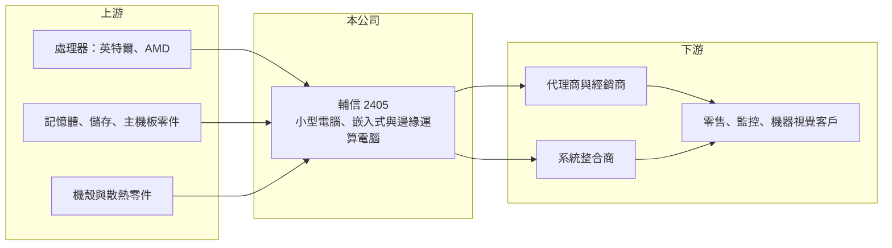

# 2405 輔信

> 上市｜[[產業索引-電腦及週邊設備業|電腦及週邊設備業]]｜上市（櫃）日期 2000/03/17

# 第一章：企業模式與商業藍圖

> [!info] 撰寫說明
> 精簡版，由 Claude 依公開資料整理，架構比照 [[2330台積電]]，資料截至 2026-10-08。來源：證交所開放資料快照（基本資料、2026 年第二季財報、營益分析、股利、每月營收）、Goodinfo 經營績效年度表、聯合新聞網 2026 年 1 月營收報導。產品發展沿革為整理性描述；公開資料有限。#待校對

輔信以 Shuttle 品牌的小型電腦起家，近年轉型為商用與工業用的嵌入式、邊緣運算電腦供應商，本章說明這段轉型與目前的商業模式。

- **核心業務：** 輔信成立於 1983 年、2000 年上市，總部在台北內湖，英文名稱 Shuttle。公司早年以 XPC 小型[[準系統]]聞名（待校對），也曾大量承接 PC 代工，營收在 2017 年仍有 47.6 億元。之後公司逐步退出低毛利的代工業務，轉向專業的嵌入式電腦與邊緣運算電腦，營收縮小到 17 億元左右，但毛利率從約 12% 提高到 40% 左右。
- **營收結構：** 公司未在本次來源揭露產品別比重。依 2026 年 1 月報導，主要應用為智慧零售、影像監控、機器視覺與智慧城市，客戶是商用與工業客戶，透過代理商、經銷商、方案夥伴與系統整合商銷售，實際案例包括美國企業資料備份、日本藥妝零售與日本監控平台升級。
- **營運據點：** 輔信透過海外子公司與通路夥伴經營歐美與日本市場，亞太區出貨相對穩定。生產據點配置在本次來源中未查得（待校對）。
- **長期方向：** 公司把成長押在[[邊緣 AI]] 與邊緣運算：在零售店、監控現場與工廠產線就地處理影像與資料，需要體積小、耐用且可長期供貨的電腦，這正好延續輔信做小型電腦的設計能力。公司表示將深化軟硬體整合，並以策略備料與多元供應商因應記憶體價格波動。

# 第二章：護城河深度與競爭優勢

小型與嵌入式電腦市場客戶分散、規格多樣，本章分析輔信在其中的競爭位置。

- **競爭優勢：** 輔信累積多年小型機構、散熱與電源設計經驗，能把完整電腦放進很小的機箱，這在零售、監控等空間有限的場域很實用。轉向專案型商用客戶後，產品一旦被導入店面或監控系統，往往會隨客戶展店而持續採購，毛利率也因此高於過去的代工業務。
- **主要對手：** [[工業電腦]]與邊緣運算市場有 [[2395研華]]、[[2397友通]]、3088艾訊、[[8050廣積]]、8234新漢 等專業廠，商用小型電腦則有 [[2357華碩]]、[[2377微星]]、[[2376技嘉]] 等品牌廠的迷你電腦產品。輔信規模小，必須依靠利基專案與客製彈性競爭。
- **觀察重點：** 輔信毛利率已經提高到四成，但營業費用幾乎吃掉全部毛利，營業利益率長期在 0 附近。長期要看營收能否回到成長，讓固定的研發與通路費用被攤薄；若營收維持在 17 億元左右，轉型的成果很難轉化為股東報酬。

# 第三章：財務體質與盈利規模

資料日期：2026-10-08，表格是撰寫當時的快照；最新月營收、毛利率、累計 EPS 由自動排程寫在本筆記的屬性欄位（月營收、毛利率、累計EPS 等）。#待校對

輔信轉型後毛利率大幅提高，但營收規模不足，本業長期處於損益兩平附近。

| 年度 | 營收（億元） | [[毛利率]] | [[營業利益率]] | EPS（元） | [[ROE]] |
|---|---|---|---|---|---|
| 2021 | 18.4 | 39.0% | 0.12% | 0.58 | 5.58% |
| 2022 | 17.3 | 40.3% | 0.41% | 0.16 | 1.53% |
| 2023 | 17.1 | 40.7% | −1.23% | 0.04 | 0.38% |
| 2024 | 16.7 | 41.0% | −3.01% | 0.03 | 0.26% |
| 2025 | 17.4 | 36.8% | −5.28% | −0.20 | −2.19% |

- **營收規模：** 2020 年與 2025 年營收都是 17.4 億元，五年年複合成長率約 0%。2026 年上半年營收 9.0 億元，前 8 月累計 12.2 億元、年增約 8%。
- **獲利：** 2021 至 2025 年平均 ROE 約 1.1%。2026 年上半年毛利率 43.1%、營業利益率 0.44%、EPS 0.03 元，本業仍在損益兩平附近。
- **財務特色：** 2026 年第二季末股本 34.3 億元、母公司權益 34.4 億元、每股淨值 10.0 元，負債總額只有 10.3 億元，財務保守。非流動資產 25.8 億元，占總資產一半以上，對一家營收 17 億元的電腦公司偏高，組成細項未查得（待校對）。公司章程允許半年配息，2025 年下半年以資本公積發放現金 0.1 元。
- **[[ROIC]] 與 [[WACC]]：** 2025 年營業損失約 0.92 億元（17.4 億 × −5.28%），以權益總額 35.5 億元計 ROIC 約 −2.6%（推算），2021 至 2022 年也只有 0% 至 0.2% 左右。WACC 以 CAPM 推估：無風險利率 1.75%、市場風險溢酬 6%、β 取同業常見值 0.8，股東權益成本約 6.55%；公司幾乎無有息負債，WACC 約 6.5%（推算）。本業報酬長期低於資金成本，代表目前尚未創造經濟價值。

# 第四章：總體風險與地緣政治

輔信的風險主要是規模不足與轉型成果的不確定性。

- **產業週期：** 商用與零售客戶的資本支出隨景氣起伏，零售業展店與監控系統更新都會在景氣差時延後。專案型訂單的時點不穩定，季度營收波動也較大。
- **營運風險：** 記憶體、處理器等零組件漲價或缺貨時，小廠的議價能力較弱，必須提前備料，存貨與資金壓力隨之上升。研發與海外通路費用相對營收比重高，營收若下滑，虧損會擴大。
- **其他風險：** 營收以海外市場為主，匯率變動會影響毛利；非營運資產比重高，其價值與收益波動也會影響整體獲利。

# 專有名詞解析

## 應用

- **[[邊緣 AI]]**：在終端或靠近資料產生處（工廠、醫院、企業機房）執行 AI 運算，而非全部送到雲端資料中心。

## 產業

- **[[準系統]]**：已裝好機殼、主機板與電源，由使用者或通路再自行加裝處理器、記憶體與硬碟的電腦半成品。
- **[[工業電腦]]**：用於工廠自動化、交通、醫療等場域的電腦，強調長期供貨、耐用與穩定。

# 核心供應鏈

- 上游：[[INTC英特爾]]、[[AMD超微]] 的處理器平台，記憶體與儲存裝置，機殼與散熱零件。
- 下游／客戶：代理商、經銷商、方案夥伴與系統整合商，終端為智慧零售、影像監控、機器視覺與智慧城市應用，主要市場包括美國與日本。
- 同業：[[2395研華]]、[[2397友通]]、3088艾訊、[[8050廣積]]、8234新漢。

## 最新新聞
<!-- news:start -->
<!-- news:end -->

## 相關連結
- [公開資訊觀測站](https://mopsov.twse.com.tw/mops/web/t05st03?step=1&firstin=1&co_id=2405)
- [Goodinfo](https://goodinfo.tw/tw/StockDetail.asp?STOCK_ID=2405)
- [Yahoo 股市](https://tw.stock.yahoo.com/quote/2405)
- [鉅亨網新聞](https://www.cnyes.com/twstock/2405/news)
