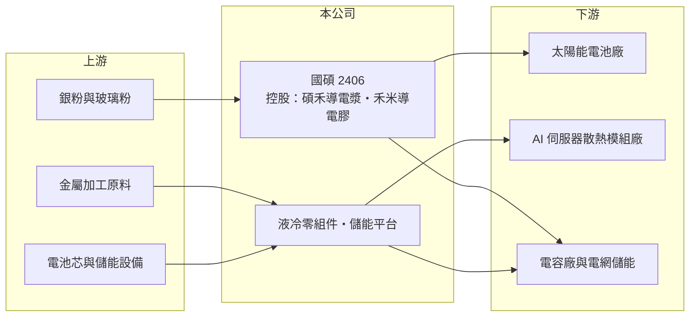

# 2406 國碩

> 上市｜[[產業索引-光電業|光電業]]｜上市（櫃）日期 2000/04/29

# 第一章：企業模式與商業藍圖

> [!info] 撰寫說明
> 精簡版，由 Claude 依公開資料整理，架構比照 [[2330台積電]]，資料截至 2026-10-08。來源：證交所開放資料快照（基本資料、2026 年第二季資產負債與損益、股利）、Goodinfo 經營績效頁、經濟日報 2026 年 7 月營收報導、理財周刊報導。子公司持股比例未查得。#待校對

國碩早年是光碟片製造商，光碟市場消失後轉型為控股型態，主要獲利來源是合併報表內的子公司 [[3691碩禾]]（太陽能[[導電漿]]）。理解國碩，等於理解一家「母公司持股比例不高、營收卻幾乎全來自子公司」的集團，以及它在太陽能材料、AI 散熱與儲能三條線上的布局。

- **核心業務：** 國碩成立於 1997 年、2000 年上市。目前業務包括：透過碩禾生產太陽能電池用的銀漿（導電漿）；AI 伺服器[[液冷散熱]]管接件與零組件的加工、測試服務；子公司禾米供應固態電容用的高分子導電膠；以及[[儲能]]案場開發。
- **營收結構：** 公司未公開分部比重，但碩禾 2026 年上半年營收 51.5 億元，國碩合併營收 55.4 億元，可知導電漿等碩禾業務占合併營收九成以上（推算）。碩禾本身營收約七成來自銀漿，約一成來自被動元件用特殊膠材。
- **營運據點：** 總部在台灣，導電漿主要銷往亞洲太陽能電池廠。2026 年中國取消 249 項光電產品的出口退稅，中國電池廠調漲報價，帶動導電漿價格與營收。
- **長期方向：** 公司定位為「綠能＋AI 散熱＋儲能」三引擎：與工研院合作冷板散熱技術，2025 年底與 [[6873泓德能源]] 成立儲能平台「星國電力」，首個案場 100MW。三條線都還在建立期，能否形成穩定獲利仍待驗證。

# 第二章：護城河深度與競爭優勢

國碩站在兩條長期成長主線上，但在每個領域都不是龍頭，護城河偏窄。

- **競爭優勢：** 碩禾在太陽能導電漿耕耘多年，配方與客戶認證是主要門檻；禾米的高分子導電膠受惠 AI 伺服器對固態電容的需求，屬於規模小但技術門檻較高的材料。液冷管接件則利用既有的精密加工能力切入，讓集團同時接觸能源轉型與 AI 散熱兩條需求。
- **主要對手：** 導電漿面對杜邦（Solamet）、賀利氏等國際材料商與大量中國同業（#待校對），價格競爭激烈；AI 散熱領域有 [[3017奇鋐]]、[[3324雙鴻]]、[[3653健策]] 等大廠，國碩屬於零組件層級的後進者。
- **觀察重點：** 長期最重要的是毛利率能否穩定在 15% 以上。2019 至 2025 年毛利率在 -0.4% 到 12.6% 之間，本業連年虧損；2026 年上半年毛利率 15.1%、營業利益率 4.9%，若能延續，才代表轉型真正成功。

# 第三章：財務體質與盈利規模

資料日期：2026-10-08，表格是撰寫當時的快照；最新月營收、毛利率、累計 EPS 由自動排程寫在本筆記的屬性欄位（月營收、毛利率、累計EPS 等）。#待校對

國碩過去多年本業虧損、ROE 為負，2026 年隨導電漿價格回升與 AI 相關業務成長才出現轉機。

| 年度 | 營收（億元） | [[毛利率]] | [[營業利益率]] | EPS（元） | [[ROE]] |
|---|---|---|---|---|---|
| 2019 | 84.7 | 11.6% | -0.65% | 0.74 | 未查得 |
| 2020 | 95.5 | 12.6% | -2.54% | -2.17 | -10.3% |
| 2021 | 83.5 | 7.79% | -1.23% | 0.09 | -4.15% |
| 2022 | 67.3 | 9.85% | -6.70% | -0.45 | -6.13% |
| 2023 | 39.4 | -0.43% | -25.3% | -0.99 | -13.0% |
| 2024 | 69.1 | 5.35% | -10.5% | -0.86 | -10.7% |
| 2025 | 63.7 | 9.92% | -7.86% | -0.92 | -10.0% |

（來源：Goodinfo 經營績效頁；ROE 欄位在原頁面不易辨識，2019 年數值與 EPS 不一致，列為未查得。2026 年上半年依證交所資料：營收 55.4 億元、毛利率 15.1%、營業利益率 4.9%、EPS 0.33 元。）

- **營收規模：** 2019 至 2025 年營收由 84.7 億元降到 63.7 億元，年複合成長率約 -4.6%（推算），2023 年一度只剩 39.4 億元。營收主要隨銀價與太陽能產業景氣波動，2026 年上半年營收年增約 1.3 倍，主因中國出口退稅取消帶動導電漿漲價。
- **獲利：** 2020 至 2025 年 ROE 全部為負，近五年（2021 至 2025）平均約 -8.8%（推算），代表長期在消耗股東權益。保留盈餘在 2026 年第二季為 -0.4 億元，累積虧損已吃掉過去的盈餘。
- **財務特色：** 2026 年第二季總資產約 174.3 億元、負債 86.4 億元（非流動負債 49.9 億元，推估與儲能與廠房投資有關）、權益總計 87.8 億元，但歸屬母公司權益只有 37.1 億元，其餘約 50 億元是非控制權益，顯示子公司碩禾等的外部股東占比很高。每股淨值約 10.6 元。2025 年度未配息，Goodinfo 統計的歷年平均現金股利僅約 0.09 元。
- **[[ROIC]] 與 [[WACC]]：** 以 2025 年營業損失約 5.0 億元（63.7 億元 × -7.86%）計算，稅後營業利益為負，以權益總計 87.8 億元到權益加全部負債 174.3 億元為投入資本，ROIC 約 -2.3% 至 -4.6%（推算）。WACC 以 [[CAPM]] 推估：無風險利率 1.75%、市場風險溢酬 6%、β 假設 1.2（太陽能材料股常見值），權益成本約 8.95%；稅後負債成本假設 2.4%、負債占約五成，WACC 約 5.7%（推算）。ROIC 長期遠低於 WACC，代表過去多年在毀損價值；若以 2026 年上半年營業利益率 4.9% 年化，ROIC 約 2.5% 至 5%（推算），仍低於 WACC。

# 第四章：總體風險與地緣政治

國碩的風險集中在太陽能材料的價格戰、銀價波動，以及新事業的投資負擔。

- **產業週期：** 導電漿營收取決於全球光電裝機量與中國電池廠的產能與價格，中國產能過剩時，材料價格會被一路壓低，2023 年的毛利率轉負就是例子。AI 散熱需求則跟隨雲端業者的資本支出循環。
- **營運風險：** 銀占導電漿成本的大部分，銀價上漲雖推升營收，但若無法轉嫁就會壓縮毛利；太陽能電池技術從 PERC 轉向 TOPCon、HJT 等新結構，也要求導電漿配方持續更新。液冷零組件若打不進主要供應鏈，成長會受限。
- **其他風險：** 儲能案場需要大額資金，非流動負債增加會提高財務風險；中國出口退稅等政策變化可能讓導電漿價格大幅反轉。母公司權益占比低，股東實際分到的子公司獲利比例有限。

# 專有名詞解析

## 應用

- **[[導電漿]]**：塗在太陽能電池表面形成電極的銀漿或銀鋁漿，負責收集電流，銀是主要成本。
- **[[液冷散熱]]**：以冷卻液流經冷板帶走晶片熱量的散熱方式，散熱效率高於風扇，AI 伺服器逐漸普及。
- **[[儲能]]**：以電池等設備儲存電力，在用電尖峰或再生能源不穩時釋放，用於電網調頻與削峰填谷。

## 金融

- **[[非控制權益]]**：合併報表中屬於子公司其他股東的權益，不屬於母公司股東。
- **[[CAPM]]**：資本資產定價模型，以無風險利率加上 β 乘以市場風險溢酬估算股東要求報酬率。

# 核心供應鏈

- 上游：銀粉與玻璃粉等導電漿材料、金屬加工原料、電池芯與儲能設備。
- 下游／客戶：亞洲太陽能電池廠、AI 伺服器散熱模組與系統廠、固態電容廠、儲能案場。
- 同業：子公司 [[3691碩禾]]；AI 散熱 [[3017奇鋐]]、[[3324雙鴻]]、[[3653健策]]；儲能合作夥伴 [[6873泓德能源]]。

## 最新新聞
<!-- news:start（自動產生，請勿手動編輯此範圍） -->
- 2026-10-12 📰 媒體 18:50｜營收速報 - 國碩(2406)9月營收8.67億元年增率高達62.29％｜[鉅亨網](https://news.cnyes.com/news/id/6628375)
- 2026-10-07 🏛️ 重訊 20:27｜公告子公司禾迅綠電(股)公司115年現金增資調整發行股 數及延長特定人繳款期間之補償方案｜[觀測站](https://mops.twse.com.tw/mops/#/web/t05st01)

完整紀錄：[[2406國碩 新聞]]
<!-- news:end -->

## 相關連結
- [公開資訊觀測站](https://mopsov.twse.com.tw/mops/web/t05st03?step=1&firstin=1&co_id=2406)
- [Goodinfo](https://goodinfo.tw/tw/StockDetail.asp?STOCK_ID=2406)
- [Yahoo 股市](https://tw.stock.yahoo.com/quote/2406)
- [鉅亨網新聞](https://www.cnyes.com/twstock/2406/news)
