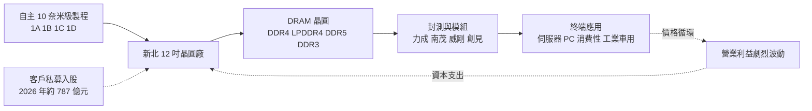
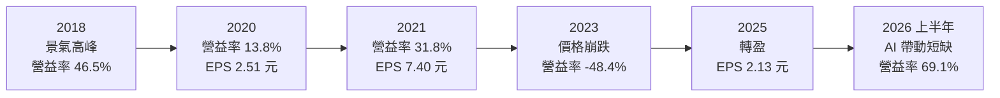
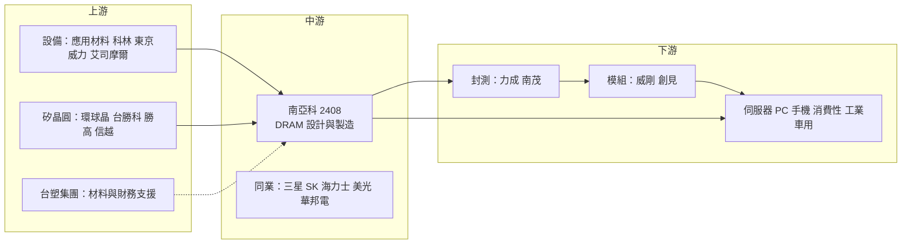

# 2408 南亞科

> 上市｜[[產業索引-半導體業|半導體業]]｜上市（櫃）日期 2000/08/17

# 第一章：企業模式與商業藍圖

> [!info] 撰寫說明
> 本文由 Claude 依公開資料整理，架構比照 [[2330台積電]] 的四章研究，資料截至 2026-10-08。財務數字來源：證交所開放資料快照（基本資料、2026 年第二季資產負債與綜合損益、股利）、Goodinfo 經營績效頁與股利政策頁（2016 至 2025 年）、MoneyDJ 季資產負債表（2026 年第二季借款與現金科目）、優分析 2026 年 1 月法說會報導（資本支出、新廠時程、產品組合）、科技新報 2017 年 1 月報導（2016 年處分華亞科股權）、中央社與科技新報 2026 年報導（私募、長約）；南亞科與美光的技術合作沿革、新廠後續階段產能規劃係憑舊版筆記與記憶整理，尚未逐條比對原始文件。#待校對

在評估一家公司的長期投資價值時，第一步是看懂它靠什麼賺錢、為什麼能一直賺下去。本章針對南亞科技（股票代號：2408，以下簡稱南亞科）的商業模式進行定性分析，說明一家規模遠小於全球三大廠的 DRAM 製造商，如何在一個以寡占與價格循環為特徵的產業中生存，又為什麼它的獲利會在虧損與暴利之間大幅擺盪。理解南亞科的關鍵不是任何一季的數字，而是 DRAM 產業的循環本質。

## 一、核心定位：台灣唯一自有技術的 DRAM 製造商

南亞科成立於 1995 年，2000 年在台灣證交所上市，是台塑集團旗下的記憶體公司，董事長為鄒明仁、總經理為李培瑛，總部與 12 吋晶圓廠位於新北市。南亞科生產 [[DRAM]]（動態隨機存取記憶體），也就是電腦、手機、伺服器與各種電子產品用來暫存運算資料的記憶體。它屬於 [[IDM]] 型態：自行開發製程技術、自有晶圓廠生產、以自有品牌銷售。

全球 DRAM 市場由 [[005930三星電子]]、SK 海力士與美光三大廠寡占，三家合計占絕大部分市占，南亞科的規模遠小於它們。這個位置決定了南亞科的兩個長期特性。

第一是技術路線的轉變。南亞科過去長期與美光合作，取得製程技術授權，並與美光合資經營華亞科。2016 年，美光收購華亞科，南亞科處分持有的華亞科股權並認列大額業外利益，2016 年歸屬母公司淨利達 237.09 億元、EPS 8.66 元（科技新報）。此後南亞科逐步轉為自主開發 10 奈米級製程，目前已量產第一代與第二代（1A、1B），並開發第三代（1C）與第四代（1D），長期規劃導入 [[EUV]]（技術合作沿革待校對）。能自行開發 DRAM 製程的公司全球只有少數幾家，這是南亞科最重要的技術資產。

第二是價格接受者的角色。南亞科規模小、產品以標準型與[[利基型記憶體]]為主，難以影響市場價格，獲利幾乎完全取決於 DRAM 報價的漲跌。DRAM 是高度標準化的商品，價格由全球供需決定，而供給又取決於三大廠的擴產決策，南亞科只能在這個框架內調整產品組合與成本。

## 二、終端應用／產品板塊：以 DDR4 與 LPDDR4 為主的產品組合

南亞科未公布完整的營收比重，但在法說會揭露產出結構。依 2026 年 1 月法說會報導，[[DDR5]] 約占產出一成多、DDR3 約兩成，其餘主要是 [[DDR4]] 與 LPDDR4。由於比重不完整，本章不繪製圓餅圖。

- **標準型 DRAM（DDR4、DDR5）：** 用於伺服器、PC 與筆電。DDR5 是新一代主流規格，速度與容量較高；南亞科已完成 128GB DDR5 RDIMM 模組功能測試，單顆晶粒速度達 7200 Mb/s。提升 DDR5 比重，是南亞科跟上主流市場的關鍵。
- **低功耗 DRAM（LPDDR4、LPDDR5）：** 用於手機、平板與部分筆電，強調省電。南亞科以 LPDDR4 為主，LPDDR5 仍在推進。
- **利基型 DRAM（DDR3、DDR4 等舊規格）：** 用於電視、機上盒、網通設備、工業與車用。這些客戶的產品生命週期長，需要穩定的舊規格供貨，而三大廠通常會逐步淡出舊規格，這是南亞科能長期經營的利基。
- **客製化 AI 記憶體：** 南亞科開發客製化超寬 I/O 記憶體方案，並以 [[TSV]] 堆疊技術切入邊緣與行動 AI 所需的高頻寬記憶體。南亞科不直接與三大廠在 [[HBM]] 正面競爭，而是選擇客製化的利基路線。

這個產品組合有一個長期的雙面性：三大廠把產能轉向 HBM 與 DDR5 時，DDR4 與 LPDDR4 的供給減少，南亞科反而受惠；但當舊規格需求自然萎縮，或中國業者大量供應舊規格時，南亞科的產品組合就會變成劣勢。

## 三、資本轉化邏輯：重資產、高固定成本的價格槓桿

南亞科的資本循環是典型的記憶體產業模式，可以從三個面向理解。

- **固定成本高，價格決定一切：** DRAM 廠的折舊、人事與研發費用大多是固定的，產量變化不大時，營收的增減幾乎全部反映在利潤上。2023 年 DRAM 價格崩跌，南亞科營收只有 299 億元，[[毛利率]]負 15%、[[營業利益率]]負 48.4%；2026 年上半年價格大漲，營收 1,316 億元，毛利率 75.2%、營業利益率 69.1%（證交所資料）。同一座工廠、相近的產量，獲利卻可以從大幅虧損變成製造業罕見的暴利，這就是記憶體的價格槓桿。
- **逆循環投資的難題：** 記憶體廠必須持續投資製程與產能，否則成本會落後對手。但最理想的投資時點往往是景氣低谷，而那正是公司虧損、最缺錢的時候。南亞科依靠台塑集團的財務支持與帳上現金度過低谷，2023 至 2025 年上半年雖然連續虧損，仍維持製程研發。
- **客戶入股與[[長約]]：** 2026 年 4 月，南亞科完成私募，向四家主要客戶募得約 787.2 億元，私募後客戶合計持股約一成（中央社報導）；長期合約約占訂單一半。這是南亞科嘗試改變循環本質的方式：讓下游客戶分擔擴產資金，並以長約降低價格崩跌時的衝擊。這種模式能否在下一次景氣下行時發揮作用，仍有待驗證。

## 四、企業長期藍圖：新廠擴產、製程自主與客製化記憶體

- **新廠擴產：** 依 2026 年 1 月法說會，2026 年資本支出約 500 億元，年增約 273%，創歷史新高；新廠預計 2027 年初開始裝機、2028 年上半年量產，初期月產能約 2 萬片，之後分階段擴充（後續階段的產能與總投資額依舊版筆記整理，約 4,800 億元，待校對）。這是南亞科成立以來最大的一次擴產，將大幅提高位元產出與規模經濟。
- **製程自主：** 持續推進第三代與第四代 10 奈米級製程與 EUV，縮小與三大廠在位元密度與單位成本上的差距。對南亞科而言，製程進度就是成本競爭力，也是在景氣下行時能否少虧的關鍵。
- **從標準品走向客製化：** 透過客製化超寬 I/O 與 TSV 堆疊，切入[[邊緣AI]]與行動 AI 的記憶體需求。若這條路能形成規模，南亞科的產品將較少受到標準型 DRAM 報價的直接影響，循環波動有機會縮小。

# 第二章：護城河深度與競爭優勢

在長期價值投資中，「護城河」指企業抵禦競爭、長期維持超額利潤的保護機制。DRAM 是高度標準化的商品，本章分析南亞科在這樣的產業中擁有哪些防禦能力、面對哪些國內外對手，以及這些優勢在價格循環中能守住多少。

## 一、南亞科護城河的核心組成要素

DRAM 產業本身的進入門檻極高，但對已經在場內的業者而言，產品同質性高、價格由市場決定。南亞科的護城河屬於「產業門檻高、個別優勢窄」的類型，主要由四個要素構成：

- **1. 自主製程技術：** 能自行開發 10 奈米級 DRAM 製程的公司全球只有少數幾家，這需要數十年的研發累積與巨額資本。產業門檻讓新進者很難進入，但這個門檻保護的是整個產業，而不是南亞科相對於三大廠的地位。
- **2. 利基型市場的供貨穩定性：** 工業、網通、車用與消費性客戶的產品生命週期長，需要長期穩定的舊規格 DRAM。三大廠逐步淡出舊規格時，南亞科成為這些客戶的重要供應來源，客戶也願意為穩定供貨簽訂長約。
- **3. 客戶入股與長約：** 2026 年的私募讓主要客戶成為股東，加上長約約占一半，提高了客戶黏著度，也讓南亞科在擴產時有更明確的需求依據。
- **4. 台塑集團的財務後盾：** 記憶體產業的低谷可能長達兩三年，母集團的財務支持讓南亞科能在虧損期間維持研發與投資，這是許多小型記憶體廠在歷史上被淘汰時所缺少的條件。

## 二、全球主要競爭對手格局

| 對手 | 定位 | 對南亞科的影響 |
|---|---|---|
| [[005930三星電子]] | 全球最大 DRAM 廠，HBM 與 DDR5 主要供應商 | 規模、技術與資本遠大於南亞科，景氣反轉時擁有最強的成本優勢 |
| SK 海力士 | HBM 領導廠 | 技術世代領先，AI 記憶體的主要受益者 |
| 美光 | 美國 DRAM 大廠，南亞科過去的技術合作方 | 在標準型 DRAM 與 LPDDR 直接競爭 |
| 長鑫存儲（CXMT） | 中國政策扶植的 DRAM 廠 | 大量供應 DDR4 與 LPDDR4，是利基型與舊規格 DRAM 最大的價格威脅 |
| [[2344華邦電]] | 台灣利基型 DRAM 與 NOR Flash 廠 | 在利基型 DRAM 直接競爭，同樣布局客製化 AI 記憶體 |
| [[6770力積電]] | 晶圓代工兼利基型記憶體 | 部分利基型記憶體業務重疊 |

## 三、優勢轉化：哪些守得住、哪些守不住

- **守得住：** 在記憶體供給吃緊的期間，三大廠產能優先供應 HBM 與 DDR5，南亞科的 DDR4 與 LPDDR4 供給相對稀缺，價格漲幅反而最大。利基型客戶的長期供貨關係，也能在需求平穩時提供穩定的出貨量。
- **守不住：** 景氣下行時的成本競爭。南亞科的製程世代與規模都落後三大廠，單位成本較高，價格下跌時虧損幅度通常大於大廠。2023 與 2024 年南亞科營業利益率分別為負 48.4% 與負 30.9%，就是例證。中國長鑫大量供應舊規格 DRAM，也讓南亞科最依賴的利基市場面臨長期的價格壓力。
- **觀察重點：** 長期可以追蹤三件事。第一是第三、四代製程與 EUV 的導入進度，這決定南亞科與三大廠的成本差距能否縮小；第二是新廠能否在 2028 年如期量產，以及量產時是否正逢景氣下行；第三是 DDR5、LPDDR5 與客製化 AI 記憶體的營收比重能否提升，讓產品組合不再過度依賴終將萎縮的舊規格。

# 第三章：財務體質與盈利規模

資料日期：2026-10-08。數字取自 Goodinfo 經營績效頁與股利政策頁、證交所開放資料快照與 MoneyDJ 季資產負債表，表格是撰寫當時的快照；最新月營收、毛利率、累計 EPS 由自動排程寫在本筆記的屬性欄位（月營收、毛利率、累計EPS 等）。#待校對

財務報表是檢驗護城河是否真實存在的最終標準。對記憶體公司而言，單一年度的數字幾乎沒有意義，本章用完整循環的多年度數據，檢視南亞科的獲利品質與資本報酬。

## 一、獲利能力的基石：三率

| 年度 | 營收（億元） | [[毛利率]] | [[營業利益率]] | EPS（元） | [[ROE]] |
|---|---|---|---|---|---|
| 2018 | 847 | 55.0% | 46.5% | 12.80 | 26.5% |
| 2019 | 517 | 31.9% | 18.4% | 3.23 | 6.2% |
| 2020 | 610 | 25.7% | 13.8% | 2.51 | 5.03% |
| 2021 | 856 | 43.3% | 31.8% | 7.40 | 14.0% |
| 2022 | 570 | 37.5% | 19.3% | 4.72 | 8.26% |
| 2023 | 299 | -15.0% | -48.4% | -2.40 | -4.28% |
| 2024 | 341 | -1.23% | -30.9% | -1.64 | -3.06% |
| 2025 | 666 | 22.5% | 7.87% | 2.13 | 3.94% |

（來源：Goodinfo 經營績效頁，合併報表。2026 年上半年依證交所資料，營收 1,316.36 億元、毛利率 75.2%、營業利益率 69.1%、EPS 23.38 元。）

- **三年一小循環、六年一大循環：** 從表中可以看到 2018 年高峰、2019 至 2020 年回落、2021 年回升、2023 至 2024 年深度虧損、2026 年再創新高的完整循環。營業利益率在負 48.4% 到正 69.1% 之間擺盪，波動幅度之大，在台股中屬於最劇烈的一群。
- **長期平均才是真實的獲利能力：** 2016 至 2025 年十年間，南亞科營業利益的平均約 103 億元（推算，依 Goodinfo 各年營收乘以營業利益率），平均營業利益率約 18%（推算）。高峰年的獲利必須用來彌補低谷年的虧損，評估南亞科不應以 2026 年的數字外推。
- **營收成長慢於循環波動：** 2020 至 2025 年營收年複合成長率約 1.8%（推算），十年間營收在 299 億到 856 億元之間來回。南亞科的長期成長要靠新廠增加位元產出，而不是單純的價格上漲。

## 二、[[ROE]]：資本效率

2021 至 2025 年南亞科的平均 ROE 約 3.8%（推算），其中 2023 與 2024 年為負值；若把 2018 年高峰納入，2016 至 2025 年的平均則明顯較高（2016、2017 年另含處分華亞科的業外利益）。2026 年上半年 EPS 23.38 元，以第二季底每股淨值 93.49 元粗估，年化 ROE 可能超過四成（推算），但這是循環高峰的數字。依證交所資料，2026 年第二季權益總計約 3,227 億元，比一年前大幅增加，原因是上半年的高獲利與約 787 億元的私募增資。淨值擴大後，未來要維持相同的 ROE，需要更多的獲利。

## 三、資本支出、自由現金流與股利

- **[[CapEx]]：** 2025 年資本支出預算上限 196 億元、實際支出 134 億元；2026 年預估約 500 億元，其中七成用於廠房、三成用於設備（優分析）。新廠後續階段的投資規模遠大於過去，未來數年將是南亞科資本支出最高的時期。
- **[[自由現金流]]：** 多年度自由現金流數字未查得。記憶體廠的自由現金流跟著價格循環起伏：高峰年大幅為正，低谷年可能為負。依 MoneyDJ，2026 年第二季現金及約當現金約 2,176 億元，足以支應短期擴產；但新廠進入大規模裝機後，自由現金流將明顯被資本支出消耗（推估）。
- **股利穩定度：** 依 Goodinfo 股利政策頁，南亞科 2016 至 2025 年度的現金股利分別約為 1.5、3.51、7.11、1.50、1.30、3.70、2.13、0、0 與 1.35 元。2023 與 2024 年度因虧損未配息；2025 年度證交所資料顯示決議每股配發 1.5 元，Goodinfo 列為 1.347 元，推估是私募增資後按新股數調整。南亞科的股利完全跟著循環走，不適合當作穩定收息的標的。

## 四、[[ROIC]] 與 [[WACC]]：價值創造利差

- **ROIC（推算）：** 投入資本以 2026 年第二季權益總計約 3,227 億元，加上有息負債約 227 億元（應付公司債 40.0 億、長期借款 144.0 億、租賃負債 43.0 億，MoneyDJ），合計約 3,454 億元。若以 2026 年上半年營業利益 909.38 億元年化約 1,819 億元、扣除 20% 稅率後約 1,455 億元計算，ROIC 約 42%（推算）；若以 2025 年營業利益約 52.4 億元、稅後約 41.9 億元計算，ROIC 只有約 1.2%（推算）。若以 2016 至 2025 年平均營業利益約 103 億元、稅後約 82.5 億元，對照私募前約 1,700 至 1,900 億元的投入資本，循環平均 ROIC 約在 4% 至 5%（推算）。
- **WACC（推算）：** 以 [[CAPM]] 估算股東權益成本：無風險利率取台灣 10 年期公債約 1.75%，市場風險溢酬 6%，β 假設 1.3（記憶體股波動大，取同業常見值，未查得南亞科實際數字），權益成本約 9.55%。稅前負債成本假設 2.5%、稅率 20%，稅後約 2.0%。以帳面價值計算，負債占投入資本約 7%、權益約 93%，WACC 約 9.0%（推算）。
- **價值創造判斷：** 南亞科在景氣高峰年的 ROIC 遠高於 WACC，低谷年則遠低於 WACC，以完整循環平均來看，約 4% 至 5% 的 ROIC 低於約 9% 的資金成本，代表過去十年整體並未創造穩定的超額價值。2026 年的暴利能否改變這個結論，取決於兩件事：第一是高峰期的獲利有多少被保留並投入有效率的產能；第二是新廠投產時的 DRAM 價格。若新廠在景氣下行時開出，龐大的折舊將長期壓低資本報酬；若客戶入股與長約能讓下一次低谷的虧損明顯縮小，南亞科的循環平均 ROIC 才有機會超過 WACC。

# 第四章：總體風險與地緣政治

任何企業都無法脫離宏觀環境獨立存在。本章分析南亞科未來必須面對的地緣政治、產業週期、營運與技術風險。

## 一、地緣政治風險

- **中國長鑫的國家級競爭：** 中國以國家資金扶植長鑫存儲，在 DDR4 與 LPDDR4 等舊規格大量供貨。這對南亞科最依賴的利基市場構成長期的價格壓力，而且這種競爭不完全由商業邏輯決定。
- **美國出口管制的雙面性：** 美國對中國先進記憶體與半導體設備的管制，一方面延緩長鑫的技術升級，讓南亞科在技術上保有一段距離；另一方面也可能限制南亞科對部分中國客戶的銷售，或影響設備取得。
- **生產集中在台灣：** 南亞科的晶圓廠全部在台灣新北市，新廠也在台灣。兩岸關係、地震、供電與供水等風險，都會直接影響全部產能。

## 二、產業週期與市場結構風險

- **記憶體循環必然反轉：** DRAM 價格歷來大起大落，每一次高峰都會吸引業者擴產，擴產產能開出後就會帶來下一次的價格下跌。AI 帶動的需求讓這一輪的高峰特別高，但三大廠與中國業者的擴產計畫，終將讓供需重新平衡。
- **[[長鞭效應]]：** 漲價期間客戶會提前備貨，訂單高於真實需求；價格見頂後，客戶開始消化庫存，訂單快速萎縮，價格下跌速度往往比上漲更快。
- **終端需求被排擠：** 記憶體大漲會推高手機、PC 與消費性電子的成本，可能抑制終端出貨，最後回頭壓抑記憶體需求。

## 三、營運環境的隱性風險

- **產品組合偏舊：** DDR3、DDR4 與 LPDDR4 仍占產出的大部分，舊規格的需求長期會萎縮，南亞科必須在舊規格需求消失前，完成 DDR5 與 LPDDR5 的放量。
- **巨額擴產的時點風險：** 新廠是南亞科有史以來最大的投資，若投產時正逢景氣下行，折舊將大幅侵蝕獲利，並讓公司在下一個低谷承受比過去更大的虧損。
- **私募稀釋與客戶關係：** 私募讓既有股東權益稀釋約一成，換取客戶綁定。客戶成為股東後，在價格談判中的角色也可能變得更複雜。
- **匯率：** DRAM 以美元報價，新台幣升值會壓縮以台幣計算的營收與毛利率。

## 四、科技演進風險

- **製程追趕的難度：** 10 奈米級以下的 DRAM 製程越來越難微縮，EUV 導入需要龐大的設備投資與技術累積。若第三、四代製程延誤，與三大廠的成本差距將進一步擴大。
- **AI 記憶體路線的不確定性：** HBM 由三大廠主導，南亞科選擇客製化超寬 I/O 與 TSV 堆疊的路線，能否找到足夠大的應用市場並形成規模，仍有不確定性（推估）。
- **新型記憶體架構：** 記憶體內運算、CXL 記憶體擴充等新架構，可能改變 DRAM 的產品形態與競爭規則，南亞科需要持續投入研發才能跟上。

# 專有名詞解析

## 半導體

- **[[DRAM]]**：動態隨機存取記憶體，電腦與手機用來暫存運算資料的記憶體，斷電後資料會消失。
- **[[DDR4]]**：第四代雙倍資料率 DRAM 規格，曾是 PC 與伺服器主流，目前逐步被 DDR5 取代。
- **[[DDR5]]**：第五代雙倍資料率 DRAM 規格，速度與容量高於 DDR4，是目前伺服器與 PC 的主流新規格。
- **[[利基型記憶體]]**：用於電視、網通、工業與車用等特定市場的記憶體，多為舊規格或小容量，生命週期長。
- **[[HBM]]**：高頻寬記憶體，把多顆 DRAM 垂直堆疊並與 GPU 封裝在一起，是 AI 加速器的關鍵元件。
- **[[TSV]]**：矽穿孔，在晶片中打出垂直導通孔，讓多顆晶片能直接堆疊連接，是 HBM 與 3D 封裝的關鍵技術。
- **[[EUV]]**：極紫外光微影，以 13.5 奈米波長光源曝光的設備技術，是先進邏輯與 DRAM 製程微縮的關鍵。
- **[[IDM]]**：整合元件製造商，自行設計、製造並銷售晶片的公司，例如三星、英特爾與南亞科。

## 應用

- **[[邊緣AI]]**：在終端裝置或現場設備上直接執行 AI 推論，不必把資料傳回雲端，延遲低、隱私較佳。

## 金融

- **[[長約]]**：供應商與客戶事先約定數量與價格機制的長期合約，可降低價格與出貨的波動。
- **[[ROIC]]**：投入資本報酬率，稅後營業利益除以股東權益加有息負債，衡量本業運用資本的效率。
- **[[WACC]]**：加權平均資金成本，依股東權益與負債的比重，加權計算公司取得資金的平均成本。
- **[[CAPM]]**：資本資產定價模型，以無風險利率加上 β 乘以市場風險溢酬估算股東要求報酬率。
- **[[長鞭效應]]**：終端需求的小幅變動，沿供應鏈往上游傳遞時被逐級放大，造成上游庫存與訂單劇烈波動。

# 核心供應鏈

## 1. 上游：設備、材料與集團資源
- 半導體設備：[[AMAT應用材料]]、[[LRCX科林研發]]、[[8035東京威力科創]]、[[ASML艾司摩爾]]
- 矽晶圓：[[6488環球晶]]、[[3532台勝科]]、[[3436勝高]]、[[4063信越化學]]
- 集團資源：[[1303南亞]]、[[1301台塑]]（台塑集團）

## 2. 中游：南亞科本身與同業
- 國際 DRAM 大廠：[[005930三星電子]]、SK 海力士、美光
- 台灣同業：[[2344華邦電]]、[[6770力積電]]
- 中國同業：長鑫存儲

## 3. 下游：封測與模組
- 封裝測試：[[6239力成]]、[[8150南茂]]
- 記憶體模組：[[3260威剛]]、[[2451創見]]

## 4. 下游：終端應用
- 伺服器、PC、手機、電視與機上盒、網通、工業與車用電子

## 最新新聞
<!-- news:start（自動產生，請勿手動編輯此範圍） -->
- 2026-10-21 🏛️ 重訊 17:03｜公告本公司廠房興建工程｜[觀測站](https://mops.twse.com.tw/mops/#/web/t05st01)
- 2026-10-16 🏛️ 重訊 16:55｜公告本公司取得機器設備｜[觀測站](https://mops.twse.com.tw/mops/#/web/t05st01)
- 2026-10-15 🏛️ 重訊 16:54｜公告本公司取得廠務設備｜[觀測站](https://mops.twse.com.tw/mops/#/web/t05st01)
- 2026-10-13 📰 媒體 18:11｜鉅亨速報 - Factset 最新調查：南亞科(2408-TW)EPS預估上修至76.14元，預估目標價為681.4元｜[鉅亨網](https://news.cnyes.com/news/id/6629541)
- 2026-10-13 📰 媒體 05:10｜〈台股盤前要聞〉南亞科預期DRAM Q4續漲、台達電Q3營收衝1970億元寫新猷｜[鉅亨網](https://news.cnyes.com/news/id/6628856)

完整紀錄：[[2408南亞科 新聞]]
<!-- news:end -->

## 相關連結
- [公開資訊觀測站](https://mopsov.twse.com.tw/mops/web/t05st03?step=1&firstin=1&co_id=2408)
- [Goodinfo](https://goodinfo.tw/tw/StockDetail.asp?STOCK_ID=2408)
- [Yahoo 股市](https://tw.stock.yahoo.com/quote/2408)
- [鉅亨網新聞](https://www.cnyes.com/twstock/2408/news)
