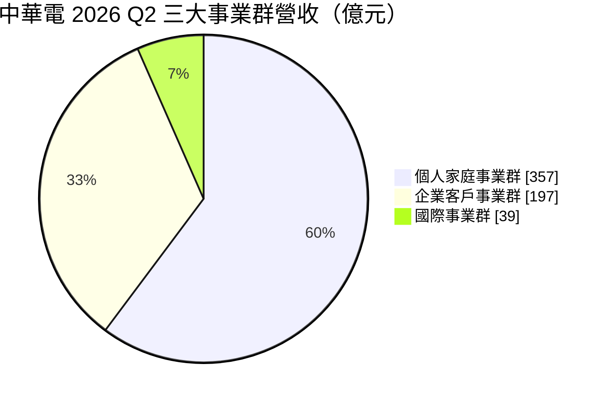
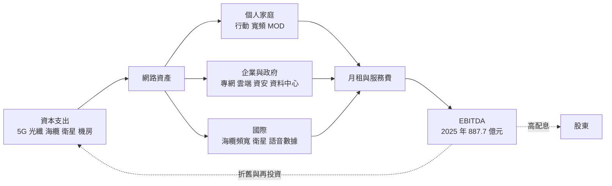
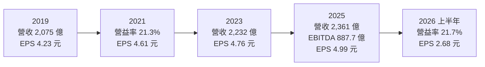
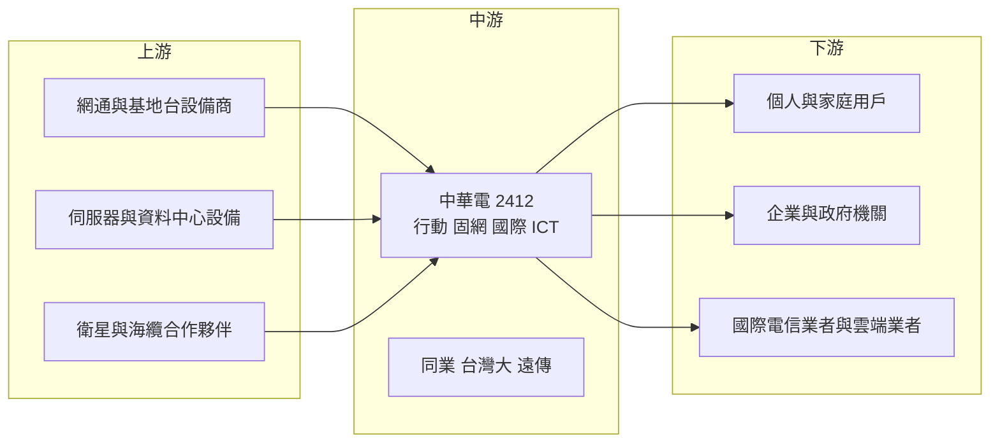

# 2412 中華電

> 上市｜[[產業索引-通信網路業|通信網路業]]｜上市（櫃）日期 2000/10/27

# 第一章：企業模式與商業藍圖

> [!info] 撰寫說明
> 本文由 Claude 依公開資料整理，架構比照 [[2330台積電]] 的四章研究，資料截至 2026-10-08。財務數字來源：證交所開放資料快照（基本資料、2026 年第二季資產負債與綜合損益、股利）、Goodinfo 經營績效頁與股利政策頁（2016 至 2025 年）、MoneyDJ 季資產負債表（2026 年第二季借款與租賃負債）、中華電信 2025 年第四季與 2026 年第二季法說會內容（優分析、富果研究、民報整理，事業群營收、用戶數、EBITDA、資本支出預算）；民營化與海外掛牌年份、交通部持股比例係憑記憶整理，尚未逐條比對原始文件。#待校對

在評估一家公司的長期投資價值時，第一步是看懂它靠什麼賺錢、為什麼能一直賺下去。本章針對中華電信（股票代號：2412，以下簡稱中華電）的商業模式進行定性分析，說明一家營收年增率只有個位數的電信公司，為什麼能長期被視為台股最典型的防禦型標的，以及它如何在本業成長天花板明顯的情況下，用企業資通訊、資料中心與國際業務尋找新的成長來源。

## 一、核心定位：台灣最大的綜合電信業者

中華電的前身是交通部電信總局。1996 年，電信總局的營運部門公司化，成立中華電信股份有限公司，2000 年在台灣證交所上市，之後在美國發行存託憑證並完成民營化（年份待校對），交通部至今仍是最大股東（持股比例待校對）。董事長為簡志誠、總經理為林榮賜，實收資本額約 775.7 億元。

中華電是台灣唯一同時擁有完整行動網路、固網、寬頻、國際海纜與衛星通訊的業者，也是全台最大的電信公司。它的商業模式可以用「網路基礎建設收租」來概括：先投入大量資本建置基地台、光纖、海纜、衛星地面站與機房，再向個人、家庭、企業與政府收取月租與服務費。

這個模式有兩個長期特性。第一，網路一旦建好，每多服務一個用戶的邊際成本很低，因此營收與[[EBITDA]]非常穩定，能支撐接近或超過百分之百的配息率。第二，台灣行動與寬頻的滲透率早已飽和，本業成長主要靠資費升級，而不是用戶數增加；要找到新的成長，必須往企業資通訊（[[ICT]]）、資料中心、資安與國際業務發展。

## 二、業務板塊：三大事業群

中華電依客戶別分為三大事業群。依 2026 年第二季法說會，各事業群的單季營收如下：

- **個人家庭事業群（約 357 億元）：** 包括行動通訊、HiNet 與光世代寬頻、MOD 影音與家用電話。這是中華電的基本盤，收入來自數千萬個長期月租用戶，波動極小。2026 年第二季行動用戶約 1,343 萬戶，行動業務收入市占率 41.2%；智慧型手機用戶中 [[5G]] 滲透率 48.8%。寬頻用戶約 447 萬戶。
- **企業客戶事業群（約 197 億元）：** 包括企業網路、專線、雲端、資料中心、資安、物聯網與智慧城市等 ICT 專案。政府機關、金融業與大型企業是主要客戶。這塊業務的成長性高於個人家庭，但專案型收入的利潤率較低、認列時點較不平均。
- **國際事業群（約 39 億元）：** 包括國際語音與數據、[[海纜]]頻寬出租、衛星通訊與海外子公司。規模最小，但在通訊韌性受到重視後，策略地位明顯提升。

三個事業群合計約 593 億元，與第二季合併營收 613.6 億元的差額，推估為其他收入與部門間調整。

## 三、資本轉化邏輯：網路資產收租

中華電的資本循環可以從三個面向理解。

- **固網與光纖的獨占性：** 中華電承接了電信總局時代遍布全台的管道與最後一哩線路，之後逐步升級為光纖。這套固網基礎設施的重建成本極高、需要大量路權與施工時間，其他業者難以複製，因此中華電在固網寬頻長期居於主導地位，也是企業專網與資料中心的天然基礎。
- **資費升級推升 [[ARPU]]：** 用戶數成長有限，營收成長主要來自用戶從 4G 升級到較高資費的 5G 方案，以及寬頻升速。依法說會，2025 年第四季行動 ARPU 為 572 元、年增 3.6%，寬頻 ARPU 819 元、年增 3.3%。每年 3% 上下的 ARPU 成長，正是中華電本業營收年增率長期落在低個位數的原因。
- **折舊與資本支出的平衡：** 電信業必須持續投資才能維持網路品質，每一代行動技術（3G、4G、5G）都需要新的頻譜與基地台投資。中華電 2025 年 EBITDA 約 887.7 億元，而資本支出通常只占 EBITDA 的三成多（2026 年預算 319.1 億元），剩下的現金足以支撐高配息，這是它長期能維持高殖利率的財務基礎。

## 四、企業長期藍圖：AI 資料中心、衛星與國際海纜

- **AI 資料中心（[[AIDC]]）：** 中華電把傳統網路資料中心升級為可容納高功耗 GPU 的 AI 資料中心，2026 年第二季桃園崙坪 AIDC 園區啟用。資料中心是中華電把網路資產延伸到運算服務的關鍵，也是企業客戶事業群的主要成長來源。
- **衛星通訊與通訊韌性：** 中華電已與[[低軌衛星]]業者 OneWeb、中軌衛星業者 SES 合作並貢獻營收，並與 Astranis 合作建置自有衛星。在海纜受損事件頻傳的背景下，衛星備援成為國家通訊韌性的重要一環，中華電是主要的執行者。
- **國際海纜：** SJC2 與 Apricot 海纜在 2025 年第四季啟用，提升台灣對外的國際頻寬與備援能力。海纜是長壽命的基礎設施，能提供數十年的頻寬出租收入。
- **本業的穩定維護：** 在新事業之外，中華電的長期任務仍是維持行動與固網的品質領先，透過 5G 滲透率提升與寬頻升速，讓本業營收維持低個位數的穩定成長。

# 第二章：護城河深度與競爭優勢

在長期價值投資中，「護城河」指企業抵禦競爭、長期維持超額利潤的保護機制。電信業是少數由法規直接構築門檻的產業，本章分析中華電的護城河構成、國內外主要競爭對手，以及這些優勢在本業成長停滯下能轉化成多少新的獲利。

## 一、中華電護城河的核心組成要素

中華電的護城河屬於「寬護城河」，主要來自法規、網路資產與規模，由五個要素構成：

- **1. 特許經營與[[頻譜]]：** 電信業需要政府核發執照與頻譜，新進者必須投入龐大資金競標頻譜並建置全國網路，門檻極高。台灣行動市場在業者整併後維持三強格局，競爭結構穩定。
- **2. 難以複製的固網與光纖資產：** 遍布全台的管道與光纖網路，是電信總局數十年累積的成果。這套資產讓中華電在寬頻、企業專線與國際海纜登陸都具備其他業者無法比擬的基礎。
- **3. 規模與品牌：** 中華電擁有最多的用戶與最廣的基地台覆蓋，加上「網路最穩定」的長期品牌形象，讓它在行動資費上不需要參與最激烈的價格戰，行動業務收入市占率仍能維持在四成以上。
- **4. 政府與企業客戶關係：** 政府機關、金融業與大型企業對網路可靠度與資安要求極高，中華電長期承接這些客戶的專網與資安服務，客戶更換供應商的風險與成本都很高。
- **5. 國際與衛星網路：** 海纜登陸站、國際電路與衛星合作，讓中華電在國際通訊與國家通訊韌性上地位獨特，這部分的政策支持度也最高。

## 二、主要競爭對手格局

| 對手 | 定位 | 對中華電的影響 |
|---|---|---|
| [[3045台灣大]] | 第二大電信業者，合併台灣之星 | 用戶規模擴大，並結合集團電商與媒體資源 |
| [[4904遠傳]] | 第三大電信業者，合併亞太電信 | 積極發展企業 ICT、雲端與資料中心，在企業市場直接競爭 |
| 有線電視與地區寬頻業者 | 地區性寬頻 | 在部分地區以價格搶寬頻用戶 |
| [[AMZN亞馬遜]]、[[MSFT微軟]]、[[GOOGL谷歌]] | 國際雲端業者 | 企業雲端與 AI 運算的競爭者，同時也是中華電資料中心與網路的合作夥伴 |
| 國際低軌衛星業者 | 衛星寬頻與衛星直連 | 長期可能跨入行動與寬頻服務，改變競爭規則 |

## 三、優勢轉化：哪些守得住、哪些守不住

- **守得住：** 固網寬頻、政府與大型企業專網、國際海纜與衛星備援。這些業務建立在難以複製的基礎設施與長期客戶關係上，中華電的領先地位十分穩固。行動業務收入市占率在 2026 年第二季仍創新高，也說明品牌與網路品質優勢沒有被削弱。
- **守不住：** 本業的成長速度與企業雲端的主導權。台灣人口停滯、滲透率飽和，行動與寬頻營收只能維持低個位數成長；企業 IT 持續移往國際公有雲，中華電在雲端運算上難以與國際大廠比拼規模與技術，較可能扮演整合與轉售的角色（推估）。
- **觀察重點：** 長期可以追蹤三件事。第一是 ICT 與國際業務能否持續雙位數成長，同時維持合理的利潤率；第二是 AIDC 的出租率與客戶結構，這決定資料中心投資的報酬；第三是 5G 滲透率提升後，ARPU 成長是否放緩，以及三大業者之間是否出現新的價格戰。

# 第三章：財務體質與盈利規模

資料日期：2026-10-08。數字取自 Goodinfo 經營績效頁與股利政策頁、證交所開放資料快照、MoneyDJ 季資產負債表與中華電信法說會整理，表格是撰寫當時的快照；最新月營收、毛利率、累計 EPS 由自動排程寫在本筆記的屬性欄位（月營收、毛利率、累計EPS 等）。#待校對

財務報表是檢驗護城河是否真實存在的最終標準。電信業的毛利率與製造業的意義不同，本章除了三率，也加入 EBITDA、配息率與資本報酬，檢視中華電「網路收租」模式的獲利品質。

## 一、獲利能力的基石：三率與 EBITDA

| 年度 | 營收（億元） | [[毛利率]] | [[營業利益率]] | EPS（元） | [[ROE]] |
|---|---|---|---|---|---|
| 2019 | 2,075 | 34.5% | 19.6% | 4.23 | 8.74% |
| 2020 | 2,076 | 34.0% | 20.4% | 4.31 | 8.95% |
| 2021 | 2,105 | 35.8% | 21.3% | 4.61 | 9.53% |
| 2022 | 2,167 | 36.9% | 21.6% | 4.70 | 9.68% |
| 2023 | 2,232 | 36.5% | 20.8% | 4.76 | 9.63% |
| 2024 | 2,300 | 36.3% | 20.4% | 4.80 | 9.72% |
| 2025 | 2,361 | 36.8% | 20.6% | 4.99 | 10.1% |

（來源：Goodinfo 經營績效頁，合併報表。2026 年上半年依證交所資料，營收 1,213.52 億元、毛利率 37.7%、營業利益率 21.7%、EPS 2.68 元。2025 年 EBITDA 約 887.7 億元，EBITDA 率約 37.6%（推算），依法說會整理。）

- **十年如一日的穩定度：** 2016 至 2025 年，中華電的毛利率始終在 34% 到 37% 之間，營業利益率在 19.6% 到 21.6% 之間，EPS 在 4.23 元到 5.16 元之間。這種穩定度在台股中極為少見，是「網路收租」模式最直接的證明。
- **緩慢而持續的成長：** 2019 年營收觸底後，中華電連續六年營收成長，2020 至 2025 年營收年複合成長率約 2.6%（推算）。成長來源是 5G 資費升級、企業 ICT 與國際業務，而不是用戶數擴張。
- **EPS 回到過去高點：** 2016 年 EPS 5.16 元、2017 年 5.01 元，之後隨 4G 價格戰與競爭下滑到 2019 年的 4.23 元，2025 年才回到 4.99 元。這段歷史說明，即使是寬護城河的電信業，價格競爭仍可能讓獲利停滯數年。

## 二、[[ROE]]：資本效率

2021 至 2025 年中華電的平均 ROE 約 9.7%（推算），十年來都在 8.7% 到 11.1% 之間。ROE 不高的原因是中華電資本密集、負債低，股東權益龐大：依證交所資料，2026 年第二季權益總計約 3,820.8 億元，每股淨值約 47.26 元，負債總計約 1,715.5 億元，其中有息負債只有約 382 億元（MoneyDJ）。中華電的 ROE 主要靠穩定獲利與高配息維持，盈餘幾乎全數配出，股東權益不會快速膨脹，因此 ROE 能長期穩定，但提升空間有限。

## 三、資本支出、自由現金流與股利

- **[[CapEx]]：** 2026 年資本支出預算 319.1 億元、年增 15.2%，用於 5G、光纖、AIDC、海纜與衛星（法說會）。電信業的資本支出會隨著技術世代與頻譜釋出週期性升高，新一代行動技術與 AI 資料中心可能讓未來幾年的資本支出維持在較高水準。
- **[[自由現金流]]：** 多年度自由現金流數字未查得。以 2025 年 EBITDA 約 887.7 億元對照 2026 年資本支出預算 319.1 億元，推估營業現金流在支應資本支出後，仍足以支撐每年約 400 億元的現金股利（推算，以 5.2 元乘以約 77.6 億股）。
- **股利穩定度：** 依 Goodinfo 股利政策頁，中華電 2016 至 2025 年度每年配發 4.2 元到 5.2 元現金股利，且全部來自盈餘。以各年度 EPS 計算，配發率長期在 96% 到 104% 之間（推算），2025 年度每股 5.2 元、配發率約 104%。中華電是台股中股利最穩定的公司之一，這是它被視為防禦型標的的核心原因。配發率超過百分之百的部分，來自累積盈餘與折舊產生的現金，可持續性取決於資本支出是否長期上升。

## 四、[[ROIC]] 與 [[WACC]]：價值創造利差

- **ROIC（推算）：** 以 2025 年營收 2,361 億元乘以營業利益率 20.6%，營業利益約 486.4 億元，扣除 20% 稅率後稅後營業利益約 389.1 億元。投入資本以 2026 年第二季權益總計約 3,820.8 億元，加上有息負債約 382.0 億元（短期借款 7.95 億、一年內到期長期負債 34.99 億、應付公司債 214.28 億、長期借款 16.0 億、租賃負債 108.77 億，MoneyDJ），合計約 4,202.8 億元，ROIC 約 9.3%（推算）。以 2026 年上半年營業利益 263.66 億元年化計算，ROIC 約 10.0%（推算）。
- **WACC（推算）：** 以 [[CAPM]] 估算股東權益成本：無風險利率取台灣 10 年期公債約 1.75%，市場風險溢酬 6%，β 假設 0.35（中華電股價波動遠低於大盤，取電信股常見的低 β 值，未查得實際數字），權益成本約 3.85%。稅前負債成本假設 2.0%、稅率 20%，稅後約 1.6%。以帳面價值計算，負債占投入資本約 9%、權益約 91%，WACC 約 3.6%（推算）。若保守地把 β 提高到 0.6，權益成本約 5.35%，WACC 約 5.0%（推算）。
- **價值創造判斷：** 中華電約 9% 至 10% 的 ROIC，高於 3.6% 至 5.0% 的資金成本，利差穩定為正，代表它長期持續創造價值，只是幅度溫和。這是典型「低報酬、低風險、高穩定」的價值創造模式：中華電不會帶來爆發性的成長，但能長期以穩定的現金流回饋股東。需要留意的是，AIDC 與衛星等新投資若報酬率低於本業，長期會拉低整體 ROIC；資本支出若持續上升而營收成長未同步加快，利差也會逐漸收窄。

# 第四章：總體風險與地緣政治

任何企業都無法脫離宏觀環境獨立存在。電信是國家關鍵基礎設施，本章分析中華電面對的地緣政治與通訊韌性議題、市場結構、營運與法規風險，以及新技術對傳統電信模式的長期影響。

## 一、地緣政治風險

- **通訊韌性與國安：** 台灣對外通訊高度依賴海纜，近年多次發生海纜受損事件。中華電是海纜維運與衛星備援的主要業者，這讓它成為政策支持的對象，但也承擔維運成本與資安壓力。
- **兩岸風險：** 若發生衝突或封鎖，通訊基礎設施會是優先受影響的目標。中華電的網路資產全部在台灣，這是無法分散的風險。
- **設備供應鏈：** 依台灣法規，電信核心網路不採用中國品牌設備，中華電主要向歐美與日韓設備商採購。設備選擇受限，可能讓採購成本高於國際平均。

## 二、產業週期與市場結構風險

- **本業成長天花板：** 台灣人口停滯，行動與寬頻滲透率已高，營收成長主要依賴 ARPU 提升。當 5G 滲透率接近飽和，資費升級帶來的成長就會放緩。
- **價格競爭的歷史教訓：** 4G 時代的吃到飽價格戰，讓中華電 EPS 從 2016 年的 5.16 元下滑到 2019 年的 4.23 元。台灣大與遠傳完成整併後規模擴大，若再次發動資費戰，可能再度壓抑 ARPU。
- **ICT 專案的波動：** 企業 ICT 與政府標案的營收認列時點不一，利潤率也低於電信本業，ICT 占比提高會讓整體利潤率與季度營收的波動變大。

## 三、營運環境的隱性風險

- **資安風險：** 作為國家關鍵基礎設施與最大的網路服務商，中華電是網路攻擊的主要目標，重大資安事件可能造成服務中斷與商譽損失。
- **折舊上升：** 資本支出增加，加上 AIDC、海纜與衛星等新投資，未來折舊上升可能壓抑營業利益率。
- **電力與散熱：** AI 資料中心需要大量電力與散熱，台灣的電力供應穩定度與綠電取得，是 AIDC 擴充的實際限制。

## 四、科技與法規演進風險

- **頻譜與法規：** 頻譜競標價格、資費管制與網路中立等法規變化，都會影響資本支出與獲利。下一代行動技術的頻譜釋出，可能再次帶來一波高額的頻譜與建網支出。
- **衛星直連手機：** 低軌衛星直連手機等技術，長期可能讓國際衛星業者跨入行動服務，削弱地面基地台網路的獨占性。
- **雲端與 AI 的角色變化：** 企業 IT 持續移往國際公有雲，中華電在企業雲端的角色可能從主要供應商轉為整合與轉售夥伴（推估），企業客戶事業群的利潤結構也會隨之改變。

# 專有名詞解析

## 應用

- **[[5G]]**：第五代行動通訊技術，速度、容量與延遲表現優於 4G，也是推升電信資費與 ARPU 的主要動力。

## 金融

- **[[EBITDA]]**：稅前息前折舊攤銷前利潤，電信等資本密集產業常用來衡量本業現金獲利能力。
- **[[ROE]]**：股東權益報酬率，稅後淨利除以股東權益，衡量公司運用股東資金賺錢的效率。
- **[[ROIC]]**：投入資本報酬率，稅後營業利益除以股東權益加有息負債，衡量本業運用資本的效率。
- **[[WACC]]**：加權平均資金成本，依股東權益與負債的比重，加權計算公司取得資金的平均成本。
- **[[CAPM]]**：資本資產定價模型，以無風險利率加上 β 乘以市場風險溢酬估算股東要求報酬率。
- **[[自由現金流]]**：營業活動現金流減去資本支出，代表企業可自由用於配息、還債或併購的現金。

## 產業

- **[[ICT]]**：資訊與通訊科技，電信業常用來指企業網路、雲端、資料中心、資安與系統整合等服務。
- **[[ARPU]]**：每用戶平均營收，電信業衡量資費水準與用戶價值的核心指標。
- **[[頻譜]]**：政府分配給電信業者使用的無線電頻率資源，需經競標取得，是行動通訊的必要條件。
- **[[海纜]]**：鋪設在海底的光纖電纜，承載絕大部分的國際網路與通話流量。
- **[[低軌衛星]]**：在距地表約數百至兩千公里軌道運行的通訊衛星，延遲低，可提供寬頻與備援通訊。
- **[[AIDC]]**：AI 資料中心，能容納高功耗 GPU 伺服器、具備高密度供電與散熱能力的資料中心。

# 核心供應鏈

## 1. 上游：設備與合作夥伴
- 網通與光通訊設備：[[2345智邦]]、[[6285啟碁]]、[[3596智易]]（推估，未查得實際採購關係），以及歐美與日韓基地台設備商（Nokia、Ericsson 等，待校對）
- 伺服器與資料中心設備：[[2382廣達]]、[[6669緯穎]]、[[2308台達電]]（推估，未查得實際採購關係）
- 衛星合作：OneWeb、SES、Astranis；海纜：SJC2、Apricot 等國際海纜聯盟

## 2. 中游：中華電本身與同業
- 台灣電信同業：[[3045台灣大]]、[[4904遠傳]]
- 系統整合同業：[[6214精誠]]

## 3. 下游：客戶
- 個人與家庭：行動、寬頻與 MOD 用戶
- 企業與政府：專網、雲端、資料中心與資安客戶
- 國際：國際電信業者、雲端業者與海纜頻寬客戶，合作夥伴包括 [[AMZN亞馬遜]]、[[MSFT微軟]]、[[GOOGL谷歌]]

## 最新新聞
<!-- news:start（自動產生，請勿手動編輯此範圍） -->
- 2026-10-13 📰 媒體 16:28｜中華電信資產活化效益發酵推升EPS 「以租代售」貢獻持續性收入｜[鉅亨網](https://news.cnyes.com/news/id/6629412)
- 2026-10-13 📰 媒體 13:27｜中華電信竹林碳匯專案全台首例過關 預期今年綠電使用將逾1億度｜[鉅亨網](https://news.cnyes.com/news/id/6629343)
- 2026-10-13 📰 媒體 10:00｜電信三雄獲利王換人！台灣大前9月EPS險勝中華電，遠傳靠5G追趕｜[鉅亨網](https://news.cnyes.com/news/id/6629211)
- 2026-10-12 📰 媒體 20:27｜〈電信三雄財報〉中華電信資通訊業務動能強勁 9月EPS 0.57元續坐獲利王寶座｜[鉅亨網](https://news.cnyes.com/news/id/6628765)
- 2026-10-12 🏛️ 重訊 17:44｜中華電信公佈115年9月營運績效｜[觀測站](https://mops.twse.com.tw/mops/#/web/t05st01)

完整紀錄：[[2412中華電 新聞]]
<!-- news:end -->

## 相關連結
- [公開資訊觀測站](https://mopsov.twse.com.tw/mops/web/t05st03?step=1&firstin=1&co_id=2412)
- [Goodinfo](https://goodinfo.tw/tw/StockDetail.asp?STOCK_ID=2412)
- [Yahoo 股市](https://tw.stock.yahoo.com/quote/2412)
- [鉅亨網新聞](https://www.cnyes.com/twstock/2412/news)
