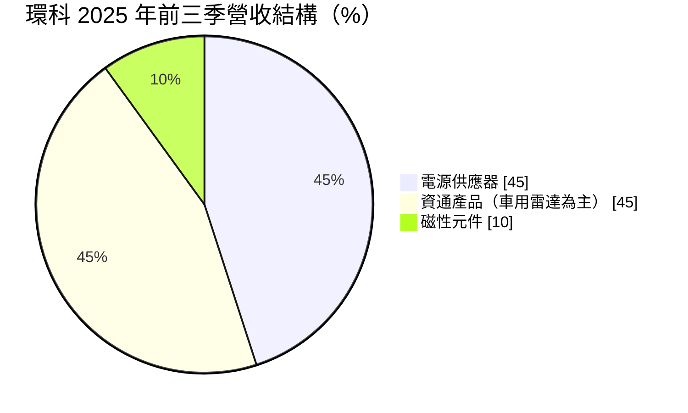
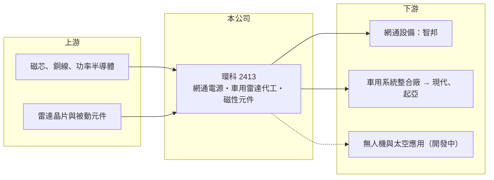

# 2413 環科

> 上市｜[[產業索引-電子零組件業|電子零組件業]]｜上市（櫃）日期 2000/09/11

# 第一章：企業模式與商業藍圖

> [!info] 撰寫說明
> 精簡版，由 Claude 依公開資料整理，架構比照 [[2330台積電]]，資料截至 2026-10-08。來源：證交所開放資料（基本資料、2026 年上半年財報、股利）、Goodinfo 經營績效頁、富果研究 2025 年 12 月法說會整理。#待校對

本章說明環隆科技（環科，2413）的三條產品線，以及它如何從傳統磁性元件廠轉成網通電源與車用雷達的代工供應商。

- **核心業務：** 環科成立於 1984 年，總部在台中工業區，早期以變壓器等磁性元件起家，後來延伸到[[電源供應器]]與資通訊產品的代工。這三條產品線共用磁性設計與電源轉換的技術，因此可以視為同一套核心能力的延伸。
- **營收結構：** 依 2025 年前三季資料，電源供應器約占 45%，以網通[[交換器]]電源為主；資通產品約占 45%，主要是車用[[毫米波雷達]]；磁性元件約占 10%。車用雷達 2025 年前三季年增 46%，是近年成長最快的部分。
- **營運據點：** 生產據點包括台中廠、中國深圳與龍巖、越南河內。車用雷達出貨到越南的系統整合廠，組裝後交給現代與起亞汽車，這種多地布局讓公司能配合客戶的「中國以外」生產需求。
- **長期方向：** 公司把網通電源往更高瓦數與高壓直流（[[HVDC]]）架構發展，並與國家太空中心合作開發太空等級電源模組，也規劃無人機應用。這些新領域在 2025 年底仍以開發為主，能否成為穩定收入要再觀察。

# 第二章：護城河深度與競爭優勢

本章分析環科的競爭位置：它的護城河來自特定客戶的長期合作，而不是規模。

- **競爭優勢：** 環科是 [[2345智邦]] 交換器電源的主要供應商之一，雙方共同開發新一代電源，代表公司已進入客戶的研發流程，而不是單純比價。車用雷達方面，環科是現代與起亞某款雷達系統的獨家 Tier 2 供應商，車用零件一旦導入通常會持續供貨到車型生命週期結束。
- **主要對手：** 網通與伺服器電源的主要對手是 [[2308台達電]]、[[2301光寶科]]、[[3015全漢]] 等大廠，磁性元件則面對眾多中國廠商的價格競爭。環科規模小，難以在標準化電源上與大廠拼成本，因此要依靠客製化與特定客戶的深度合作。
- **觀察重點：** 客戶集中是雙面刃：智邦與韓系車廠的訂單帶來成長，但也代表單一客戶的需求變化會直接影響營收。長期要看新客戶與無人機、太空等新應用能否分散這個風險。

# 第三章：財務體質與盈利規模

資料日期：2026-10-08，表格是撰寫當時的快照；最新月營收、毛利率、累計 EPS 由自動排程寫在本筆記的屬性欄位（月營收、毛利率、累計EPS 等）。#待校對

本章用多年度數字檢視環科的獲利能力，結論是本業長期微利，獲利波動大。

| 年度 | 營收（億元） | [[毛利率]] | [[營業利益率]] | EPS（元） | [[ROE]] |
|---|---|---|---|---|---|
| 2020 | 38.0 | 15.2% | 0.4% | -0.10 | -0.9% |
| 2021 | 40.4 | 15.5% | 1.4% | 0.35 | 2.6% |
| 2022 | 48.3 | 17.3% | 5.3% | 2.07 | 13.5% |
| 2023 | 46.0 | 14.9% | 1.9% | 0.84 | 5.2% |
| 2024 | 32.3 | 12.2% | -5.9% | -0.44 | -2.8% |
| 2025 | 33.4 | 15.2% | 0.7% | 0.41 | 2.6% |

- **營收規模：** 2020 至 2025 年營收年複合成長率約 -2.5%，2022 年高峰 48 億元後在 2024 年明顯下滑。2026 年上半年營收 18.0 億元，回到成長軌道。
- **獲利：** 毛利率長期落在 12% 至 17%，營業利益率多數年度低於 2%，顯示本業競爭激烈、議價力有限。2026 年上半年 EPS 2.39 元，但其中營業外收益約 2.79 億元，本業營業利益只有約 0.62 億元，業外來源未查得，不能視為常態獲利。
- **財務特色：** 近 5 年（2021 至 2025）平均 ROE 約 4.2%。2025 年度配發現金股利 0.5 元，高於當年 EPS 0.41 元，等於動用保留盈餘配息。2026 年第二季股東權益 22.6 億元、負債 24.3 億元。
- **[[ROIC]] 與 [[WACC]]：** 2025 年營業利益約 0.24 億元（33.4 億 × 0.73%），稅後約 0.20 億元，以股東權益 22.6 億元計算 ROIC 不到 1%，把全部負債算入約 0.4%（推算）；即使以 2026 年上半年的本業水準年化，ROIC 也只約 4%（推算）。WACC 以 [[CAPM]] 推估：無風險利率 1.75%、市場風險溢酬 6%、β 假設 1.0，股東權益成本 7.75%；負債成本假設稅後 2%、負債占資本 25%（假設），WACC 約 6.3%（推算）。ROIC 長期低於 WACC，代表本業在多數年度沒有賺到資金成本，車用雷達與高瓦數電源能否把營業利益率拉到 5% 以上，是價值能否轉正的關鍵。

# 第四章：總體風險與地緣政治

本章整理環科長期要面對的風險。

- **產業週期：** 網通設備有明顯的庫存週期，2023 至 2024 年網通去化庫存時，環科營收從 46 億元降到 32 億元。車用雷達則跟著車型改款與汽車銷量起伏。
- **營運風險：** 客戶集中度高，智邦與現代、起亞相關訂單若轉單或車型停產，營收會明顯受影響。台中廠曾因外籍勞工不足而產能受限，顯示中小型製造廠在人力上的脆弱性。
- **其他風險：** 營收以美元為主，匯率波動曾在 2025 年第二季造成虧損。多地生產雖能分散地緣政治風險，但也增加管理成本；太空與無人機等新事業的研發投入，短期內可能拖累獲利。

# 專有名詞解析

## 應用

- **[[毫米波雷達]]**：以毫米波段電磁波偵測距離與速度的感測器，用於汽車盲點偵測、防撞與自動駕駛輔助。

## 金融

- **[[CAPM]]**：資本資產定價模型，以無風險利率加上 β 乘以市場風險溢酬，推估股東要求的報酬率。

## 產業

- **[[電源供應器]]**：把市電轉換成設備所需電壓與電流的裝置，伺服器、網通設備與工業設備都需要。
- **[[交換器]]**：網路中負責轉送封包的設備，資料中心與企業網路的基礎設施。
- **[[HVDC]]**：高壓直流供電架構，資料中心用較高電壓的直流配電以降低轉換損耗。

# 核心供應鏈

- 上游：磁芯、漆包銅線、功率半導體與被動元件，以及車用雷達所需的射頻晶片。
- 下游／客戶：網通交換器廠 [[2345智邦]]；車用雷達經越南系統整合廠供應現代與起亞汽車；國家太空中心與國內無人機廠為開發中的合作對象。
- 同業：[[2308台達電]]、[[2301光寶科]]、[[3015全漢]]、[[2457飛宏]]（電源）；磁性元件同業以中國廠商為主。

## 最新新聞
<!-- news:start -->
<!-- news:end -->

## 相關連結
- [公開資訊觀測站](https://mopsov.twse.com.tw/mops/web/t05st03?step=1&firstin=1&co_id=2413)
- [Goodinfo](https://goodinfo.tw/tw/StockDetail.asp?STOCK_ID=2413)
- [Yahoo 股市](https://tw.stock.yahoo.com/quote/2413)
- [鉅亨網新聞](https://www.cnyes.com/twstock/2413/news)
