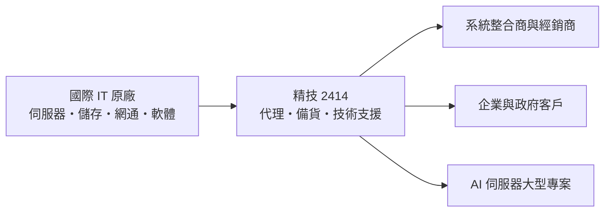
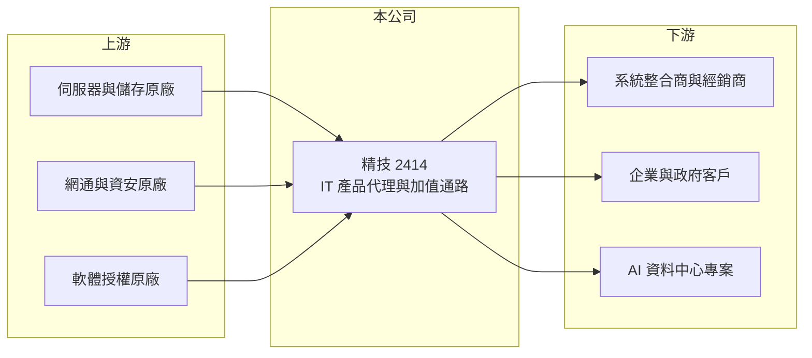

# 2414 精技

> 上市｜[[產業索引-電子通路業|電子通路業]]｜上市（櫃）日期 2000/09/11

# 第一章：企業模式與商業藍圖

> [!info] 撰寫說明
> 本文由 Claude 依公開資料整理，架構比照 [[2330台積電]] 的四章研究，資料截至 2026-10-08。財務數字來源：Goodinfo 年度經營績效頁與基本資料頁、證交所開放資料（基本資料、資產負債、綜合損益、營益分析、股利、每月營收與營收備註）。代理品牌、產品別營收比重與集團持股關係公開資料有限，部分描述憑記憶整理並標註待校對，產業描述為整理性內容，尚未逐條比對原始文件。#待校對

在評估單一個股的長期投資價值時，首要步驟是拆解企業的底層獲利邏輯。本章說明精技電腦（股票代號：2414，以下簡稱精技）如何以電腦與企業 IT 產品的通路經營，賺取薄利多銷的通路價差。

## 一、核心定位：電腦與企業 IT 產品的專業通路

精技成立於 1979 年 3 月，是台灣最早的電腦通路商之一，1998 年上櫃、2000 年 9 月轉上市，實收資本額約 16.2 億元，董事長為葉佳紋、總經理為李盈芳。公司的主要業務登記為「電腦及電腦週邊產品之通路經營」，一般認為屬於精誠資訊集團的一員（憑記憶，待校對）。#待校對

通路商（[[代理商]]）的商業模式是向國際原廠進貨、再賣給系統整合商、經銷商與企業客戶，賺取進銷之間的價差，並提供備貨、物流、信用額度與技術支援。通路商不負責研發與製造，但要承擔存貨與應收帳款的資金壓力，因此毛利率低、周轉要快。精技的毛利率長期在 8% 左右、營業利益率 2% 至 3%，是典型的 IT 通路結構。

* **產品範圍：** 依產業慣例，IT 通路的產品包括伺服器、儲存設備、網通設備、電腦周邊與軟體授權，精技的代理品牌與比重未查得。#待校對
* **加值服務：** 企業級產品（伺服器、儲存、資安）需要售前規劃與售後技術支援，加值型通路的毛利率高於只做物流的消費性通路。

## 二、AI 伺服器專案帶來的規模跳升

2026 年精技的營收出現結構性跳升。依公司在月營收的說明，2026 年 8 月營收年增 79.5%，主要受惠於大型專案的 [[AI伺服器]]需求；1 至 8 月累計營收 281.1 億元，年增約 48%，已接近 2025 年全年的 284 億元。2026 年 8 月董事會也決議辦理現金增資，以支應營運資金需求（資金用途細節未查得）。

* **策略意義：** AI 伺服器單價高，一筆大型專案就能讓營收大幅增加，但也需要先墊付大量貨款與庫存，對通路商的資金調度是很大的考驗。這類專案的毛利率通常低於一般企業 IT 產品（推估），2026 年上半年毛利率 7.10%，低於前幾年的 8% 至 8.8%。
* **長期方向：** 精技的長期價值取決於能否把 AI 基礎建設的機會轉成持續性的企業客戶關係，而不只是一次性的大型標案。

# 第二章：護城河深度與競爭優勢

在長期價值投資中，「護城河」指企業抵禦競爭、維持超額利潤的保護機制。本章分析精技在 IT 通路的位置。

## 一、護城河的組成

通路業的護城河普遍較窄，精技的優勢主要來自：

* **代理權與原廠關係：** 國際原廠在每個市場通常只授權少數通路商，取得並維持代理權需要長期的銷售實績與信用紀錄。四十多年的經營歷史讓精技累積了原廠信任（推估）。
* **下游經銷網絡與技術服務：** 企業 IT 產品需要專業的售前與售後支援，擁有技術團隊與廣泛經銷商網絡的通路商，原廠較不容易替換。
* **資金與信用能力：** 大型專案需要先墊付貨款，通路商的銀行額度與營運資金規模本身就是門檻。

## 二、競爭對手格局

| 對手 | 定位 | 對精技的影響 |
|---|---|---|
| [[2347聯強]] | 台灣最大 3C 與 IT 通路 | 規模與物流優勢，資訊產品全面競爭 |
| [[8112至上]] | 記憶體與 IT 產品通路 | 部分產品線重疊 |
| [[2480敦陽科]]、[[6112邁達特]] | 企業 IT 系統整合 | 在企業客戶端兼具競爭與合作 |
| [[3029零壹]] | 資安與企業軟體代理 | 企業 IT 代理市場競爭 |

## 三、守得住與守不住的地方

* **守得住：** 需要技術支援的企業級產品，以及長期合作的原廠代理線。
* **守不住：** 毛利率。通路商的價差由原廠定價與同業競爭決定，大型專案的價格透明度高，規模越大的訂單毛利率通常越薄。
* **觀察重點：** AI 伺服器專案是否延續到 2027 年以後、營運資金與負債是否控制得宜，以及現金增資後 ROE 的變化。

# 第三章：財務體質與盈利規模

資料日期：2026-10-08。數字取自 Goodinfo 年度經營績效頁與證交所開放資料，表格是撰寫當時的快照；最新月營收、毛利率、累計 EPS 由自動排程寫在本筆記的屬性欄位（月營收、毛利率、累計EPS 等）。#待校對

財務報表是檢驗護城河是否真實存在的最終標準。本章用多年度三率、ROE 與資本報酬，檢視精技的獲利品質。

## 一、多年度獲利

| 年度 | 營收（新台幣） | [[毛利率]] | [[營業利益率]] | EPS（元） | [[ROE]] |
|---|---|---|---|---|---|
| 2019 | 190 億 | 8.60% | 1.93% | 1.81 | 9.70% |
| 2020 | 216 億 | 8.01% | 2.15% | 2.25 | 11.7% |
| 2021 | 239 億 | 8.83% | 3.08% | 3.44 | 15.8% |
| 2022 | 251 億 | 8.33% | 2.76% | 3.08 | 13.5% |
| 2023 | 231 億 | 8.31% | 2.20% | 2.38 | 9.88% |
| 2024 | 240 億 | 8.43% | 2.38% | 2.67 | 11.7% |
| 2025 | 284 億 | 7.94% | 2.53% | 3.17 | 13.3% |
| 2026 上半年 | 203.3 億 | 7.10% | 2.85% | 2.53 | 未查得 |

註：2026 年 1 至 8 月累計營收 281.1 億元，年增約 47.8%。

* **營業利益率對營收規模很敏感：** 通路商的毛利率變化不大，但營業費用多為人事與倉儲等固定成本。2019 年營收 190 億元時營業利益率 1.93%，2021 年營收 239 億元時升到 3.08%；2026 年上半年營業費用只占營收約 4.2%，低於 2025 年的約 5.4%（推算），因此毛利率雖下滑，營業利益率反而上升。這是通路業典型的[[營業槓桿]]。
* **營收年複合成長率：** 2020 至 2025 年約 5.6%（推算），2026 年因 AI 專案明顯加速。

## 二、長期指標

* **平均 ROE：** 2021 至 2025 年平均約 12.8%（推算），以低毛利的通路業而言表現穩定。
* **股利：** 2025 年度配發現金股利 3.0 元，以 EPS 3.17 元計算，[[配發率]]約 95%（推算），精技長期把大部分盈餘發還股東。
* **資產結構：** 2026 年第二季總資產 180.4 億元，負債 137.2 億元、權益 43.1 億元（歸屬母公司 31.5 億元），負債比約 76%；流動資產 162.2 億元，幾乎全部是存貨、應收帳款與現金。AI 專案讓[[營運資金]]需求暴增，這也是辦理現金增資的背景。

## 三、[[ROIC]] 與 [[WACC]]：價值創造利差

**ROIC 推算：** 2025 年營業利益約 7.19 億元（284 億元 × 2.53%），稅後約 5.75 億元。以 2026 年第二季權益 43.1 億元計算 ROIC 約 13.3%；若把負債 137.2 億元全部計入投入資本，約 3.2%（推算）。負債中有大量應付帳款屬於無息的營運負債，有息負債金額未查得，實際 ROIC 應介於兩者之間，推估約 6% 至 10%。

**WACC 推算：** 權益成本以 [[CAPM]] 估算，台灣 10 年期公債 1.75%、市場風險溢酬 6%、β 取 0.8（通路業常見值，非來源數字），約 6.55%；負債成本假設 2.5%，稅後 2%。假設權益占資本 50%，WACC 約 4.3%（推算）。

**結論：** 精技的 ROIC 推估高於 WACC，屬於小幅創造價值的通路商。通路業的價值來自「薄利乘以高周轉」，只要存貨與應收帳款周轉維持穩定，低毛利也能帶來合理的資本報酬；反過來說，一旦大型專案出現呆帳或存貨跌價，薄薄的利潤很容易被吃掉。

# 第四章：總體風險與地緣政治

任何企業都無法脫離宏觀環境獨立存在。本章分析精技必須面對的產業週期、營運與外部風險。

## 一、產業週期

* **企業 IT 支出週期：** 企業與政府的 IT 預算隨景氣調整，景氣轉弱時伺服器與網通設備的採購會延後。
* **AI 投資週期：** AI 伺服器需求目前快速成長，但大型專案具有一次性，若 AI 資本支出放緩，營收可能回到原本的規模。

## 二、營運風險

* **營運資金與信用風險：** 大型專案需要墊付貨款，若客戶付款延遲或財務出問題，應收帳款可能形成損失。
* **存貨跌價：** IT 產品更新快，伺服器與零組件價格下跌時，庫存可能需要提列跌價損失。
* **代理權變動：** 原廠可能調整通路政策、改為直營或更換代理商，影響特定產品線的營收。

## 三、其他風險

* **股本稀釋：** 2026 年辦理現金增資，股本增加後若獲利未同步成長，EPS 與 ROE 會被稀釋。
* **匯率：** 進貨多以美元計價，新台幣匯率變動影響毛利與匯兌損益。
* **利率：** 營運資金大量依賴銀行借款時，利率上升會增加利息費用。

# 專有名詞解析

## 應用

- **[[AI伺服器]]**：搭載 GPU 或 AI 加速器、用於模型訓練與推論的高效能伺服器，單價與功耗都遠高於一般伺服器。

## 金融

- **[[營運資金]]**：流動資產減流動負債，代表企業日常營運需要投入的資金，存貨與應收帳款越多，所需資金越大。
- **[[營業槓桿]]**：固定成本占比高的企業，營收增加時利潤增幅大於營收增幅；反之營收下滑時利潤跌得更快。
- **[[配發率]]**：現金股利占當年度每股盈餘的比例，用來衡量公司把多少獲利分給股東。

## 產業

- **[[代理商]]**：取得國際原廠授權、在特定市場銷售其產品的通路公司，提供備貨、物流、信用與技術支援，賺取進銷價差。

# 核心供應鏈

## 1. 上游：國際 IT 原廠
- 伺服器、儲存、網通、資安與軟體原廠（代理品牌名單未查得）
- AI 伺服器相關平台與製造商可參考：[[NVDA輝達]]、[[2382廣達]]、[[6669緯穎]]、[[3231緯創]]（是否為代理或採購來源未查得）

## 2. 本公司與同業
- 集團關係：[[6214精誠]]（集團持股關係待校對）
- IT 通路同業：[[2347聯強]]、[[8112至上]]、[[3029零壹]]

## 3. 下游：客戶
- 系統整合商：[[2480敦陽科]]、[[6112邁達特]]、[[2471資通]]、[[6183關貿]]（是否為客戶未查得）
- 企業、政府與 AI 資料中心專案

## 最新新聞
<!-- news:start -->
<!-- news:end -->

## 相關連結
- [公開資訊觀測站](https://mopsov.twse.com.tw/mops/web/t05st03?step=1&firstin=1&co_id=2414)
- [Goodinfo](https://goodinfo.tw/tw/StockDetail.asp?STOCK_ID=2414)
- [Yahoo 股市](https://tw.stock.yahoo.com/quote/2414)
- [鉅亨網新聞](https://www.cnyes.com/twstock/2414/news)
