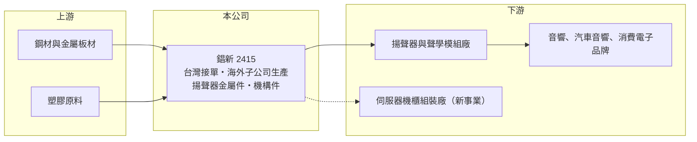

# 2415 錩新

> 上市｜[[產業索引-電子零組件業|電子零組件業]]｜上市（櫃）日期 2000/09/11

# 第一章：企業模式與商業藍圖

> [!info] 撰寫說明
> 精簡版，由 Claude 依公開資料整理，架構比照 [[2330台積電]]，資料截至 2026-10-08。來源：證交所開放資料（基本資料、2026 年上半年財報、股利）、Goodinfo 經營績效頁、nStock 公司簡介，以及財經媒體標題。公開資料有限，產品細節多憑媒體標題與過往認知整理。#待校對

本章說明錩新科技（2415）的商業模式：台灣母公司接單、海外子公司生產的金屬與塑膠零件廠，主力產品與[[揚聲器]]相關。

- **核心業務：** 錩新成立於 1972 年，營業項目是金屬製品、電子零組件與塑膠射出製品。依媒體報導，公司營收以揚聲器相關的金屬零件為主，非揚聲器產品比重仍在 10% 上下（媒體標題，年份待校對）。揚聲器金屬件是喇叭磁路中的導磁零件，用於音響、汽車音響與消費電子，技術門檻在於沖壓與車削的精度和大量生產的成本控制（產品細節待校對）。
- **營收結構：** 公開資料沒有產品別比重。2025 年全年營收約 23.6 億元，2026 年上半年約 12.4 億元，近年營收規模大致維持在 20 至 25 億元。
- **營運據點：** 自 2007 年（民國 96 年）起，公司調整營運架構，由台灣母公司接單後，交給海外子公司加工生產。媒體報導公司在越南擴產，代表生產基地正從中國往東南亞分散（擴產時程待校對）。
- **長期方向：** 公司嘗試把[[沖壓]]與金屬加工能力延伸到 [[AI 機櫃]]與伺服器機架零件，媒體報導相關產品已開始出貨（年份待校對）。如果這條線能放大，可以降低對單一揚聲器市場的依賴。

# 第二章：護城河深度與競爭優勢

本章分析錩新的競爭位置：它是利基金屬零件供應商，優勢在於製程經驗與成本，而非品牌。

- **競爭優勢：** 揚聲器金屬件看似簡單，但尺寸精度與磁性表現會直接影響音質，客戶通常不會輕易更換驗證過的供應商。錩新經營五十年以上，累積了穩定的客戶關係與量產經驗，毛利率在 2024 至 2025 年維持在 24% 至 27%，高於一般代工型金屬件廠（推估比較）。
- **主要對手：** 主要競爭者是中國當地的金屬沖壓與車削廠，它們在人工與原料採購上有成本優勢。台股中揚聲器相關的公司有 [[2439美律]] 等聲學模組廠，但它們多半是錩新的下游或不同層級的供應商，而非直接對手（關係待校對）。
- **觀察重點：** 長期要觀察非揚聲器產品（包括伺服器機構件）的比重能否持續提高，以及越南新產能能否維持原有的毛利率。若新產品只是低毛利的代工件，對整體獲利的幫助有限。

# 第三章：財務體質與盈利規模

資料日期：2026-10-08，表格是撰寫當時的快照；最新月營收、毛利率、累計 EPS 由自動排程寫在本筆記的屬性欄位（月營收、毛利率、累計EPS 等）。#待校對

本章用多年度數字檢視錩新的獲利波動與資產負債表特色。

| 年度 | 營收（億元） | [[毛利率]] | [[營業利益率]] | EPS（元） | [[ROE]] |
|---|---|---|---|---|---|
| 2020 | 19.6 | 24.6% | 11.7% | 0.66 | 4.3% |
| 2021 | 24.5 | 30.5% | 17.8% | 2.73 | 13.1% |
| 2022 | 23.5 | 24.3% | 6.1% | 0.01 | 1.4%（註） |
| 2023 | 22.6 | 18.8% | 7.8% | -0.22 | 0.4%（註） |
| 2024 | 22.9 | 23.8% | 10.1% | 1.14 | 3.4% |
| 2025 | 23.7 | 26.6% | 14.6% | 1.81 | 6.9% |

註：2022 至 2023 年 ROE 與 EPS 方向不一致，可能因來源以含[[非控制權益]]的淨利計算，待校對。

- **營收規模：** 2020 至 2025 年營收年複合成長率約 4%，規模穩定但成長有限。
- **獲利：** 營業利益率在 6% 至 18% 之間，但 EPS 波動遠大於營業利益，2022 至 2023 年營業利益仍為正、EPS 卻接近零或為負，顯示業外損益與非控制權益分走的獲利影響很大。2026 年上半年毛利率 23.0%、營業利益率 6.5%、EPS 0.47 元。
- **財務特色：** 資產負債表規模遠大於營收：2026 年第二季資產總計約 109 億元，其中流動資產約 90.6 億元、流動負債約 71.0 億元，而年營收只有約 24 億元；非控制權益約 13.8 億元，接近母公司權益 17.3 億元。這種結構常見於海外子公司同時持有大量存款與借款的台商，但具體原因未查得，是研究這家公司最需要釐清的地方。2025 年度配發現金股利 0.48 元與股票股利約 1.11 元，股本由 9 億元增加到 10 億元。近 5 年（2021 至 2025）平均 ROE 約 5.0%。
- **[[ROIC]] 與 [[WACC]]：** 2025 年營業利益約 3.5 億元（23.7 億 × 14.6%），稅後約 2.8 億元。以含非控制權益的權益總計 31.0 億元為投入資本，ROIC 約 9%；若把全部負債 78.0 億元都算入，只有約 2.5%（推算）。由於負債的組成未查得，真實值可能落在中間。WACC 以 [[CAPM]] 推估：無風險利率 1.75%、市場風險溢酬 6%、β 假設 0.9，股東權益成本約 7.2%；負債成本假設稅後 2%、負債占資本 50%（假設），WACC 約 4.6%（推算）。以營業層面看，本業 ROIC 在 2025 年可能高於 WACC，但歸屬母公司股東的 ROE 長期只有 5% 左右，代表本業創造的價值有相當部分被業外與少數股東分走。

# 第四章：總體風險與地緣政治

本章整理錩新長期要面對的風險。

- **產業週期：** 揚聲器需求跟著消費性電子、家用音響與汽車銷售起伏，屬於成熟市場，長期成長性有限。消費電子需求轉弱時，零件廠的訂單會比終端更早下滑。
- **營運風險：** 資產負債表龐大而且以流動負債為主，若利率上升或海外資金調度受限，財務成本可能侵蝕獲利。生產完全依賴海外子公司，母公司對子公司的控制權與少數股東的分配也影響股東實際能拿到的獲利。
- **其他風險：** 金屬原料（鋼材）價格與人民幣、越南盾匯率波動會影響成本；美中關稅使客戶要求移出中國生產，越南擴產需要新的資本支出與學習曲線。

# 專有名詞解析

## 金融

- **[[非控制權益]]**：子公司中不屬於母公司的股權，其分得的淨利不計入母公司股東的 EPS。
- **[[CAPM]]**：資本資產定價模型，以無風險利率加上 β 乘以市場風險溢酬，推估股東要求的報酬率。

## 產業

- **[[揚聲器]]**：把電訊號轉成聲音的元件，由磁路、振膜與音圈組成，用於音響、汽車、手機與筆電。
- **[[沖壓]]**：以模具與沖床把金屬板材壓成特定形狀的加工方式，適合大量生產金屬零件。
- **[[AI 機櫃]]**：整合 AI 伺服器、電源、散熱與網路的整櫃系統，需要大量金屬機構件與滑軌。

# 核心供應鏈

- 上游：鋼材、磁性材料與塑膠原料供應商。
- 下游／客戶：揚聲器與聲學模組廠，再供應音響、汽車與消費電子品牌；伺服器機櫃組裝廠為發展中的新客群。具體客戶名稱未查得。
- 同業：中國當地金屬沖壓與車削廠；台股聲學相關公司 [[2439美律]]（多為下游，關係待校對）。

## 最新新聞
<!-- news:start（自動產生，請勿手動編輯此範圍） -->
- 2026-10-23 🏛️ 重訊 16:39｜代子公司富鑫證券公告召開股東臨時會｜[觀測站](https://mops.twse.com.tw/mops/#/web/t05st01)
- 2026-10-20 🏛️ 重訊 16:31｜代重要子公司錩新(越南)公告臨時股東會決議事項｜[觀測站](https://mops.twse.com.tw/mops/#/web/t05st01)
- 2026-10-19 🏛️ 重訊 16:11｜代重要子公司錩新(越南)公告召開股東臨時會｜[觀測站](https://mops.twse.com.tw/mops/#/web/t05st01)

完整紀錄：[[2415錩新 新聞]]
<!-- news:end -->

## 相關連結
- [公開資訊觀測站](https://mopsov.twse.com.tw/mops/web/t05st03?step=1&firstin=1&co_id=2415)
- [Goodinfo](https://goodinfo.tw/tw/StockDetail.asp?STOCK_ID=2415)
- [Yahoo 股市](https://tw.stock.yahoo.com/quote/2415)
- [鉅亨網新聞](https://www.cnyes.com/twstock/2415/news)
