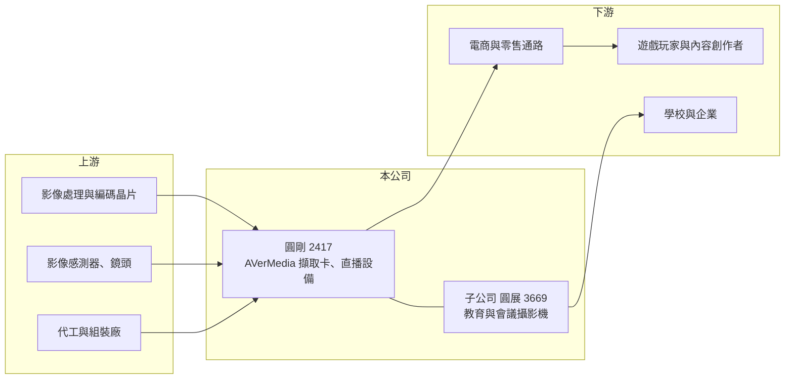

# 2417 圓剛

> 上市｜[[產業索引-電腦及週邊設備業|電腦及週邊設備業]]｜上市（櫃）日期 2000/09/11

# 第一章：企業模式與商業藍圖

> [!info] 撰寫說明
> 精簡版，由 Claude 依公開資料整理，架構比照 [[2330台積電]]，資料截至 2026-10-08。來源：證交所開放資料快照（基本資料、2026 年第二季財報、營益分析、股利、每月營收）、Goodinfo 經營績效年度表、StockAnalysis 年度損益表。產品線與子公司圓展的描述為依產業常識整理，本次來源未逐條驗證；公開資料有限。#待校對

圓剛是台灣少數以自有品牌經營影音設備的公司，本章說明它的品牌產品、集團結構，以及營收從疫情高峰回落後的定位。

- **核心業務：** 圓剛成立於 1990 年、2000 年上市，總部在新北中和，英文品牌 AVerMedia。公司以[[影像擷取卡]]起家，把攝影機、遊戲機或電腦的影音訊號轉成可錄影、可直播的數位串流，產品包括遊戲[[直播串流]]用的擷取盒、網路攝影機、麥克風等創作者設備（待校對）。董事長郭重松同時兼任總經理，經營層長期穩定。
- **營收結構：** 本次來源未查得產品別比重。圓剛合併持有上市公司 [[3669圓展]]，圓展的教育用實物投影機、視訊會議攝影機等產品也計入合併營收（持股比例與營收占比待校對），2026 年第二季末[[非控制權益]] 10.9 億元，反映圓展有相當比例屬其他股東。
- **營運據點：** 公司以台灣為研發與品牌總部，透過海外子公司經營美國、歐洲、日本與中國市場，產品多委外或在集團工廠生產（待校對）。毛利率長期在 50% 以上，顯示它賣的是品牌與軟體整合，而不是代工製造。
- **長期方向：** 疫情期間遠距工作、線上教學與直播需求讓 2020 年營收衝上 70.5 億元，之後回落到 33 億元左右。長期方向是在創作者經濟、混合辦公與智慧教室這幾個結構性需求中，維持品牌產品的軟硬體整合優勢；2026 年上半年營業利益率回升到 7.2%，是費用控制與產品組合調整的初步成果。

# 第二章：護城河深度與競爭優勢

影音周邊是品牌與通路驅動的市場，本章分析圓剛的品牌護城河與面對的競爭。

- **競爭優勢：** 圓剛累積三十多年影像擷取技術，擷取卡需要硬體編碼、驅動程式與直播軟體的長期相容性維護，這是一般周邊廠難以快速複製的能力。自有品牌讓它能取得 55% 以上的毛利率，在電腦周邊產業中相當少見。
- **主要對手：** 遊戲擷取與直播設備的主要對手是 Corsair 旗下的 Elgato，網路攝影機與視訊會議則有 Logitech、Poly 等國際品牌；教育與會議攝影機領域，子公司圓展與國際品牌及中國廠商競爭。國際大廠在通路與行銷預算上遠大於圓剛。
- **觀察重點：** 圓剛的問題是費用結構：毛利率高，但 2023 至 2025 年營業利益率在 −3% 到 0.4% 之間，代表研發、行銷與通路費用幾乎吃掉毛利。長期要看營收能否穩定成長，讓品牌費用被攤薄，以及新產品能否在直播與 AI 影像應用中維持定價力。

# 第三章：財務體質與盈利規模

資料日期：2026-10-08，表格是撰寫當時的快照；最新月營收、毛利率、累計 EPS 由自動排程寫在本筆記的屬性欄位（月營收、毛利率、累計EPS 等）。#待校對

圓剛 2020 年疫情高峰後營收腰斬，毛利率卻持續提高，獲利的關鍵在於費用能否跟著調整。

| 年度 | 營收（億元） | [[毛利率]] | [[營業利益率]] | EPS（元） | [[ROE]]（註） |
|---|---|---|---|---|---|
| 2021 | 47.2 | 49.4% | 11.4% | 0.27 | 7.44% |
| 2022 | 39.7 | 49.8% | 1.85% | 0.23 | 4.68% |
| 2023 | 32.4 | 55.2% | −2.76% | 0.01 | 3.0% |
| 2024 | 32.7 | 57.0% | −2.74% | −0.39 | 1.04% |
| 2025 | 33.6 | 55.7% | 0.44% | −0.19 | 0.71% |

註：ROE 取自 Goodinfo，推估以含非控制權益的合併淨利計算，與歸屬母公司的 EPS 方向不一致（例如 2024 年 EPS 為負、ROE 為正），使用前需校對。

- **營收規模：** 2020 年營收 70.5 億元，2025 年 33.6 億元，五年年複合成長率約 −13.8%，主要是疫情需求的高基期回落。2026 年上半年營收 18.7 億元，前 8 月累計 24.5 億元、年增約 10%。
- **獲利：** 2026 年上半年毛利率 57.7%、營業利益率 7.2%，EPS 0.60 元，截至 2026 年 6 月的近四季 EPS 為 1.37 元，是 2021 年以來最好的水準。不過合併淨利有近一半歸屬非控制權益，母公司股東實得比例較低。
- **財務特色：** 2026 年第二季末母公司權益 27.5 億元、每股淨值 21.6 元，負債總額 21.0 億元。公司持有庫藏股 3,008 萬股、帳列 6.97 億元，約占股本兩成，是規模相當大的[[庫藏股]]操作。股利方面，即使 2024 與 2025 年 EPS 為負，仍各配發 0.2 元與 0.25 元現金股利，顯示公司傾向維持小額但不中斷的配息。
- **[[ROIC]] 與 [[WACC]]：** 2025 年營業利益約 0.15 億元（33.6 億 × 0.44%），以權益總額 38.4 億元計 ROIC 約 0.3%（推算）；若以近四季營業利益率 5.9% 計，營業利益約 2.1 億元、稅後約 1.7 億元，ROIC 約 4.4%（推算）。WACC 以 CAPM 推估：無風險利率 1.75%、市場風險溢酬 6%、β 取周邊品牌常見值 0.9，股東權益成本約 7.2%；有息負債細項未查得，假設比重低，WACC 約 7%（推算）。即使 2026 年獲利改善，ROIC 仍低於 WACC，品牌價值尚未轉化為超額報酬。

# 第四章：總體風險與地緣政治

圓剛的風險來自消費性需求波動、國際品牌競爭與費用結構。

- **產業週期：** 直播、遠距會議與線上教學的需求在疫情期間被大幅提前，之後經歷多年去化。遊戲主機世代更替、直播平台熱度與教育預算週期，都會讓需求出現大起大落。
- **營運風險：** 國際品牌在通路與行銷上的規模優勢明顯，圓剛若要維持能見度就必須持續投入行銷費用。產品生命週期短，新品若錯過遊戲主機或平台更新的時點，庫存跌價風險升高。
- **其他風險：** 營收以海外為主，美元與歐元匯率會影響獲利；子公司圓展的經營結果會透過合併報表影響圓剛，但利潤有相當部分歸屬其他股東。

# 專有名詞解析

## 應用

- **[[直播串流]]**：透過網路即時播送影音內容，常見於遊戲實況、線上教學與企業活動。

## 金融

- **[[非控制權益]]**：子公司股權中不屬於母公司的部分，代表子公司的其他股東權益。
- **[[庫藏股]]**：公司從市場買回、尚未註銷或轉讓的自家股票，買回期間不參與配息與表決。

## 產業

- **[[影像擷取卡]]**：把攝影機、遊戲機等外部影音訊號轉成電腦可錄製、可直播之數位串流的設備。

# 核心供應鏈

- 上游：影像處理與編碼晶片、影像感測器與鏡頭、代工組裝廠（具體供應商未查得）。
- 下游／客戶：全球電商與零售通路，終端為遊戲玩家、直播主與內容創作者；子公司 [[3669圓展]] 服務學校與企業的教育與會議需求。
- 同業：國際品牌 Elgato（Corsair）、Logitech；教育與會議攝影機同業包括國際品牌與中國廠商。

## 最新新聞
<!-- news:start -->
<!-- news:end -->

## 相關連結
- [公開資訊觀測站](https://mopsov.twse.com.tw/mops/web/t05st03?step=1&firstin=1&co_id=2417)
- [Goodinfo](https://goodinfo.tw/tw/StockDetail.asp?STOCK_ID=2417)
- [Yahoo 股市](https://tw.stock.yahoo.com/quote/2417)
- [鉅亨網新聞](https://www.cnyes.com/twstock/2417/news)
