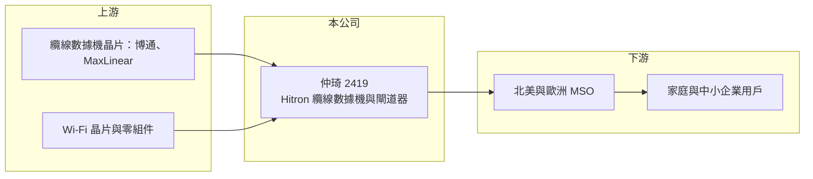

# 2419 仲琦

> 上市｜[[產業索引-通信網路業|通信網路業]]｜上市（櫃）日期 2000/09/11

# 第一章：企業模式與商業藍圖

> [!info] 撰寫說明
> 精簡版，由 Claude 依公開資料整理，架構比照 [[2330台積電]] 的四章研究，資料截至 2026-10-08。來源：證交所開放資料（基本資料、綜合損益、資產負債、營益分析、股利、每月營收）。公開資料有限，本次未取得多年度經營績效頁，產品與客戶描述多為整理性內容，尚未逐條比對原始文件。#待校對

本章說明仲琦科技（股票代號：2419，品牌 Hitron，以下簡稱仲琦）的商業模式：專注有線電視寬頻設備的網通公司。

- **核心業務：** 仲琦成立於 1986 年，2000 年在台灣證券交易所上市，總部位於新竹科學園區。仲琦以 Hitron 品牌與代工方式，供應有線電視業者使用的[[纜線數據機]]與家用閘道器，也就是讓用戶透過有線電視同軸電纜上網的設備（待校對）。這類設備由有線電視業者（[[MSO]]）採購後租給或配發給用戶，因此仲琦的客戶是電信與有線電視營運商，而不是一般消費者。
- **營收結構：** 公開資料未提供產品別營收比重。依業務性質，營收以 [[DOCSIS]] 纜線數據機與整合 Wi-Fi 的寬頻閘道器為主，市場以北美有線電視業者為核心（待校對）。客戶數少、單一客戶訂單大，年度營收會隨主要客戶的標案與換機週期劇烈變動。
- **營運據點：** 總部與研發位於新竹科學園區，生產據點與海外子公司細節本次未查得（待校對）。北美客戶近年要求供應鏈分散到中國以外，生產布局是網通設備廠的長期課題。
- **長期方向：** 有線電視業者正從 DOCSIS 3.1 升級到 DOCSIS 4.0，並搭配 Wi-Fi 7 閘道器，以和光纖網路業者競爭高速寬頻市場，這是仲琦未來數年最主要的換機需求來源。另一方面，有線電視網路本身面臨光纖到府（[[PON]]）與固定無線接取的長期替代壓力。

# 第二章：護城河深度與競爭優勢

本章評估仲琦在有線寬頻設備這個利基市場中的競爭位置。

- **競爭優勢：** 纜線數據機必須通過 CableLabs 規格認證與每家 MSO 的長時間驗證，軟體也要與客戶的網管系統整合，因此新供應商進入不易，既有供應商在換代時有先行優勢。仲琦長期專注這個市場，累積了與北美 MSO 的合作經驗。不過客戶議價能力強，產品規格由客戶主導，屬於窄護城河。
- **主要對手：** 國際對手包括 Vantiva（原 Technicolor 與 CommScope 家用網路部門）、Sagemcom；台灣同業有 [[3596智易]]、[[5388中磊]]、[[6285啟碁]]，它們同時供應光纖、DSL 與纜線寬頻設備，規模大於仲琦（對手名單為產業常識整理，待校對）。
- **觀察重點：** 第一，DOCSIS 4.0 換機週期何時進入大量出貨。第二，毛利率能否維持在 18% 以上，2026 上半年為 18.67%。第三，客戶集中度與新客戶開發，單一客戶的採購縮減就可能讓公司由盈轉虧。

# 第三章：財務體質與盈利規模

資料日期：2026-10-08。數字取自證交所開放資料，表格是撰寫當時的快照；最新月營收、毛利率、累計 EPS 由自動排程寫在本筆記的屬性欄位（月營收、毛利率、累計EPS 等）。#待校對

本次只取得證交所開放資料，多年度數字大多未查得，以下以可確認的數字為主。

| 年度 | 營收（新台幣） | [[毛利率]] | [[營業利益率]] | EPS（元） | [[ROE]] |
|---|---|---|---|---|---|
| 2023 | 未查得 | 未查得 | 未查得 | 未查得 | 未查得 |
| 2024 | 未查得 | 未查得 | 未查得 | 未查得 | 未查得 |
| 2025 | 未查得 | 未查得 | 未查得 | 約 -0.36（推算） | 約 -2.4%（推算） |
| 2026 上半年 | 41.2 億 | 18.67% | 1.51% | 0.14 | 未查得 |

註：2025 年依證交所股利資料的本期淨損 1.17 億元，除以股本約 3.21 億股推算 EPS，再除以股東權益約 48 億元推算 ROE。2026 上半年取自證交所營益分析與綜合損益開放資料。

- **營收規模：** 2026 年 1 至 8 月累計營收 67.95 億元，較去年同期的 55.62 億元成長約 22%，8 月單月 20.1 億元，顯示出貨集中在少數月份的專案特性。多年度營收年複合成長率未查得。
- **獲利：** 2025 年稅後淨損約 1.17 億元，2026 上半年轉為小幅獲利，稅後淨利 0.45 億元，其中業外收益 0.46 億元占稅前利益四成以上，本業營業利益率只有 1.5%。網通代工型業務毛利率低、費用固定，營收規模是獲利的關鍵。
- **財務特色：** 依證交所資料，2026 年第二季底資產總計 118.0 億元、股東權益 48.2 億元、流動負債 54.7 億元，每股淨值 14.99 元。流動負債偏高，可能包含應付帳款與短期借款，反映網通廠備料的營運資金需求（推估）。2025 年度未配發股利。
- **[[ROIC]] 與 [[WACC]]：** 以 2026 上半年營業利益 0.62 億元年化並扣 20% 稅後約 0.99 億元，投入資本以股東權益 48.2 億元加非流動負債 3.18 億元（代替有息負債，短期借款未拆出）約 51.4 億元計算，ROIC 約 1.9%（推算）；若計入可能存在的短期借款，ROIC 會更低。WACC 以 CAPM 推估：無風險利率 1.75%、市場風險溢酬 6%、β 取 1.0（推估，網通同業常見值），權益成本約 7.75%；稅前負債成本假設 2.5%，加權後 WACC 約 6% 至 7%（推算）。ROIC 明顯低於 WACC，代表目前的獲利水準尚不足以補償資金成本，需要靠 DOCSIS 4.0 換機帶動營收與毛利同步提升。

# 第四章：總體風險與地緣政治

本章整理仲琦面對的長期風險，核心是客戶集中與技術替代。

- **產業週期：** 寬頻設備需求取決於 MSO 的資本支出與換機週期，通常數年一次大換代，換代前後的營收落差很大。2025 年虧損、2026 年營收回升，正反映這種週期。
- **營運風險：** 客戶集中在少數北美有線電視業者，任何一家客戶轉單或縮減採購都會重創營收。晶片缺貨或漲價時，代工廠難以把成本完全轉嫁給強勢客戶。
- **其他風險：** 美國關稅政策與供應鏈在地化要求，可能迫使網通廠調整生產地點並增加成本。長期來看，光纖到府與 5G 固定無線接取會侵蝕有線電視寬頻的市占，壓縮纜線數據機市場的總規模。

# 專有名詞解析

## 應用

- **[[纜線數據機]]**：透過有線電視同軸電纜連上網路的用戶端設備，由有線電視業者配發，常整合 Wi-Fi 路由功能。
- **[[DOCSIS]]**：有線電視網路傳輸資料的國際標準，由 CableLabs 制定，3.1 與 4.0 版本分別支援數 Gbps 等級的速度。
- **[[PON]]**：被動光纖網路，電信商把光纖拉到家戶的主流架構，10G PON、25G PON 代表傳輸速度世代。

## 金融

- **[[ROIC]]**：投入資本報酬率，稅後營業利益除以股東權益與有息負債的合計，衡量本業對所有資金提供者的報酬。
- **[[WACC]]**：加權平均資金成本，依股東權益與負債的比重加權計算的資金成本，ROIC 高於它才代表創造價值。

## 產業

- **[[MSO]]**：多系統有線電視營運商，同時經營多個地區的有線電視與寬頻網路，是纜線數據機的主要採購者。

# 核心供應鏈

- 上游：纜線數據機與 Wi-Fi 晶片 [[AVGO博通]]、MaxLinear，網通晶片 [[2379瑞昱]] 等（實際供應商未公開，待校對）。
- 下游／客戶：北美為主的有線電視多系統營運商，客戶名稱本次未查得。
- 同業：[[3596智易]]、[[5388中磊]]、[[6285啟碁]]、Vantiva、Sagemcom。

## 最新新聞
<!-- news:start -->
<!-- news:end -->

## 相關連結
- [公開資訊觀測站](https://mopsov.twse.com.tw/mops/web/t05st03?step=1&firstin=1&co_id=2419)
- [Goodinfo](https://goodinfo.tw/tw/StockDetail.asp?STOCK_ID=2419)
- [Yahoo 股市](https://tw.stock.yahoo.com/quote/2419)
- [鉅亨網新聞](https://www.cnyes.com/twstock/2419/news)
