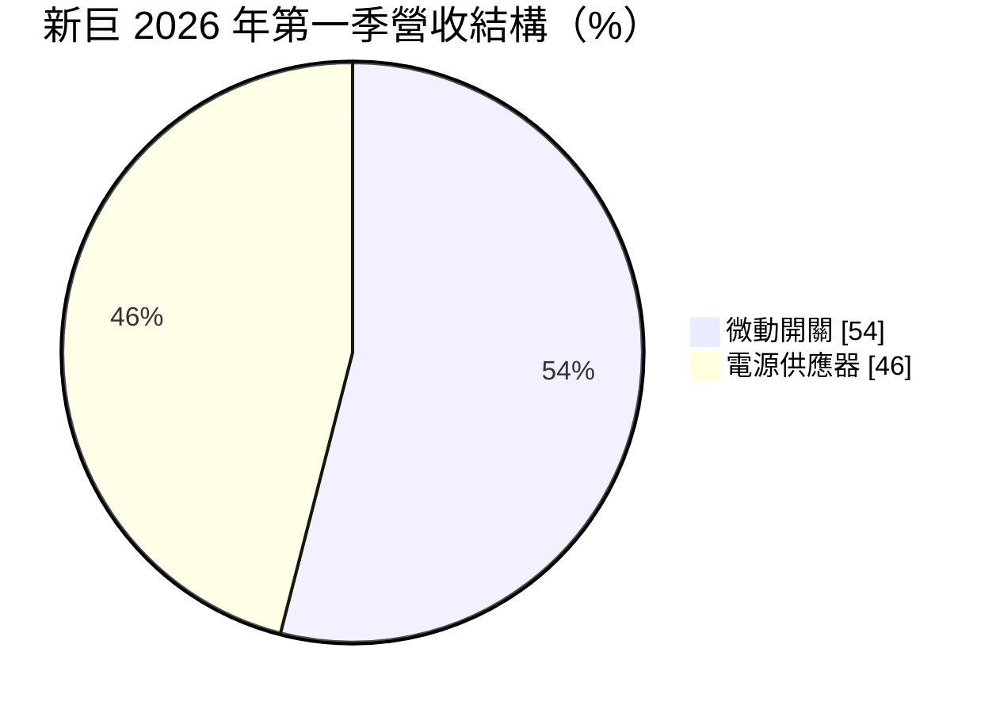
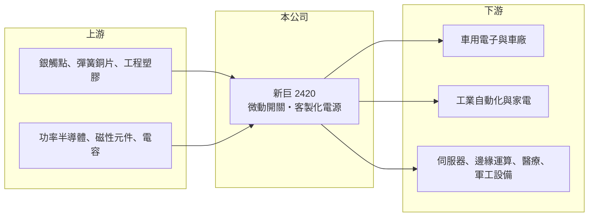

# 2420 新巨

> 上市｜[[產業索引-電子零組件業|電子零組件業]]｜上市（櫃）日期 2000/09/11

# 第一章：企業模式與商業藍圖

> [!info] 撰寫說明
> 精簡版，由 Claude 依公開資料整理，架構比照 [[2330台積電]]，資料截至 2026-10-08。來源：證交所開放資料（基本資料、2026 年上半年財報、股利）、Goodinfo 經營績效頁、富果研究 2026 年 5 月法說會整理。#待校對

本章說明新巨科技（2420）的兩大事業：高可靠度的[[微動開關]]，以及鎖定伺服器、醫療與軍工等利基市場的客製化[[電源供應器]]。

- **核心業務：** 新巨成立於 1983 年，總部在新北五股。微動開關是一種體積小、行程短的機械開關，用在車鎖、中控鎖、工業自動化設備與高階家電，要求動作數十萬次以上不失效。電源事業則提供高瓦數、高功率密度的客製化電源，客戶是伺服器、邊緣運算、醫療與軍工設備廠。
- **營收結構：** 2026 年第一季微動開關約占 54%、電源約占 46%，管理層也形容兩者大約各半。AI 與邊緣運算相關產品約占總營收 15%，公司預期比重會提升。
- **營運據點：** 生產據點與產能資訊在本次查得的資料中沒有說明，以台灣總部研發、海外工廠生產的模式為主（待校對）。公司表示將持續拓展海外市場以提高營收穩定性。
- **長期方向：** 電源方面，公司持續開發伺服器用的共用冗餘電源（CRPS）、1400W 與 2000W 醫療電源，以及整合電池管理功能、朝 [[BBU]] 方向發展的電源模組。微動開關方面，則以可靠度維持在車用與工控的地位，並因應中國車廠的國產化趨勢。

# 第二章：護城河深度與競爭優勢

本章分析新巨為什麼能長期維持接近五成的毛利率，這在台灣零組件廠中相當少見。

- **競爭優勢：** 新巨的兩條產品線都是「少量多樣、可靠度優先」的利基市場。車用與工控的開關、醫療與軍工的電源都需要長時間的安規與可靠度認證（例如醫療電源的 60601 安規），客戶換供應商的成本很高，因此價格競爭不像消費性電子那麼激烈。這解釋了毛利率由 2020 年 37% 一路升到 2024 年 48% 的原因。
- **主要對手：** 微動開關的國際對手是歐姆龍（Omron）、Cherry 等日歐品牌，新巨定位為具價格競爭力的國際品牌；媒體整理指出，以外銷為目標的中國一線車廠仍傾向採用包括新巨在內的國際品牌開關。電源方面的對手包括 [[2308台達電]]、[[3015全漢]]、[[6282康舒]] 等大廠，新巨避開大量標準品，專做客製化高階機種。
- **觀察重點：** 長期要看伺服器與 BBU 等新電源產品能否在維持高毛利的同時擴大規模，以及中國車廠國產化是否壓縮微動開關的市占率。營收自 2021 年高點約 26.6 億元後未再成長，成長性是新巨最大的課題。

# 第三章：財務體質與盈利規模

資料日期：2026-10-08，表格是撰寫當時的快照；最新月營收、毛利率、累計 EPS 由自動排程寫在本筆記的屬性欄位（月營收、毛利率、累計EPS 等）。#待校對

本章用多年度數字檢視新巨的獲利品質：高毛利、高配息，但營收成長停滯。

| 年度 | 營收（億元） | [[毛利率]] | [[營業利益率]] | EPS（元） | [[ROE]] |
|---|---|---|---|---|---|
| 2020 | 24.8 | 37.2% | 20.7% | 2.90 | 13.9% |
| 2021 | 26.6 | 38.6% | 23.7% | 3.82 | 17.5% |
| 2022 | 26.4 | 42.2% | 26.4% | 4.43 | 19.0% |
| 2023 | 21.3 | 42.6% | 25.2% | 3.55 | 14.6% |
| 2024 | 22.4 | 47.9% | 27.8% | 4.36 | 17.4% |
| 2025 | 21.8 | 45.9% | 29.2% | 3.91 | 15.0% |

- **營收規模：** 2020 至 2025 年營收年複合成長率約 -2.5%，規模在 21 億至 27 億元之間。2026 年上半年營收 11.4 億元，與過去相近。
- **獲利：** 毛利率與營業利益率幾乎每年提升，2025 年營業利益率達 29%，2026 年上半年進一步到 49.1% 與 32.5%，EPS 2.30 元。營收不成長、利潤率卻上升，代表公司主動淘汰低毛利產品、往高階機種集中。
- **財務特色：** 近 5 年（2021 至 2025）平均 ROE 約 16.7%，穩定而且偏高。2025 年度配發現金股利 3.0 元，約占 EPS 77%，配息穩定。2026 年第二季股東權益 38.9 億元、負債 21.5 億元，負債比約 36%，財務保守。
- **[[ROIC]] 與 [[WACC]]：** 2025 年營業利益約 6.4 億元（21.8 億 × 29.2%），稅後約 5.1 億元。以股東權益 38.9 億元為投入資本，ROIC 約 13%；把全部負債 21.5 億元也算入，約 8.4%（推算），實際值在兩者之間。WACC 以 [[CAPM]] 推估：無風險利率 1.75%、市場風險溢酬 6%、β 假設 0.9（利基型零組件常見值），股東權益成本約 7.2%；負債成本假設稅後 2%、負債占資本 10%（假設），WACC 約 6.6%（推算）。ROIC 穩定高於 WACC 數個百分點，代表新巨長期在創造經濟價值，但因為營收不成長，價值創造的總量難以放大。

# 第四章：總體風險與地緣政治

本章整理新巨長期要面對的風險。

- **產業週期：** 微動開關跟著汽車、家電與工業設備的景氣起伏；伺服器電源則受資料中心投資週期影響。2023 年營收下滑約兩成，反映工控與消費需求的庫存調整。
- **營運風險：** 中國車廠與家電廠加速採用本土零件，可能侵蝕新巨在中國市場的開關業務。電源事業若要打入大型雲端客戶，需與台達電等大廠正面競爭，可能拉低毛利率。
- **其他風險：** 銅、銀觸點與塑膠等原物料漲價會壓縮毛利，公司已提前備料因應。營收以外幣計價，新台幣升值會影響換算後的利潤。

# 專有名詞解析

## 金融

- **[[CAPM]]**：資本資產定價模型，以無風險利率加上 β 乘以市場風險溢酬，推估股東要求的報酬率。

## 產業

- **[[微動開關]]**：行程極短、靠簧片快速切換的機械開關，用於車鎖、滑鼠、家電與工業設備，重視耐用次數與可靠度。
- **[[電源供應器]]**：把市電轉換成設備所需電壓與電流的裝置，伺服器、網通設備與工業設備都需要。
- **[[BBU]]**：備援電池單元，資料中心在斷電時提供短時間電力，讓伺服器安全切換或關機。

# 核心供應鏈

- 上游：開關用的銀觸點、銅合金彈片與工程塑膠；電源用的功率半導體、磁性元件與電容。
- 下游／客戶：車用電子與車廠、工業自動化與高階家電廠、伺服器與醫療軍工設備廠，具名客戶未查得。
- 同業：微動開關有 Omron、Cherry 等國際品牌；電源有 [[2308台達電]]、[[3015全漢]]、[[6282康舒]]。

## 最新新聞
<!-- news:start -->
<!-- news:end -->

## 相關連結
- [公開資訊觀測站](https://mopsov.twse.com.tw/mops/web/t05st03?step=1&firstin=1&co_id=2420)
- [Goodinfo](https://goodinfo.tw/tw/StockDetail.asp?STOCK_ID=2420)
- [Yahoo 股市](https://tw.stock.yahoo.com/quote/2420)
- [鉅亨網新聞](https://www.cnyes.com/twstock/2420/news)
