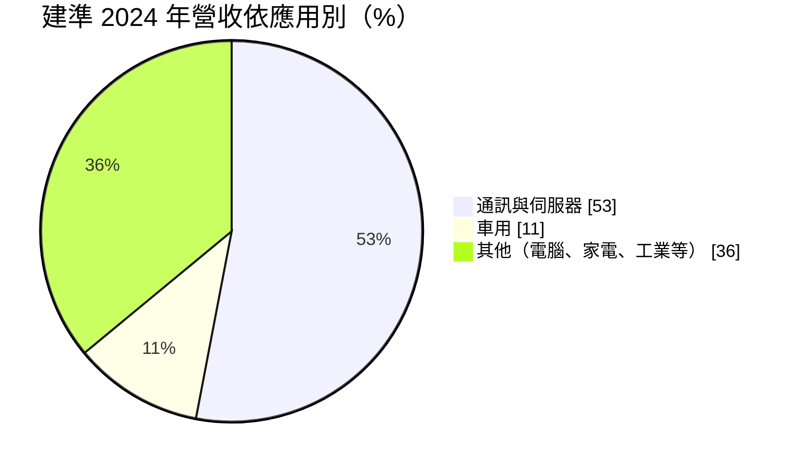
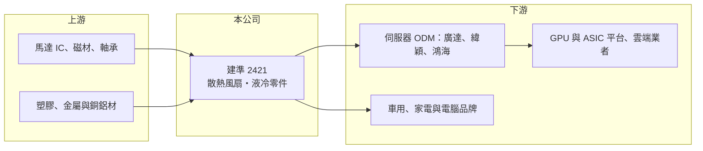

# 2421 建準

> 上市｜[[產業索引-電子零組件業|電子零組件業]]｜上市（櫃）日期 2000/09/11

# 第一章：企業模式與商業藍圖

> [!info] 撰寫說明
> 精簡版，由 Claude 依公開資料整理，架構比照 [[2330台積電]]，資料截至 2026-10-08。來源：證交所開放資料（基本資料、2026 年上半年財報、股利）、Goodinfo 經營績效頁、財報狗 2025 年 3 月建準報導。#待校對

本章說明建準電機（2421）的商業模式：從家電與電腦風扇起家的全球第三大風扇廠，近年因 [[AI 伺服器]]散熱需求而轉型成資料中心散熱供應商。

- **核心業務：** 建準成立於 1980 年，總部在高雄，主要產品是各種尺寸的直流[[散熱風扇]]與馬達，依報導為全球第三大風扇製造商。風扇的技術核心是馬達設計、軸承壽命與噪音控制，伺服器用的高轉速風扇對風量與可靠度的要求遠高於家用產品。
- **營收結構：** 2024 年通訊與伺服器占 53%、車用占 11%，其餘為電腦、家電與工業應用。2024 年第四季伺服器營收占比達 44.5%，其中 AI 伺服器約 23.3%，顯示營收重心已從消費性產品轉向資料中心。
- **營運據點：** 生產以中國為主，包括廣東惠州，公司在惠州建置量產液冷散熱的新廠，並在台灣五股設立實驗室新廠（依 2025 年報導，預計 2025 年下半年啟用）。其他海外據點未查得。
- **長期方向：** 新一代 AI 伺服器逐步改用[[液冷散熱]]，但機櫃內仍需風扇輔助。建準的策略是從風扇延伸到水冷板、幫浦與冷卻液分配裝置（[[CDU]]）等液冷零件，讓公司在氣冷轉液冷的過程中不被淘汰。

# 第二章：護城河深度與競爭優勢

本章分析建準的護城河：量產規模、伺服器客戶認證，以及馬達技術的累積。

- **競爭優勢：** 伺服器風扇的單價與規格都比消費性風扇高，客戶認證週期長，一旦進入雲端業者與 GPU 平台的供應鏈，通常能隨平台世代延續供貨。建準已打入 [[NVDA輝達]] GB200 供應鏈，並供應多家國際大廠的 ASIC AI 伺服器（2025 年前兩月 ASIC 伺服器約占出貨八成）。規模與認證共同構成建準的優勢。
- **主要對手：** 風扇市場的主要對手包括 [[2308台達電]]、日本電產（Nidec，台股有 [[6230尼得科超眾]]），以及 [[3017奇鋐]]、[[3324雙鴻]]、8996高力 等散熱模組與液冷廠。奇鋐與雙鴻以整套散熱模組與液冷系統見長，建準則在風扇本身的量產與成本上具優勢。
- **觀察重點：** 長期最大的問題是 AI 伺服器全面液冷後，風扇的用量與單價是否下降，以及建準的液冷零件能否在奇鋐、雙鴻等先行者之外取得一席之地。毛利率能否維持在 30% 上下，是判斷轉型成敗的指標。

# 第三章：財務體質與盈利規模

資料日期：2026-10-08，表格是撰寫當時的快照；最新月營收、毛利率、累計 EPS 由自動排程寫在本筆記的屬性欄位（月營收、毛利率、累計EPS 等）。#待校對

本章用多年度數字檢視建準在 AI 伺服器週期中的獲利變化。

| 年度 | 營收（億元） | [[毛利率]] | [[營業利益率]] | EPS（元） | [[ROE]] |
|---|---|---|---|---|---|
| 2020 | 128 | 23.5% | 8.7% | 3.39 | 19.3% |
| 2021 | 136 | 18.7% | 3.4% | 1.71 | 9.6% |
| 2022 | 141 | 22.5% | 8.0% | 4.34 | 22.8% |
| 2023 | 129 | 27.9% | 11.8% | 5.16 | 21.5% |
| 2024 | 146 | 28.4% | 11.5% | 5.46 | 19.7% |
| 2025 | 187 | 31.1% | 15.0% | 7.94 | 25.8% |

註：2025 年 EPS 取自 Goodinfo；以證交所資料的 2025 年稅後淨利 21.7 億元除以目前股本推算約 7.55 元，差異可能來自期間股數變動，待校對。

- **營收規模：** 2020 至 2025 年營收年複合成長率約 8%，2025 年大增約 28% 到 187 億元，主要來自伺服器。2026 年上半年營收 104.4 億元，持續成長。
- **獲利：** 毛利率由 2021 年低點 18.7% 提升到 2025 年 31.1%，營業利益率從 3.4% 升到 15%。這是產品組合改變的結果：高單價伺服器風扇取代家電與電腦風扇。2026 年上半年毛利率 31.5%、營業利益率 15.6%、EPS 4.78 元。
- **財務特色：** 近 5 年（2021 至 2025）平均 ROE 約 19.9%。2025 年度配發現金股利 5.5 元，約占 EPS 七成。2026 年第二季股東權益 105.2 億元、負債 106.1 億元，負債中以流動負債（99.1 億元）為主，多為應付帳款等營運負債（推估）。
- **[[ROIC]] 與 [[WACC]]：** 2025 年營業利益約 28 億元（187 億 × 15%），稅後約 22.4 億元。以股東權益 105.2 億元為投入資本，ROIC 約 21%；把全部負債 106.1 億元也算入，約 10.6%（推算）。由於負債多為營運性負債，實際 ROIC 應接近區間上緣。WACC 以 [[CAPM]] 推估：無風險利率 1.75%、市場風險溢酬 6%、β 假設 1.2（AI 伺服器題材股波動較大），股東權益成本約 9.0%；負債成本假設稅後 2%、負債占資本 15%（假設），WACC 約 7.9%（推算）。ROIC 明顯高於 WACC，代表建準在伺服器轉型後持續創造經濟價值；2021 年 ROE 僅 9.6% 的低谷則提醒，產品組合一旦轉差，利差會快速縮小。

# 第四章：總體風險與地緣政治

本章整理建準長期要面對的風險。

- **產業週期：** 營收高度連動雲端業者的資本支出，AI 伺服器投資若放緩，伺服器風扇需求會同步下滑。家電與電腦風扇則受消費景氣影響，屬成熟市場。
- **營運風險：** 液冷取代氣冷是結構性的技術風險，若風扇用量減少，而液冷零件又被既有大廠搶先，建準的成長動能會受限。客戶集中在少數雲端與 GPU 平台，也增加議價壓力。
- **其他風險：** 生產集中在中國，面臨美中關稅與供應鏈移轉的壓力，未來可能需要在東南亞或美國增設產能。銅、鋁與磁材價格，以及人民幣、美元匯率都會影響毛利。

# 專有名詞解析

## 應用

- **[[AI 伺服器]]**：搭載 GPU 或 ASIC 加速器、用於訓練與推論 AI 模型的伺服器，功耗與散熱需求遠高於一般伺服器。

## 金融

- **[[CAPM]]**：資本資產定價模型，以無風險利率加上 β 乘以市場風險溢酬，推估股東要求的報酬率。

## 產業

- **[[散熱風扇]]**：以馬達帶動扇葉產生氣流、把熱帶走的零件，伺服器、電腦、家電與車用都會使用。
- **[[液冷散熱]]**：以液體流經冷板帶走晶片熱量的散熱方式，散熱效率高於氣冷，是高功耗 AI 伺服器的主流方向。
- **[[CDU]]**：冷卻液分配裝置，負責在液冷系統中分配冷卻液、控制溫度與流量。

# 核心供應鏈

- 上游：馬達驅動 IC、磁性材料、軸承，以及塑膠、銅、鋁等原料。
- 下游／客戶：伺服器組裝廠（例如 [[2382廣達]]、[[6669緯穎]]、[[2317鴻海]]，個別供貨關係待校對），最終用於 [[NVDA輝達]] GB200 等 GPU 平台與雲端業者的 ASIC 伺服器；另有車用、家電與電腦品牌客戶。
- 同業：[[2308台達電]]、[[6230尼得科超眾]]、[[3017奇鋐]]、[[3324雙鴻]]、8996高力。

## 最新新聞
<!-- news:start -->
<!-- news:end -->

## 相關連結
- [公開資訊觀測站](https://mopsov.twse.com.tw/mops/web/t05st03?step=1&firstin=1&co_id=2421)
- [Goodinfo](https://goodinfo.tw/tw/StockDetail.asp?STOCK_ID=2421)
- [Yahoo 股市](https://tw.stock.yahoo.com/quote/2421)
- [鉅亨網新聞](https://www.cnyes.com/twstock/2421/news)
