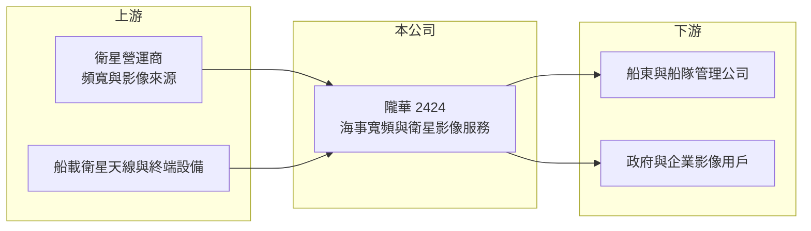

# 2424 隴華

> 上市｜[[產業索引-通信網路業|通信網路業]]｜上市（櫃）日期 2000/09/11

# 第一章：企業模式與商業藍圖

> [!info] 撰寫說明
> 精簡版，由 Claude 依公開資料整理，架構比照 [[2330台積電]] 的四章研究，資料截至 2026-10-08。來源：證交所開放資料（基本資料、綜合損益、資產負債、營益分析、股利、每月營收）、Goodinfo 年度經營績效、nStock 公司簡介。公開資料有限，業務描述多為整理性內容，尚未逐條比對原始文件。#待校對

本章說明隴華電子（股票代號：2424，以下簡稱隴華）的商業模式：一家營收規模很小、正在發展衛星相關服務的老牌電子公司。

- **核心業務：** 隴華成立於 1973 年，2000 年在台灣證券交易所上市，總部位於台北市松山區。依 nStock 整理的公司營業項目，隴華集團目前主要從事[[海事衛星寬頻]]數據服務及[[衛星影像]]技術等業務。海事衛星寬頻是讓航行中的船舶透過衛星連網，提供船員通訊、船隊管理與航行數據傳輸；衛星影像則是取得並分析衛星拍攝的地表資料，應用於監測與測繪。
- **營收結構：** 公開資料未提供業務別營收比重。依 Goodinfo，2025 年全年營收僅 1.88 億元，2026 上半年 0.87 億元，規模在上市公司中屬於極小型。這代表隴華目前更接近「新事業開發階段」的公司，而不是成熟的營運體。
- **營運據點：** 總部位於台北，集團包含子公司，但子公司名稱與海外據點本次未查得（待校對）。海事衛星服務需要與國際衛星營運商合作取得頻寬，再轉售給船東，屬於加值服務型的商業模式（推估）。
- **長期方向：** [[低軌衛星]]星系大量部署後，海上連網的頻寬與價格都大幅改善，船舶連網、遠洋漁船管理與海事數據應用有長期成長空間。隴華能否在這個市場建立足夠的客戶規模，是公司能否轉虧為盈的關鍵。

# 第二章：護城河深度與競爭優勢

本章評估隴華在衛星服務市場的競爭條件。以目前的規模與獲利來看，隴華尚未建立可辨識的護城河。

- **競爭優勢：** 海事寬頻服務的價值在於系統整合與在地服務：船上設備安裝、維修、頻寬方案設計與船東關係，需要長期經營。隴華若能累積一定數量的船隊客戶，服務合約具有續約性質，可形成小規模的經常性收入。不過目前公開資料無法證明隴華已經具備這樣的客戶基礎。
- **主要對手：** 國際海事衛星服務由 Inmarsat（已併入 Viasat）、Marlink、KVH 等主導，Starlink 也直接推出海事方案，讓衛星營運商可以繞過中間的服務商（對手名單為產業常識整理，待校對）。中間服務商的利潤空間因此被壓縮。
- **觀察重點：** 第一，營收能否持續成長並跨過損益兩平所需的規模。第二，毛利率能否維持正值並逐步提升，2025 年毛利率為 18%，2026 上半年 16.58%。第三，公司是否需要再次增資，以及新資金投入哪些業務。

# 第三章：財務體質與盈利規模

資料日期：2026-10-08。數字取自 Goodinfo 年度經營績效與證交所開放資料，表格是撰寫當時的快照；最新月營收、毛利率、累計 EPS 由自動排程寫在本筆記的屬性欄位（月營收、毛利率、累計EPS 等）。#待校對

隴華的財務數字反映一家營收極小、長期虧損的公司，比例指標因分母小而波動劇烈。

| 年度 | 營收（新台幣） | [[毛利率]] | [[營業利益率]] | EPS（元） | [[ROE]] |
|---|---|---|---|---|---|
| 2020 | 0.18 億 | -626% | -1,009% | -7.73 | -75.1% |
| 2021 | 0.13 億 | -959% | -1,702% | -8.57 | -130% |
| 2022 | 0.79 億 | -93.8% | -208% | -4.60 | -67.0% |
| 2023 | 1.07 億 | -57.8% | -177% | -3.95 | -67.9% |
| 2024 | 1.40 億 | -24.2% | -137% | -3.35 | -61.6% |
| 2025 | 1.88 億 | 18.0% | -59% | -1.34 | -23.3% |
| 2026 上半年 | 0.87 億 | 16.58% | -76.25% | -0.99 | 未查得 |

註：2020 至 2025 年取自 Goodinfo 合併報表；2026 上半年取自證交所開放資料。

- **營收規模：** 營收從 2021 年的 0.13 億元成長到 2025 年的 1.88 億元，成長倍數高但基期極低。2026 年 1 至 8 月累計營收 1.06 億元，較去年同期的 1.19 億元減少約 11%，成長動能尚未穩定。
- **獲利：** 毛利率在 2025 年首次轉正，代表服務的定價開始能覆蓋直接成本，這是正面的變化；但營業費用仍遠大於毛利，2026 上半年營業損失 0.66 億元，稅後淨損 0.59 億元。
- **財務特色：** 依證交所資料，2026 年第二季底資產總計 3.80 億元、股東權益 2.52 億元、負債 1.09 億元，負債比重不高，但保留盈餘為 -3.46 億元，每股淨值 4.23 元，已低於面額。公司按季申報不配發股利。
- **[[ROIC]] 與 [[WACC]]：** 以 2026 上半年營業損失 0.66 億元年化約 -1.32 億元（虧損不計稅盾），投入資本以股東權益 2.52 億元加非流動負債 0.19 億元（代替有息負債）約 2.71 億元計算，ROIC 約 -49%（推算）。WACC 以 CAPM 推估：無風險利率 1.75%、市場風險溢酬 6%、β 取 1.2（推估，虧損小型股常見偏高值），權益成本約 9%；公司幾乎以權益融資，WACC 約 8.5% 至 9%（推算）。ROIC 遠低於 WACC，代表目前每投入一元資本都在虧損，公司價值仰賴未來業務規模化的可能性，而非現有獲利。

# 第四章：總體風險與地緣政治

本章整理隴華的長期風險，最大的風險是能否在資金耗盡前達到損益兩平。

- **產業週期：** 海事寬頻需求與航運景氣、漁業與能源船舶活動相關，航運低迷時船東會削減通訊預算。衛星頻寬價格因低軌星系供給大增而下滑，對終端用戶有利，但會壓縮服務商的利潤。
- **營運風險：** 營收規模太小，固定的人事與營運費用難以攤提，持續虧損會侵蝕淨值。業務仰賴國際衛星營運商的頻寬與合作條件，供應商策略改變（例如直接面對船東）會影響隴華的定位。
- **其他風險：** 淨值低於面額且保留盈餘為負，未來可能需要減資或增資，存在股權稀釋風險。衛星影像業務涉及國防與國土安全相關法規，客戶與出口可能受到管制（待校對）。

# 專有名詞解析

## 應用

- **[[海事衛星寬頻]]**：讓航行中的船舶透過衛星連上網路的服務，用於船員通訊、船隊管理與航行數據傳輸。
- **[[衛星影像]]**：由人造衛星拍攝的地表影像，經處理分析後用於監測、測繪、農業與國土安全。
- **[[低軌衛星]]**：運行在約 500 至 2,000 公里高度的通訊衛星群，延遲較低，需大量地面接收設備，代表業者為 Starlink。

## 金融

- **[[ROIC]]**：投入資本報酬率，稅後營業利益除以股東權益與有息負債的合計，衡量本業對所有資金提供者的報酬。
- **[[WACC]]**：加權平均資金成本，依股東權益與負債的比重加權計算的資金成本，ROIC 高於它才代表創造價值。

# 核心供應鏈

- 上游：國際衛星營運商（頻寬與影像資料來源）、船載衛星天線與終端設備供應商，合作對象本次未查得（待校對）。
- 下游／客戶：船東、船隊管理公司、漁業與能源船舶，以及衛星影像的政府與企業用戶。
- 同業：Marlink、KVH、Viasat（Inmarsat）等國際海事衛星服務商；台灣衛星相關公司 [[2314台揚]]、[[2485兆赫]]。

## 最新新聞
<!-- news:start（自動產生，請勿手動編輯此範圍） -->
- 2026-10-16 🏛️ 重訊 15:39｜公告本公司總經理異動(更正異動原因)｜[觀測站](https://mops.twse.com.tw/mops/#/web/t05st01)
- 2026-10-16 🏛️ 重訊 15:01｜公告本公司總經理異動｜[觀測站](https://mops.twse.com.tw/mops/#/web/t05st01)
- 2026-10-14 🏛️ 重訊 15:29｜係因本公司有價證券於集中交易市場達公布注意交易資訊 標準，故公布相關財務業務等重大訊息，以利投資人區別瞭解｜[觀測站](https://mops.twse.com.tw/mops/#/web/t05st01)

完整紀錄：[[2424隴華 新聞]]
<!-- news:end -->

## 相關連結
- [公開資訊觀測站](https://mopsov.twse.com.tw/mops/web/t05st03?step=1&firstin=1&co_id=2424)
- [Goodinfo](https://goodinfo.tw/tw/StockDetail.asp?STOCK_ID=2424)
- [Yahoo 股市](https://tw.stock.yahoo.com/quote/2424)
- [鉅亨網新聞](https://www.cnyes.com/twstock/2424/news)
