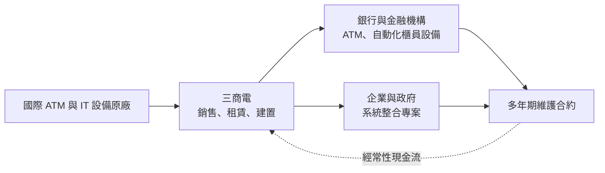
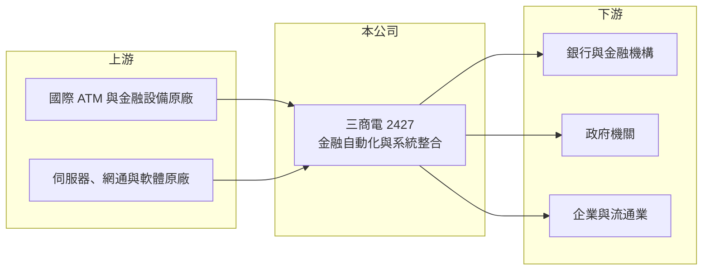

# 2427 三商電

> 上市｜[[產業索引-資訊服務業|資訊服務業]]｜上市（櫃）日期 2000/09/11

# 第一章：企業模式與商業藍圖

> [!info] 撰寫說明
> 精簡版，由 Claude 依公開資料整理，架構比照 [[2330台積電]] 的四章研究，資料截至 2026-10-08。來源：Goodinfo 年度經營績效頁與基本資料頁、證交所開放資料（基本資料、2026 年第二季資產負債與綜合損益、每月營收、股利）、CMoney 投資快訊標題。與三商集團的關係、ATM 業務與客戶描述依記憶整理；產品別營收比重未查得，公開資料有限。#待校對

三商電腦是三商集團旗下的資訊服務公司，本章說明它以金融自動化設備為根、系統整合為幹的商業模式，以及這種「設備加維護」的收入結構為何能提供穩定現金流。

## 一、核心定位：金融自動化與系統整合

- **核心業務：** 三商電的登記主要業務為「金融自動化服務機器之銷售、租賃及維護」與「系統整合業務之軟、硬體規劃、開發建置及維護」（Goodinfo 基本資料）。白話說，它一方面替銀行建置與維修 [[ATM]]、存提款機、自動化櫃員設備，另一方面替企業與政府規劃、建置資訊系統，也就是[[系統整合]]服務。財經媒體常以「金融自動化服務龍頭」稱之（CMoney 投資快訊標題）。
- **集團背景：** 公司成立於 1976 年、2000 年上市，實收資本額約 19.8 億元（證交所開放資料）。三商電屬於以 [[2905三商]] 為核心的三商集團，集團另有 [[2945三商家購]] 等零售事業（依記憶整理，待校對）。集團背景讓它在流通業與零售通路的資訊系統上有天然的合作機會。
- **營收結構：** 公開資料未查得產品別比重。以業務性質推估，營收可分為三塊：金融自動化設備銷售、設備租賃與維護合約、系統整合專案（推估）。其中維護合約按年收費，屬於[[經常性收入]]，是公司獲利穩定的基礎。
- **長期方向：** 銀行分行數減少、數位金融興起，ATM 數量成長有限，公司需要把重心移往系統整合、雲端與資安等服務。2024 至 2025 年營收由 39.7 億元跳升到 65.3 億元，但毛利率由 35.3% 降到 23.9%（Goodinfo），推估是承接較多硬體比重高的大型專案（推估），代表公司正以規模換成長。

## 二、資本轉化邏輯：裝機量帶動長期維護收入

金融設備一旦裝進銀行分行，後續的定期保養、故障維修、軟體更新與鈔匣服務通常會延續多年。這種「先賣設備、後收維護費」的模式，讓公司在硬體銷售起伏時仍有一層穩定收入，也讓既有客戶在設備汰換時較傾向留在原供應商。

# 第二章：護城河深度與競爭優勢

本章分析三商電在金融自動化與系統整合市場的競爭優勢與限制。

## 一、競爭優勢

- **全台維修網路：** ATM 分布在全台各地的分行、便利商店與公共場所，故障時需要在數小時內到場處理。建立遍布全台的維修工程師與備品網路需要長期投資，這是新進者難以快速複製的門檻。
- **銀行客戶的轉換成本：** 銀行更換 ATM 供應商，需要重新驗證設備與核心系統的介接、重新訓練人員，風險與成本都高。因此既有供應商在汰換標案中通常具有優勢。
- **集團綜效：** 三商集團的零售、餐飲與保險通路，提供內部的資訊系統需求，也讓公司熟悉流通業的作業流程（依記憶整理，待校對）。

## 二、主要對手

| 對手 | 定位 | 與三商電的比較 |
|---|---|---|
| [[6214精誠]] | 台灣最大資訊服務集團之一 | 金融與企業系統整合的主要對手，規模較大 |
| [[2453凌群]] | 政府與金融系統整合 | 在銀行與公部門專案上重疊 |
| 5410國眾 | 系統整合與網路建置 | 企業與政府標案的競爭者 |
| 國際 ATM 廠商的台灣分公司 | 直接銷售與維護 | 在大型銀行標案中與經銷商競爭 |

## 三、觀察重點

- **毛利率能否回升：** 2025 年營收大增但毛利率降到 23.9%，若大型專案只帶來營收、沒有帶來維護合約，長期利潤率會被稀釋。
- **經常性收入比重：** 維護與服務收入占比是判斷這家公司品質的核心，可惜公開資料未查得具體數字，值得在年報中追蹤。
- **數位金融的替代：** 行動支付與純網銀普及，會逐步降低銀行對實體 ATM 的需求，公司在新服務上的布局速度是長期關鍵。

# 第三章：財務體質與盈利規模

資料日期：2026-10-08，表格是撰寫當時的快照；最新月營收、毛利率、累計 EPS 由自動排程寫在本筆記的屬性欄位（月營收、毛利率、累計EPS 等）。#待校對

本章用多年度數據檢視三商電的成長與獲利品質，以及資本報酬是否高於資金成本。

## 一、多年度三率與 ROE

| 年度 | 營收（新台幣） | [[毛利率]] | [[營業利益率]] | EPS（元） | [[ROE]] |
|---|---|---|---|---|---|
| 2020 | 30.2 億 | 32.6% | 3.74% | 0.63 | 5.24% |
| 2021 | 34.9 億 | 30.6% | 4.35% | 0.81 | 6.62% |
| 2022 | 37.9 億 | 32.9% | 6.40% | 1.04 | 8.13% |
| 2023 | 39.7 億 | 35.3% | 7.73% | 1.36 | 9.17% |
| 2024 | 48.7 億 | 29.6% | 6.02% | 1.43 | 9.17% |
| 2025 | 65.3 億 | 23.9% | 5.45% | 1.53 | 9.43% |
| 2026 上半年 | 31.4 億 | 24.10% | 5.07% | 0.73 | 未查得 |

註：2020 至 2025 年取自 Goodinfo；2026 上半年取自證交所綜合損益與營益分析。

- **營收成長：** 2020 至 2025 年營收年複合成長率約 16.7%（推算），2026 年 1 至 8 月累計營收約 39.4 億元、年增約 7.2%（證交所每月營收）。成長主要來自 2024 年後的大型專案。
- **獲利結構：** 營收翻倍，EPS 只由 0.63 元增到 1.53 元，營業利益率始終在 4% 至 8% 之間，屬於薄利的系統整合業特性。
- **ROE：** 2021 至 2025 年平均 ROE 約 8.5%（推算），逐年小幅提升，但水準在資訊服務同業中偏低。

## 二、股利與財務結構

2025 年度配發現金股利 0.7 元，以 EPS 1.53 元計算配發率約 46%（推算），在資服業中偏保守。2026 年第二季底權益約 34.9 億元、總負債約 35.6 億元，其中流動負債約 25.7 億元、非流動負債約 9.9 億元（證交所資產負債）。負債比接近五成，推估與專案預收款、應付帳款及設備租賃業務的資金需求有關（推估）。

## 三、[[ROIC]] 與 [[WACC]]

**ROIC 推算：** 2025 年營業利益約 65.3 億元 × 5.45% ≈ 3.56 億元，扣除 20% 稅後約 2.85 億元。投入資本若只計權益 34.9 億元，ROIC 約 8.2%；若把非流動負債 9.9 億元全數視為有息負債，投入資本約 44.8 億元，ROIC 約 6.4%（推算，實際有息負債未查得）。

**WACC 推算：** 公債殖利率 1.75%、市場風險溢酬 6%、β 取資服股常見值 0.7，權益成本約 5.95%；負債成本假設 2.5%、稅後 2.0%，以權益約 78%、有息負債約 22% 加權，WACC 約 5.1%（推算）。

**結論：** ROIC 約 6% 至 8%，略高於約 5% 的 WACC，代表公司有創造價值，但利差不大。大型專案拉高營收卻壓低毛利率，若要擴大利差，需要提高維護與軟體服務等高毛利收入的比重。

# 第四章：總體風險與地緣政治

本章整理三商電長期面對的產業、營運與其他風險。

## 一、產業週期

- **銀行資本支出週期：** 金融自動化設備的需求取決於銀行的汰換週期與法規要求（例如新鈔、晶片卡、防詐功能升級），採購集中在特定年份，營收會隨之起伏。
- **政府與企業 IT 預算：** 系統整合專案受政府標案與企業景氣影響，景氣轉弱時企業會延後資訊投資。

## 二、營運風險

- **專案執行風險：** 大型系統整合專案常有固定價格合約，若需求變更或工程延誤，成本超支會直接侵蝕利潤。
- **毛利率稀釋：** 硬體轉售比重提高會拉低整體毛利率，公司若過度追求營收規模，可能犧牲獲利品質。
- **人才競爭：** 資安、雲端工程師供不應求，人力成本持續上升。

## 三、其他風險

- **數位金融替代：** 行動支付、無卡提款與網路銀行普及，長期會減少實體 ATM 的需求。
- **匯率：** 設備多向國際原廠採購，新台幣貶值會提高進貨成本。

# 專有名詞解析

## 應用

- **[[系統整合]]**：替客戶規劃並整合軟硬體、網路與應用系統，讓不同設備與軟體能一起運作的資訊服務。
- **[[ATM]]**：自動櫃員機，提供提款、存款、轉帳等服務的金融自動化設備，需要定期維護與保全。

## 金融

- **[[經常性收入]]**：按月或按年持續收取的收入，例如維護合約與訂閱費，可預測性高於一次性的專案收入。
- **[[ROIC]]**：投入資本報酬率，衡量企業用股東與債權人投入的資本，每年能產生多少稅後營業利益。
- **[[WACC]]**：加權平均資金成本，股東要求報酬與負債利息依資本結構加權後的平均值，是判斷是否創造價值的門檻。

# 核心供應鏈

- 上游：國際 ATM 與金融設備原廠；伺服器與網通設備原廠，例如 [[CSCO思科]]、[[MSFT微軟]]（產業代表，非指名合作對象）。
- 下游／客戶：銀行與金融機構，例如 [[2891中信金]]、[[2884玉山金]]（產業代表，非指名客戶）；政府機關；三商集團與其他流通業者，如 [[2905三商]]、[[2945三商家購]]。
- 同業：[[6214精誠]]、[[2453凌群]]、5410國眾。

## 最新新聞
<!-- news:start -->
<!-- news:end -->

## 相關連結
- [公開資訊觀測站](https://mopsov.twse.com.tw/mops/web/t05st03?step=1&firstin=1&co_id=2427)
- [Goodinfo](https://goodinfo.tw/tw/StockDetail.asp?STOCK_ID=2427)
- [Yahoo 股市](https://tw.stock.yahoo.com/quote/2427)
- [鉅亨網新聞](https://www.cnyes.com/twstock/2427/news)
