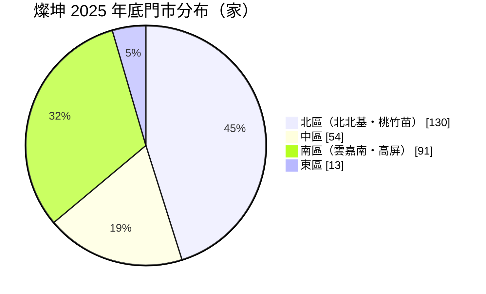
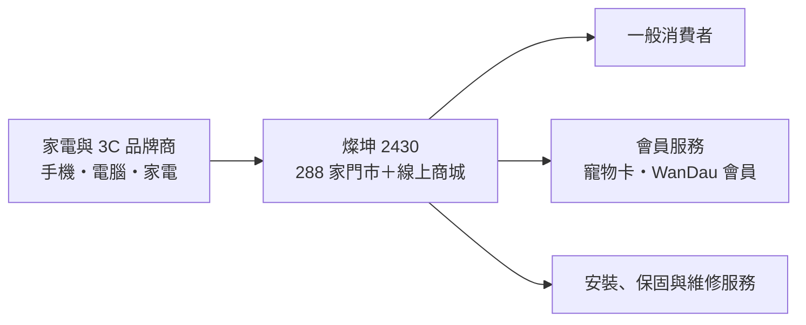
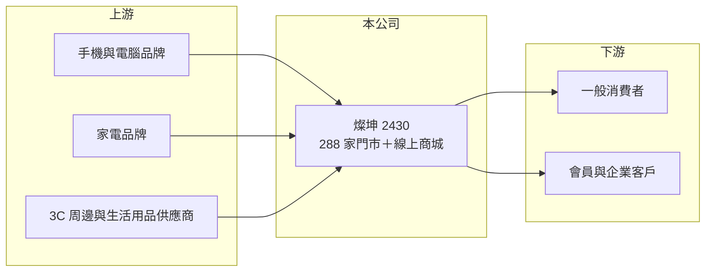

# 2430 燦坤

> 上市｜[[產業索引-電子通路業|電子通路業]]｜上市（櫃）日期 2000/09/11

# 第一章：企業模式與商業藍圖

> [!info] 撰寫說明
> 本文由 Claude 依公開資料整理，架構比照 [[2330台積電]] 的四章研究，資料截至 2026-10-08。財務數字來源：Goodinfo 年度經營績效頁、富果研究 2026 年 3 月法說會備忘錄（2025 年財報與門市分布）、證交所開放資料（基本資料、資產負債、綜合損益、營益分析、股利、每月營收）。產品別營收比重、會員數與電商比重公司未揭露，產業描述為整理性內容，尚未逐條比對原始文件。#待校對

在評估單一個股的長期投資價值時，首要步驟是拆解企業的底層獲利邏輯。本章說明燦坤實業（股票代號：2430，以下簡稱燦坤）如何以全台數百家門市經營 3C 家電零售，以及它在電商時代面對的挑戰。

## 一、核心定位：台灣主要的 3C 家電連鎖通路

燦坤成立於 1978 年 11 月，2000 年 9 月在證交所上市，實收資本額 11.68 億元，董事長為林技典。燦坤原本是小家電製造商，後來在台灣發展出「燦坤 3C」[[連鎖零售]]品牌，製造事業則移到中國並歸入同集團的 [[4930燦星網]]（集團沿革憑記憶，待校對）。今天的燦坤是一家純粹的零售通路公司。#待校對

連鎖零售的商業模式是：向家電與 3C 品牌商進貨，在門市與網路上賣給消費者，賺取進銷價差，並靠會員、延長保固、安裝服務等提高客單價。燦坤 2025 年毛利率 15.0%，但營業費用率高達約 14.2%，最後只剩 0.8% 的營業利益率。零售業的獲利公式是「毛利率減費用率」，兩者之間的差距越小，經營的容錯空間就越小。

## 二、門市網絡

依 2026 年 3 月法說會資料，截至 2025 年底燦坤全台共有 288 家[[直營門市]]：

* **北區占 45%：** 北北基 86 家、桃竹苗 44 家，是人口與消費力最集中的區域。
* **南區占 32%：** 雲嘉南 46 家、高屏 45 家，燦坤在南部的門市密度相對高。
* **單店產出：** 以 2025 年營收 176.8 億元除以 288 家門市，平均每家門市年營收約 6,100 萬元（推算，含電商與其他收入）。

## 三、長期方向：從 3C 通路轉型為生活零售平台

法說會揭露的策略包括：展店與關閉效益不彰的門市並行、整修既有門市並重新規劃動線、拓展寵物、銀髮、節能家電與數位 AI 商品四大品類，並以新的會員機制深化顧客關係，目標是從單純的 3C 家電通路轉型為涵蓋多元生活需求的零售平台。這個方向的邏輯是：3C 產品的價格透明、毛利低，寵物與銀髮商品的回購率較高、價格比較較少，可以提高來客頻率與毛利。轉型能否成功，要看新品類能否帶來實際的營收與毛利貢獻。

# 第二章：護城河深度與競爭優勢

在長期價值投資中，「護城河」指企業抵禦競爭、維持超額利潤的保護機制。本章分析燦坤在 3C 零售市場的位置。

## 一、護城河的組成

燦坤的護城河很窄，主要來自：

* **門市密度與服務能力：** 大型家電需要現場體驗、配送與安裝，全台 288 家門市與售後服務體系，是純電商較難取代的部分。
* **品牌知名度與會員基礎：** 燦坤經營數十年，在台灣消費者中有一定的品牌認知，會員資料讓公司能做精準行銷（會員數未揭露）。這種[[會員經濟]]的價值取決於會員回購頻率。

## 二、競爭對手格局

| 對手 | 定位 | 對燦坤的影響 |
|---|---|---|
| 全國電子（未上市） | 家電與 3C 連鎖，門市數相近 | 最直接的實體通路對手 |
| [[6154順發]] | 南部起家的 3C 量販 | 南部市場競爭 |
| [[8454富邦媒]]、[[8044網家]] | 電商平台 | 3C 商品價格透明，搶走大量線上訂單 |
| 量販店與 Costco | 家電與 3C 兼賣 | 以低價與會員制分食大家電需求 |
| 品牌直營店（如 Apple 授權店、小米之家） | 品牌自建通路 | 減少對連鎖通路的依賴 |

## 三、守得住與守不住的地方

* **守得住：** 需要安裝與服務的大家電、即時取貨需求，以及中南部門市密度高的地區。
* **守不住：** 標準化 3C 商品的價格。手機、筆電與周邊在電商上比價容易，實體通路很難收取溢價。
* **觀察重點：** 新品類（寵物、銀髮）的營收貢獻、門市數的淨增減，以及營業費用率能否下降。

# 第三章：財務體質與盈利規模

資料日期：2026-10-08。數字取自 Goodinfo 年度經營績效頁、富果法說會備忘錄與證交所開放資料，表格是撰寫當時的快照；最新月營收、毛利率、累計 EPS 由自動排程寫在本筆記的屬性欄位（月營收、毛利率、累計EPS 等）。#待校對

財務報表是檢驗護城河是否真實存在的最終標準。本章用多年度三率、ROE 與資本報酬，檢視燦坤的獲利品質。

## 一、多年度獲利

| 年度 | 營收（新台幣） | [[毛利率]] | [[營業利益率]] | EPS（元） | [[ROE]] |
|---|---|---|---|---|---|
| 2019 | 189 億 | 15.9% | 1.90% | 1.27 | 4.51% |
| 2020 | 195 億 | 15.6% | 2.17% | 1.85 | 6.52% |
| 2021 | 227 億 | 15.9% | 3.58% | 3.93 | 13.1% |
| 2022 | 223 億 | 15.5% | 3.29% | 4.29 | 11.4% |
| 2023 | 200 億 | 14.9% | 1.79% | 2.39 | 5.72% |
| 2024 | 190 億 | 15.1% | 1.50% | 1.61 | 4.16% |
| 2025 | 176.8 億 | 15.0% | 0.80% | 0.70 | 1.82% |
| 2026 上半年 | 86.7 億 | 14.59% | 0.38% | 0.09 | 未查得 |

註：2025 年營業利益 1.41 億元、歸屬母公司稅後淨利 0.81 億元（富果法說會備忘錄）。2026 年 1 至 8 月累計營收 117.4 億元，年減約 1.2%。

* **毛利率極度穩定：** 七年來毛利率都在 14.9% 至 15.9% 之間，代表燦坤的進銷價差結構沒有改變。
* **獲利由營收規模決定：** 2021 至 2022 年營收 220 億元以上時，營業利益率 3.3% 至 3.6%；營收回落到 177 億元，營業利益率只剩 0.8%。門市租金與人事費用大多固定，營收每減少一成，營業利益減少的幅度遠大於一成，這是零售業的[[營業槓桿]]。
* **營收年複合成長率：** 2020 至 2025 年約負 1.9%（推算），2021 至 2022 年的高峰可能與疫情期間居家需求有關（推估）。

## 二、長期指標

* **平均 ROE：** 2021 至 2025 年平均約 7.2%（推算），而且從 13.1% 一路降到 1.8%。
* **股利：** 2025 年度配發現金股利 0.8 元，高於當年 EPS 0.7 元，[[配發率]]約 114%（推算），部分動用以前年度的保留盈餘。Goodinfo 統計歷年平均現金股利約 1.46 元。
* **資產結構：** 2026 年第二季總資產 135.0 億元，負債 91.7 億元，其中非流動負債 42.3 億元，主要應為門市承租產生的[[租賃負債]]（推估）；權益 43.2 億元，每股淨值 36.99 元。

## 三、[[ROIC]] 與 [[WACC]]：價值創造利差

**ROIC 推算：** 2025 年營業利益 1.41 億元，稅後約 1.13 億元。以權益 43.2 億元計算 ROIC 約 2.6%；若把負債 91.7 億元全部計入，約 0.8%（推算）。不論用哪一種口徑，ROIC 都很低。

**WACC 推算：** 權益成本以 [[CAPM]] 估算，台灣 10 年期公債 1.75%、市場風險溢酬 6%、β 取 0.8（零售業常見值，非來源數字），約 6.55%；負債成本假設 2.5%（含租賃負債隱含利率的推估），稅後 2%。假設權益占資本 55%，WACC 約 4.5%（推算）。

**結論：** 燦坤在 2021 至 2022 年的 ROIC 接近或略高於 WACC，2023 年以後明顯低於 WACC，代表目前的門市規模與費用結構無法替股東創造價值。轉型的關鍵在於提高單店營收或降低費用率，讓營業利益率回到 3% 以上。

# 第四章：總體風險與地緣政治

任何企業都無法脫離宏觀環境獨立存在。本章分析燦坤必須面對的消費、競爭與外部風險。

## 一、產業週期

* **消費景氣與換機週期：** 3C 與家電需求受消費信心、手機與電腦的換機週期影響。疫情期間提前換機，之後幾年需求進入空窗。
* **政策補助：** 節能家電補助與貨物稅減免的開辦或結束，會造成需求提前或遞延。

## 二、營運風險

* **[[電商滲透率]]提高：** 消費者越來越習慣線上比價購買 3C 產品，實體門市的來客數與單店營收面臨長期壓力。
* **租金與人事成本：** 門市租金與基本工資上升會推高費用率，在毛利率固定的情況下直接壓縮獲利。
* **轉型執行：** 寵物、銀髮等新品類與 3C 的採購、陳列與客群都不同，需要新的商品與營運能力。

## 三、其他風險

* **品牌商直營：** 手機與家電品牌自建直營店與官網，降低對連鎖通路的依賴。
* **集團治理：** 證交所基本資料顯示總經理欄為「NA」，董事長與 [[4930燦星網]] 相同，集團內關係人交易與資源分配需要留意。
* **高配息的持續性：** 股利高於 EPS 的情況若持續，保留盈餘會逐年減少。

# 專有名詞解析

## 金融

- **[[租賃負債]]**：依國際會計準則，企業把承租門市或設備的未來租金折現後認列為負債，使租賃密集的零售業負債比明顯提高。
- **[[營業槓桿]]**：固定成本占比高的企業，營收增加時利潤增幅大於營收增幅；反之營收下滑時利潤跌得更快。

## 產業

- **[[連鎖零售]]**：以統一品牌、統一採購與管理經營多家門市的零售模式，靠規模議價與標準化營運降低成本。
- **[[直營門市]]**：由公司自行出資、聘用人員經營的門市，總部對營運掌控度高，但需自行負擔租金與人事成本。
- **[[會員經濟]]**：透過會員制度蒐集消費資料、提供專屬優惠，提高顧客回購率與終身價值的經營方式。
- **[[電商滲透率]]**：網路購物占整體零售銷售的比例，比例越高，實體通路受到的競爭壓力越大。

# 核心供應鏈

## 1. 上游：品牌供應商
- 手機與電腦：[[AAPL蘋果]]、[[005930三星電子]]、[[2357華碩]]、[[2353宏碁]]
- 家電：[[5283禾聯碩]]、[[2371大同]]、[[1504東元]]、[[1604聲寶]]、[[SONY索尼]]
- 3C 通路批發：[[2347聯強]]（是否為供應商未查得）

## 2. 本公司與同業
- 同集團：[[4930燦星網]]
- 實體零售同業：[[6154順發]]、全國電子（未上市）、[[2945三商家購]]
- 電商平台：[[8454富邦媒]]、[[8044網家]]

## 3. 下游：客戶
- 台灣一般消費者與會員

## 最新新聞
<!-- news:start -->
<!-- news:end -->

## 相關連結
- [公開資訊觀測站](https://mopsov.twse.com.tw/mops/web/t05st03?step=1&firstin=1&co_id=2430)
- [Goodinfo](https://goodinfo.tw/tw/StockDetail.asp?STOCK_ID=2430)
- [Yahoo 股市](https://tw.stock.yahoo.com/quote/2430)
- [鉅亨網新聞](https://www.cnyes.com/twstock/2430/news)
