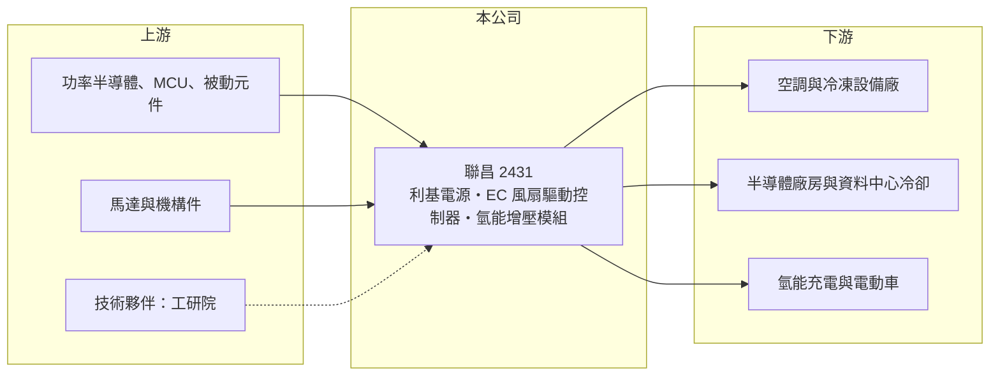

# 2431 聯昌

> 上市｜[[產業索引-電子零組件業|電子零組件業]]｜上市（櫃）日期 2000/09/11

# 第一章：企業模式與商業藍圖

> [!info] 撰寫說明
> 精簡版，由 Claude 依公開資料整理，架構比照 [[2330台積電]]，資料截至 2026-10-08。來源：證交所開放資料（基本資料、2026 年上半年財報、股利）、Goodinfo 經營績效頁、富果研究 2025 年 11 月法說會整理。公開資料有限，無營收比重。#待校對

本章說明聯昌電子（2431）的處境：傳統電源與顯示器業務大幅萎縮，公司正嘗試轉型為節能馬達驅動控制器與氫能電源的供應商。

- **核心業務：** 聯昌成立於 1968 年，是台灣歷史最久的電子公司之一。傳統產品是利基型與特殊用途[[電源供應器]]、顯示器電源，以及可升降、高更新率的特殊用途顯示器整機。這些產品過去讓公司營收超過 20 億元，但隨著客戶轉單與產品老化，2025 年營收只剩約 3.75 億元。
- **營收結構：** 公開資料沒有產品別比重。公司把重心轉向驅動控制器，應用包括飯店與醫院空調的風機盤管（FCU）控制器、半導體廠房的風機過濾單元（FFU）控制器、送風機、工業風扇馬達、水泵與冷凍設備。
- **營運據點：** 總部在台北內湖，生產據點在本次查得的資料中沒有說明（待校對）。公司與工研院合作開發新產品，並表示氫能產品已進入歐盟氫能供應鏈與印度市場。
- **長期方向：** 轉型的兩個主軸是節能與新能源。節能方面，公司與工研院合作推出 3kW 與 4.5kW 的 [[EC 風扇]]驅動控制器，已銷售到 AI 資料中心的冷卻水塔；新能源方面，開發供氫能發電機使用的 4.5kW 直流增壓模組，與台灣南部的氫能充電廠合作，準備小量生產。

# 第二章：護城河深度與競爭優勢

本章分析聯昌在轉型階段的競爭位置：技術上有基礎，但規模尚未建立。

- **競爭優勢：** 聯昌的優勢在於長年累積的電源設計能力，以及無電解電容驅動平台等核心技術。無電解電容設計搭配直流無刷馬達（[[BLDC]]），可以延長驅動器壽命，適合長時間運轉的空調與工業風扇。與工研院合作也讓公司能以較低成本取得技術來源。
- **主要對手：** 節能馬達與驅動控制器市場的主要競爭者是德國 ebm-papst、Ziehl-Abegg 等 EC 風扇大廠，以及 [[2308台達電]]、[[2421建準]] 等具馬達與電源整合能力的台廠。這些對手規模遠大於聯昌，而且已有完整的客戶與通路。
- **觀察重點：** 2025 年前三季新產品仍在推廣初期，量產未達經濟規模，毛利為負。長期要觀察驅動控制器與氫能產品能否在 2 至 3 年內做到足以覆蓋固定成本的營收規模，否則公司會持續消耗現金。

# 第三章：財務體質與盈利規模

資料日期：2026-10-08，表格是撰寫當時的快照；最新月營收、毛利率、累計 EPS 由自動排程寫在本筆記的屬性欄位（月營收、毛利率、累計EPS 等）。#待校對

本章用多年度數字呈現聯昌營收與獲利的長期下滑，以及帳上現金的緩衝。

| 年度 | 營收（億元） | [[毛利率]] | [[營業利益率]] | EPS（元） | [[ROE]] |
|---|---|---|---|---|---|
| 2020 | 23.0 | 12.7% | 1.5% | 0.42 | 3.5% |
| 2021 | 15.7 | 5.7% | -6.7% | 1.03 | 8.1% |
| 2022 | 10.0 | 5.4% | -10.0% | 0.09 | 0.7% |
| 2023 | 5.9 | -4.0% | -24.1% | -0.85 | -6.8% |
| 2024 | 4.04 | -3.0% | -28.8% | -0.63 | -5.2% |
| 2025 | 3.75 | -23.5% | -53.1% | -2.10 | -19.0% |

- **營收規模：** 2020 至 2025 年營收年複合成長率約 -30%，五年內萎縮超過八成。2026 年上半年營收約 1.21 億元，仍在縮小。
- **獲利：** 本業自 2021 年起連年虧損，2021 至 2022 年 EPS 為正是靠業外收益。2025 年毛利率 -23.5%，代表產品賣價連製造成本都不足以支付；2026 年上半年毛利率 -1.1%、營業利益率 -40%、EPS -0.32 元，虧損幅度縮小但未轉正。
- **財務特色：** 近 5 年（2021 至 2025）平均 ROE 約 -4.4%，2025 年度沒有配發股利，[[累積虧損]]約 3.0 億元。資產負債表很乾淨：2026 年第二季資產 12.0 億元中流動資產 9.1 億元，負債只有 1.2 億元，公司把部分現金轉為長期定存。證交所資料顯示股本由基本資料的約 8.07 億元增加到 2026 年第二季財報的約 11.09 億元，推估期間辦理過增資，細節待校對。
- **[[ROIC]] 與 [[WACC]]：** 2025 年營業損失約 2.0 億元（3.75 億 × -53.1%），虧損不計稅盾，以股東權益 10.8 億元計算 ROIC 約 -18%；把負債 1.2 億元也算入約 -17%（推算）。由於帳上大部分資產是現金，若只看投入營運的資本，ROIC 的負值會更深。WACC 以 [[CAPM]] 推估：無風險利率 1.75%、市場風險溢酬 6%、β 假設 1.0，公司幾乎沒有負債，WACC 約等於股東權益成本 7.75%（推算）。ROIC 遠低於 WACC，代表目前的營運在侵蝕股東價值，公司的價值主要來自帳上現金與轉型成功的可能性。

# 第四章：總體風險與地緣政治

本章整理聯昌長期要面對的風險。

- **產業週期：** 驅動控制器的需求來自空調、半導體廠房與資料中心的建置，跟著建築與資本支出週期起伏；氫能應用仍屬早期市場，政策與補貼變化會直接影響需求。
- **營運風險：** 最大風險是轉型時程拉長。新產品量產規模不足時，固定成本會持續造成虧損，帳上現金雖能支撐數年，但若持續消耗，未來可能需要再次增資，稀釋既有股東。
- **其他風險：** 小型公司在人才與研發資源上不及大廠，與工研院合作的技術也可能被其他廠商取得授權。電子零件與功率半導體的價格與供應，也會影響新產品的成本。

# 專有名詞解析

## 金融

- **[[累積虧損]]**：公司歷年虧損扣除盈餘後的負數保留盈餘，存在時通常不能配發股利。
- **[[CAPM]]**：資本資產定價模型，以無風險利率加上 β 乘以市場風險溢酬，推估股東要求的報酬率。

## 產業

- **[[電源供應器]]**：把市電轉換成設備所需電壓與電流的裝置，伺服器、網通設備與工業設備都需要。
- **[[EC 風扇]]**：以電子換向直流無刷馬達驅動的風扇，可依需求調整轉速，比傳統交流風扇省電。
- **[[BLDC]]**：直流無刷馬達，以電子電路取代電刷換向，效率高、壽命長，廣泛用於風扇、水泵與家電。

# 核心供應鏈

- 上游：功率半導體、微控制器與被動元件；馬達與機構件；工研院為技術合作夥伴。
- 下游／客戶：空調與冷凍設備廠、半導體廠房與 AI 資料中心冷卻設備、氫能充電廠，具名客戶未查得。
- 同業：ebm-papst、Ziehl-Abegg 等 EC 風扇大廠；台股 [[2308台達電]]、[[2421建準]]。

## 最新新聞
<!-- news:start -->
<!-- news:end -->

## 相關連結
- [公開資訊觀測站](https://mopsov.twse.com.tw/mops/web/t05st03?step=1&firstin=1&co_id=2431)
- [Goodinfo](https://goodinfo.tw/tw/StockDetail.asp?STOCK_ID=2431)
- [Yahoo 股市](https://tw.stock.yahoo.com/quote/2431)
- [鉅亨網新聞](https://www.cnyes.com/twstock/2431/news)
