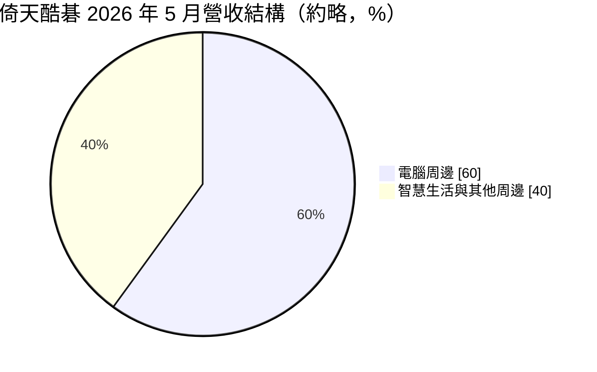
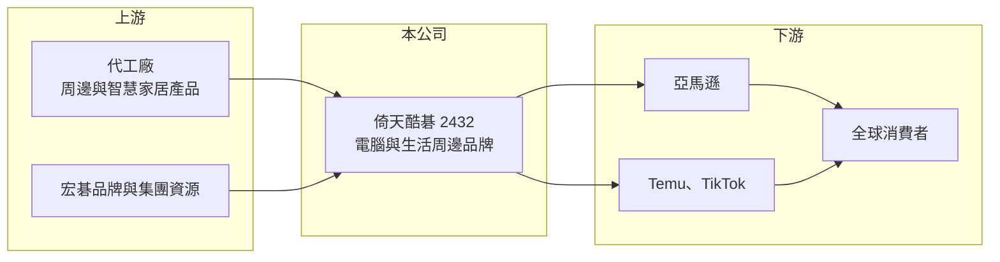

# 2432 倚天酷碁-創

> 創新板｜[[產業索引-電腦及週邊設備業|電腦及週邊設備業]]｜上市（櫃）日期 2023/05/31

# 第一章：企業模式與商業藍圖

> [!info] 撰寫說明
> 精簡版，由 Claude 依公開資料整理，架構比照 [[2330台積電]] 的四章研究，資料截至 2026-10-08。來源：Goodinfo 年度經營績效頁、經濟日報 2026 年法說會報導、證交所開放資料（基本資料、2026 年第二季資產負債與綜合損益、營益分析、股利、每月營收）。創新板／新掛牌，公開資料有限；地區別營收比重未查得。#待校對

倚天酷碁（Acer Gadget）是宏碁集團旗下專做電腦與生活周邊的品牌公司，主要透過亞馬遜等跨境電商平台銷售。本章說明它的商業模式與成長來源。

## 一、核心定位：靠跨境電商賣周邊的輕型品牌商

倚天酷碁成立於 1986 年，2023 年 5 月在證交所[[創新板]]掛牌，實收資本額約 6.2 億元，董事長由 [[2353宏碁]] 董事長陳俊聖兼任（證交所開放資料）。公司前身與早年的倚天資訊有關（待校對），目前以宏碁授權的品牌經營電腦周邊與智慧生活產品。

* **[[跨境電商]]為主要通路：** 2026 年 1 至 5 月，公司在亞馬遜、Temu、TikTok 三大平台銷售超過 300 萬台，其中亞馬遜超過 216 萬台、年增 215%（經濟日報）。公司不靠實體通路鋪貨，而是直接在電商平台上經營排名與評價。
* **[[品牌授權]]與[[輕資產]]：** 公司借用宏碁品牌的知名度，產品交由外部工廠生產，自己負責選品、設計、上架與行銷。這種模式資本支出低，但毛利率也受平台費用與價格競爭限制。

## 二、產品結構：電腦周邊為主，生活周邊為次

註：電腦周邊「超過六成」為報導描述，圓餅圖以 60% 近似。

* **電腦周邊：** USB 集線器、讀卡機、轉接線等。公司在亞馬遜的 USB Hub 市占約 15%、SD 讀卡機約 28%、USB-C 轉 HDMI 線約 10%（經濟日報）。這類產品單價低、汰換快，靠的是評價累積與上架速度。
* **智慧生活周邊：** 智慧門鎖、智慧保險箱等居家、戶外、車載與健康場景產品。公司希望未來生活周邊與電腦周邊各占一半，以降低對 PC 景氣的依賴。
* **電競掌機周邊：** 配合母公司推出電競掌機，開發相應配件。

## 三、長期方向

公司的策略是以「場景」推產品，而不是單賣一個品項，並持續擴大 Temu、TikTok 等新平台。營收從 2021 年的 14.5 億元成長到 2025 年的 32.7 億元（Goodinfo），2026 年 1 至 8 月累計營收約 31.8 億元、年增約 61%（證交所每月營收），成長動能主要來自跨境電商。

# 第二章：護城河深度與競爭優勢

周邊品牌的進入門檻不高，本章分析倚天酷碁憑什麼在電商平台上取得市占，以及哪些部分難以防守。

## 一、護城河的核心組成要素

* **宏碁品牌與集團資源：** 在電商平台上，消費者對陌生品牌的信任度低，宏碁品牌讓產品更容易被點擊與購買。集團的供應鏈與產品設計資源也能縮短開發時間。
* **電商營運能力：** 在亞馬遜取得 USB Hub 與讀卡機的高市占，代表公司已掌握平台排名、廣告投放與評價管理的方法，這種營運經驗需要時間累積。
* **輕資產結構：** 不自建工廠，產品線可以快速調整，遇到需求變化時不必背負產能折舊。

## 二、主要競爭對手

| 對手 | 定位 | 對倚天酷碁的威脅 |
|---|---|---|
| Anker（安克創新） | 全球電商周邊龍頭 | 品牌力與產品線最完整 |
| 綠聯（Ugreen） | 中國周邊與轉接線品牌 | 價格與上架速度兼具 |
| [[2365昆盈]]、[[6276安鈦克]] | 台灣周邊與電競品牌 | 部分產品線重疊 |
| 平台白牌商品 | 無品牌低價貨 | 壓低整體售價 |

## 三、守得住與守不住

* **守得住：** 已累積評價與排名的熱銷品項，以及有宏碁品牌背書的較高單價產品。
* **守不住：** 毛利率。毛利率從 2022、2023 年的 15.6% 降到 2025 年的 12.8%，2026 年上半年再降到 10.6%（Goodinfo、證交所），代表營收快速成長是靠低價與平台費用換來的。
* **觀察重點：** 智慧生活產品能否提高比重並拉高毛利率，以及營業利益率能否維持在 3% 以上。

# 第三章：財務體質與盈利規模

資料日期：2026-10-08，表格是撰寫當時的快照；最新月營收、毛利率、累計 EPS 由自動排程寫在本筆記的屬性欄位（月營收、毛利率、累計EPS 等）。#待校對

本章用多年度數據檢視倚天酷碁「營收成長、利潤率下滑」的特性。

## 一、多年度三率與 ROE

| 年度 | 營收（新台幣） | [[毛利率]] | [[營業利益率]] | EPS（元） | [[ROE]] |
|---|---|---|---|---|---|
| 2021 | 14.5 億 | 15.3% | 2.95% | 0.94 | 7.17% |
| 2022 | 16.6 億 | 15.6% | 5.65% | 3.04 | 18.3% |
| 2023 | 20.9 億 | 15.6% | 5.18% | 1.98 | 10.4% |
| 2024 | 26.1 億 | 13.2% | 4.38% | 1.88 | 9.23% |
| 2025 | 32.7 億 | 12.8% | 3.89% | 1.88 | 9.51% |
| 2026 上半年 | 22.5 億 | 10.62% | 1.72% | 0.82 | 未查得 |

註：2021 至 2025 年取自 Goodinfo（Goodinfo 頁面本身提示 2020、2021 年部分數字無法互相勾稽）；2026 上半年取自證交所營益分析與綜合損益。

* **營收穩定高成長：** 2021 至 2025 年營收年複合成長率約 22.5%（推算），是周邊產業中少見的成長速度。
* **利潤率逐年變薄：** 營業利益率從 5% 以上降到 2026 年上半年的 1.7%，EPS 停在 2 元上下，顯示營收成長沒有轉化成等比例的獲利。
* **ROE 約一成：** 2021 至 2025 年平均 ROE 約 10.9%（推算），主要靠資產周轉率而非利潤率支撐。

## 二、股利與財務結構

2025 年度配發每股 1.70 元，其中盈餘配發約 0.67 元、資本公積配發約 1.03 元（證交所股利資料），以 EPS 1.88 元計算總配發率約 90%（推算），但有六成來自資本公積，不代表盈餘本身足以支撐。2026 年第二季底總資產約 19.6 億元、總負債約 8.0 億元（幾乎全為流動負債）、權益約 11.6 億元，每股淨值 18.81 元（證交所資產負債）。

## 三、[[ROIC]] 與 [[WACC]]

**ROIC 推算：** 2025 年營業利益約 32.7 億 × 3.89% ≈ 1.27 億元，稅後約 1.02 億元。有息負債未查得，假設總負債 7.97 億元的一半約 4.0 億元為有息負債（實際可能更低，因負債多為應付帳款），加上權益 11.6 億元，投入資本約 15.6 億元，ROIC 約 6.5%（推算）。

**WACC 推算：** 台灣 10 年期公債 1.75%、市場風險溢酬 6%、β 取消費電子同業常見值 0.9，權益成本約 7.2%；負債成本 3%、稅率 20%，權益占比約 74%，WACC 約 5.9%（推算）。

**結論：** ROIC 略高於 WACC，利差很薄。輕資產模式讓投入資本不大，但利潤率持續下滑，若營業利益率再往下掉，就會跌到資金成本以下。長期能否創造價值，關鍵在毛利率能否止跌。

# 第四章：總體風險與地緣政治

本章整理倚天酷碁長期面對的平台、競爭與總體風險。

## 一、產業週期

* **PC 周邊與 PC 景氣連動：** 電腦周邊仍占六成以上，PC 換機潮或衰退期會直接影響需求。開學季、Prime Day 等節慶也造成明顯季節性。
* **消費性需求：** 智慧生活產品屬可延後消費，景氣轉弱時容易被削減。

## 二、營運風險

* **平台依賴：** 營收高度依賴亞馬遜，平台演算法、手續費或規則調整，都可能讓排名與獲利瞬間改變。
* **價格競爭：** 中國周邊品牌與白牌商品上架速度快、成本低，持續壓縮毛利率。
* **品牌授權關係：** 公司使用宏碁品牌，授權條件若改變會影響經營（授權細節未查得）。

## 三、其他風險

* **美國關稅：** 產品多在海外生產、銷往美國，美國關稅會提高成本或壓縮售價。
* **匯率：** 以美元銷售為主，新台幣升值會壓低營收與毛利。

# 專有名詞解析

## 金融

- **[[創新板]]**：證交所 2021 年設立的板塊，讓尚未獲利但具技術或創新能力的公司掛牌，初期限合格投資人交易。
- **[[ROIC]]**：投入資本報酬率，衡量企業用股東與債權人投入的資本，每年能產生多少稅後營業利益。
- **[[WACC]]**：加權平均資金成本，股東要求報酬與負債利息依資本結構加權後的平均值，是判斷是否創造價值的門檻。

## 產業

- **[[跨境電商]]**：品牌商透過亞馬遜等國際電商平台，直接把商品賣給海外消費者的銷售模式。
- **[[品牌授權]]**：品牌擁有者允許其他公司在特定產品上使用其品牌，被授權方通常支付權利金或依集團協議使用。
- **[[輕資產]]**：企業不自建大量廠房設備，把生產外包，專注在設計、品牌與銷售的經營模式。

# 核心供應鏈

- 上游：周邊與智慧家居產品的代工廠（多數在中國與東南亞，推估）；品牌與集團資源來自 [[2353宏碁]]。
- 下游／客戶：亞馬遜、Temu、TikTok 等電商平台，最終使用者為全球消費者。
- 同業：Anker、綠聯、[[2365昆盈]]、[[6276安鈦克]]。
- 集團：[[2353宏碁]]、[[6908宏碁遊戲-創]]、[[6811宏碁資訊]]。

## 最新新聞
<!-- news:start -->
<!-- news:end -->

## 相關連結
- [公開資訊觀測站](https://mopsov.twse.com.tw/mops/web/t05st03?step=1&firstin=1&co_id=2432)
- [Goodinfo](https://goodinfo.tw/tw/StockDetail.asp?STOCK_ID=2432)
- [Yahoo 股市](https://tw.stock.yahoo.com/quote/2432)
- [鉅亨網新聞](https://www.cnyes.com/twstock/2432/news)
