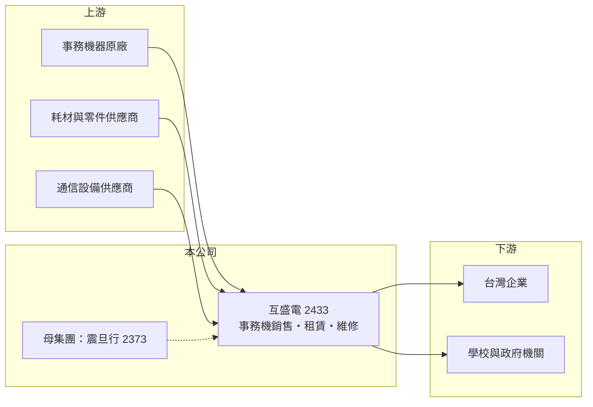

# 2433 互盛電

> 上市｜[[產業索引-其他電子業|其他電子業]]｜上市（櫃）日期 2000/09/11

# 第一章：企業模式與商業藍圖

> [!info] 撰寫說明
> 精簡版，由 Claude 依公開資料整理，架構比照 [[2330台積電]]，資料截至 2026-10-08。來源：證交所開放資料快照（基本資料、2026 年第二季資產負債與損益、股利）、Goodinfo 經營績效頁、nStock 與 MoneyLink 公司基本資料。公開資料有限，代理品牌與產品比重未查得。#待校對

互盛電是震旦集團旗下的[[事務機器]]服務公司，以影印機、多功能事務機的銷售、租賃與維修為主。它是一家典型的「成熟市場收租型」企業：市場本身不成長，但長期合約帶來穩定現金流，公司把大部分盈餘以現金股利發還股東。

- **核心業務：** 互盛電成立於 1984 年、2000 年上市，總部在台北信義區。登記業務包括影印機、傳真機等事務機器的買賣、進出口、出租與維修，另有電子零組件買賣與通信傳輸設備的銷售與工程承包。大股東 [[2373震旦行]] 與震旦國際合計持股約六成。
- **營收結構：** 產品別與銷售、租賃的比重公開資料未查得。毛利率長年在 32% 至 36%，且逐年上升，遠高於一般設備經銷商，可推知[[租賃服務]]與維修合約占有相當比重（推估），而一次性的設備銷售比重逐漸下降。
- **營運據點：** 以台灣市場為主，服務對象為企業、學校與政府機關（推估）。事務機的維修需要技術人員定期到府，服務網的覆蓋密度決定能服務多少客戶。
- **長期方向：** 在紙本列印需求下滑的環境中，公司的策略重點是守住租賃與維修客戶基礎、提高服務毛利，並維持穩定配息，而不是追求營收成長。這種經營方式更接近現金流型的公用事業，而非成長型企業。

# 第二章：護城河深度與競爭優勢

互盛電的護城河來自集團通路與長期服務合約，但所處市場長期萎縮，護城河在變窄。

- **競爭優勢：** 事務機租賃合約通常數年一約，到期後客戶多半續約或換新機，轉換供應商需要重新議約與教育訓練，因此收入可預測性高。依附震旦集團的品牌、通路與客戶基礎，也讓互盛電在台灣企業客戶中有穩定的接觸面。毛利率由 2021 年的 26.8% 升到 2025 年的 36.0%，顯示公司在縮小規模的同時改善了收入品質。
- **主要對手：** 台灣各事務機品牌的直營與經銷體系，例如富士軟片商業創新、理光、佳能、京瓷等（推估）；集團內的震旦行也經營 OA 業務，兩者的分工未查得。
- **觀察重點：** 營收由 2019 年的 43.2 億元降到 2025 年的 27.2 億元，需要觀察下滑是否趨緩；同時追蹤毛利率能否維持 35% 上下、營業利益率能否守住 15%，這兩個數字決定配息能力。

# 第三章：財務體質與盈利規模

資料日期：2026-10-08，表格是撰寫當時的快照；最新月營收、毛利率、累計 EPS 由自動排程寫在本筆記的屬性欄位（月營收、毛利率、累計EPS 等）。#待校對

互盛電的財務是「營收萎縮、利潤率提升、ROE 穩定、高配息」的組合，是成熟型企業的教科書樣貌。

| 年度 | 營收（億元） | [[毛利率]] | [[營業利益率]] | EPS（元） | [[ROE]] |
|---|---|---|---|---|---|
| 2019 | 43.2 | 31.9% | 13.8% | 4.24 | 13.4% |
| 2020 | 40.5 | 31.6% | 12.5% | 3.93 | 12.3% |
| 2021 | 38.8 | 26.8% | 11.6% | 3.80 | 11.7% |
| 2022 | 31.9 | 32.3% | 14.8% | 3.88 | 12.3% |
| 2023 | 28.9 | 34.3% | 15.2% | 3.39 | 11.1% |
| 2024 | 27.6 | 35.5% | 15.8% | 3.28 | 11.1% |
| 2025 | 27.2 | 36.0% | 15.2% | 3.05 | 10.9% |

（來源：Goodinfo 經營績效頁。2026 年上半年依證交所資料：營收 13.7 億元、毛利率 35.7%、營業利益率 14.2%、EPS 1.06 元。）

- **營收規模：** 2019 至 2025 年營收年複合成長率約 -7.4%（推算），六年間減少約三分之一，反映辦公列印市場的結構性萎縮。但營業利益率維持在 11.6% 至 15.8%，EPS 只從 4.24 元降到 3.05 元，降幅遠小於營收。
- **獲利：** 近五年（2021 至 2025）平均 ROE 約 11.4%（推算），每年都在 10.9% 至 12.3% 之間，穩定度極高。這種穩定來自租賃與維修合約的經常性收入，以及隨營收縮減而同步調整的成本結構。
- **財務特色：** 2026 年第二季總資產約 74.6 億元、負債 34.0 億元（非流動負債 9.4 億元）、權益總計 40.6 億元，歸屬母公司權益 32.6 億元。租賃事業需要先購入設備，因此資產比一般經銷商重。2025 年度配發現金股利 2.7 元，以 EPS 3.05 元計算配息率約 89%（推算）；Goodinfo 統計的歷年平均現金殖利率約 6.2%，屬高殖利率股。自由現金流是否長期為正未查得，但長期高配息推估有現金流支撐。
- **[[ROIC]] 與 [[WACC]]：** 以 2025 年營業利益約 4.1 億元（27.2 億元 × 15.2%）、稅率 20% 計算，稅後營業利益約 3.3 億元，以權益總計 40.6 億元到權益加全部負債 74.6 億元為投入資本，ROIC 約 4.4% 至 8.1%（推算），實際值推估約 6% 至 7%。WACC 以 [[CAPM]] 推估：無風險利率 1.75%、市場風險溢酬 6%、β 假設 0.6（集團持股集中、波動低的服務股常見值），權益成本約 5.35%；稅後負債成本假設 2%、負債占兩成，WACC 約 4.7%（推算）。ROIC 穩定高於 WACC，代表互盛電雖然不成長，仍持續創造小幅的經濟價值，適合以現金流與配息角度評價。

# 第四章：總體風險與地緣政治

互盛電的風險主要來自辦公列印需求的長期萎縮，以及對集團與原廠的依賴。

- **產業週期：** 企業數位化、雲端協作與無紙化使列印量逐年下降，事務機的換機需求與耗材收入長期縮減。景氣差時企業延後換機，但租賃合約可以緩衝短期衝擊。
- **營運風險：** 營收集中在台灣，市場飽和且品牌通路之間價格競爭激烈；若原廠調整代理或改為直營，或集團內部業務分工改變，對營運影響大。營收持續下滑時，固定的維修人力會逐漸壓縮利潤率。
- **其他風險：** 進口設備以日圓或美元計價，匯率影響進貨成本；集團持股約六成，流通在外股數少、股票流動性偏低。

# 專有名詞解析

## 金融

- **[[殖利率]]**：每年現金股利除以股價，代表以現價買進後每年可領回的股利比例。
- **[[CAPM]]**：資本資產定價模型，以無風險利率加上 β 乘以市場風險溢酬估算股東要求報酬率。

## 產業

- **[[事務機器]]**：影印機、印表機、傳真機與多功能事務機等辦公文件處理設備的統稱。
- **[[租賃服務]]**：設備由業者持有、客戶按月付費使用，費用通常包含維修與耗材，業者因此取得長期經常性收入。

# 核心供應鏈

- 上游：事務機器原廠、耗材與零件供應商、通信傳輸設備供應商（具體品牌未查得）。
- 下游／客戶：台灣企業、學校與政府機關（推估）。
- 同業：富士軟片商業創新、理光、佳能、京瓷等事務機品牌通路（推估）；集團母公司 [[2373震旦行]]。

## 最新新聞
<!-- news:start -->
<!-- news:end -->

## 相關連結
- [公開資訊觀測站](https://mopsov.twse.com.tw/mops/web/t05st03?step=1&firstin=1&co_id=2433)
- [Goodinfo](https://goodinfo.tw/tw/StockDetail.asp?STOCK_ID=2433)
- [Yahoo 股市](https://tw.stock.yahoo.com/quote/2433)
- [鉅亨網新聞](https://www.cnyes.com/twstock/2433/news)
