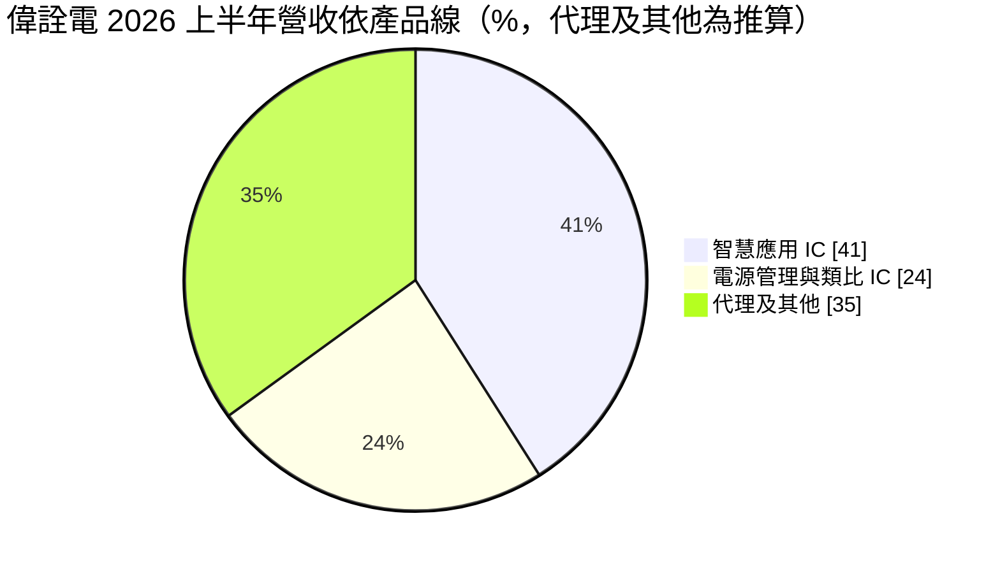
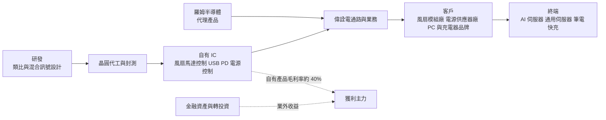
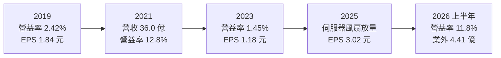
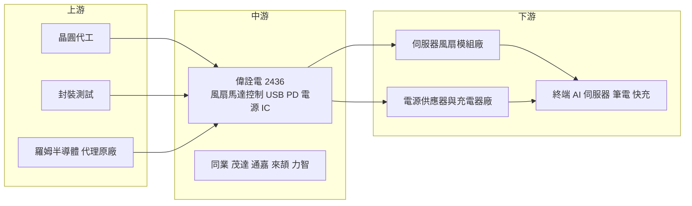

# 2436 偉詮電

> 上市｜[[產業索引-半導體業|半導體業]]｜上市（櫃）日期 2000/09/11

# 第一章：企業模式與商業藍圖

> [!info] 撰寫說明
> 本文由 Claude 依公開資料整理，架構比照 [[2330台積電]] 的四章研究，資料截至 2026-10-08。財務數字來源：證交所開放資料快照（基本資料、2026 年第二季資產負債與綜合損益、股利）、Goodinfo 經營績效頁與股利政策頁（2016 至 2025 年）、MoneyDJ 季資產負債表（2026 年第二季借款、現金與金融資產科目）、poorstock 2026 年 8 月 25 日法說會整理（產品線營收）、2025 年 12 月財經報導（伺服器風扇馬達 IC 市占、自有產品毛利率）；業外收益的具體來源、代理業務的起始年代係推估或憑記憶整理，尚未逐條比對原始文件。#待校對

在評估一家公司的長期投資價值時，第一步是看懂它靠什麼賺錢、為什麼能一直賺下去。本章針對偉詮電子（股票代號：2436，以下簡稱偉詮電）的商業模式進行定性分析，說明這家以電源控制與 USB 快充晶片為主的類比 IC 設計公司，如何在消費性電源市場被中國業者壓縮之後，靠伺服器散熱風扇的馬達控制 IC 找到新的成長引擎，以及為什麼它的帳面獲利經常明顯高於本業。

## 一、核心定位：混合訊號 IC 設計加上代理通路

偉詮電成立於 1989 年，2000 年在台灣證交所上市，總部位於新竹科學園區，董事長為林錫銘、總經理為林登信，實收資本額約 20.42 億元。偉詮電研發與銷售數位、類比與[[混合訊號IC]]，屬於 [[Fabless]] 公司，自己不擁有晶圓廠，製造委外給晶圓代工與封測廠。

偉詮電和多數 IC 設計公司最大的不同，是它同時經營一塊規模不小的代理業務，代理日本羅姆（ROHM）半導體的產品（代理起始年代待校對）。因此偉詮電的營收由兩種性質不同的生意組成：

- **自有 IC：** 包括電源管理與類比 IC（電源供應器與充電器的控制晶片、[[USB PD]] 快充協定晶片），以及智慧應用 IC（以伺服器散熱風扇的馬達控制 IC 為主）。依 2025 年 12 月財經報導，自有產品毛利率約 40%，是偉詮電獲利的主要來源。
- **代理業務：** 代理羅姆半導體的被動與主動元件，營收穩定但毛利率較低。代理業務的價值在於擴大客戶接觸面，讓偉詮電能接觸到更多系統廠，再順勢推廣自有 IC（推估）。

這個「自有 IC 加代理」的結構，決定了偉詮電的毛利率會隨產品組合變動：自有 IC 比重高時毛利率上升，代理比重高時毛利率下降。

## 二、終端應用／產品板塊：智慧應用成為最大引擎

依 2026 年 8 月 25 日法說會，2026 年上半年營收 22.07 億元，其中智慧應用 IC 約 9.07 億元、電源管理與類比 IC 約 5.34 億元，其餘為代理及其他（以總營收扣除推算）：

- **智慧應用 IC（約 41%）：** 以伺服器散熱風扇的馬達控制 IC 為核心，應用包括 GPU 型與 ASIC 型 [[AI伺服器]]與通用伺服器。依 2025 年 12 月報導，偉詮電在伺服器散熱風扇馬達驅動 IC 的市占率超過三成。AI 伺服器的功耗遠高於傳統伺服器，每台需要更多、轉速更高的風扇，這是偉詮電近年最重要的成長來源。偉詮電也推出漏液偵測 IC，對應[[液冷]]伺服器的需求。
- **電源管理與類比 IC（約 24%）：** 包括電源供應器與充電器的控制晶片，以及 USB PD 快充協定晶片。USB PD 產品線已從供電端（充電器）跨入受電端（筆電與裝置），並取得 [[AMD超微]] 平台認證。這塊業務是偉詮電的傳統本業，但面對中國業者的低價競爭，成長動能較弱。
- **代理及其他（約 35%，推算）：** 以羅姆半導體產品代理為主，營收穩定，提供偉詮電基本的營收規模與客戶網路。

## 三、資本轉化邏輯：自有 IC 拉高毛利、代理穩定營收

偉詮電的資本循環可以從三個面向理解。

- **產品組合決定毛利率：** 2016 至 2025 年偉詮電的[[毛利率]]在 24.5% 到 30.7% 之間，2026 年上半年升到 32.3%。毛利率逐步上升的原因，是毛利較高的伺服器風扇馬達 IC 比重提高。代理業務拉低了整體毛利率，但也讓營收規模比純 IC 設計公司穩定。
- **營業利益率偏薄，研發費用持續墊高：** 偉詮電的[[營業利益率]]長期在 1.5% 到 12.8% 之間，多數年份落在個位數。類比 IC 需要長時間累積設計經驗與客戶驗證，研發與業務費用相對固定；2026 年上半年營業費用年增 42%，說明公司正為伺服器與 USB PD 新產品擴大投入。
- **業外收益經常大於本業：** 偉詮電帳上持有相當規模的金融資產。依 MoneyDJ，2026 年第二季金融資產（流動與非流動）約 19.1 億元，現金約 14.9 億元。2026 年上半年營業利益 2.60 億元，業外收入卻達 4.41 億元，歸屬母公司淨利 5.97 億元（證交所資料）；2025 年淨利率 15.8% 也遠高於營業利益率 6.69%。業外收益推估主要來自金融資產的評價與處分利益，這類收益不具持續性，評估本業時應以營業利益為準。

## 四、企業長期藍圖：資料中心散熱、液冷與車用

- **資料中心散熱升級：** 法說會表示，長期成長來自資料中心升級、液冷需求擴大與車用電子。AI 伺服器的功耗與散熱需求逐代提高，風扇的數量、轉速與控制精度要求也同步提升，這讓馬達控制 IC 從低價零件變成影響系統可靠度的關鍵元件。
- **從氣冷延伸到液冷：** 液冷是 AI 伺服器散熱的長期趨勢，可能減少部分風扇用量，但液冷系統需要泵浦、流量控制與漏液偵測。偉詮電以漏液偵測 IC 卡位液冷市場，依法說會整理，其平均售價比一般風扇 IC 高約 20%。
- **USB PD 往受電端與 PC 平台延伸：** 取得 AMD 平台認證後，USB PD 產品可以打入筆電與 AI PC 供應鏈。USB 規格持續往更高功率演進，每一代都需要重新驗證，已在平台認證名單上的廠商較有優勢。
- **車用電子：** 法說會把車用列為長期方向之一，但目前未揭露具體營收比重。車用需要長時間的認證，短期內對營收的貢獻有限。

# 第二章：護城河深度與競爭優勢

在長期價值投資中，「護城河」指企業抵禦競爭、長期維持超額利潤的保護機制。本章分析偉詮電的競爭優勢、國內外主要對手，以及這些優勢在 AI 伺服器與快充市場能守住多少。

## 一、偉詮電護城河的核心組成要素

偉詮電的護城河屬於「窄但正在加深」：傳統電源控制 IC 的優勢已被中國業者削弱，但在伺服器風扇馬達控制 IC 建立了新的利基。主要由三個要素構成：

- **1. 伺服器風扇馬達控制的驗證與市占：** 伺服器風扇需要長時間高轉速運轉，馬達控制 IC 的可靠度直接影響整台伺服器的散熱與穩定性。一旦通過風扇模組廠與伺服器品牌的驗證，客戶很少為了小幅價差更換供應商。偉詮電在這個市場市占率超過三成，已經累積了驗證優勢。
- **2. USB PD 協定與平台認證：** USB PD 晶片需要通過 USB-IF 與平台廠的相容性認證，取得 AMD 平台認證代表偉詮電跨過了進入 PC 平台的門檻。協定晶片的軟體與相容性經驗需要長期累積，這是新進者短期內難以追上的部分。
- **3. 代理加自有的通路綜效：** 代理羅姆產品讓偉詮電接觸到更多系統廠與模組廠，可以順勢推廣自有 IC，這是純 IC 設計公司沒有的通路優勢（推估）。

## 二、全球主要競爭對手格局

| 對手 | 定位 | 對偉詮電的影響 |
|---|---|---|
| [[6138茂達]] | 電源管理與馬達驅動 IC | 在風扇馬達驅動 IC 是主要對手，產品線與客戶高度重疊 |
| [[3588通嘉]]、[[6799來頡]] | 電源控制與 USB PD 晶片 | 在快充與電源控制 IC 直接競爭 |
| [[6719力智]] | 電源管理 IC | 在部分電源管理產品競爭 |
| 德州儀器、英飛凌、安森美 | 國際類比大廠 | 產品線完整，可整包提供伺服器電源與控制方案，議價能力強 |
| 中國類比 IC 業者 | 報價低、產能大 | 搶食充電器與消費性電源控制 IC，是電源管理產品線成長停滯的主因 |

## 三、優勢轉化：哪些守得住、哪些守不住

- **守得住：** AI 伺服器與通用伺服器的風扇馬達控制 IC，以及液冷相關的漏液偵測 IC。這些產品重視可靠度與長期供貨，價格不是唯一考量，偉詮電可以維持較高的毛利率。
- **守不住：** 一般消費性充電器的電源控制 IC。中國業者報價低、產品同質化，2026 年上半年電源管理與類比 IC 營收年減 8%，說明這塊傳統業務已失去成長動能。
- **觀察重點：** 長期可以追蹤三件事。第一是伺服器散熱相關 IC 的市占率能否維持在三成以上，特別是在液冷普及後，偉詮電能否從風扇控制延伸到液冷控制；第二是 USB PD 受電端產品能否在 PC 平台放量；第三是營業利益率能否穩定站上雙位數，讓獲利不再依賴業外收益。

# 第三章：財務體質與盈利規模

資料日期：2026-10-08。數字取自 Goodinfo 經營績效頁與股利政策頁、證交所開放資料快照與 MoneyDJ 季資產負債表，表格是撰寫當時的快照；最新月營收、毛利率、累計 EPS 由自動排程寫在本筆記的屬性欄位（月營收、毛利率、累計EPS 等）。#待校對

財務報表是檢驗護城河是否真實存在的最終標準。本章用多年度的三率、ROE、現金流與資本報酬，檢視偉詮電的獲利品質，並把本業與業外分開看。

## 一、獲利能力的基石：三率

| 年度 | 營收（億元） | [[毛利率]] | [[營業利益率]] | EPS（元） | [[ROE]] |
|---|---|---|---|---|---|
| 2019 | 23.2 | 24.8% | 2.42% | 1.84 | 11.1% |
| 2020 | 26.2 | 25.4% | 4.82% | 1.94 | 11.1% |
| 2021 | 36.0 | 30.7% | 12.8% | 4.25 | 21.9% |
| 2022 | 28.9 | 29.2% | 8.43% | 0.83 | 2.9% |
| 2023 | 28.9 | 27.1% | 1.45% | 1.18 | 5.3% |
| 2024 | 30.9 | 29.8% | 5.3% | 1.57 | 7.36% |
| 2025 | 35.7 | 29.9% | 6.69% | 3.02 | 13.9% |

（來源：Goodinfo 經營績效頁，合併報表。2026 年上半年依證交所資料，營收 22.07 億元、毛利率 32.3%、營業利益率 11.8%、EPS 3.02 元。）

- **毛利率穩步上升：** 2019 年毛利率 24.8%，2025 年 29.9%，2026 年上半年 32.3%。這個趨勢反映產品組合從消費性電源控制轉向伺服器風扇馬達 IC，是偉詮電轉型最清楚的財務證據。
- **營業利益率波動大：** 2021 年在疫情帶動的 PC 與快充需求下，營業利益率達 12.8%；2023 年消費性電子庫存調整，營業利益率降到 1.45%。2024 年起伺服器需求成長，營業利益率逐步回升，2026 年上半年回到 11.8%。
- **EPS 常被業外放大：** 2019、2020 與 2025 年的淨利率都遠高於營業利益率，代表業外收益占獲利相當比重。2022 年營業利益率 8.43%，EPS 卻只有 0.83 元，推估是當年金融資產評價損失所致。業外收益讓偉詮電的 EPS 比本業波動更大。
- **營收溫和成長：** 2020 至 2025 年營收年複合成長率約 6.4%（推算），2026 年 1 至 8 月累計營收年增約 30%，成長主要來自智慧應用 IC。

## 二、[[ROE]]：資本效率

2021 至 2025 年偉詮電的平均 ROE 約 10.3%（推算），但年度間差距很大，從 2022 年的 2.9% 到 2021 年的 21.9%。ROE 的波動主要來自業外收益，而不是本業。依證交所資料，2026 年第二季權益總計約 48.1 億元，每股淨值約 23.82 元。偉詮電帳上的現金與金融資產合計約 34 億元（MoneyDJ），約占權益的七成，這些資產的報酬率決定了業外收益，也讓 ROE 更像是「本業加上一個投資組合」的綜合結果。

## 三、資本支出、自由現金流與股利

- **[[CapEx]]：** 偉詮電沒有晶圓廠，資本支出主要是研發設備與辦公設施，規模小，具體金額未查得。
- **[[自由現金流]]：** 多年度自由現金流數字未查得。由於資本支出低，自由現金流大致跟著營業利益與營運資金變化（推估）；代理業務需要備貨，景氣轉換時存貨與應收帳款的變化可能讓單年度現金流明顯波動。
- **有息負債：** 依 MoneyDJ，2026 年第二季有一年內到期長期負債約 8.70 億元（性質未查得，可能為公司債或可轉債，待校對），另有租賃負債約 0.32 億元，短期借款為零。
- **股利穩定度：** 依 Goodinfo 股利政策頁，偉詮電 2016 年度以來每年都配發現金股利，金額從 2016 年度的 0.5 元逐步提高，2021 年度 3 元為最高，2022 至 2025 年度分別約為 1.2、1.21、1.5 與 1.96 元。2025 年度證交所資料顯示每股 2 元，Goodinfo 列為 1.957 元，推估為股數變動後的調整。以各年度 EPS 計算，2021 至 2025 年度的配發率約在 65% 到 145% 之間（推算），偉詮電傾向維持穩定的現金股利，即使獲利低的年份也會以較高配發率發放。

## 四、[[ROIC]] 與 [[WACC]]：價值創造利差

- **ROIC（推算）：** 以 2025 年營收 35.7 億元乘以營業利益率 6.69%，營業利益約 2.39 億元，扣除 20% 稅率後稅後營業利益約 1.91 億元。投入資本以 2026 年第二季權益總計約 48.1 億元，加上有息負債約 9.02 億元（一年內到期長期負債 8.70 億、租賃負債 0.32 億，MoneyDJ），合計約 57.1 億元，ROIC 約 3.3%（推算）。以 2026 年上半年營業利益 2.60 億元年化約 5.2 億元、稅後約 4.16 億元計算，ROIC 約 7.3%（推算）。
- **WACC（推算）：** 以 [[CAPM]] 估算股東權益成本：無風險利率取台灣 10 年期公債約 1.75%，市場風險溢酬 6%，β 假設 1.0（台灣中小型類比 IC 設計股常見值，未查得偉詮電實際數字），權益成本約 7.75%。稅前負債成本假設 2.5%、稅率 20%，稅後約 2.0%。以帳面價值計算，負債占投入資本約 16%、權益約 84%，WACC 約 6.8%（推算）。
- **價值創造判斷：** 以 2025 年本業計算，偉詮電的 ROIC 約 3.3%，低於約 6.8% 的資金成本；2026 年上半年隨伺服器業務放量，年化 ROIC 約 7.3%，剛好與 WACC 相近。這代表偉詮電本業過去多數年份並未創造超額價值，帳面上看起來不錯的 ROE 有相當部分來自業外。若投入資本扣除與本業無關的現金與金融資產，本業的實際資本報酬會明顯較高（推估），因此真正的關鍵是伺服器散熱 IC 能否讓營業利益率長期維持在雙位數，使 ROIC 穩定超過 WACC。

# 第四章：總體風險與地緣政治

任何企業都無法脫離宏觀環境獨立存在。本章分析偉詮電未來必須面對的地緣政治、產業週期、營運與技術風險。

## 一、地緣政治風險

- **AI 伺服器出口管制：** 偉詮電的成長高度依賴 AI 伺服器，美國對高階 AI 晶片與伺服器的出口管制，可能影響部分伺服器的出貨地區與數量，間接影響風扇與馬達控制 IC 的需求。
- **伺服器組裝地轉移：** 伺服器組裝廠逐步移往美國、墨西哥與東南亞，風扇模組與 IC 供應商需要配合新的交貨地點與認證，增加營運成本。
- **中國市場的本土替代：** 充電器與消費性電源大多在中國生產，中國推動本土 IC 替代，會持續壓縮偉詮電在消費性電源控制 IC 的市場。

## 二、產業週期與市場結構風險

- **AI 資本支出週期：** 偉詮電目前最大的成長引擎與雲端業者的 AI 資本支出高度相關。若 AI 投資在某段期間放緩，伺服器出貨與散熱需求會同步下滑。
- **消費性電子週期：** USB PD 與電源控制 IC 依賴筆電、手機與充電器的換機週期，2023 年營業利益率降到 1.45%，就是消費性電子庫存調整的結果。
- **[[長鞭效應]]：** 伺服器零組件在缺貨時客戶會超額下單，需求反轉時庫存調整會被放大，馬達控制 IC 這類小零件的訂單波動往往比終端出貨更劇烈。

## 三、營運環境的隱性風險

- **業外收益的不確定性：** 偉詮電的獲利有相當比例來自業外，金融市場下跌時可能出現評價損失，讓 EPS 與本業表現脫節。
- **費用成長快於營收：** 2026 年上半年營業費用年增 42%，若營收成長放緩而費用持續墊高，營業利益率會快速下降。
- **代理權的依賴：** 代理業務依賴與羅姆半導體的長期合作，若代理條件改變或原廠調整通路策略，偉詮電約三成多的營收會受到影響。

## 四、科技或法規演進風險

- **液冷取代氣冷：** AI 伺服器逐步導入液冷，若液冷大幅取代風扇，馬達控制 IC 的需求可能減少。偉詮電以漏液偵測 IC 卡位液冷，能否在液冷系統中取得與風扇控制相當的市占，是長期最重要的技術課題。
- **USB 規格演進：** USB PD 新版規格持續提高功率與協定複雜度，偉詮電需要持續投入研發才能維持認證與相容性。
- **能效法規：** 各國對電源供應器與充電器的能效要求逐步提高，電源控制 IC 需要配合新的規範設計，這既是新產品機會，也增加研發負擔。

# 專有名詞解析

## 半導體

- **[[混合訊號IC]]**：同時處理類比訊號與數位訊號的積體電路，常見於電源管理、馬達控制與感測應用。
- **[[Fabless]]**：無晶圓廠的 IC 設計公司，只負責設計，製造委外給晶圓代工廠。
- **[[USB PD]]**：USB 電力傳輸協定，讓充電器與裝置協商電壓與電流，實現大功率快充。

## 應用

- **[[AI伺服器]]**：搭載 GPU 或 AI 加速晶片、專門執行 AI 訓練與推論的伺服器，功耗與散熱需求遠高於一般伺服器。
- **[[液冷]]**：以液體帶走伺服器晶片熱量的散熱方式，散熱效率高於風扇氣冷，逐步用於高功耗 AI 伺服器。

## 金融

- **[[業外收益]]**：本業以外的收入，例如投資處分利益、金融資產評價或股利收入，通常不具持續性。
- **[[營業利益率]]**：營業利益占營收的比例，反映扣除營業費用後本業的獲利能力。
- **[[ROIC]]**：投入資本報酬率，稅後營業利益除以股東權益加有息負債，衡量本業運用資本的效率。
- **[[WACC]]**：加權平均資金成本，依股東權益與負債的比重，加權計算公司取得資金的平均成本。
- **[[CAPM]]**：資本資產定價模型，以無風險利率加上 β 乘以市場風險溢酬估算股東要求報酬率。
- **[[長鞭效應]]**：終端需求的小幅變動，沿供應鏈往上游傳遞時被逐級放大，造成上游庫存與訂單劇烈波動。

## 產業

- **[[代理商]]**：代理原廠產品、負責銷售與技術支援的通路商，毛利率通常低於自有產品。

# 核心供應鏈

## 1. 上游：晶圓代工、封測與代理原廠
- 晶圓代工與封測：供應商未揭露
- 代理原廠：羅姆半導體（ROHM）

## 2. 中游：偉詮電本身與同業
- 馬達驅動與電源管理：[[6138茂達]]、[[6719力智]]
- 電源控制與 USB PD：[[3588通嘉]]、[[6799來頡]]
- 國際類比大廠：德州儀器、英飛凌、安森美

## 3. 下游：模組與系統客戶
- 伺服器風扇與散熱模組廠：[[2421建準]]、[[3017奇鋐]]、[[3324雙鴻]]（推估，未查得實際採購關係）
- 電源供應器廠：[[2308台達電]]、[[2301光寶科]]（推估，未查得實際採購關係）
- 處理器平台：[[AMD超微]]（USB PD 平台認證）

## 4. 下游：終端應用
- AI 伺服器與通用伺服器：[[NVDA輝達]] 機櫃平台相關供應鏈、雲端業者
- 筆電、AI PC 與快充充電器品牌

## 最新新聞
<!-- news:start（自動產生，請勿手動編輯此範圍） -->
- 2026-10-05 📰 媒體 17:50｜營收速報 - 偉詮電(2436)9月營收4.13億元年增率高達32.29％｜[鉅亨網](https://news.cnyes.com/news/id/6621837)

完整紀錄：[[2436偉詮電 新聞]]
<!-- news:end -->

## 相關連結
- [公開資訊觀測站](https://mopsov.twse.com.tw/mops/web/t05st03?step=1&firstin=1&co_id=2436)
- [Goodinfo](https://goodinfo.tw/tw/StockDetail.asp?STOCK_ID=2436)
- [Yahoo 股市](https://tw.stock.yahoo.com/quote/2436)
- [鉅亨網新聞](https://www.cnyes.com/twstock/2436/news)
