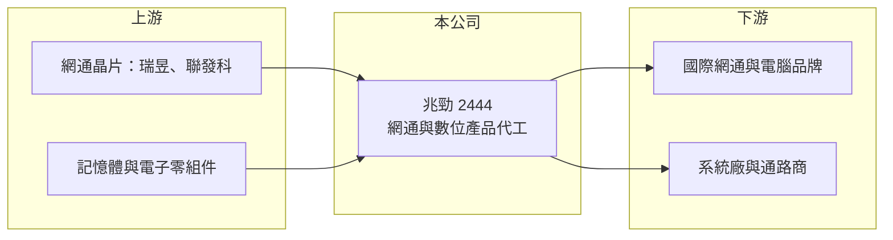

# 2444 兆勁

> 上市｜[[產業索引-通信網路業|通信網路業]]｜上市（櫃）日期 2000/12/08

# 第一章：企業模式與商業藍圖

> [!info] 撰寫說明
> 精簡版，由 Claude 依公開資料整理，架構比照 [[2330台積電]] 的四章研究，資料截至 2026-10-08。來源：證交所開放資料（基本資料、綜合損益、資產負債、營益分析、股利、每月營收）、Goodinfo 年度經營績效、nStock 公司簡介。公開資料有限，產品與客戶描述多為整理性內容，尚未逐條比對原始文件。#待校對

本章說明兆勁科技（股票代號：2444，以下簡稱兆勁）的商業模式：一家以網通產品代工為主的中小型電子廠。

- **核心業務：** 兆勁成立於 1995 年，2000 年在台灣證券交易所上市，原名友旺科技，總部登記於新竹科學園區、主要營運據點在苗栗竹南。依公司營業項目，兆勁從事數位與數據網路通訊、視聽電子、記憶體產品及筆記型電腦周邊設備的研發、生產與銷售。實務上以無線網卡、無線模組與網路周邊等網通產品的 [[ODM]] 代工為主（待校對），客戶是國際品牌與系統廠。
- **營收結構：** 公開資料未提供產品別營收比重。產品線橫跨網通、影音與記憶體周邊，代表公司採取「多產品、小批量」的策略，靠承接不同客戶的專案維持產能利用率，但也意味著每條產品線的規模都不大（推估）。
- **營運據點：** 依 nStock 揭露，註冊地為新竹科學園區、主要營運據點為苗栗縣竹南鎮，集團另有子公司，海外生產據點本次未查得（待校對）。
- **長期方向：** 網通周邊產品已高度標準化，晶片廠提供完整參考設計後，代工門檻持續降低。兆勁長期需要找到較具技術門檻的利基產品，或在特定客戶中取得穩定的長期訂單，否則很難擺脫價格競爭。

# 第二章：護城河深度與競爭優勢

本章評估兆勁在網通代工市場的競爭位置。以連年虧損與毛利率轉負來看，兆勁目前沒有明顯的護城河。

- **競爭優勢：** 兆勁的優勢在於中小型專案的彈性：大型網通代工廠偏好大量訂單，兆勁可以承接數量較少、規格客製的產品。長期合作的客戶關係與無線產品的認證經驗，是公司主要的經營資產。不過這類優勢容易被同業複製，議價能力有限。
- **主要對手：** 無線模組與網通周邊代工的同業包括 [[6285啟碁]]、[[3380明泰]]、[[3062建漢]]、[[4906正文]]，以及大量中國代工廠，它們在規模與成本上都具優勢（對手名單為產業常識整理，待校對）。
- **觀察重點：** 第一，毛利率能否回到正值並站穩一成以上，2026 上半年毛利率為 -5.17%，代表出貨價格低於成本。第二，產品組合調整的方向與成效。第三，持續虧損下的資金來源與資本結構變化。

# 第三章：財務體質與盈利規模

資料日期：2026-10-08。數字取自 Goodinfo 年度經營績效與證交所開放資料，表格是撰寫當時的快照；最新月營收、毛利率、累計 EPS 由自動排程寫在本筆記的屬性欄位（月營收、毛利率、累計EPS 等）。#待校對

兆勁的財務數字呈現營收縮小、毛利率惡化的趨勢，2022 年是近年唯一明顯獲利的一年。

| 年度 | 營收（新台幣） | [[毛利率]] | [[營業利益率]] | EPS（元） | [[ROE]] |
|---|---|---|---|---|---|
| 2020 | 17.7 億 | 14.4% | -4.42% | -0.93 | -10.4% |
| 2021 | 17.7 億 | 12.3% | 1.45% | 0.12 | 1.41% |
| 2022 | 18.0 億 | 17.7% | 6.50% | 1.18 | 12.9% |
| 2023 | 18.2 億 | 10.6% | 0.09% | -0.16 | -1.61% |
| 2024 | 13.9 億 | 12.2% | -5.18% | -0.24 | -2.51% |
| 2025 | 11.4 億 | 4.19% | -15.5% | -1.90 | -22.0% |
| 2026 上半年 | 4.34 億 | -5.17% | -31.69% | -1.35 | 未查得 |

註：2020 至 2025 年取自 Goodinfo 合併報表；2026 上半年取自證交所開放資料。

- **營收規模：** 2020 至 2023 年營收穩定在 18 億元上下，2024 年起明顯下滑，2020 至 2025 年年複合成長率約 -8.4%（推算）。2026 年 1 至 8 月累計營收 6.41 億元，較去年同期的 7.71 億元減少約 17%。
- **獲利：** 2021 至 2025 年平均 ROE 約 -2.4%（推算），六年中只有 2021、2022 年獲利。2022 年在網通缺料、價格上漲的環境下，毛利率升到 17.7%、EPS 1.18 元，說明公司的獲利高度依賴產業景氣，而非自身的定價能力。2025 年稅後淨損 1.93 億元，2026 上半年再虧 1.38 億元。
- **財務特色：** 依證交所資料，2026 年第二季底資產總計 17.24 億元、股東權益 6.67 億元、負債 10.52 億元，保留盈餘為 -4.94 億元，每股淨值 6.57 元。負債占資產比重約六成，持續虧損會讓財務結構進一步惡化。2025 年度未配發股利，Goodinfo 顯示歷年平均現金股利約 0.28 元。
- **[[ROIC]] 與 [[WACC]]：** 以 2026 上半年營業損失 1.37 億元年化約 -2.75 億元（虧損不計稅盾），投入資本以股東權益 6.67 億元加非流動負債 4.76 億元（代替有息負債）約 11.43 億元計算，ROIC 約 -24%（推算）；即使以 2022 年景氣高點的營業利益約 1.17 億元計算，ROIC 也只有約 8%（推算，資本以近期數字代替）。WACC 以 CAPM 推估：無風險利率 1.75%、市場風險溢酬 6%、β 取 1.1（推估，中小型網通代工股常見值），權益成本約 8.35%；稅前負債成本假設 3%，加權後 WACC 約 6% 至 7%（推算）。長期來看兆勁的 ROIC 只有在景氣高峰時短暫高於 WACC，多數年度在毀損資本。

# 第四章：總體風險與地緣政治

本章整理兆勁的長期風險，主要來自產品同質化與財務體質。

- **產業週期：** 網通周邊需求跟隨 PC、筆電與消費電子的換機週期，2022 年缺料時代工廠議價力短暫提升，2023 年後庫存調整，價格與訂單同時下滑。兆勁的營收與毛利在這個週期中波動很大。
- **營運風險：** 營收縮小後產能利用率下降，固定成本壓垮毛利，2026 上半年毛利率已轉負。若持續承接低價訂單維持產能，虧損可能擴大；若退出低毛利產品，營收會再縮小，兩難局面明顯。
- **其他風險：** 主要零組件為網通晶片與記憶體，價格與供應受晶片廠影響。持續虧損可能需要減資彌補或增資籌資，存在股權稀釋風險。美國關稅政策也可能影響出口型代工廠的生產布局與成本。

# 專有名詞解析

## 應用

- **[[Wi-Fi]]**：以無線電波讓設備連上區域網路的技術，每一代標準提升速度與連線數量。

## 金融

- **[[ROIC]]**：投入資本報酬率，稅後營業利益除以股東權益與有息負債的合計，衡量本業對所有資金提供者的報酬。
- **[[WACC]]**：加權平均資金成本，依股東權益與負債的比重加權計算的資金成本，ROIC 高於它才代表創造價值。

## 產業

- **[[ODM]]**：原廠委託設計製造，代工廠可提出設計方案並負責生產，與客戶綁定較深，議價能力較高。

# 核心供應鏈

- 上游：網通晶片 [[2379瑞昱]]、[[2454聯發科]]，記憶體與電子零組件（實際供應商未公開，待校對）。
- 下游／客戶：國際網通與電腦品牌、系統廠與通路商，客戶名稱本次未查得。
- 同業：[[6285啟碁]]、[[3380明泰]]、[[3062建漢]]、[[4906正文]]、[[3047訊舟]]。

## 最新新聞
<!-- news:start -->
<!-- news:end -->

## 相關連結
- [公開資訊觀測站](https://mopsov.twse.com.tw/mops/web/t05st03?step=1&firstin=1&co_id=2444)
- [Goodinfo](https://goodinfo.tw/tw/StockDetail.asp?STOCK_ID=2444)
- [Yahoo 股市](https://tw.stock.yahoo.com/quote/2444)
- [鉅亨網新聞](https://www.cnyes.com/twstock/2444/news)
