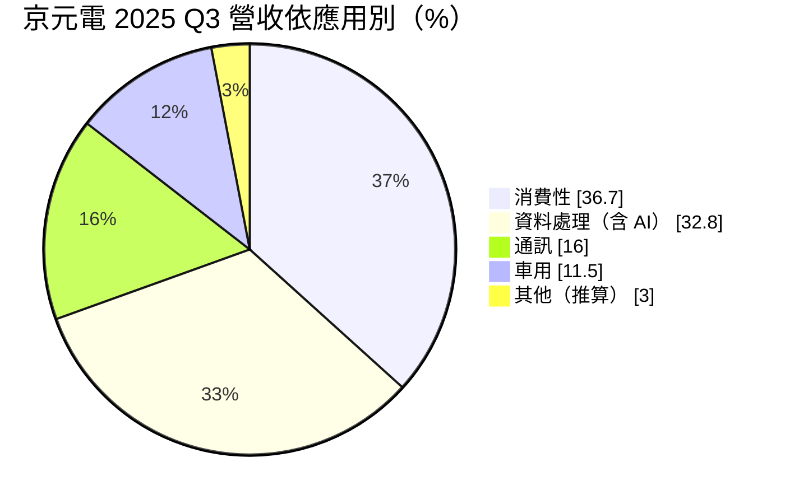
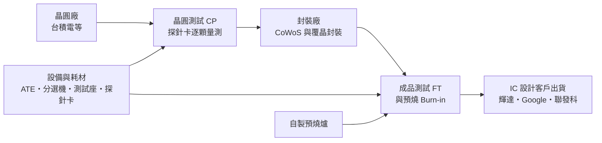
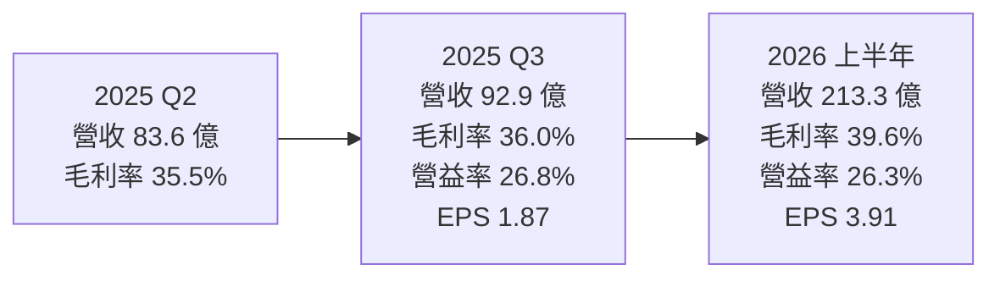
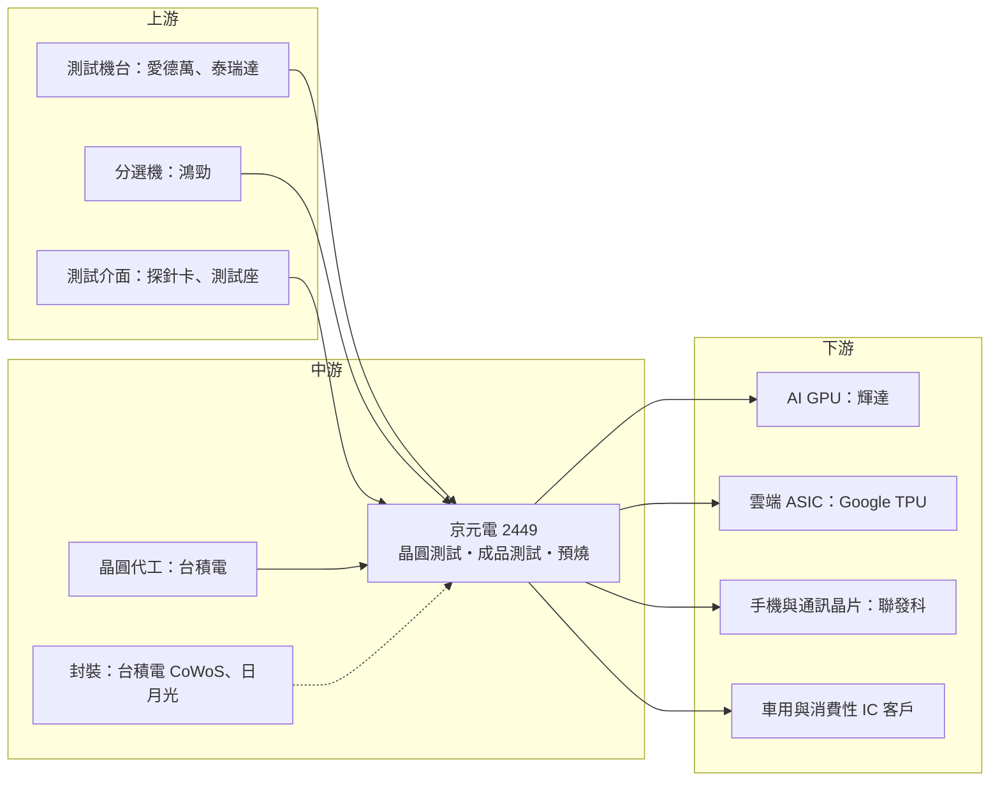

# 2449 京元電子

> 上市｜[[產業索引-半導體業|半導體業]]｜上市（櫃）日期 2001/05/09

# 第一章：企業模式與商業藍圖

> [!info] 撰寫說明
> 本文由 Claude 依公開資料整理，架構比照 [[2330台積電]] 的四章研究，資料截至 2026-10-08。財務數字來源：Goodinfo 經營績效頁（2019 至 2025 年度）、證交所開放資料快照（基本資料、2026 年上半年損益與第二季資產負債、股利）、富果研究 2025 年 11 月法說會整理、優分析轉載之 2026 年資本支出報導、科技新報 2024 年 4 月出售京隆科技報導與 2026 年 6 月大摩報告報導；產業描述為整理性內容，尚未逐條比對原始文件。#待校對

在評估單一個股的長期投資價值時，首要步驟是拆解企業的底層獲利邏輯。本章針對京元電子（股票代號：2449，以下簡稱京元電）的商業模式進行定性分析，說明一家專做「測試」的半導體服務公司，如何在 AI 晶片時代從配角變成關鍵瓶頸。

## 一、核心定位：全球最大的專業半導體測試代工廠之一

京元電成立於 1987 年 5 月，總部位於新竹，2001 年上市。和多數同時做封裝與測試的封測廠不同，京元電專注在半導體的「測試」這個環節，屬於[[測試代工]]業者。晶片從晶圓廠出來後，要先在晶圓階段用探針逐顆量測（[[CP測試]]），封裝完成後再做最終測試（[[FT]]），高階產品還要經過長時間高溫通電的[[預燒測試]]，確認沒有早期失效的瑕疵品，才能出貨給客戶。

測試看起來只是品質檢查，但它直接決定晶片的出貨[[良率]]與可靠度。一顆 AI 加速晶片售價動輒上萬美元，如果有瑕疵流到客戶的伺服器裡，損失遠大於測試成本。因此晶片越貴、越複雜，客戶越願意把測試交給經驗豐富、產能充足的專業廠。依富果研究整理的 2025 年 11 月法說會資料，全球前 50 大半導體公司中有 48% 是京元電的客戶。

京元電的商業定位有兩個重點：

* **以設備規模與工程能力換取客戶信任：** 測試的核心資產是測試機台（[[ATE]]）、分選機與無塵室空間。京元電擁有超過 5,100 套測試設備，能同時服務 GPU、手機晶片、車用與消費性晶片等各種產品，規模本身就是接單條件。
* **專注測試、退出中國製造：** 2024 年 4 月，京元電宣布出售蘇州子公司京隆科技 92.16% 股權，交易金額約人民幣 48.85 億元，買方包括蘇州當地產業基金與通富微電等。公司說明原因是地緣政治與美國出口管制使中國市場競爭加劇，決定退出中國半導體製造業務。這次出售讓京元電把資源全部集中在台灣，專攻 AI 等高階測試。

## 二、終端應用板塊：AI 運算成為成長主軸

依富果研究整理的 2025 年第三季法說會資料，京元電的營收結構如下：

依服務別，同一季成品測試占 58.2%、晶圓測試占 30.4%、預燒占 9.0%、封裝及其他占 2.4%。

* **資料處理（含 AI）：** 包括 GPU、雲端業者自研 [[ASIC]] 與伺服器 CPU 的測試，是最主要的成長動能。依科技新報引述大摩報告，2025 年 AI 相關產品約占營收 25% 至 30%，2026 年預估超過 35%。京元電是 [[NVDA輝達]] AI 晶片的主力測試夥伴，這也是使用者核心供應鏈章節所寫「與台積電合作：輝達 AI 晶片主力測試廠」的由來。同一份報告也提到 [[GOOGL谷歌]] 的 [[TPU]]、CPU 與部分晶圓測試，預估 2026 年約占營收一成。
* **消費性：** 比重最高，但會隨 AI 比重擴大而下降，內容包括各類消費電子晶片、記憶體與周邊 IC。
* **通訊：** 以手機晶片為主，表現穩定。這部分對應使用者在 [[2454聯發科]] 供應鏈中把京元電列為「主力晶片最終測試廠」的角色。
* **車用：** 車用 [[MCU]]、感測與電源晶片，需要更嚴格的高低溫測試，2025 年下半年需求停滯。

## 三、資本轉化邏輯：無塵室與機台就是產能

* **AI 晶片拉長測試時間：** 依優分析報導，AI 晶片通常需要「一次預燒、兩次成品測試」的完整流程，而大摩報告指出主要客戶新一代產品的預燒時間由約 3 小時延長到 5 至 6 小時。測試時間越長，同一套機台能處理的晶片越少，客戶就需要更多機台與空間。這是 AI 時代測試產業的結構性變化：晶片數量不一定暴增，但每顆晶片消耗的測試產能大幅增加。
* **瓶頸在無塵室：** 富果研究整理的法說會指出，京元電的主要瓶頸是無塵室空間不足，2025 年 11 月公告承租楊梅的前華映廠房。2025 年第三季資本支出中，AI 成品測試設備占 42%，廠房與無塵室建設占 38%。
* **自製設備降低成本：** 京元電具備自行開發與製造預燒爐等測試設備的能力，可以提供客製化且成本較低的方案，這是它和只買標準設備的同業之間的差異之一。
* **重資產、高折舊：** 測試廠的營收來自機台的使用時間，機台與廠房投資先發生、折舊逐年攤提。只要產能利用率維持高檔，增加的營收大部分會轉為利潤；反之，需求下滑時折舊不會減少，獲利波動會被放大。

## 四、企業長期藍圖：押注 AI 測試的長期需求

* **連續創新高的資本支出：** 依科技新報報導，京元電 2025 年資本支出原訂 218.44 億元（含子公司 233 億元），之後隨 AI 需求上調，大摩估計 2025 年實際約 370 億元。2025 年 12 月董事會通過 2026 年資本支出 393.72 億元，大摩預估實際可能達到 500 億元，約一半用於廠房與無塵室。為支應擴產，京元電與兆豐銀行等銀行團簽訂 350 億元聯合授信。
* **從 GPU 擴展到 ASIC 與 CPU：** 法說會指出，GPU 測試自 2023 年起步，仍是營收主力；ASIC 測試在 2025 年開始放量，2026、2027 年成長幅度會很大。大摩報告也提到伺服器 CPU 測試比重上升。客戶組合從單一 GPU 大客戶擴展到多家雲端業者，可以降低集中風險。
* **長期擴產規劃：** 管理層在法說會表示，核心策略是持續投資廠房與無塵室，以滿足 AI 客戶 2024 至 2027 年的長期需求。這代表京元電把未來數年的成長，押在 AI 晶片測試需求持續擴張上。

# 第二章：護城河深度與競爭優勢

在長期價值投資中，「護城河」指企業抵禦競爭、維持超額利潤的保護機制。本章分析京元電的護城河構成、全球主要競爭對手，以及這些優勢在 AI 測試需求擴張與同業追趕下能守住多少。

## 一、京元電護城河的核心組成要素

測試代工常被認為是同質性高的服務，但在高階 AI 晶片上，京元電已建立起「中等寬度」的護城河，由三個要素組成：

* **1. 測試程式與客戶驗證的轉換成本：** 每一顆新晶片的測試程式、測試座與探針卡都要和測試廠共同開發，並通過客戶的品質驗證。AI 晶片的測試流程更長、更複雜，一旦在某個測試廠完成導入，換廠就要重新開發與驗證，客戶通常不會在產品世代中途更換。
* **2. 產能規模與交期：** AI 晶片出貨時程緊迫，客戶最在意的是測試廠能不能及時提供足夠的機台與空間。京元電願意提前投資數百億元擴產，讓它在需求爆發時能接下大單，這種「先蓋好再等客戶」的能力，是中小型測試廠很難複製的。
* **3. 專業測試廠的中立性：** 京元電不做晶片設計，也不做大規模封裝，客戶不必擔心技術外流給競爭對手。加上它能自製預燒設備，對客製化需求的反應速度較快。

## 二、全球主要競爭對手格局

| 對手 | 定位 | 對京元電的威脅 |
|---|---|---|
| [[3711日月光投控]] | 全球最大封測集團，封裝與測試一條龍 | 可提供封裝加測試的整包服務，正積極擴充 AI 測試產能 |
| [[AMKR艾克爾]] | 全球第二大封測廠，美國與東南亞產能多 | 具美國本土布局，受惠在地化需求 |
| [[6257矽格]] | 台灣測試廠，手機、網通與車用晶片為主 | 在通訊與消費性測試直接競爭 |
| [[3264欣銓]] | 台灣晶圓測試廠，車用與 MCU 為主 | 在晶圓測試與車用領域競爭 |
| [[2330台積電]] | 晶圓廠自建先進封裝與部分測試 | 在 CoWoS 後段可能把部分測試留在自家流程 |

## 三、優勢轉化：哪些市場守得住、哪些守不住

* **守得住：** 已導入的 AI GPU 與 ASIC 成品測試和預燒。依科技新報引述大摩報告，京元電幾乎包辦最大客戶某系列 CPU 的全部最終測試與預燒，在 AI GPU 與 ASIC 最終測試的市占穩固。這類業務的轉換成本最高。
* **守不住：** 一般消費性與成熟產品的測試，同業眾多，價格競爭較激烈，也較容易隨景氣下修。
* **觀察重點：** 第一，AI 相關營收比重能否如預期提升到三成五以上；第二，大規模擴產後產能利用率能否維持，避免折舊壓縮毛利；第三，日月光與台積電是否把更多 AI 測試留在自家流程，壓縮專業測試廠的空間。

# 第三章：財務體質與盈利規模

資料日期：2026-10-08。數字取自 Goodinfo 經營績效頁、證交所開放資料快照與法說會整理，表格是撰寫當時的快照；最新月營收、毛利率、累計 EPS 由自動排程寫在本筆記的屬性欄位（月營收、毛利率、累計EPS 等）。#待校對

財務報表是檢驗護城河是否真實存在的最終標準。本章用多年度的三率、[[ROE]]、現金流與資本報酬，檢視京元電在 AI 擴產期的獲利品質。

## 一、獲利能力的基石：三率

| 年度 | 營收（新台幣） | [[毛利率]] | [[營業利益率]] | EPS（元） | [[ROE]] |
|---|---|---|---|---|---|
| 2019 | 255 億 | 27.5% | 15.8% | 2.49 | 12.0% |
| 2020 | 290 億 | 27.5% | 16.1% | 2.97 | 13.1% |
| 2021 | 338 億 | 30.7% | 19.6% | 4.23 | 16.3% |
| 2022 | 368 億 | 35.5% | 24.9% | 5.59 | 19.4% |
| 2023 | 240 億 | 33.0% | 21.9% | 4.78 | 15.6% |
| 2024 | 269 億 | 34.8% | 23.0% | 6.36 | 19.1% |
| 2025 | 349 億 | 35.8% | 25.8% | 9.01 | 23.2% |
| 2026 上半年 | 213.3 億 | 39.61% | 26.25% | 3.91 | 約 15.3%（年化推算） |

資料來源：2019 至 2025 年為 Goodinfo 經營績效頁；2026 上半年依證交所綜合損益與營益分析快照（營收 213.3 億元、營業利益 56.0 億元、歸屬母公司淨利 47.8 億元），ROE 以上半年淨利年化除以 2026 年第二季歸屬母公司權益 626.6 億元推算。2023 年起的營收明顯低於 2022 年，推估是京隆科技出售後改列停業單位、營收重編所致，前後年度不宜直接比較；2025 年 EPS 推估含京隆處分利益（科技新報報導預估約 38.27 億元），屬一次性收益。

* **毛利率逐步墊高：** 從 2019、2020 年的 27.5%，一路提升到 2025 年的 35.8% 與 2026 年上半年的 39.6%。主因是高單價、長測試時間的 AI 產品比重提高，以及產能利用率維持高檔。對重資產的測試廠而言，毛利率能突破 35% 代表定價與產能利用都處於很好的位置。
* **營業利益率高且穩定：** 測試廠的營業費用占營收比例低，毛利大部分直接轉為營業利益。京元電的營業利益率在 2022 年後多數年度維持在 22% 到 26%，2026 年上半年為 26.25%。
* **擴產期的成長：** 以重編後的口徑計算，2023 年到 2025 年營收從 240 億元增加到 349 億元，年複合成長率約 20.6%（推算）。2026 年上半年營收 213.3 億元，已超過 2025 年全年的六成。

## 二、[[ROE]]：資本效率

京元電 2021 至 2025 年的 ROE 分別為 16.3%、19.4%、15.6%、19.1% 與 23.2%，五年平均約 18.7%（推算）。2025 年的 23.2% 含京隆處分利益，若扣除一次性收益，本業 ROE 推估約在 17% 到 19% 之間。2026 年上半年年化 ROE 約 15.3%（推算），比 2025 年低，主要是權益因其他綜合損益增加而擴大（上半年其他綜合損益 86.8 億元，推估為持有金融資產的評價利益），以及 2025 年配發股票股利使股本增加。

依證交所 2026 年第二季資產負債快照，京元電資產總計 1,287.5 億元，負債 660.8 億元，權益 626.7 億元，每股淨值 51.25 元。負債比約 51%，其中非流動負債 453.6 億元，推估主要是為擴產而借的長期借款與廠房租賃負債。法說會中公司表示負債約占總資產 46%（2025 年第三季），屬可控範圍。

## 三、資本支出、自由現金流與股利

* **[[CapEx]] 大幅擴張：** 2025 年資本支出由原訂 218 億元上調到大摩估計的約 370 億元，2026 年董事會通過 393.72 億元。以 2025 年營收 349 億元計，資本支出已超過全年營收，屬於極積極的擴產期。
* **[[自由現金流]]轉負：** 富果研究整理的法說會資料指出，2025 年第三季自由現金流為負，原因是資本支出較高。擴產期的資金缺口由營業現金流、銀行團 350 億元聯貸與出售京隆的現金（科技新報報導淨流入約 166 億元）共同支應。
* **股利：** 依證交所股利資料，2025 年度股東會確認配發現金股利 1 元與股票股利 0.5 元，現金配發率明顯低於過去，反映公司把資金優先投入擴產。另依科技新報 2024 年報導，京元電出售京隆後提撥約 36.68 億元，於 2025 年與 2026 年每股各加發現金 1.5 元（實際發放方式待校對）。公司章程規定現金股利不低於股東股利總額的 20%。

## 四、[[ROIC]] 與 [[WACC]]：價值創造利差

**ROIC 推算：** 2026 年上半年營業利益 56.0 億元，年化約 112 億元，以 20% 稅率計算稅後營業利益約 89.6 億元。投入資本以 2026 年第二季權益總計 626.7 億元，加上非流動負債 453.6 億元作為有息負債的近似值（有息負債明細未查得），合計約 1,080 億元，ROIC 約 8.3%（推算）。若以 2025 年營業利益約 90 億元（349 億元 × 25.8%）計算，稅後約 72 億元，ROIC 約 6.7%（推算）。由於投入資本已包含大量尚未產生營收的新廠房與在建工程，且權益中含金融資產評價利益，這個數字會低估既有產能的實際報酬。

**WACC 推算：** 台灣 10 年期公債殖利率取 1.75%，市場風險溢酬取 6%，β 取半導體封測股常見的 1.1 至 1.3（京元電本身的 β 未查得），股東權益成本約 8.4% 至 9.6%。負債成本取 2%，稅後 1.6%，以權益約 58%、負債約 42% 的資本結構計算，WACC 約 5.5% 至 6.2%（推算）。

**解讀：** 京元電的 ROIC 約 7% 到 8%，略高於 WACC 約 5.5% 到 6.2%，代表仍在創造價值，但利差不大。這是大規模擴產期常見的現象：資本先投入，營收與獲利要等新產能填滿後才會跟上。若 AI 測試需求如管理層預期持續到 2027 年，新廠滿載後 ROIC 有機會回升；若需求提早放緩，龐大的折舊會讓 ROIC 進一步接近甚至低於資金成本。

# 第四章：總體風險與地緣政治

任何企業都無法脫離宏觀環境獨立存在。本章分析京元電未來必須面對的地緣政治、產業週期與營運風險。

## 一、地緣政治風險

* **已退出中國，但產能集中台灣：** 出售京隆後，京元電的生產幾乎全部集中在台灣苗栗、新竹與桃園一帶，避開了中國製造的出口管制風險，卻也讓兩岸情勢成為最直接的集中風險。
* **美國在地化要求：** 美國推動半導體供應鏈在地化，若主要客戶要求部分 AI 晶片在美國完成封裝與測試，京元電可能需要評估海外布局，而海外設廠的成本與人力條件都比台灣更高。
* **出口管制：** AI 晶片受美國出口管制，客戶對特定國家的出貨限制會間接影響測試量。

## 二、產業週期與市場結構風險

* **客戶集中：** AI 營收集中在少數 GPU 與雲端業者客戶。大摩報告提到最大客戶的多個產品系列都在京元電測試，單一客戶的產品轉換或訂單調整，對營收影響很大。
* **[[長鞭效應]]：** 消費性與車用占營收近五成，終端需求轉弱時，客戶會先調整晶片庫存，測試訂單往往比終端需求下滑得更快。2023 年營收下滑就是例子。
* **AI 資本支出週期：** 京元電的擴產是以 AI 需求持續成長為前提。若雲端業者放緩 AI 投資，新產能可能面臨閒置。

## 三、營運環境的隱性風險

* **折舊壓力：** 連續兩年三、四百億元的資本支出，未來每年的折舊會大幅增加。只要產能利用率下滑，毛利率會快速下降。
* **財務槓桿上升：** 為擴產簽訂 350 億元聯貸，負債比升到五成左右，利率上升或現金流轉弱時，財務彈性會降低。
* **空間、水電與人才：** 無塵室空間是目前最大的瓶頸，加上台灣的供電穩定、工程人才招募，都會影響擴產速度。
* **股本稀釋：** 配發股票股利會增加股本，若獲利成長跟不上，每股盈餘會被稀釋。

## 四、科技演進風險

AI 晶片正從單顆晶片走向以[[先進封裝]]整合多顆晶片與 [[HBM]] 的模組，測試重點也從「封裝後測一次」轉向在每個階段確認每顆小晶片都是良品（[[KGD]]），並增加系統級測試（[[SLT]]）。如果測試流程逐步前移到晶圓廠或封裝廠內部完成，專業測試廠的角色可能被壓縮；反過來，若測試複雜度持續提高，專業測試廠的價值會更高。京元電需要持續投資新的測試技術與設備，才能跟上客戶每一代產品的需求。

# 專有名詞解析

## 半導體

- **[[測試代工]]**：專門替 IC 設計公司或晶圓廠提供晶片測試服務的業者，本身不設計也不製造晶片。
- **[[CP測試]]**：晶圓針測，晶片還在晶圓上時以探針卡逐顆量測電性，提早剔除不良品。
- **[[FT]]**：成品測試，晶片封裝完成後的最終電性與功能測試，合格後才出貨給客戶。
- **[[預燒測試]]**：讓晶片在高溫、高電壓下長時間運作，篩掉可能早期失效的瑕疵品，AI 晶片的預燒時間特別長。
- **[[ATE]]**：自動測試設備，執行晶片電性測試的主機台，主要供應商為愛德萬與泰瑞達。
- **[[探針卡]]**：晶圓測試時接觸晶片電極的介面，上面布滿細微探針，需依每顆晶片客製。
- **[[KGD]]**：已知良品晶粒，在封裝前就確認為良品的晶片，多晶片先進封裝特別需要。
- **[[SLT]]**：系統級測試，把晶片放在接近實際使用的系統環境中測試，補足傳統電性測試的不足。
- **[[ASIC]]**：特殊應用積體電路，為特定用途客製的晶片，例如雲端業者自研的 AI 加速器。
- **[[TPU]]**：張量處理器，Google 自行設計、專門處理 AI 運算的加速晶片。
- **[[先進封裝]]**：把多顆晶片以中介層、混合鍵合等方式高密度整合的封裝技術，例如 CoWoS、SoIC。
- **[[HBM]]**：高頻寬記憶體，以多層 DRAM 堆疊並緊鄰處理器封裝，是 AI 加速器的關鍵元件。

## 金融

- **[[CapEx]]**：資本支出，企業購買土地、廠房與設備的支出。
- **[[自由現金流]]**：營業活動現金流減去資本支出，代表企業可自由用於配息、還債或併購的現金。
- **[[長鞭效應]]**：終端需求的小幅變動，沿供應鏈往上游傳遞時被逐級放大，造成上游庫存與訂單劇烈波動。

# 核心供應鏈

## 1. 上游：測試設備與測試介面
- 自動測試設備（ATE）：愛德萬（Advantest）、泰瑞達（Teradyne）（待校對）
- 測試分選機與溫控設備：[[7769鴻勁]]（今周刊 2026 年 1 月報導列京元電為鴻勁的間接客戶）
- 晶圓測試探針卡：[[6223旺矽]]、[[6510精測]]（推估）
- 成品測試座：[[6515穎崴]]（推估）
- 預燒爐：京元電自行開發製造，部分設備不需外購

## 2. 中游：前段晶圓與封裝夥伴
- AI 晶片合作與晶圓來源：[[2330台積電]]（輝達 AI 晶片主力測試廠）
- CoWoS 等先進封裝完成後送成品測試：[[2330台積電]]、[[3711日月光投控]]（推估）

## 3. 下游：IC 設計客戶
- AI GPU 主力測試夥伴：[[NVDA輝達]]
- 雲端自研 ASIC（TPU）與伺服器 CPU：[[GOOGL谷歌]]
- 手機晶片最終測試（FT）：[[2454聯發科]]
- 車用、消費性與記憶體周邊 IC：多家國際 IC 設計公司與 IDM，個別名單未查得

## 4. 同業競爭
- 封測一條龍集團：[[3711日月光投控]]、[[AMKR艾克爾]]
- 台灣專業測試廠：[[6257矽格]]、[[3264欣銓]]

延伸閱讀：[[台積電供應鏈]]、[[聯發科供應鏈]]

## 供應鏈關係
- 與 [[2330台積電]] 合作：輝達 AI 晶片主力測試廠（台積電供應鏈 › 下游：專業封裝與最終測試廠 (OSAT)）
- 供應給 [[2454聯發科]]：主力晶片最終測試廠 (FT)（聯發科供應鏈 › 中游：專業封裝與最終測試廠 (OSAT)）

## 最新新聞
<!-- news:start（自動產生，請勿手動編輯此範圍） -->
- 2026-10-13 📰 媒體 21:06｜京元電子 14 億美元設廠成焦點，近期 2 檔節目皆看多｜[CMoney](https://news.google.com/rss/articles/CBMiWEFVX3lxTFBuWjN0ZzZqcWtTTFFoLUIwSEtFbEpWR3NTY2RtRHZLc2FzM09LWnh5MUZ1WnpxZHVwX0t2TWRKNUVfZElzbW5zbGpvX0VpdVhIS1lZWnlXQnE?oc=5)
- 2026-10-13 📰 媒體 15:53｜京元電子：這次的利多，真的不一樣！｜[CMoney](https://news.google.com/rss/articles/CBMiWEFVX3lxTFBRQ2thc1U4dXV5aFNFdFc5ZS1DMzUtbzItMlBGQnFOMHB0U0JmNzlMbkQxdXFtWjdUSnpCaEtiYzREc1dIdmVTblBmVGNieVc3czB5eS1JdFk?oc=5)
- 2026-10-13 📰 媒體 15:31｜輝達預付款鎖定美國晶片測試產能京元電子擴產獲客戶資金支持，AI測試需求持續升溫｜[鉅亨網](https://news.cnyes.com/news/id/6629408)
- 2026-10-13 📰 媒體 14:31｜京元電子 公告本公司取消為子公司背書保證案｜[CMoney](https://news.google.com/rss/articles/CBMiWEFVX3lxTFBxS0sxT2ZheEU1aTAtNzZBenRCR3dtU0xXeGhXcGwzX1lydWY1SERfY1pjSjRPWnAwMmZlWmFxN00ybkh1Vk1aMFFLeUMxZkdWMlMzNHhDZGI?oc=5)
- 2026-10-13 📰 媒體 14:13｜董事會：京元電子(2449)及旗下AeternZ決議與客戶簽訂客戶預付款協議｜[富聯網](https://news.google.com/rss/articles/CBMiiAFBVV95cUxNdVMwbVhiMVJGNVp2THlKZldNN2ZwemFhU2ZJTXFPV25aSmwxbHdlRDU1Mnc2UXVEcVlTSVFzSFBVSDFTV0d6YmZVLVl1N0R1dmVncDlmOWtvMjQ0cjROWjlJdG9CeVlzQUd6cnNscU5qN0JabnhXWGNMRE1PbTdBNVdiSXpGWDVF?oc=5)

完整紀錄：[[2449京元電子 新聞]]
<!-- news:end -->

## 相關連結
- [公開資訊觀測站](https://mopsov.twse.com.tw/mops/web/t05st03?step=1&firstin=1&co_id=2449)
- [Goodinfo](https://goodinfo.tw/tw/StockDetail.asp?STOCK_ID=2449)
- [Yahoo 股市](https://tw.stock.yahoo.com/quote/2449)
- [鉅亨網新聞](https://www.cnyes.com/twstock/2449/news)
