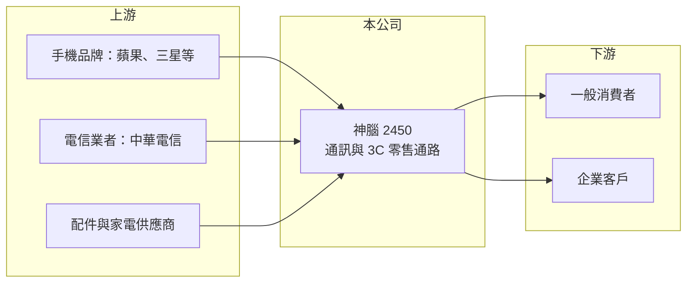

# 2450 神腦

> 上市｜[[產業索引-通信網路業|通信網路業]]｜上市（櫃）日期 2001/05/24

# 第一章：企業模式與商業藍圖

> [!info] 撰寫說明
> 精簡版，由 Claude 依公開資料整理，架構比照 [[2330台積電]] 的四章研究，資料截至 2026-10-08。來源：證交所開放資料（基本資料、綜合損益、資產負債、營益分析、股利、每月營收、本益比殖利率）、Goodinfo 年度經營績效、nStock 公司簡介；產業描述為整理性內容，尚未逐條比對原始文件。#待校對

本章說明神腦國際（股票代號：2450，以下簡稱神腦）的商業模式：台灣主要的電信與 3C 零售通路之一，最大股東是中華電信。

- **核心業務：** 神腦成立於 1979 年，2001 年在台灣證券交易所上市，總部位於新北市新店區。依公司營業項目，神腦從事行動電話、資訊、家電、配件及保健商品的買賣與維修。它的角色是「通路商」：向手機品牌與電信業者進貨，透過實體門市與線上通路賣給消費者，同時協助電信業者辦理門號與資費方案，賺取商品價差與電信佣金。
- **營收結構：** 公開資料未提供產品別營收比重。以業務性質來看，手機銷售占營收大宗，其次是配件、資訊與家電商品，以及電信門號佣金與維修服務（待校對）。手機單價高、毛利低，配件與服務單價低、毛利高，這個組合決定了神腦約一成的毛利率結構。
- **營運據點：** 營運集中在台灣，以全台實體門市搭配網路商城經營。依 nStock 揭露，[[2412中華電]] 於 2007 年 1 月取得神腦股權，截至 2026 年 6 月 30 日持股 27.79%，是神腦的最終母公司。這層關係讓神腦成為中華電信門號與資費方案的重要銷售通路。另外，神腦在 2006 年 10 月 1 日把無線通訊事業群分割成立 [[3558神準]]，從此專注零售通路。
- **長期方向：** 手機市場已經成熟，換機週期拉長，單靠賣手機難以成長。神腦的長期方向是提高配件、自有品牌商品、維修服務與異業商品的比重，並結合中華電信的會員與數位服務，把門市從「賣手機的地方」轉型成「電信與生活服務據點」。

# 第二章：護城河深度與競爭優勢

本章評估神腦作為通路商的護城河。通路業本身競爭激烈，神腦的優勢主要來自與中華電信的綁定。

- **競爭優勢：** 第一，與中華電信的股權與業務合作，讓神腦穩定取得門號佣金與電信客戶的來客量，這是一般 3C 通路沒有的流量來源。第二，全台門市網路與售後維修能力，提供消費者購買、辦門號與維修的一站式服務，形成一定的地點與服務便利性。第三，品牌知名度與蘋果、三星等手機品牌的長期供貨關係。整體屬於窄護城河，獲利率很薄。
- **主要對手：** 電信業者的直營門市（[[3045台灣大]] 的 myfone、[[4904遠傳]]）、3C 量販通路（燦坤、全國電子），以及電商平台與品牌官網直營，都在爭奪同一批換機消費者（對手名單為產業常識整理，待校對）。
- **觀察重點：** 第一，毛利率能否維持在 10% 以上，這反映高毛利配件與服務的比重。第二，營業利益率能否從約 1% 提升，因為門市租金與人事是主要固定成本。第三，中華電信的合作條件與持股是否變動。

# 第三章：財務體質與盈利規模

資料日期：2026-10-08。數字取自 Goodinfo 年度經營績效與證交所開放資料，表格是撰寫當時的快照；最新月營收、毛利率、累計 EPS 由自動排程寫在本筆記的屬性欄位（月營收、毛利率、累計EPS 等）。#待校對

神腦的財務呈現典型的通路業特徵：營收大、毛利率低、營業利益率很薄，但資本需求小、現金股利穩定。

| 年度 | 營收（新台幣） | [[毛利率]] | [[營業利益率]] | EPS（元） | [[ROE]] |
|---|---|---|---|---|---|
| 2020 | 270 億 | 11.4% | 1.14% | 1.69 | 7.39% |
| 2021 | 310 億 | 11.2% | 1.56% | 2.31 | 9.88% |
| 2022 | 312 億 | 10.9% | 1.12% | 2.55 | 10.5% |
| 2023 | 313 億 | 10.9% | 1.36% | 2.73 | 11.1% |
| 2024 | 323 億 | 10.8% | 1.24% | 1.85 | 7.42% |
| 2025 | 331 億 | 10.5% | 1.01% | 1.72 | 6.89% |
| 2026 上半年 | 172.3 億 | 9.90% | 0.89% | 0.67 | 未查得 |

註：2020 至 2025 年取自 Goodinfo 合併報表；2026 上半年取自證交所開放資料。

- **營收規模：** 營收從 2020 年的 270 億元穩定成長到 2025 年的 331 億元，年複合成長率約 4.2%（推算）。2026 年 1 至 8 月累計營收 230.9 億元，較去年同期成長約 17%，營收規模持續擴大。
- **獲利：** 毛利率長期穩定在 10% 至 11.5%，但有逐年小幅下滑的趨勢；營業利益率在 1% 至 1.6% 之間，營收每 100 元只賺約 1 元的本業利益。EPS 在 2023 年達 2.73 元後回落，2021 至 2025 年平均 ROE 約 9.2%（推算）。2026 上半年營業利益 1.54 億元，加上業外收益後稅後淨利 1.73 億元。
- **財務特色：** 依證交所資料，2026 年第二季底股東權益 62.2 億元、負債 45.4 億元，每股淨值 24.07 元，保留盈餘 29.2 億元。2025 年度配發現金股利 1.55 元，以 EPS 1.72 元計算配發率約 90%（推算），證交所資料顯示 2026 年 10 月初殖利率約 5.5%。通路業資本支出以門市裝修為主，金額不大，自由現金流長期為正的機率高（推估，現金流數字本次未查得）。
- **[[ROIC]] 與 [[WACC]]：** 以 2025 年營業利益約 3.34 億元（營收 331 億元 × 營業利益率 1.01%）扣 20% 稅後約 2.67 億元，投入資本以股東權益 62.2 億元加非流動負債 7.15 億元（代替有息負債，主要可能為門市租賃負債）約 69.3 億元計算，ROIC 約 3.9%（推算）；2026 上半年年化約 3.6%。WACC 以 CAPM 推估：無風險利率 1.75%、市場風險溢酬 6%、β 取 0.7（推估，零售通路與電信相關股常見偏低值），權益成本約 5.95%；負債比重低，WACC 約 5.5% 至 6%（推算）。ROIC 略低於 WACC，代表本業利潤勉強覆蓋資金成本；神腦的 ROE 高於 ROIC，部分來自業外收益與營運資金的運用（應付帳款大於存貨的通路特性）。

# 第四章：總體風險與地緣政治

本章整理神腦面對的長期風險，核心是通路去中間化與手機市場成熟。

- **產業週期：** 手機銷售隨新機發表與 5G 等世代更替循環，旗艦機上市的下半年通常是旺季。換機週期拉長、手機平均單價上升但銷量下滑，會壓縮通路商的成長空間。
- **營運風險：** 門市租金與人事成本隨通膨上升，但毛利率逐年下滑，營業利益率可能被進一步擠壓。手機品牌與電信業者若擴大直營或線上直銷，神腦的中間角色與佣金收入會受到影響。
- **其他風險：** 對中華電信的依賴是雙面刃，若合作條件或持股結構改變，來客與佣金都會受影響。手機存貨跌價風險在新機發表前後較高，需要精準的庫存管理。

# 專有名詞解析

## 金融

- **[[ROIC]]**：投入資本報酬率，稅後營業利益除以股東權益與有息負債的合計，衡量本業對所有資金提供者的報酬。
- **[[WACC]]**：加權平均資金成本，依股東權益與負債的比重加權計算的資金成本，ROIC 高於它才代表創造價值。

## 產業

- **[[通路商]]**：向品牌商進貨並透過門市或網路賣給消費者的中間商，靠商品價差與服務收入獲利，毛利率通常偏低。
- **[[5G]]**：第五代行動通訊技術，速度與容量高於 4G，用戶升級 5G 方案是電信業者提高 ARPU 的主要途徑。

# 核心供應鏈

- 上游：手機品牌 [[AAPL蘋果]]、[[005930三星電子]] 等；電信業者與最大股東 [[2412中華電]]；配件、資訊與家電供應商。
- 下游／客戶：一般消費者與企業客戶。
- 同業：電信直營通路 [[3045台灣大]]、[[4904遠傳]]；3C 量販燦坤、全國電子；電商平台。

## 最新新聞
<!-- news:start -->
<!-- news:end -->

## 相關連結
- [公開資訊觀測站](https://mopsov.twse.com.tw/mops/web/t05st03?step=1&firstin=1&co_id=2450)
- [Goodinfo](https://goodinfo.tw/tw/StockDetail.asp?STOCK_ID=2450)
- [Yahoo 股市](https://tw.stock.yahoo.com/quote/2450)
- [鉅亨網新聞](https://www.cnyes.com/twstock/2450/news)
