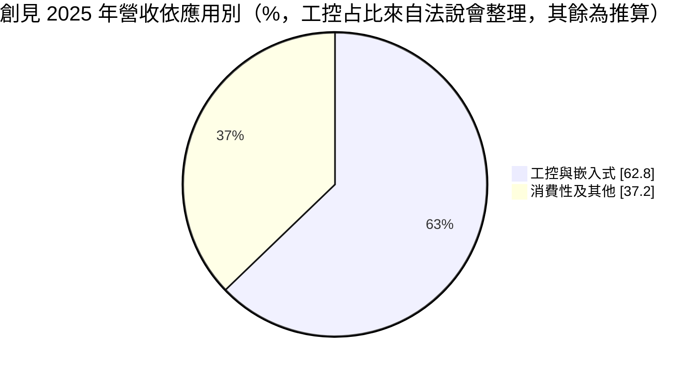
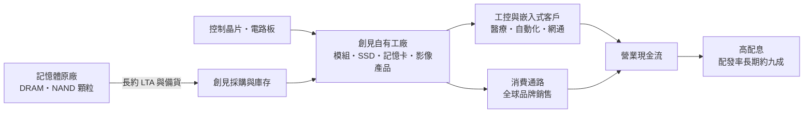
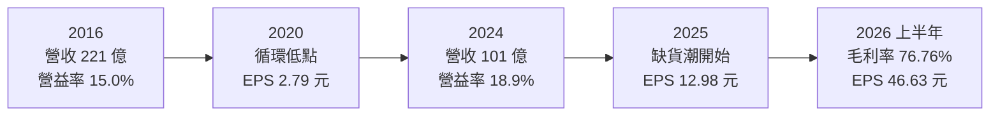
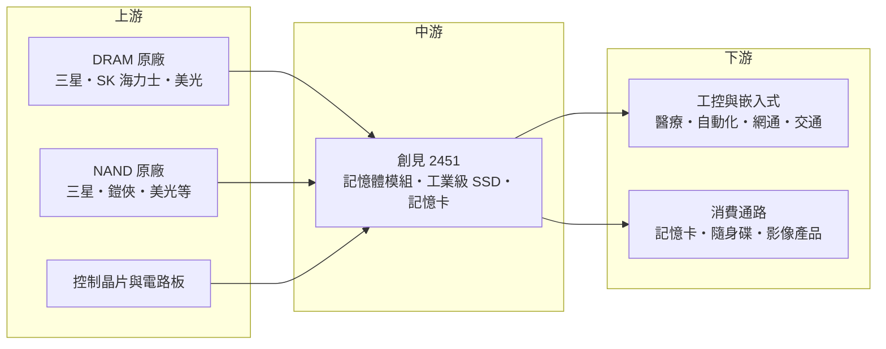

# 2451 創見

> 上市｜[[產業索引-半導體業|半導體業]]｜上市（櫃）日期 2001/05/03

# 第一章：企業模式與商業藍圖

> [!info] 撰寫說明
> 本文由 Claude 依公開資料整理，架構比照 [[2330台積電]] 的四章研究，資料截至 2026-10-08。財務數字來源：證交所開放資料快照（基本資料、2026 年第二季資產負債與綜合損益、股利）、Goodinfo 經營績效頁與股利政策頁（2016 至 2025 年）、富果研究 2026 年 4 月法說會整理（工控占比、庫存與配息政策）、聯合報與優分析 2026 年財報報導；產業描述為整理性內容，尚未逐條比對原始文件。#待校對

在評估一家公司的長期投資價值時，第一步是看懂它靠什麼賺錢、為什麼能一直賺下去。本章針對創見資訊（股票代號：2451，以下簡稱創見）的商業模式進行定性分析，說明一家不生產記憶體晶片的模組廠，如何靠工控客戶、品牌與庫存管理，在全球最劇烈的半導體價格循環裡存活三十多年，並且依公司說法從未出現年度虧損。

## 一、核心定位：以工控與嵌入式應用為主的記憶體模組品牌

創見成立於 1989 年，2001 年上市，總部位於台北內湖，董事長為創辦人束崇萬，實收資本額約 43.1 億元。創見本身不生產記憶體晶片，而是向上游原廠採購 [[DRAM]] 與 [[NAND Flash]] 顆粒，搭配控制晶片與電路板，做成記憶體模組、工業級 [[SSD]]、記憶卡、隨身碟，以及行車記錄器、密錄器等影像產品，以自有品牌 Transcend 銷售到全球。

理解創見，要先理解「模組廠」在記憶體產業中的位置。記憶體產業的核心價值掌握在少數晶片原廠手上，模組廠的角色是把標準化的顆粒，轉換成符合特定客戶需求的產品，並承擔通路、庫存與售後服務。這個位置的附加價值不高，因此多數模組廠的獲利高度依賴顆粒價格的漲跌。創見的不同之處，在於它長期把重心放在工業控制與嵌入式市場，而不是比價最激烈的消費性零售市場。依富果整理的 2026 年 4 月法說會內容，工控相關產品占 2025 年營收約 62.8%，高於 2024 年的 58.3%。

工控客戶的需求特性與消費者完全不同。一台[[工業電腦]]、醫療設備或網通設備的產品生命週期可能長達五到十年，客戶在乎的是同一規格能否長期穩定供貨、產品能否在高溫與震動環境下可靠運作，以及出問題時供應商能否即時支援。這類客戶一旦完成驗證，就不會為了幾個百分點的價差更換供應商。法說會資料提到，創見與美國兩大醫療相關客戶、歐洲最大的自動化公司與美國大型網通公司都有長期合作關係，這是創見營運穩定性的主要來源。

## 二、終端應用／產品板塊：工控占比逐年提高

- **工控與嵌入式解決方案（約 63%）：** 這是創見的主力，涵蓋交通、醫療、數位娛樂、工業自動化、網通、嵌入式運算、AIoT 與國防等八大領域。產品包括工業級記憶體模組、工業級 SSD 與記憶卡，特點是寬溫、長期供貨與客製化韌體。工控產品的毛利率與客戶黏著度都高於消費性產品，因此占比提高代表創見的獲利品質在改善。
- **消費性產品（約 37%，推算）：** 包括記憶卡、隨身碟、外接硬碟、消費性 SSD，以及行車記錄器與密錄器等影像產品。這塊業務的價值在於品牌曝光與通路規模，但價格競爭激烈，獲利波動也較大。
- **產品技術組合：** 依法說會整理，創見的 NAND 產品已不使用 SLC，MLC 約占一成、TLC 約占九成。公司在 MLC 停產前已備足最後一批庫存，預計可支應到 2026 年底，這是工控模組廠為客戶處理「舊規格停產」問題的典型做法。

## 三、資本轉化邏輯（營運模式）：顆粒成本、庫存週期與高配息

- **獲利主要來自顆粒價差：** 模組廠的成本結構中，記憶體顆粒占絕大部分，加工附加價值有限。當記憶體價格上漲時，先前以低價買進的庫存按新價格出售，會產生明顯的[[庫存利益]]；價格下跌時，高價庫存則要認列[[存貨跌價損失]]。這使得創見的毛利率在不同年份之間差異很大，從 2020 年的 21.6% 到 2025 年的 46.8% 都出現過。
- **[[LTA]] 確保缺貨時拿得到貨：** 記憶體缺貨時，原廠會優先供應大客戶與長約客戶。創見與主要供應商簽有長期供貨協議，讓它在 2025 至 2026 年的缺貨潮中仍能維持出貨。對工控客戶來說，「拿得到貨」本身就是選擇供應商的重要理由。
- **輕資產與高配息：** 模組廠的生產設備以表面黏著、測試與自動化設備為主，資本支出遠低於晶圓廠。創見因此能把大部分盈餘以現金股利發還股東，法說會提到過去多年的配發率在九成以上。主要的資金需求是採購顆粒所需的[[營運資金]]，而不是蓋廠。
- **極少對外籌資：** 依富果整理，創見規劃發行可轉換公司債，是成立 37 年來首次對外籌資計畫，反映記憶體價格高漲時，備貨所需的營運資金大幅增加。

## 四、企業長期藍圖：從模組廠走向工控儲存解決方案商

- **深耕工控與嵌入式：** 管理層的長期方向是提高工控占比、加強研發與自動化製造，並在全球 12 個營運據點為大型客戶提供在地化服務，目標是「以價值而非價格競爭」。這個方向如果成功，創見的毛利率在記憶體跌價期的下限會逐步墊高。
- **跟上記憶體規格演進：** 從 [[DDR5]] 高速大容量模組到高層數 [[3D NAND]] 的 SSD 與記憶卡，創見必須持續推出新規格，才能在工控客戶的新設計中取得位置。
- **[[邊緣運算]]帶來的新需求：** 機器人、智慧工廠、車載與 AI PC 等應用，需要在設備端儲存與處理大量資料，對耐用、可靠的工業級儲存產品需求會增加，這是創見工控業務的長期成長動能。

# 第二章：護城河深度與競爭優勢

在長期價值投資中，「護城河」指企業抵禦競爭、長期維持超額利潤的保護機制。本章分析創見作為記憶體模組廠的競爭優勢由哪些要素構成、在國內外面對哪些對手，以及這些優勢在記憶體循環中能守住多少。

## 一、護城河的核心組成要素

記憶體模組產業整體的護城河偏窄，因為核心零件來自少數原廠，產品規格也高度標準化。創見的優勢屬於「客戶轉換成本加上財務紀律」型的窄護城河，主要由以下三個要素構成：

- **1. 工控客戶的驗證與長期供貨承諾：** 工業與醫療設備的認證週期長，換掉記憶體或儲存供應商，客戶必須重新驗證整個系統的相容性與可靠度，成本與時間都很高。創見在工控市場累積的長期客戶，等於一份穩定的需求底盤，讓它在記憶體下行期仍能維持獲利，依公司說法成立以來從未虧損。
- **2. 品牌、自有工廠與全球服務網：** 創見經營 Transcend 品牌三十多年，在全球設有營運據點，並擁有自動化的自有工廠。自有工廠讓它能掌握品質與交期，全球據點則讓它能提供在地技術支援。法說會也提到創見是台灣第一家取得 AEO（優質企業）認證的模組廠，通關速度較快。
- **3. 保守財務與採購能力：** 創見長期幾乎沒有借款，帳上現金充裕。這讓它在價格低點有能力備貨，在缺貨期有能力與原廠簽訂長約，也讓它在跌價期能承受存貨損失而不必被迫拋售。在一個高度週期性的產業，資產負債表本身就是競爭優勢。

## 二、全球主要競爭對手格局

| 對手 | 定位 | 對創見的影響 |
|---|---|---|
| 金士頓（Kingston） | 全球最大的記憶體模組品牌，未上市 | 規模、通路與原廠關係遠勝台灣同業，主導消費性模組價格 |
| [[3260威剛]] | 台灣大型記憶體模組廠，消費性與電競比重高 | 庫存操作積極，在消費性與部分工控市場競爭 |
| 5289宜鼎 | 工控儲存與記憶體模組專業廠 | 定位最接近創見，在工控與嵌入式市場直接競爭 |
| [[8271宇瞻]]、[[4967十銓]] | 台灣中型模組品牌 | 在消費性、工控與電競市場競爭 |
| 原廠自有模組事業 | 三星、美光、SK 海力士的模組與 SSD 產品 | 在企業級與消費性 SSD 市場與模組廠直接競爭，也決定顆粒分配 |

## 三、優勢轉化：守得住／守不住／觀察重點

- **守得住：** 工控與嵌入式客戶的長期訂單。這些客戶看重驗證、供貨穩定與技術支援，價格敏感度低，讓創見在記憶體跌價期仍能維持正的營業利益。2016 至 2024 年即使營收從 221 億元降到約 100 億元，創見每年的營業利益率仍維持在 10% 以上，就是這塊底盤的證明。
- **守不住：** 記憶體價格反轉時的毛利率高點，以及消費性產品的市占率。模組廠無法控制顆粒價格，缺貨期的超額利潤會在跌價期回吐；消費性市場則面對金士頓與原廠品牌的規模競爭，營收長期難以成長。
- **觀察重點：** 長期而言，可以追蹤三件事。第一是工控占比能否持續提升到七成以上；第二是記憶體跌價期毛利率的下限是否逐步提高；第三是公司能否在缺貨期把超額獲利轉成股利，而不是轉成跌價期的高價庫存。
- **經營層與資本配置習慣：** 創見由創辦人束崇萬長期主導，經營風格以保守著稱：幾乎不舉債、不做大型併購、不追逐熱門題材，盈餘大多以現金發還股東。這種風格的好處是讓股東在完整的記憶體循環中，持續拿到穩定的現金回報；代價則是營收規模長期停滯，2016 年的 221 億元直到 2025 年才被超越。投資人看創見時，應該把它視為一檔「現金流與股利型」的週期股，而不是成長股。

# 第三章：財務體質與盈利規模

資料日期：2026-10-08。數字取自 Goodinfo 經營績效頁與股利政策頁、證交所開放資料快照與富果法說會整理，表格是撰寫當時的快照；最新月營收、毛利率、累計 EPS 由自動排程寫在本筆記的屬性欄位（月營收、毛利率、累計EPS 等）。#待校對

財務報表是檢驗護城河是否真實存在的最終標準。本章用多年度的三率、ROE、股利與資本報酬，檢視創見在完整記憶體循環中的獲利品質。

## 一、獲利能力的基石：三率

| 年度 | 營收（億元） | [[毛利率]] | [[營業利益率]] | EPS（元） | [[ROE]] |
|---|---|---|---|---|---|
| 2016 | 221 | 22.4% | 15.0% | 6.69 | 14.1% |
| 2018 | 176 | 20.0% | 12.1% | 4.83 | 10.3% |
| 2020 | 114 | 21.6% | 10.6% | 2.79 | 6.29% |
| 2021 | 143 | 29.2% | 20.2% | 5.90 | 13.2% |
| 2022 | 121 | 22.5% | 12.4% | 5.72 | 12.5% |
| 2023 | 105 | 29.0% | 18.0% | 4.63 | 10.2% |
| 2024 | 101 | 30.7% | 18.9% | 5.39 | 11.8% |
| 2025 | 171 | 46.8% | 38.3% | 12.98 | 26.0% |

（來源：Goodinfo 經營績效頁，合併報表。2026 年上半年依證交所資料：營收 324.4 億元、毛利率 76.76%、營業利益率 73.70%、EPS 46.63 元，屬記憶體缺貨高峰期的極端數字。）

- **營收長期萎縮後的循環反彈：** 2016 至 2024 年，創見營收由 221 億元一路降到約 101 億元，主要是消費性記憶卡與隨身碟需求萎縮，以及公司主動退出低毛利產品。2020 至 2025 年營收年複合成長率約 8.4%（推算），幾乎全部來自 2025 年的記憶體漲價，而不是出貨量的長期成長。
- **毛利率底部逐步墊高：** 2016 至 2020 年毛利率在 20% 至 22% 之間，2023 至 2024 年在記憶體價格並不特別好的情況下仍有 29% 至 31%，反映工控占比提高帶來的產品組合改善。這是創見長期最值得關注的變化，因為它決定了下一次跌價期的獲利下限。
- **高峰期的獲利不可外推：** 2025 年與 2026 年上半年的獲利，來自 AI 伺服器排擠一般記憶體產能所造成的缺貨與漲價。依富果整理，公司表示庫存帳面價值約 50 億元，但因單價上漲，實際數量反而減少，並強調不依賴囤貨賺取庫存利益。投資人評估創見時，應以完整循環的平均獲利判斷，而不是以高峰期的單季獲利推估長期價值。

## 二、[[ROE]]：資本效率

2021 至 2025 年創見平均 ROE 約 14.7%（推算），扣除 2025 年高峰則約 11.9%，在低負債的模組廠中屬於穩健水準。創見的 ROE 幾乎完全由本業獲利驅動，而不是靠財務槓桿：依證交所資料，2026 年第二季資產總計約 539.4 億元、負債約 154.7 億元，其中非流動負債僅約 4.9 億元，負債主要是應付帳款與應付所得稅等營運性負債；權益總計約 384.7 億元，每股淨值約 89.19 元。由於大部分盈餘都配發出去，股東權益不會快速膨脹，這也有助於維持 ROE。

## 三、資本支出、自由現金流與股利

- **[[CapEx]]：** 模組廠的資本支出以自動化設備為主，金額相對營收很小，具體數字未查得。創見真正的資金壓力來自庫存與應收帳款，在記憶體漲價期，備貨需要的營運資金會同步膨脹，這也是公司規劃首次發行可轉債的原因。
- **[[自由現金流]]：** 多年度自由現金流金額未查得。依產業特性推估，創見在記憶體跌價期因庫存下降，營業現金流通常偏強；在漲價期則因備貨，現金流可能低於帳面獲利（推估）。
- **股利穩定度：** 依 Goodinfo，2015 至 2025 年度創見每年都有配發現金股利，金額在 3.05 元到 11.78 元之間，2021 至 2024 年度約 5 至 6 元，2025 年度為 11.78 元。以 EPS 計算，2021 至 2025 年度的配發率大約在九成上下（推算），法說會亦表示過去多年配發率逾九成。沒有股票股利、股本長期不變，股東報酬完全以現金呈現。

## 四、[[ROIC]] 與 [[WACC]]：價值創造利差

- **ROIC（推算）：** 創見幾乎沒有有息負債，投入資本約等於股東權益。以 2024 年這個較接近常態的年份計算，營收約 101 億元乘以營業利益率 18.9%，營業利益約 19.1 億元，扣除 20% 稅率後稅後營業利益約 15.3 億元；股東權益以 ROE 11.8% 與稅後淨利約 23.2 億元（EPS 5.39 元乘以約 4.31 億股）回推約 197 億元，ROIC 約 7.8%（推算）。2025 年營業利益約 65.6 億元（171.25 億元乘以 38.3%），稅後約 52.5 億元，以 2026 年第二季權益 384.7 億元為分母，ROIC 約 13.6%（推算，分母已包含 2026 年上半年的高額獲利，屬保守估計）。由於股東權益中包含大量現金，若扣除現金計算營運資本報酬，實際的本業 ROIC 會更高（推估）。
- **WACC（推算）：** 以 [[CAPM]] 估算股東權益成本：無風險利率取台灣 10 年期公債約 1.75%，市場風險溢酬 6%，β 假設 0.9（記憶體模組同業常見值，未查得創見實際數字），權益成本約 7.15%。創見幾乎沒有有息負債，WACC 約等於權益成本，約 7.2%（推算）。
- **價值創造判斷：** 在 2024 年這類普通年份，創見的 ROIC 與 WACC 大致相當，略高一些；在記憶體缺貨年份，ROIC 遠高於 WACC。這代表創見是一家「平常勉強打平資金成本、在循環高峰大幅創造價值」的公司。工控占比提高能否把普通年份的 ROIC 拉到明顯高於 WACC 的水準，是判斷它能否從純週期股轉為穩定創造價值企業的關鍵。

# 第四章：總體風險與地緣政治

任何企業都無法脫離宏觀環境獨立存在。本章分析創見未來必須面對的地緣政治、產業週期、營運與技術風險。

## 一、地緣政治風險

- **上游原廠高度集中：** 全球 DRAM 由三星、SK 海力士與美光三家主導，NAND 也集中在少數幾家廠商。這些原廠分布在韓國、美國、日本與中國，任何出口管制、地緣衝突或天災，都可能影響顆粒供應與價格，模組廠只能被動承受。
- **中國記憶體廠的崛起：** 中國記憶體原廠在政策支持下擴產，可能改變全球供需結構，短期壓低價格，長期也可能受到美國管制而使供應鏈分裂。模組廠在選擇顆粒來源時，必須同時考慮成本與客戶對產地的要求。
- **關稅與在地化要求：** 創見的工控客戶分布在美國與歐洲，美國對電子產品的關稅政策，可能影響產品售價與客戶的供應鏈安排（推估）。

## 二、產業週期與市場結構風險

- **記憶體循環：** 記憶體是半導體中週期最劇烈的產品，價格可能在一年內翻倍，也可能在一年內腰斬。2025 至 2026 年的漲價來自原廠把產能轉向 [[HBM]] 與高階伺服器記憶體，當新產能開出或 AI 需求放緩，價格回落幾乎是必然的，只是時間點難以預測。
- **[[長鞭效應]]：** 缺貨時客戶會超額下單、提前備貨，價格反轉時又會同時去化庫存，讓需求下滑的幅度被放大。模組廠位在供應鏈中段，最容易受到這種波動衝擊。
- **議價權不對稱：** 原廠決定顆粒價格與分配量，模組廠只能在品牌、服務與產品組合上爭取空間。這個結構性弱勢不會因為單一循環的高獲利而改變。

## 三、營運環境的隱性風險

- **高價庫存的跌價損失：** 漲價期為了確保供貨而買進的高價庫存，在價格反轉時可能需要認列跌價損失，抵銷過去的庫存利益。創見的財務紀律能降低這個風險，但無法完全避免。
- **規模停滯：** 創見營收長期在 100 億至 220 億元之間，規模遠小於金士頓。在原廠分配顆粒時，規模小的模組廠可能被排在後面，這在缺貨期會限制出貨能力。
- **接班與經營風格延續：** 創見長期由創辦人主導，保守的財務紀律是公司重要的無形資產。未來經營權交接時，這種資本配置習慣能否延續，是長期股東需要留意的事（推估）。

## 四、科技與規格演進風險

- **規格世代轉換：** DDR4 轉向 DDR5、NAND 由 MLC 轉向 TLC 與 QLC，舊規格停產會讓工控客戶面臨換料與重新驗證的問題。這對創見既是風險，也是機會：能替客戶處理停產問題的供應商，客戶黏著度會更高。
- **原廠向下整合：** 原廠若擴大自有模組與 SSD 品牌，或直接服務大型工控客戶，模組廠的中間角色可能被壓縮。
- **儲存架構改變：** 邊緣運算與 AI 設備對儲存的需求在增加，但若新型記憶體或系統整合方式改變，模組產品的形態也可能跟著改變，創見需要持續投入研發才能跟上。

# 專有名詞解析

## 半導體

- **[[DRAM]]**：動態隨機存取記憶體，電腦與伺服器的主記憶體，斷電後資料會消失，價格週期波動很大。
- **[[NAND Flash]]**：高容量的快閃記憶體，斷電後資料仍保存，用於 SSD、記憶卡與手機儲存。
- **[[SSD]]**：固態硬碟，以 NAND Flash 儲存資料，速度遠快於傳統硬碟，工業級產品強調耐溫與耐用。
- **[[DDR5]]**：第五代 DDR 記憶體規格，頻寬與容量高於 DDR4，是新一代 PC 與伺服器的主流。
- **[[3D NAND]]**：把 NAND 記憶單元垂直堆疊多層以提高容量的技術，層數越高，單位容量成本越低。
- **[[HBM]]**：高頻寬記憶體，把多層 DRAM 堆疊並與 AI 晶片封裝在一起，會排擠一般 DRAM 產能。

## 應用

- **[[邊緣運算]]**：在靠近資料來源的設備上處理資料，不必全部傳回雲端，用於工廠、車輛與機器人。

## 金融

- **[[庫存利益]]**：原料價格上漲時，以較低成本買進的庫存按較高價格出售所得到的額外利潤。
- **[[存貨跌價損失]]**：庫存的市價低於帳面成本時，依會計規定認列的損失，常見於記憶體跌價期。
- **[[營運資金]]**：流動資產減流動負債，代表日常營運需要投入的資金，模組廠主要卡在庫存。
- **[[長鞭效應]]**：終端需求的小幅變動，沿供應鏈往上游傳遞時被逐級放大，造成庫存與訂單劇烈波動。
- **[[ROIC]]**：投入資本報酬率，稅後營業利益除以股東權益加有息負債，衡量本業運用資本的效率。
- **[[WACC]]**：加權平均資金成本，依股東權益與負債的比重，加權計算公司取得資金的平均成本。
- **[[CAPM]]**：資本資產定價模型，以無風險利率加上 β 乘以市場風險溢酬估算股東要求報酬率。

## 產業

- **[[工業電腦]]**：用於工廠自動化、交通、醫療等場域的電腦，強調耐用、長期供貨與規格穩定。
- **[[LTA]]**：長期供貨協議，買賣雙方約定未來一段期間的供貨量與價格機制，缺貨時能確保拿得到貨。

# 核心供應鏈

## 1. 上游：記憶體顆粒與零組件
- DRAM 與 NAND 原廠：[[005930三星電子]]、SK 海力士、美光、鎧俠（創見未公開供應商名單，屬產業常見供應來源）
- 台灣記憶體廠：[[2408南亞科]]、[[2344華邦電]]（推估）
- SSD 與記憶卡控制晶片：[[8299群聯]] 等（推估）

## 2. 中游：創見本身與同業
- 創見：工業級記憶體模組、SSD、記憶卡、隨身碟、行車記錄器與密錄器
- 台灣同業：[[3260威剛]]、5289宜鼎、[[8271宇瞻]]、[[4967十銓]]
- 國際同業：金士頓

## 3. 下游：工控與嵌入式客戶
- 醫療設備、工業自動化、網通設備與交通系統客戶（法說會提及美國醫療客戶、歐洲自動化大廠與美國網通公司，未具名）
- 工業電腦業者，例如 [[2395研華]]（推估，未查證為實際客戶）

## 4. 下游：消費市場
- 全球電子通路、電商與零售商

## 最新新聞
<!-- news:start（自動產生，請勿手動編輯此範圍） -->
- 2026-10-06 📰 媒體 18:50｜營收速報 - 創見(2451)9月營收60.35億元年增率高達290.42％｜[鉅亨網](https://news.cnyes.com/news/id/6622877)
- 2026-10-06 📰 媒體 17:58｜創見Q3營收160.7億元創次高 深化AI及工控應用｜[鉅亨網](https://news.cnyes.com/news/id/6622827)

完整紀錄：[[2451創見 新聞]]
<!-- news:end -->

## 相關連結
- [公開資訊觀測站](https://mopsov.twse.com.tw/mops/web/t05st03?step=1&firstin=1&co_id=2451)
- [Goodinfo](https://goodinfo.tw/tw/StockDetail.asp?STOCK_ID=2451)
- [Yahoo 股市](https://tw.stock.yahoo.com/quote/2451)
- [鉅亨網新聞](https://www.cnyes.com/twstock/2451/news)
