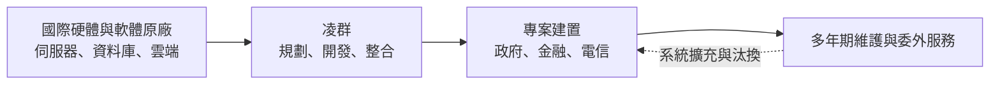
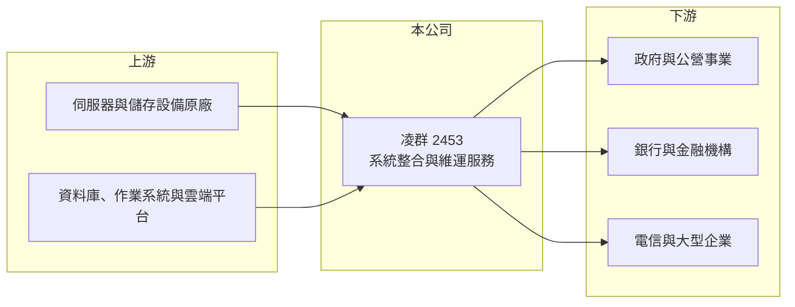

# 2453 凌群

> 上市｜[[產業索引-資訊服務業|資訊服務業]]｜上市（櫃）日期 2001/05/22

# 第一章：企業模式與商業藍圖

> [!info] 撰寫說明
> 精簡版，由 Claude 依公開資料整理，架構比照 [[2330台積電]] 的四章研究，資料截至 2026-10-08。來源：Goodinfo 年度經營績效頁與基本資料頁、證交所開放資料（基本資料、2026 年第二季資產負債與綜合損益、每月營收、股利）。客戶產業分布、海外據點與歷史沿革依記憶整理；營收比重未查得，公開資料有限。#待校對

凌群電腦是台灣歷史最久的系統整合公司之一，本章說明它如何以政府、金融與大型企業的關鍵系統為核心，靠長期合約與維運服務累積穩定的營收。

## 一、核心定位：關鍵任務系統的整合商

- **核心業務：** 凌群的登記主要業務為「電腦系統之出租與銷售、電腦系統整合及電腦軟硬體維護」（Goodinfo 基本資料）。實際上它替政府機關、銀行、電信與大型企業建置核心資訊系統，包括主機與伺服器、資料庫、應用軟體開發與後續維運，屬於典型的[[系統整合]]服務商。這類系統一旦上線就必須全年無休運作，客戶最在意的是穩定與長期服務能力。
- **公司背景：** 凌群成立於 1975 年、2001 年上市，董事長為劉瑞復，實收資本額 10 億元（證交所開放資料）。公司經營團隊長期穩定，從大型主機時代一路經歷開放系統、網路、雲端到 AI 的技術轉換（依記憶整理，待校對）。
- **營收結構：** 公開資料未查得產品別比重。以業務性質推估，營收由硬體與軟體轉售、客製化軟體開發、維護與委外服務組成，客戶以政府與公營事業、金融業、電信與製造業為主（推估，待校對）。維護與委外服務按年計價，構成公司的[[經常性收入]]基礎。
- **營運據點：** 以台灣為主，並在中國與東南亞設有子公司服務海外客戶（依記憶整理，待校對）。

## 二、資本轉化邏輯：先建置、後維運

凌群的商業模式是先以專案取得客戶，系統上線後再以維護與功能擴充延續合作。政府與銀行的核心系統使用年限常達十年以上，期間的版本更新、法規調整、資安強化都會產生新的服務需求。這讓凌群的營收雖然沒有爆發性成長，卻能年年穩定增加，2020 至 2025 年營收由 57.6 億元增加到 74.3 億元（Goodinfo）。

## 三、長期方向

公司近年把資源放在雲端轉型、資安與 AI 應用，協助既有的政府與金融客戶把舊系統搬上雲端或導入數據分析（依產業趨勢推估，待校對）。海外市場目前規模仍小，帶著本土解決方案走向東南亞等市場，是公司長期的第二條成長路線（推估）。

# 第二章：護城河深度與競爭優勢

本章分析凌群的護城河構成，以及它在台灣系統整合市場面對的競爭。

## 一、競爭優勢

- **長期客戶關係與領域知識：** 政府與銀行的核心系統涉及大量業務規則與法規細節，凌群服務這些客戶數十年，熟悉其作業流程。新供應商即使技術相當，也需要很長時間才能累積同等的領域知識，這是系統整合業最主要的護城河。
- **轉換成本：** 核心系統更換供應商的風險極高，一旦出錯就會影響民眾或客戶服務。因此客戶通常傾向由原團隊繼續維護與升級，凌群因此擁有高續約率的維運收入（推估）。
- **穩定的獲利紀律：** 2020 至 2025 年營業利益率由 2.84% 逐年提高到 4.75%，ROE 由 9.0% 升到 14.0%（Goodinfo），顯示公司在不追求規模爆衝的情況下，持續改善專案毛利與費用控制。

## 二、主要對手

| 對手 | 定位 | 與凌群的比較 |
|---|---|---|
| [[6214精誠]] | 大型資訊服務集團 | 金融與企業系統的主要對手，產品線更廣 |
| [[2427三商電]] | 金融自動化與系統整合 | 在銀行專案上重疊 |
| [[6183關貿]] | 政府與通關資訊服務 | 公部門標案的競爭者 |
| [[2480敦陽科]] | 高科技製造業系統整合 | 企業 IT 基礎建設的競爭者 |
| 中華電信與大型電信商 | 政府雲與網路服務 | 憑網路與機房資源承接大型政府案 |

## 三、觀察重點

- **維運收入占比：** 經常性收入比重越高，營收波動越小、評價也越穩定，可惜具體數字未查得。
- **人均產值：** 系統整合業的成本主要是人力，營收成長能否快於人力成長，決定利潤率能否持續改善。
- **雲端轉型的角色：** 若客戶直接向雲端業者採購，傳統整合商的硬體轉售收入會減少，凌群需要把角色轉為雲端架構與維運服務商。

# 第三章：財務體質與盈利規模

資料日期：2026-10-08，表格是撰寫當時的快照；最新月營收、毛利率、累計 EPS 由自動排程寫在本筆記的屬性欄位（月營收、毛利率、累計EPS 等）。#待校對

本章用多年度數據檢視凌群穩定成長的獲利軌跡與資本報酬。

## 一、多年度三率與 ROE

| 年度 | 營收（新台幣） | [[毛利率]] | [[營業利益率]] | EPS（元） | [[ROE]] |
|---|---|---|---|---|---|
| 2020 | 57.6 億 | 22.8% | 2.84% | 1.70 | 9.0% |
| 2021 | 58.7 億 | 24.3% | 4.34% | 2.16 | 11.1% |
| 2022 | 59.5 億 | 25.5% | 4.44% | 2.51 | 12.2% |
| 2023 | 63.8 億 | 26.0% | 4.47% | 2.78 | 13.3% |
| 2024 | 69.3 億 | 25.8% | 4.54% | 3.06 | 14.2% |
| 2025 | 74.3 億 | 25.2% | 4.75% | 3.12 | 14.0% |
| 2026 上半年 | 33.8 億 | 24.86% | 5.20% | 1.53 | 未查得 |

註：2020 至 2025 年取自 Goodinfo；2026 上半年取自證交所綜合損益與營益分析。

- **營收成長：** 2020 至 2025 年營收年複合成長率約 5.2%（推算），2026 年 1 至 8 月累計營收約 45.9 億元、年增約 6.6%（證交所每月營收），成長平穩。
- **獲利改善：** EPS 連續五年成長，由 1.70 元增到 3.12 元，增幅明顯大於營收，代表毛利率與費用率同步改善。
- **ROE：** 2021 至 2025 年平均 ROE 約 13.0%（推算），而且逐年向上。

## 二、股利與財務結構

2025 年度配發現金股利 2.8 元，以 EPS 3.12 元計算配發率約 90%（推算），屬於高配息政策。2026 年第二季底權益約 21.3 億元、總負債約 24.3 億元，其中流動負債約 22.9 億元、非流動負債僅約 1.4 億元（證交所資產負債）。負債以流動負債為主，推估多為應付帳款與專案預收款等營運性負債，而非銀行借款（推估），這是系統整合業常見的資本結構。

## 三、[[ROIC]] 與 [[WACC]]

**ROIC 推算：** 2025 年營業利益約 74.3 億元 × 4.75% ≈ 3.53 億元，扣除 20% 稅後約 2.82 億元。投入資本以 2026 年第二季權益 21.3 億元加上非流動負債 1.4 億元（保守視為有息負債）計算，約 22.7 億元，ROIC 約 12.4%（推算）。

**WACC 推算：** 公債殖利率 1.75%、市場風險溢酬 6%、β 取資服股常見值 0.7，權益成本約 5.95%；負債成本假設 2.5%、稅後 2.0%，負債比重約 6%，WACC 約 5.7%（推算）。

**結論：** ROIC 約 12% 明顯高於約 5.7% 的 WACC，利差約 6 至 7 個百分點，代表凌群長期在創造價值。輕資產的系統整合模式不需要大量資本支出，因此能把大部分盈餘配給股東。

# 第四章：總體風險與地緣政治

本章整理凌群長期面對的產業、營運與其他風險。

## 一、產業週期

- **政府預算：** 公部門專案占比高（推估），政府資訊預算的編列與標案時程會影響營收認列的節奏。
- **金融業 IT 投資：** 銀行的核心系統更新屬於大型、長週期投資，啟動時間受監管要求與景氣影響。

## 二、營運風險

- **人力成本：** 系統整合以工程師人力為主要成本，薪資上漲若無法反映在報價上，利潤率會被壓縮。
- **專案風險：** 固定價格的大型標案若需求變更或延誤，可能出現專案虧損。
- **技術轉型：** 雲端原生、AI 與低程式碼開發工具降低了客製開發的需求，公司需要持續投資新技術與人才。

## 三、其他風險

- **資安責任：** 承接政府與金融的關鍵系統，一旦發生資安事件，不只面臨賠償，也會影響後續標案資格。
- **海外市場：** 海外子公司的規模較小，匯率與當地法規變化會帶來額外的不確定性。

# 專有名詞解析

## 應用

- **[[系統整合]]**：替客戶規劃並整合軟硬體、網路與應用系統，讓不同設備與軟體能一起運作的資訊服務。

## 金融

- **[[經常性收入]]**：按月或按年持續收取的收入，例如維護合約與訂閱費，可預測性高於一次性的專案收入。
- **[[ROIC]]**：投入資本報酬率，衡量企業用股東與債權人投入的資本，每年能產生多少稅後營業利益。
- **[[WACC]]**：加權平均資金成本，股東要求報酬與負債利息依資本結構加權後的平均值，是判斷是否創造價值的門檻。

# 核心供應鏈

- 上游：伺服器、儲存與網通設備原廠，資料庫與雲端平台業者，例如 [[MSFT微軟]]、[[AMZN亞馬遜]]、[[GOOGL谷歌]]（產業代表，非指名合作對象）。
- 下游／客戶：政府機關與公營事業、銀行與金融機構、電信與大型企業，例如 [[2412中華電]]（產業代表，非指名客戶）。
- 同業：[[6214精誠]]、[[2427三商電]]、[[6183關貿]]、[[2480敦陽科]]。

## 最新新聞
<!-- news:start -->
<!-- news:end -->

## 相關連結
- [公開資訊觀測站](https://mopsov.twse.com.tw/mops/web/t05st03?step=1&firstin=1&co_id=2453)
- [Goodinfo](https://goodinfo.tw/tw/StockDetail.asp?STOCK_ID=2453)
- [Yahoo 股市](https://tw.stock.yahoo.com/quote/2453)
- [鉅亨網新聞](https://www.cnyes.com/twstock/2453/news)
