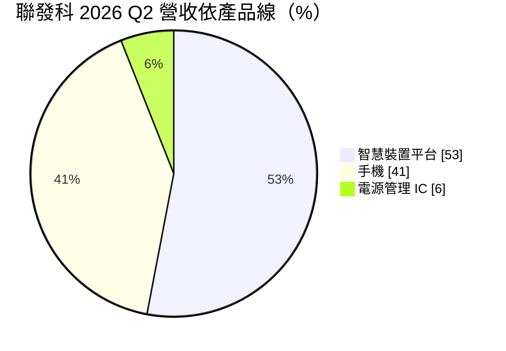
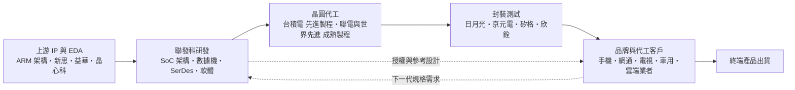
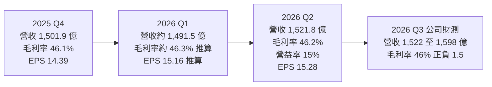

> 上市｜[[產業索引-半導體業|半導體業]]｜上市（櫃）日期 2001/07/23

# 第一章：企業模式與商業藍圖

> [!info] 撰寫說明
> 本文由 Claude 依公開資料整理，架構比照 [[2330台積電]] 的四章研究，資料截至 2026-10-08。財務數字來源：Goodinfo 經營績效頁（2019 至 2025 年度）、證交所開放資料快照（2026 年上半年損益與 2026 年第二季資產負債、股利）、風傳媒與旺得富 2026 年第二季法說會報導、優分析 2026 年 2 月法說會報導、工商時報與旺得富 2025 年第四季財報報導、Futurum Group 2026 年分析師日整理、roo.cash 歷年股利整理；公司沿革與併購年份為憑記憶整理，標註待校對；產業描述為整理性內容，尚未逐條比對原始文件。#待校對

在評估單一個股的長期投資價值時，首要步驟是拆解企業的底層獲利邏輯。本章針對聯發科技（股票代號：2454，以下簡稱聯發科）的商業模式進行定性分析，說明一家沒有晶圓廠的 IC 設計公司，如何靠「把複雜系統做成平台」的能力，從光碟機晶片一路走到全球手機處理器出貨龍頭，並在 2020 年代中期把觸角伸進 AI 資料中心。

## 一、核心定位：把整套系統做成一顆晶片的平台型 IC 設計公司

聯發科成立於 1997 年 5 月，前身是 [[2303聯電]] 的多媒體事業部（待校對），總部位於新竹科學園區。公司屬於典型的 [[Fabless]]（無晶圓廠）模式：自己負責晶片架構、電路設計、軟體與客戶支援，晶圓交給 [[2330台積電]] 等代工廠生產，封裝測試交給 [[3711日月光投控]]、[[2449京元電子]] 等專業廠商。這也是使用者在「核心供應鏈」章節中把上游列為 [[IP]] 與 [[EDA]]、中游列為晶圓代工與封測夥伴的原因。

聯發科真正的核心能力，不是單一晶片做得最快，而是把一整套系統所需的功能整合進一顆系統單晶片（[[SoC]]），再附上完整的參考設計與軟體，讓客戶能用最少的工程資源推出產品。這種「交鑰匙」（[[Turnkey]]）模式最早用在 DVD 播放機與功能手機晶片上，讓中國大量中小品牌得以快速做出手機（待校對）。進入智慧型手機時代後，同一套方法延伸到 4G、5G 手機處理器，使聯發科依 Futurum Group 整理的分析師日資料，成為全球手機應用處理器（[[AP]]／SoC）市占第一的供應商。

這種平台能力有兩層商業意義：

* **以研發規模換取多產品線的槓桿：** 手機晶片累積的處理器、數據機、影像與省電技術，可以重複用在電視、Wi-Fi 路由器、車用座艙、筆電與資料中心晶片上。同一筆研發投入被多條產品線分攤，是聯發科能同時經營數十種產品的基礎。
* **以客戶上市速度建立黏著度：** 客戶採用聯發科平台，不只是買一顆晶片，而是連同軟體、驅動程式與參考設計一起導入。下一代產品沿用同一套開發環境最省事，這讓客戶關係在世代之間延續。

公司的另一個長期特色是透過併購擴張版圖。依公開資料，聯發科在 2011 年合併無線網路晶片廠雷凌、2012 年宣布合併電視晶片廠晨星、並在 2010 年代中後期取得電源管理 IC 廠立錡的全部股權，旗下另有藍牙音訊晶片子公司 [[6526達發]]（以上年份待校對）。這幾次併購分別補齊了網通、電視與電源管理三塊拼圖，也形塑了今天「手機、智慧裝置平台、電源管理」三大產品線的架構。

## 二、終端應用板塊：手機比重下降，智慧裝置平台成為最大板塊

聯發科把產品分成三大類。依風傳媒整理的 2026 年第二季法說會資料，營收結構如下：

* **手機：** 以天璣（Dimensity）系列 5G 手機 SoC 為主，從入門機到旗艦機都有產品。依優分析報導，2025 年手機營收超過 100 億美元、年增 8%，其中旗艦晶片約 30 億美元，都是歷史新高。主要客戶是 Android 陣營，包括使用者在供應鏈章節列出的 [[005930三星電子]]、[[1810小米]]、OPPO、vivo 與 [[688036傳音控股]]。2026 年因記憶體漲價推升手機物料成本、壓抑終端需求，第二季手機營收年減 20%，比重一度降到 41%。
* **智慧裝置平台：** 涵蓋 Wi-Fi 與網通、寬頻、電視與顯示器、平板與 Chromebook、車用座艙、物聯網與資料中心 [[ASIC]]。依優分析報導，2025 年通訊類產品營收超過 30 億美元，[[Wi-Fi]] 7 營收成長三倍、5G 數據機晶片翻倍。這一塊正是使用者供應鏈章節第 6、7 節所描述的網通、電視與 AI 運算客戶群，例如 [[CSCO思科]]、[[3596智易]]、[[5388中磊]]、[[SONY索尼]] 與 [[NVDA輝達]]。2026 年第二季智慧裝置平台年增 26%，比重升到 53%，首度明顯超過手機。
* **電源管理 IC：** 主要來自立錡體系的 [[PMIC]]，用在手機、筆電、伺服器與消費性電子，比重約 6%，營收相對平穩。

這個結構的轉變很重要。過去聯發科的獲利高度跟著手機景氣起伏；當智慧裝置平台與資料中心的比重上升，公司的成長來源變得更分散，也更接近企業端（B2B）的長期合約型生意。

## 三、資本轉化邏輯：研發是最大的「資本支出」

* **輕資產、重研發：** 聯發科不需要蓋晶圓廠，真正的投入是工程師與先進製程的開發費用。依工商時報報導，2025 年第四季研發費用 392.48 億元，占營收超過 26%。以 2026 年上半年證交所資料計算，營業費用 936 億元，占營收約 31%（推算），其中大部分是研發。換句話說，聯發科的「產能」是研發團隊，研發費用就是它最主要的資本支出。
* **與代工廠綁定先進製程：** 旗艦手機晶片與資料中心 ASIC 都使用台積電最先進的製程。依旺得富報導，2 奈米旗艦手機晶片在 2026 年第三季推出。能否第一時間取得最先進產能，直接決定旗艦產品的競爭力，這也是使用者把台積電列為「旗艦級與高階製程主力」的原因。
* **成熟製程分散供應：** 電源管理、Wi-Fi 等晶片使用 [[2303聯電]]、[[5347世界先進]] 等成熟製程代工，必要時也與 [[005930三星電子]]、[[INTC英特爾]] 合作，以分散產能與地緣風險。
* **獲利的關鍵在毛利率與費用率的平衡：** 晶片售價扣掉晶圓與封測成本後，聯發科長期把[[毛利率]]維持在 46% 到 50% 之間；再扣掉 30% 上下的營業費用，[[營業利益率]]落在 15% 到 23%。公司在 2026 年面對晶圓、封裝與記憶體成本上升時，明確表示以調價轉嫁成本、目標是守住毛利率，而不是追求更高毛利，這反映出它以市占與長期客戶關係為優先的定價哲學。

## 四、企業長期藍圖：從手機晶片公司轉型為多引擎的運算平台

依 Futurum Group 整理的 2026 年分析師日內容，聯發科把自己的轉型描述為從「單一引擎」走向「多引擎」時代，並把資料中心列為最優先的事業。

* **資料中心 ASIC：** 聯發科替雲端業者（[[CSP]]）設計客製化 AI 加速晶片，競爭對手是 [[AVGO博通]] 與 [[MRVL邁威爾]]。它的優勢來自長年替思科、Juniper 等網通設備商開發的高速傳輸介面（[[SerDes]]），以及在 224G、448G 世代的投入。依旺得富報導，首款 AI 加速器 ASIC 預計 2026 年第四季量產，第二款目標 2028 年量產，2026 年資料中心相關營收預估超過 20 億美元。依優分析報導的 2026 年 2 月法說，公司預估 ASIC 在 2027 年可占營收約兩成。市場普遍解讀的主要客戶是 [[GOOGL谷歌]] 的 [[TPU]] 專案（推估，公司未公開客戶名稱），這和使用者在供應鏈章節把 Google、Meta 列為「ASIC 客製化合作潛力」一致。
* **與輝達的運算合作：** 聯發科與 [[NVDA輝達]] 共同開發 GB10 超級晶片，由聯發科提供 CPU 與記憶體子系統、輝達提供 GPU，用在 DGX Spark 個人 AI 電腦。雙方也在車用智慧座艙（Dimensity Auto）合作。這讓聯發科取得進入 PC 與工作站市場的門票，也對應使用者供應鏈章節第 7 節的策略聯盟。
* **Arm 架構 PC 與車用：** 聯發科已是 Arm 架構 Chromebook 的第一大供應商，並希望協助 PC 品牌把 Arm 筆電推向主流；車用方面與 Denso 合作安全系統整合，智慧座艙則與輝達合作。
* **資金準備：** 依旺得富報導，董事會在 2026 年核准 50 億美元的彈性融資預算，用來確保先進製程與先進封裝產能。這代表 ASIC 事業需要預先鎖定供應鏈，資本需求比傳統手機晶片更高，是聯發科經營模式的一個結構性變化。

# 第二章：護城河深度與競爭優勢

在長期價值投資中，「護城河」指企業抵禦競爭、維持超額利潤的保護機制。本章分析聯發科的護城河構成、全球主要競爭對手，以及這些優勢在手機成熟化與 AI 晶片競賽中能守住多少。

## 一、聯發科護城河的核心組成要素

聯發科的護城河屬於「寬但需要持續投資維護」的類型。它沒有晶圓廠那種實體資產的進入障礙，優勢主要來自技術累積、規模與客戶生態系，由四個要素組成：

* **1. 數據機與完整 SoC 的技術門檻：** 手機 SoC 最難的部分是蜂巢式數據機，必須支援全球各國的 2G 到 5G 規格，並通過各地電信商認證。全世界能獨立做出高階 5G 數據機並整合進 SoC 的公司只有少數幾家，聯發科是其中之一。這個門檻讓新進者很難在手機市場直接挑戰它，連蘋果自研數據機都花了多年時間。
* **2. 規模經濟與研發攤提：** 聯發科每年研發費用以千億元計（2025 年第四季單季即達 392 億元），而這些投入可以分攤到數億顆手機晶片與數十條非手機產品線上。中小型 IC 設計公司即使技術可行，也很難負擔先進製程每一代越來越高的光罩與設計成本。
* **3. 客戶生態系與轉換成本：** 從中國手機品牌、網通設備廠到電視品牌，客戶的軟體、驅動程式與生產測試流程都建立在聯發科平台上。換平台不只是換晶片，而是重做軟體驗證與產線測試，因此客戶傾向在世代之間延續合作。
* **4. 與台積電的先進製程夥伴關係：** 聯發科是台積電長年的大客戶，能在 3 奈米、2 奈米等最新節點較早取得產能與設計支援。在先進製程產能吃緊的年代，這本身就是競爭優勢。

## 二、全球主要競爭對手格局

| 對手 | 定位 | 對聯發科的威脅 |
|---|---|---|
| [[QCOM高通]] | 手機 SoC 與數據機龍頭，旗艦 Android 主力 | 在旗艦手機與數據機專利上直接競爭，也是 Arm PC 的主要對手 |
| [[AAPL蘋果]] | 自研 A 系列與 M 系列晶片、自研數據機 | 不對外銷售，但壓縮高階手機晶片的可服務市場 |
| [[005930三星電子]] | Exynos 手機晶片，同時是聯發科客戶 | 三星手機若提高自家晶片比例，聯發科的份額會減少 |
| 紫光展銳 | 中國手機晶片廠，主攻入門機 | 在低價手機與新興市場以價格競爭 |
| 中國手機品牌自研晶片 | 華為海思、小米玄戒等 | 中國品牌自研比例上升，可能侵蝕聯發科的中高階份額 |
| [[AVGO博通]]、[[MRVL邁威爾]] | 資料中心 ASIC 與高速 SerDes 龍頭 | 已與雲端業者有多年合作，是聯發科切入 ASIC 的主要對手 |
| [[2379瑞昱]] | 網通、電視、音訊晶片 | 在 Wi-Fi、電視與 PC 周邊晶片與聯發科重疊 |

## 三、優勢轉化：哪些市場守得住、哪些守不住

* **守得住：** 中階與入門 5G 手機、Wi-Fi 路由器與寬頻設備、智慧電視晶片。這些市場重視整合度、成本與上市速度，正好是聯發科平台模式最強的地方。依 Futurum 整理，聯發科在 Android 電視與手機 AP 市占都是全球第一。
* **守得較吃力：** 旗艦手機。旗艦晶片的毛利高，但需要和高通在效能、功耗與品牌偏好上正面競爭，又面臨中國品牌自研晶片的替代。2025 年旗艦晶片營收約 30 億美元創新高，代表聯發科已在旗艦市場站穩，但每一代都必須重新爭取。
* **尚待證明：** 資料中心 ASIC。博通與邁威爾擁有多年的雲端客戶關係，聯發科的第一款產品在 2026 年第四季才量產，Futurum 也指出雲端業者的設計週期長、既有供應商會強力反擊，市占提升會是多年的過程。
* **觀察重點：** 第一，ASIC 是否如期放量，以及第二款 ASIC 能否帶來新客戶或更大的份額；第二，智慧裝置平台的比重能否穩定在五成以上，讓公司降低對手機景氣的依賴；第三，在晶圓與記憶體成本上升時，毛利率能否維持在 46% 左右的目標區間。

# 第三章：財務體質與盈利規模

資料日期：2026-10-08。數字取自 Goodinfo 經營績效頁、證交所開放資料快照與法說會報導，表格是撰寫當時的快照；最新月營收、毛利率、累計 EPS 由自動排程寫在本筆記的屬性欄位（月營收、毛利率、累計EPS 等）。#待校對

財務報表是檢驗護城河是否真實存在的最終標準。本章用多年度的三率、[[ROE]]、股利與資本報酬，檢視聯發科在手機週期與 AI 轉型中的獲利品質。

## 一、獲利能力的基石：三率

| 年度 | 營收（新台幣） | [[毛利率]] | [[營業利益率]] | EPS（元） | [[ROE]] |
|---|---|---|---|---|---|
| 2019 | 2,462 億 | 41.9% | 9.17% | 14.69 | 7.88% |
| 2020 | 3,221 億 | 43.9% | 13.4% | 26.01 | 12.0% |
| 2021 | 4,934 億 | 46.9% | 21.9% | 70.56 | 27.7% |
| 2022 | 5,488 億 | 49.4% | 23.1% | 74.59 | 27.1% |
| 2023 | 4,334 億 | 47.8% | 16.6% | 48.51 | 18.9% |
| 2024 | 5,306 億 | 49.6% | 19.3% | 66.92 | 27.5% |
| 2025 | 5,960 億 | 47.5% | 17.4% | 66.16 | 26.1% |
| 2026 上半年 | 3,013 億 | 46.25% | 15.19% | 30.44 | 約 22.9%（年化推算） |

資料來源：2019 至 2025 年為 Goodinfo 經營績效頁；2026 上半年依證交所綜合損益與營益分析快照（營收 3,013.3 億元、營業利益 457.6 億元、歸屬母公司淨利 484.9 億元），ROE 以上半年淨利年化除以 2026 年第二季歸屬母公司權益 4,241.9 億元推算。

* **毛利率長期穩定在高檔：** 2019 年毛利率 41.9%，2021 年後穩定在 46% 到 50% 之間。5G 時代聯發科打入中高階與旗艦手機，產品組合往上移，是毛利率站穩高檔的主因。對 IC 設計公司而言，毛利率代表產品的技術含量與議價能力，能長期守在 46% 以上，說明聯發科已不是單純靠低價取勝。
* **營業利益率反映研發投入的節奏：** 2021、2022 年 5G 換機潮讓營業利益率衝上 22% 到 23%；2023 年手機庫存調整，營收下滑兩成，營業利益率掉到 16.6%。2025 年到 2026 年上半年營收仍在成長，營業利益率卻從 19.3% 降到 15% 左右，主因是 AI、資料中心與 2 奈米平台的研發費用大幅增加。這是「先投入、後收成」的典型階段，要等 ASIC 放量後才能驗證回報。
* **營運槓桿明顯：** 聯發科的費用以研發人力為主，短期內相對固定。營收擴張時利潤成長更快，營收衰退時利潤下滑也更劇烈，2023 年 EPS 從 74.59 元跌到 48.51 元就是例子。

## 二、[[ROE]]：資本效率

聯發科 2021 至 2025 年的 ROE 分別為 27.7%、27.1%、18.9%、27.5% 與 26.1%，五年平均約 25.5%（推算）。即使在 2023 年的手機低谷，ROE 仍接近 19%，顯示獲利能力有相當的韌性。2020 年至 2025 年營收從 3,221 億元成長到 5,960 億元，年複合成長率約 13.1%（推算）；若從 2019 年算起則約 15.9%（推算）。

ROE 能長期維持在 25% 上下，關鍵在於 Fabless 模式不需要大量固定資產，加上高配息政策把多餘現金還給股東、避免權益過度膨脹。依證交所 2026 年第二季資產負債快照，聯發科資產總計 7,874 億元，負債 3,548 億元，權益 4,326 億元，每股淨值 265.77 元。負債以流動負債（3,203 億元）為主，多屬應付帳款、應付股利與員工酬勞等營運性負債，而非借款（推估）。

## 三、資本支出、自由現金流與股利

* **[[CapEx]] 低：** 作為 Fabless 公司，聯發科的資本支出主要是辦公大樓、研發設備與測試機台，相對營收很小（具體金額未查得）。這讓營業現金流絕大部分可以轉成[[自由現金流]]，自由現金流長期為正（推估，依商業模式與高配息紀錄）。
* **股利政策：** 聯發科自 2023 年起改為半年配息。依 roo.cash 整理，2020 至 2022 年度現金股利分別為 37 元、73 元與 76 元，2021 至 2024 年每年另含 16 元特別股利。依證交所股利資料，2025 年下半年配發 24.5 元，加上上半年 29 元，2025 年度合計 53.5 元，以全年 EPS 66.16 元計算配發率約 81%（推算）。2024 年度合計 54 元，配發率同樣約 81%（推算）。高且穩定的配發率，是聯發科資本配置最明顯的特徵。
* **轉型帶來的新資本需求：** 2026 年董事會核准 50 億美元彈性融資預算，用來鎖定先進製程與封裝產能。如果 ASIC 事業需要預付產能或長期合約，未來的自由現金流與配發率可能和過去不同，這是長期投資人需要追蹤的變化。

## 四、[[ROIC]] 與 [[WACC]]：價值創造利差

**ROIC 推算：** 2025 年營收 5,960 億元 × 營業利益率 17.4% ＝ 營業利益約 1,037 億元，以 20% 稅率計算稅後營業利益約 830 億元。投入資本以 2026 年第二季權益總計 4,326 億元為基礎；聯發科的有息負債金額未查得，從負債結構判斷借款很少，此處以零計（推估）。2025 年 ROIC 約 830 ÷ 4,326 ＝ 19.2%（推算）。2026 年上半年營業利益 457.6 億元年化後稅後約 732 億元，ROIC 約 16.9%（推算）。需要注意的是，權益中包含大量現金與金融資產，若扣除這些非營業資產，本業實際的 ROIC 會明顯更高。

**WACC 推算：** 台灣 10 年期公債殖利率取 1.75%，市場風險溢酬取 6%，β 取大型 IC 設計股常見的 1.0 至 1.3（聯發科本身的 β 未查得），股東權益成本約 7.8% 至 9.6%。由於幾乎沒有有息負債，WACC 約等於股東權益成本，約 7.8% 至 9.6%（推算）。

**解讀：** 聯發科的 ROIC 約 17% 到 19%，比 WACC 高出約 8 到 11 個百分點，代表公司長期在創造經濟價值。不過利差在 2025 年後收窄，原因是研發費用為 AI 與資料中心預先投入。未來 ROIC 能否回到 2021、2022 年的水準，取決於 ASIC 放量後的獲利能否覆蓋這波研發投資。

# 第四章：總體風險與地緣政治

任何企業都無法脫離宏觀環境獨立存在。本章分析聯發科未來必須面對的地緣政治、產業週期與營運風險。

## 一、地緣政治風險

* **中國市場的雙重依賴：** 中國手機品牌是聯發科手機業務最重要的客戶群，使用者在供應鏈章節列出的小米、OPPO、vivo、傳音都屬於這個陣營。這帶來兩個風險：一是美國對中國的出口管制若擴大到手機晶片或先進製程，聯發科可能被限制出貨；二是中國推動晶片自主，品牌自研晶片與本土晶片廠的比重上升，會逐步侵蝕聯發科的份額。
* **生產集中在台灣：** 聯發科雖然沒有工廠，但旗艦晶片與資料中心 ASIC 幾乎都在台積電台灣廠生產，封測也集中在台灣。兩岸情勢若影響台灣半導體生產，聯發科會和台積電同時受到衝擊。
* **美國關稅與在地化：** 美國對半導體或電子產品課徵關稅時，雖然晶片本身不一定直接被課稅，但終端產品成本上升會壓抑需求。聯發科與英特爾、三星的代工合作，有部分分散生產地點的意義。

## 二、產業週期與市場結構風險

* **手機市場成熟：** 全球智慧型手機出貨已多年沒有明顯成長，依旺得富報導，聯發科在 2026 年預估全球手機出貨年減 15%。手機業務的成長將主要靠旗艦晶片的份額與單價，而非整體市場擴大。
* **[[長鞭效應]]與庫存週期：** 2023 年手機庫存調整讓聯發科營收年減約兩成，說明 IC 設計公司處在供應鏈上游，終端需求的小幅變化會被放大反映在晶片訂單上。
* **AI 資本支出週期：** 資料中心 ASIC 的成長依賴雲端業者持續擴大 AI 投資。若 AI 投資放緩，或雲端業者改變自研晶片的策略與供應商分配，聯發科的新事業會受影響，而且相關研發與產能預付已經投入。

## 三、營運環境的隱性風險

* **成本上升與毛利壓力：** 依風傳媒報導，2026 年晶圓、封裝與記憶體成本同步上升。先進製程每一代的晶圓價格都更高，聯發科必須把成本轉嫁給客戶，但在中低階手機市場轉嫁空間有限。
* **客戶集中：** 資料中心 ASIC 屬於少數大客戶的專案型生意，單一客戶的設計勝負就可能大幅影響營收。
* **人才競爭：** IC 設計的核心資產是工程師。AI 熱潮讓全球晶片設計人才搶手，研發人力成本持續上升，也是營業費用率居高不下的原因之一。
* **匯率：** 營收以美元計價為主，新台幣升值會壓縮以台幣計算的營收與獲利。

## 四、科技演進風險

聯發科必須在每一代製程與通訊標準上準時推出產品。手機方面，從 5G 到未來 6G 的數據機研發、以及 2 奈米之後的製程轉換，都需要龐大的前期投入；任何一代延誤，都可能讓高通或自研晶片的品牌拿走旗艦份額。資料中心方面，AI 加速器的架構演進極快，高速傳輸從 224G 走向 448G、封裝從 [[CoWoS]] 走向更大的 [[Chiplet]] 與共同封裝光學（[[CPO]]），聯發科能否在這些技術上持續領先，決定它能否在博通與邁威爾主導的市場站穩。另一方面，[[RISC-V]] 等開放架構的興起，長期可能改變處理器 IP 的授權結構，對依賴 [[ARM安謀]] 架構的聯發科既是機會也是不確定性。

# 專有名詞解析

## 半導體

- **[[Fabless]]**：無晶圓廠的 IC 設計模式，公司只負責設計晶片，生產交給晶圓代工廠，代表廠商為聯發科、高通。
- **[[SoC]]**：系統單晶片，把處理器、繪圖、數據機、影像處理等功能整合在同一顆晶片上，是手機的核心元件。
- **[[Turnkey]]**：交鑰匙方案，晶片商連同參考設計與軟體一起提供，讓客戶不必從零開發就能推出產品。
- **[[ASIC]]**：特殊應用積體電路，為特定用途客製的晶片，例如雲端業者自研的 AI 加速器。
- **[[SerDes]]**：串列器與解串器，負責晶片之間高速傳輸資料的電路，是 AI 伺服器與網通晶片的關鍵技術。
- **[[PMIC]]**：電源管理 IC，負責把電池或電源轉換成各元件所需的電壓，並控制耗電。
- **[[TPU]]**：張量處理器，Google 自行設計、專門處理 AI 運算的加速晶片。
- **[[Chiplet]]**：小晶片架構，把大晶片拆成多顆小晶片再以先進封裝整合，可提高良率並混用不同製程。
- **[[CPO]]**：共同封裝光學，把光學收發元件和運算或交換晶片封裝在一起，以降低高速傳輸的耗電。
- **[[RISC-V]]**：開放免授權費的處理器指令集架構，可作為 ARM 架構以外的選擇。
- **[[AP]]**：應用處理器，手機中負責執行作業系統與應用程式的主處理器，常與數據機整合成 SoC。

## 應用

- **[[Wi-Fi]]**：無線區域網路標準，Wi-Fi 7 是最新一代，傳輸速度與穩定度大幅提升。
- **[[CSP]]**：雲端服務供應商，例如 Amazon、Google、Microsoft、Meta，是 AI 伺服器與客製化晶片的主要買家。

## 金融

- **[[ROIC]]**：投入資本報酬率，衡量企業用股東與債權人資金創造本業利潤的效率。
- **[[WACC]]**：加權平均資金成本，企業取得股權與債務資金的綜合成本，ROIC 高於 WACC 才算創造價值。
- **[[長鞭效應]]**：終端需求的小幅變動，沿供應鏈往上游傳遞時被逐級放大，造成上游庫存與訂單劇烈波動。

# 核心供應鏈

# 2454聯發科全景生態系與核心供應鏈

## 1. 上游：矽智財 (IP) 與設計工具 (EDA)
- 行動裝置處理器核心架構 IP：[[ARM安謀]]
- RISC-V 開源架構 IP 合作：[[6533晶心科]]
- 基礎元件與傳輸介面 IP：[[6643M31]]、[[3035智原]]
- 電子設計自動化軟體 (EDA)：[[SNPS新思科技]]
- 電子設計自動化軟體 (EDA)：[[CDNS益華電腦]]

## 2. 中游：晶圓代工生產夥伴 (Foundry)
- 旗艦級與高階製程主力 (天璣系列)：[[2330台積電]]
- 成熟製程主力 (電源管理、Wi-Fi 晶片)：[[2303聯電]]
- 電源管理與驅動 IC 代工：[[5347世界先進]]
- 特殊製程與多元代工備援：[[005930三星電子]]
- 智慧邊緣晶片策略代工合作：[[INTC英特爾]] (IFS)

## 3. 中游：專業封裝與最終測試廠 (OSAT)
- 全球最大高階封裝主力廠：[[3711日月光投控]]
- 高階手機晶片與網通晶片封測：[[AMKR艾克爾]]
- 主力晶片最終測試廠 (FT)：[[2449京元電子]]
- 網通與電源管理晶片測試：[[6257矽格]]
- 車用晶片與微控制器測試：[[3264欣銓]]

## 4. 中游：測試介面與高階檢測分析
- 高階晶圓測試探針卡：[[6510精測]]
- 垂直與懸臂式探針卡：[[6223旺矽]]
- 高階同軸測試座 (Socket)：[[6515穎崴]]
- 晶片可靠度驗證分析：[[3289宜特]]
- 晶圓材料分析與故障排除：[[3587閎康]]

## 5. 下游：智慧型手機主力客戶 (Android 陣營)
- 國際智慧手機巨頭 (中低階與 A 系列)：[[005930三星電子]]
- 中高階智慧手機大廠：[[1810小米]]
- 中國非上市手機巨頭 (步步高體系)：OPPO
- 中國非上市手機巨頭 (步步高體系)：vivo
- 非洲智慧手機之王：[[688036傳音控股]]

## 6. 下游：網通、智慧顯示與終端設備客戶
- 全球網通設備巨頭：[[CSCO思科]]
- 台灣網通設備代工廠：[[3596智易]]
- 台灣寬頻與無線通訊代工：[[5388中磊]]
- 台灣網通交換器代工：[[3380明泰]]
- 智慧電視與顯示設備：[[SONY索尼]]
- 智慧電視與顯示設備：[[6753夏普]]

## 7. 策略聯盟：車用電子與 AI 運算 (未來藍圖)
- 車用智慧座艙與 AI 策略結盟：[[NVDA輝達]] (合作 Dimensity Auto 平台)
- 邊緣 AI 與 AI PC 運算平台生態合作：[[MSFT微軟]]
- 大型雲端伺服器 (ASIC 客製化合作潛力)：[[GOOGL谷歌]]
- 大型雲端伺服器 (ASIC 客製化合作潛力)：[[META臉書]]

## 供應鏈關係
- [[2330台積電]] 的客戶：行動通訊與 5G 晶片（台積電供應鏈 › 下游：頂級 IC 設計客戶 (Fabless) › 智慧手機與消費性電子）

## 最新新聞
<!-- news:start（自動產生，請勿手動編輯此範圍） -->
- 2026-10-13 📰 媒體 15:51｜10/13 台股重挫 960 點！長榮 2603 逆勢上漲，聯發科、0050 為何走弱？｜[果仁家](https://news.google.com/rss/articles/CBMiU0FVX3lxTE1LeDFLZVJMb2hLV2kyYS1OQ2NhN1FndDJTcW1HdUVxZkdyRGpXLVZ4ZEdwMk9TN3FWQlpMajcxdGxLTG13U0VUMW45TXJMaWJqRlJR?oc=5)
- 2026-10-13 📰 媒體 09:31｜台股開盤大跌失守49K 台積電跌30元、聯發科下挫70元｜[鏡週刊Mirror Media](https://news.google.com/rss/articles/CBMiXEFVX3lxTE5YejhTdmhveDVGMGZwVWV1aGZtSFFtdlBaU1hnX0xsOHhucGw5Z0FfMG85ZFpvT2thV0VSb21UUTR5eXFKaThQWnF4cDRnZ2JPY3dPX0s1ckVVTlhn0gFgQVVfeXFMUFFjOWt1MFFUZlNta0t5Qktxb3RJVDVGcjhaYjVLaU84ckJBVEN1QjVPSDBFSFhCRmRvVjBGOXoyNE1BNEdKb0xWX0JhSmxvRkdienl4VFFHNTRkRUZVV09z?oc=5)
- 2026-10-13 📰 媒體 06:51｜看好川湖卻先停利賣了！杜金龍示警AI股短線暴漲風險台積電、聯發科打算抱到2028年 - 上市櫃｜[旺得富理財網](https://news.google.com/rss/articles/CBMiakFVX3lxTFBIUHZ6Q2hfU1VaakFfb2kyc2cwUzdvcEpETklVSHFLOEdWZ3FJU1l3ZzVsekRXVVQwcy1kOHdBVjhoQVI4Rjh3NGJTX1JHOENiWFpYdmFSbDNDUmdCWGZoQ3kxM2pYOTdzcEE?oc=5)
- 2026-10-13 📰 媒體 05:01｜營收速報》聯發科營收年月雙增 Q2估持平至小減｜[自由時報](https://news.google.com/rss/articles/CBMiWEFVX3lxTE9jZlNIQlVYN1NfazZhdTZoWlJrUzF5UnYtQ2ZjRG1CaGctYWRFU3lVeV9ZdGw0elNXZF9JZDdaNEY0NjlveUg2SEw5b2NIVVdBb2hzMGxGaDc?oc=5)
- 2026-10-13 📰 媒體 00:23｜聯發科7月營收484.75 億元｜[聚財網](https://news.google.com/rss/articles/CBMiTEFVX3lxTE8zVGZRY0E0QlRyQ291bzljQmtoVVozY0tvRF9DQ01zRzFiM3JJbVlidmI4NHI3ZzVfVm5RVV9POS1Dc1hlUTBCVjhaYzg?oc=5)

完整紀錄：[[2454聯發科 新聞]]
<!-- news:end -->

## 相關連結
- [公開資訊觀測站](https://mopsov.twse.com.tw/mops/web/t05st03?step=1&firstin=1&co_id=2454)
- [Goodinfo](https://goodinfo.tw/tw/StockDetail.asp?STOCK_ID=2454)
- [Yahoo 股市](https://tw.stock.yahoo.com/quote/2454)
- [鉅亨網新聞](https://www.cnyes.com/twstock/2454/news)
