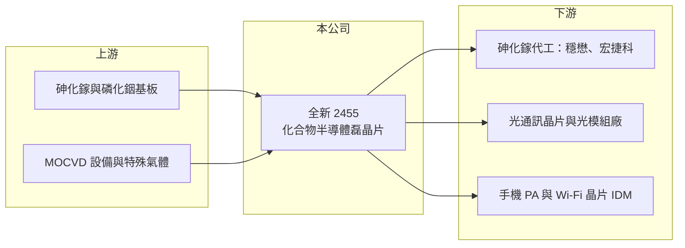

# 2455 全新

> 上市｜[[產業索引-通信網路業|通信網路業]]｜上市（櫃）日期 2002/01/24

# 第一章：企業模式與商業藍圖

> [!info] 撰寫說明
> 精簡版，由 Claude 依公開資料整理，架構比照 [[2330台積電]] 的四章研究，資料截至 2026-10-08。來源：證交所開放資料（基本資料、綜合損益、資產負債、營益分析、股利、每月營收）、Goodinfo 年度經營績效、nStock 公司簡介。產品別營收比重本次未取得原始數字，產品與客戶描述多為整理性內容，尚未逐條比對原始文件。#待校對

本章說明全新光電（股票代號：2455，以下簡稱全新）的商業模式：替射頻與光通訊晶片廠製作關鍵材料「磊晶片」的上游供應商。

- **核心業務：** 全新成立於 1996 年，2002 年在台灣證券交易所上市，總部與工廠位於桃園市平鎮區。依公司營業項目，全新研究、開發、生產與銷售光電半導體[[磊晶]]片及光電元件。磊晶是在[[砷化鎵]]或[[InP]]（磷化銦）基板上長出多層精密晶體薄膜，這些薄膜決定了晶片的電性與發光特性，下游晶圓代工廠再把磊晶片做成功率放大器或雷射晶片。
- **營收結構：** 公開資料本次未取得產品別比重。依產業整理，全新的產品分為兩大類：一是用於手機與 Wi-Fi [[PA]] 的砷化鎵 [[HBT]] 與 pHEMT 磊晶片，屬於射頻（微電子）產品，是傳統主力；二是光電子產品，包括 3D 感測與資料中心短距傳輸用的 [[VCSEL]] 磊晶，以及光通訊雷射用的磷化銦磊晶（待校對）。近年光電子比重隨 AI 資料中心光模組需求提升而增加。
- **營運據點：** 依證交所資料，總部與生產基地位於桃園平鎮，磊晶設備（MOCVD 等）集中在台灣（海外據點本次未查得，待校對）。磊晶片屬於少量多樣、高度客製的產品，生產集中有利於製程與品質管理。
- **長期方向：** 全新的長期成長來自「射頻穩定、光通訊加速」的組合。手機 PA 市場成熟，需求跟著手機出貨與 5G、Wi-Fi 世代更替波動；資料中心從 800G 走向 1.6T 光模組，需要更多高速雷射與光偵測器，磷化銦磊晶是其中供給相對緊張的環節，這是全新未來十年最重要的成長來源。

# 第二章：護城河深度與競爭優勢

本章評估全新在化合物半導體磊晶市場的護城河。從長期 40% 左右的毛利率來看，全新具有實在的技術門檻。

- **競爭優勢：** 第一，磊晶製程的 know-how：薄膜厚度、摻雜濃度與晶格匹配需要長期累積的配方與良率經驗，客戶認證一個新磊晶來源往往需要一年以上。第二，客戶轉換成本：下游晶片設計與製程參數綁定特定磊晶結構，一旦量產很少更換供應商。第三，同時具備砷化鎵與磷化銦兩種材料平台，讓全新能跨足射頻與光通訊兩個市場。整體屬於窄到中等的護城河。
- **主要對手：** 全球磊晶片市場由少數廠商主導，主要對手包括英國 IQE、日本住友化學，以及台灣的 [[4971IET-KY]]（英特磊）、[[3081聯亞]]（磷化銦光通訊磊晶）。部分大型 IDM 也自行生產磊晶（對手名單為產業常識整理，待校對）。
- **觀察重點：** 第一，光電子產品比重能否持續提升，帶動整體毛利率回到 40% 以上。第二，磷化銦基板供應是否受限，因為基板產能有限且部分來自中國。第三，射頻產品在手機市場成熟後能否維持穩定的出貨。

# 第三章：財務體質與盈利規模

資料日期：2026-10-08。數字取自 Goodinfo 年度經營績效與證交所開放資料，表格是撰寫當時的快照；最新月營收、毛利率、累計 EPS 由自動排程寫在本筆記的屬性欄位（月營收、毛利率、累計EPS 等）。#待校對

全新的財務數字顯示一家高毛利、低負債、持續高配息的上游材料公司。

| 年度 | 營收（新台幣） | [[毛利率]] | [[營業利益率]] | EPS（元） | [[ROE]] |
|---|---|---|---|---|---|
| 2020 | 26.5 億 | 42.1% | 26.0% | 2.88 | 18.6% |
| 2021 | 36.1 億 | 42.1% | 29.3% | 4.62 | 27.7% |
| 2022 | 26.0 億 | 41.8% | 22.3% | 2.95 | 17.1% |
| 2023 | 26.9 億 | 41.2% | 20.1% | 2.43 | 14.6% |
| 2024 | 32.4 億 | 39.5% | 22.3% | 3.63 | 21.0% |
| 2025 | 33.8 億 | 36.1% | 19.8% | 2.97 | 16.5% |
| 2026 上半年 | 19.25 億 | 38.35% | 23.40% | 2.20 | 未查得 |

註：2020 至 2025 年取自 Goodinfo 合併報表；2026 上半年取自證交所開放資料。

- **營收規模：** 2020 至 2025 年營收年複合成長率約 5.0%（推算），2021 年手機與 5G 需求高峰時達 36.1 億元，2022 至 2023 年庫存調整時回落。2026 年 1 至 8 月累計營收 28.18 億元，較去年同期成長約 36%，成長明顯加速。
- **獲利：** 毛利率長期在 36% 至 42% 之間，營業利益率約 20% 至 29%，在台灣通信網路類股中屬於高水準。2025 年毛利率降到 36.1%，可能與新台幣匯率與產品組合有關（推估）；2026 上半年回升到 38.35%。2021 至 2025 年平均 ROE 約 19.4%（推算）。
- **財務特色：** 依證交所資料，2026 年第二季底資產總計 57.2 億元、負債 20.2 億元，股東權益約 36.9 億元（資產減負債推算），每股淨值 19.75 元。2025 年度配發現金股利 2.65 元，以 EPS 2.97 元計算配發率約 89%（推算），公司長期以高配發率回饋股東。
- **[[ROIC]] 與 [[WACC]]：** 以 2025 年營業利益約 6.69 億元（營收 33.8 億元 × 營業利益率 19.8%）扣 20% 稅後約 5.35 億元，投入資本以股東權益 36.9 億元加非流動負債 6.5 億元（代替有息負債）約 43.4 億元計算，ROIC 約 12.3%（推算）；以 2026 上半年營業利益 4.50 億元年化計算約 16.6%（推算）。WACC 以 CAPM 推估：無風險利率 1.75%、市場風險溢酬 6%、β 取 1.2（推估，化合物半導體同業常見值），權益成本約 8.95%；負債比重低，WACC 約 8% 至 8.5%（推算）。ROIC 長期高於 WACC 約 4 至 8 個百分點，代表全新持續創造經濟價值，這也與它的高毛利與高配息相互印證。

# 第四章：總體風險與地緣政治

本章整理全新面對的長期風險，主要來自終端市場週期與原料供應。

- **產業週期：** 射頻磊晶需求跟著手機出貨與庫存週期波動，2022 至 2023 年的庫存調整讓營收與獲利同步下滑，呈現明顯的[[長鞭效應]]。光通訊需求雖然受 AI 資料中心帶動，但光模組客戶的建置節奏也可能出現集中拉貨、再庫存調整的循環。
- **營運風險：** 客戶集中於少數砷化鎵代工廠與光通訊晶片廠，主要客戶的市占變化會直接影響全新的訂單。擴產需要投入 MOCVD 等昂貴設備，若需求不如預期，折舊會壓低毛利率。
- **其他風險：** 磷化銦與砷化鎵基板、鎵等原料的供應部分集中在中國，中國的出口管制可能影響原料取得與成本。營收以美元計價為主，新台幣升值會壓縮毛利率。

# 專有名詞解析

## 半導體

- **[[磊晶]]**：在基板上長出一層排列整齊的晶體薄膜，是 LED 與化合物半導體元件的關鍵製程。
- **[[砷化鎵]]**：由鎵與砷組成的化合物半導體材料，適合做發光、射頻與高速光電元件。
- **[[InP]]**：磷化銦，適合製作光通訊雷射與光接收元件的化合物半導體材料，是資料中心光模組的關鍵。
- **[[HBT]]**：異質接面雙極電晶體，以砷化鎵等材料製作，是手機功率放大器的主流元件結構。
- **[[VCSEL]]**：垂直共振腔面射型雷射，從晶片表面垂直發光，用於手機 3D 感測與資料中心短距光通訊。
- **[[PA]]**：功率放大器，把要發射的無線訊號放大到足夠強度，手機、Wi-Fi 與基地台都需要。

# 核心供應鏈

- 上游：砷化鎵與磷化銦基板、MOCVD 磊晶設備與特殊氣體（供應商本次未查得，待校對）。
- 下游／客戶：砷化鎵代工廠 [[3105穩懋]]、[[8086宏捷科]]；光通訊晶片與光模組廠如 [[4979華星光]]、[[3363上詮]] 一類的光通訊供應鏈；國際射頻 IDM（客戶名稱公司未公開，待校對）。
- 同業：[[4971IET-KY]]、[[3081聯亞]]、IQE、住友化學。

## 最新新聞
<!-- news:start（自動產生，請勿手動編輯此範圍） -->
- 2026-10-07 🏛️ 重訊 16:05｜係因本公司有價證券於集中交易市場達公布注意交易資訊 標準，故公布相關財務業務等重大訊息，以利投資人區別瞭解｜[觀測站](https://mops.twse.com.tw/mops/#/web/t05st01)

完整紀錄：[[2455全新 新聞]]
<!-- news:end -->

## 相關連結
- [公開資訊觀測站](https://mopsov.twse.com.tw/mops/web/t05st03?step=1&firstin=1&co_id=2455)
- [Goodinfo](https://goodinfo.tw/tw/StockDetail.asp?STOCK_ID=2455)
- [Yahoo 股市](https://tw.stock.yahoo.com/quote/2455)
- [鉅亨網新聞](https://www.cnyes.com/twstock/2455/news)
