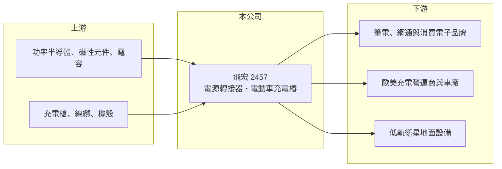

# 2457 飛宏

> 上市｜[[產業索引-電子零組件業|電子零組件業]]｜上市（櫃）日期 2001/09/17

# 第一章：企業模式與商業藍圖

> [!info] 撰寫說明
> 精簡版，由 Claude 依公開資料整理，架構比照 [[2330台積電]]，資料截至 2026-10-08。來源：證交所開放資料（基本資料、2026 年上半年財報、股利）、Goodinfo 經營績效頁、nStock 公司簡介，以及財經媒體標題。公開資料有限，無最新營收比重；充電樁子公司名稱憑過往認知整理。#待校對

本章說明飛宏科技（2457）的兩條主線：歷史悠久的電源轉接器，以及近十年投入的電動車[[充電樁]]。

- **核心業務：** 飛宏成立於 1972 年，原名飛宏企業，2003 年更名為飛宏科技，主要業務是電源變壓器（電源轉接器）與電動車充電樁的研發、設計、生產與銷售。電源轉接器是筆電、網通設備、消費電子外接的變壓器，屬於量大、價格競爭激烈的產品；充電樁則是單價高、需要軟硬體整合與各國認證的系統產品。
- **營收結構：** 本次未查得最新的產品比重。從財務數字推估，2023 年毛利率由約 15% 跳升到 26%，與高毛利的直流快充樁出貨增加有關（推估）。媒體報導公司電源業務也切入[[低軌衛星]]地面設備（年份待校對）。
- **營運據點：** 總部在桃園龜山，生產據點未在本次資料中查得（過往以中國與東南亞為主，待校對）。充電樁事業以獨立子公司經營（品牌名稱為 Zerova，待校對），客戶多在美國與歐洲。
- **長期方向：** 媒體以「轉型 2.0」描述公司策略，聚焦三大領域帶動營運回溫（標題資訊，細節待校對）。長期來看，飛宏的命運取決於充電樁能否在北美與歐洲的充電網路建設中取得穩定訂單，以及電源業務能否轉向衛星、工業等較高毛利的應用。

# 第二章：護城河深度與競爭優勢

本章分析飛宏的競爭位置：電源業務面臨大廠與中國廠夾擊，充電樁則是全球競爭的新興市場。

- **競爭優勢：** 飛宏的優勢在於五十年的電源設計經驗，以及較早投入直流快充樁，取得美國與歐洲的安規認證與營運商客戶。充電樁需要通過各國電網、安全與通訊協定認證，認證本身就是進入門檻。
- **主要對手：** 電源轉接器的對手包括 [[2308台達電]]、[[2301光寶科]]、[[6412群電]]、[[6282康舒]]，以及大量中國廠商。充電樁的對手包括 ABB、西門子等國際電機大廠、特斯拉自建充電網路、[[2308台達電]]，以及中國的充電設備廠。
- **觀察重點：** 美國聯邦充電補助政策的延續、歐美充電營運商的財務狀況，都會直接影響飛宏的充電樁訂單。2025 年營收降到 98 億元、營業利益率 -6.1%，顯示充電樁需求放緩時，公司固定成本壓力很大。

# 第三章：財務體質與盈利規模

資料日期：2026-10-08，表格是撰寫當時的快照；最新月營收、毛利率、累計 EPS 由自動排程寫在本筆記的屬性欄位（月營收、毛利率、累計EPS 等）。#待校對

本章用多年度數字檢視飛宏轉型的成效：毛利率提高了，但營業利益多數年度仍為負。

| 年度 | 營收（億元） | [[毛利率]] | [[營業利益率]] | EPS（元） | [[ROE]] |
|---|---|---|---|---|---|
| 2020 | 92.4 | 12.7% | -4.0% | -0.46 | -3.2% |
| 2021 | 123 | 12.0% | -2.8% | -0.92 | -5.9% |
| 2022 | 140 | 15.3% | 0.1% | 0.19 | 1.2% |
| 2023 | 123 | 26.1% | 2.9% | 0.68 | 3.4% |
| 2024 | 109 | 27.0% | -1.4% | 0.48 | 2.1% |
| 2025 | 98 | 21.1% | -6.1% | -1.48 | -6.7% |

- **營收規模：** 2020 至 2025 年營收年複合成長率約 1%，2022 年高峰 140 億元後連續下滑。2026 年上半年營收 43.3 億元，仍低於前一年同期。
- **獲利：** 毛利率從 12% 提升到 21% 至 27%，但研發與管理費用隨充電樁事業擴大，使營業利益率多數年度為負。2026 年上半年毛利率 22.6%、營業利益率 -5.9%、EPS -0.65 元。
- **財務特色：** 近 5 年（2021 至 2025）平均 ROE 約 -1.2%，依 nStock 資料近五年沒有配息。公司在 2023 年辦理[[現金增資]]，2026 年第二季股東權益 88.7 億元、負債 45.6 億元，負債比約 34%，資本結構尚屬保守，但虧損會逐步消耗淨值。
- **[[ROIC]] 與 [[WACC]]：** 2025 年營業損失約 6.0 億元（98 億 × -6.12%），虧損不計稅盾，以股東權益 88.7 億元計算 ROIC 約 -6.8%，把全部負債 45.6 億元也算入約 -4.5%（推算）。WACC 以 [[CAPM]] 推估：無風險利率 1.75%、市場風險溢酬 6%、β 假設 1.0，股東權益成本 7.75%；負債成本假設稅後 2%、負債占資本 20%（假設），WACC 約 6.6%（推算）。即使在獲利最好的 2023 年，ROE 也只有 3.4%，飛宏長期沒有賺到資金成本，轉型投入的資本至今仍在侵蝕股東價值。

# 第四章：總體風險與地緣政治

本章整理飛宏長期要面對的風險。

- **產業週期：** 充電樁需求受電動車銷售與各國補貼政策驅動，政策轉向會造成訂單大幅波動；電源轉接器則跟著筆電與網通設備的庫存週期起伏。
- **營運風險：** 充電樁事業需要持續投入研發、認證與售後服務，在規模不足時固定成本很高。若營運商客戶延後建置或財務出狀況，應收帳款與存貨也有減損風險。
- **其他風險：** 美國關稅與在地生產要求可能迫使公司在美國設廠，增加資本支出。營收以美元與歐元計價，匯率波動影響明顯；轉接器業務則持續面對中國廠商的價格競爭。

# 專有名詞解析

## 金融

- **[[現金增資]]**：公司發行新股向投資人募集現金，可補充資金但會稀釋原股東持股。
- **[[CAPM]]**：資本資產定價模型，以無風險利率加上 β 乘以市場風險溢酬，推估股東要求的報酬率。

## 產業

- **[[充電樁]]**：替電動車充電的設備，分為交流慢充與直流快充，直流快充樁單價高、技術門檻也較高。
- **[[低軌衛星]]**：在約 500 至 2,000 公里高度運行的通訊衛星，延遲低，地面需要大量接收設備與電源。

# 核心供應鏈

- 上游：功率半導體、磁性元件與電容；充電樁用的充電槍、線纜與機殼。
- 下游／客戶：筆電、網通與消費電子品牌；歐美充電營運商與車廠；低軌衛星地面設備廠，具名客戶未查得。
- 同業：電源有 [[2308台達電]]、[[2301光寶科]]、[[6412群電]]、[[6282康舒]]；充電樁有 ABB、西門子與 [[2308台達電]]。

## 最新新聞
<!-- news:start -->
<!-- news:end -->

## 相關連結
- [公開資訊觀測站](https://mopsov.twse.com.tw/mops/web/t05st03?step=1&firstin=1&co_id=2457)
- [Goodinfo](https://goodinfo.tw/tw/StockDetail.asp?STOCK_ID=2457)
- [Yahoo 股市](https://tw.stock.yahoo.com/quote/2457)
- [鉅亨網新聞](https://www.cnyes.com/twstock/2457/news)
