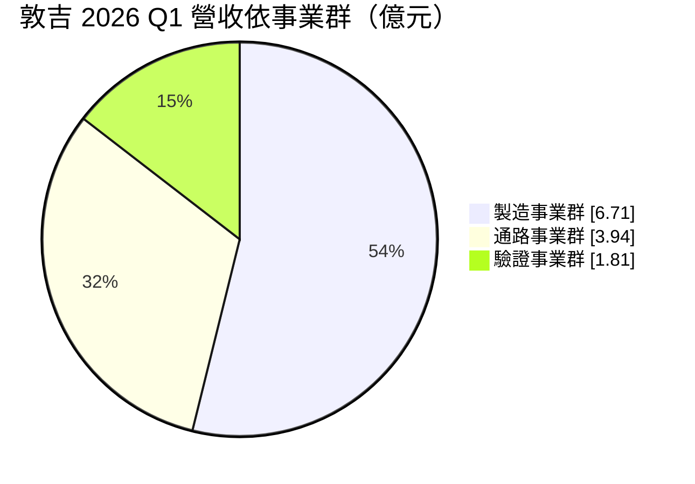
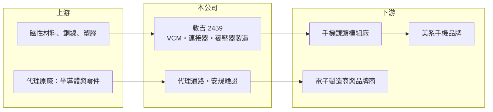

# 2459 敦吉

> 上市｜[[產業索引-其他電子業|其他電子業]]｜上市（櫃）日期 2001/09/17

# 第一章：企業模式與商業藍圖

> [!info] 撰寫說明
> 精簡版，由 Claude 依公開資料整理，架構比照 [[2330台積電]]，資料截至 2026-10-08。來源：證交所開放資料快照（基本資料、2026 年第二季資產負債與損益、股利）、Goodinfo 經營績效頁、富果研究 2026 年 5 月法說會筆記、nStock 公司簡介。#待校對

敦吉科技是一家同時經營「製造、通路、驗證」三種業務的電子公司。三者性質不同：製造事業（[[VCM]] 音圈馬達、連接器、變壓器）貢獻大部分獲利；代理通路營收大但毛利薄；[[安規驗證]]服務規模小但穩定。理解敦吉的關鍵，是看獲利主力 VCM 與美系手機客戶的關係。

- **核心業務：** 敦吉成立於 1980 年、2001 年上市，董事長兼總經理為鍾元凱。製造事業生產手機鏡頭用的 VCM、連接器、變壓器與成型繞線產品；通路事業代理半導體、[[LCM]] 與電子零件；驗證事業提供電子產品的安規、電磁相容與無線認證測試，已取得歐盟 RED 指令相關認證。
- **營收結構：** 依 2026 年第一季法說會資料，營收 12.46 億元中，製造事業群 6.71 億元、通路事業群 3.94 億元、驗證事業群 1.81 億元；產品面 VCM 約占 30.5%、連接器 7.5%、變壓器 6.1%。製造事業群貢獻約 77% 的獲利。

- **營運據點：** 總部在台灣，VCM 業務的美系客戶占比超過六到七成，中國市場則聚焦高階產品。生產據點細節未查得（#待校對）。
- **長期方向：** 提高高毛利產品比重、擴充驗證服務的項目與產能，並導入 AI 於內部管理與智慧製造。2024 年營收大減但毛利率大升，推估與縮減低毛利代理業務、產品組合轉向製造有關（#待校對），這也是公司近年的經營主軸。

# 第二章：護城河深度與競爭優勢

敦吉的護城河集中在 VCM 打入美系手機供應鏈的地位，驗證與通路則提供穩定度。

- **競爭優勢：** VCM 負責推動手機鏡頭自動對焦，需要精密的磁路設計與大量穩定生產能力，進入美系手機供應鏈要經過長期驗證，打入後通常可隨機種延續數年。驗證服務則依賴實驗室認證資格與政府、國際機構授權，進入門檻高且收入穩定。三種業務互補，使敦吉的獲利波動小於純零件廠。
- **主要對手：** VCM 有日系 TDK、Alps Alpine 與中國大陸廠商（#待校對）；電子零件代理面對 [[3702大聯大]]、[[3036文曄]] 等大型通路商，規模差距很大；驗證服務則與 SGS、UL、台灣電子檢驗中心等機構競爭。
- **觀察重點：** 長期追蹤 VCM 在美系手機新機的份額與規格變化（例如潛望式鏡頭與光學防手震），以及毛利率能否維持在 28% 至 30%；驗證事業若能持續成長，可降低對單一手機客戶的依賴。

# 第三章：財務體質與盈利規模

資料日期：2026-10-08，表格是撰寫當時的快照；最新月營收、毛利率、累計 EPS 由自動排程寫在本筆記的屬性欄位（月營收、毛利率、累計EPS 等）。#待校對

敦吉的財務特徵是 EPS 長期穩定在 4 至 5.5 元、ROE 約一成、配息率高，營收雖下滑但獲利品質改善。

| 年度 | 營收（億元） | [[毛利率]] | [[營業利益率]] | EPS（元） | [[ROE]] |
|---|---|---|---|---|---|
| 2019 | 75.7 | 16.4% | 7.62% | 4.20 | 10.5% |
| 2020 | 63.6 | 20.4% | 10.4% | 4.25 | 10.5% |
| 2021 | 69.9 | 21.2% | 10.7% | 5.01 | 12.1% |
| 2022 | 78.5 | 23.3% | 13.1% | 5.43 | 12.5% |
| 2023 | 74.2 | 19.6% | 9.84% | 5.46 | 10.7% |
| 2024 | 51.7 | 28.5% | 14.8% | 5.32 | 9.82% |
| 2025 | 49.1 | 28.4% | 13.1% | 5.17 | 9.20% |

（來源：Goodinfo 經營績效頁。2026 年上半年依證交所資料：營收 25.8 億元、毛利率 30.0%、營業利益率 15.7%、EPS 3.19 元。）

- **營收規模：** 2019 至 2025 年營收由 75.7 億元降到 49.1 億元，年複合成長率約 -7.0%（推算），主要下滑發生在 2024 年。但同期毛利率由 16.4% 升到 28.4%，EPS 反而從 4.20 元升到 5 元以上，顯示營收減少的部分多是低毛利業務。
- **獲利：** 近五年（2021 至 2025）平均 ROE 約 10.9%（推算），區間 9.2% 至 12.5%，相當穩定。2026 年上半年 EPS 3.19 元，營業利益率 15.7%，是近年高點。
- **財務特色：** 2026 年第二季總資產約 97.2 億元、負債 33.7 億元（非流動負債僅 0.9 億元）、權益總計 63.5 億元，幾乎沒有長期借款，每股淨值約 56 元。2025 年度配發現金股利 4.2 元，以 EPS 5.17 元計算配息率約 81%（推算）；Goodinfo 統計的歷年平均現金殖利率約 5.7%，配息長期穩定。權益中保留盈餘達 42.5 億元，累積獲利扎實。
- **[[ROIC]] 與 [[WACC]]：** 以 2025 年營業利益約 6.4 億元（49.1 億元 × 13.1%）、稅率 20% 計算，稅後營業利益約 5.1 億元，以權益總計 63.5 億元到權益加全部負債 97.2 億元為投入資本，ROIC 約 5.3% 至 8.1%（推算）；由於公司持有較多現金與流動資產（流動資產 65.3 億元），扣除超額現金後的實際 ROIC 會更高（推估）。WACC 以 [[CAPM]] 推估：無風險利率 1.75%、市場風險溢酬 6%、β 假設 0.8（電子零組件股常見值），權益成本約 6.55%；負債多為營業性應付款，WACC 約 6.3%（推算）。ROIC 大致高於 WACC，代表敦吉能持續創造小幅經濟價值，且以高配息方式把價值交還股東。

# 第四章：總體風險與地緣政治

敦吉的風險集中在 VCM 的客戶集中度與手機市場的變化。

- **產業週期：** VCM 需求跟著智慧型手機出貨與新機規格走，旺季集中在下半年，季度營收波動明顯。代理業務則隨半導體與電子零件的庫存循環起伏。
- **營運風險：** VCM 美系客戶占比高，單一客戶換供應商、調整規格或減少鏡頭數量，都會直接影響獲利主力。代理業務毛利低，比重變動會讓整體毛利率上下擺動。
- **其他風險：** 生產與銷售涉及中國市場，面臨美中貿易與關稅風險；外銷以美元計價，新台幣升值會壓縮獲利。手機鏡頭技術若轉向新型致動器，VCM 可能被替代。

# 專有名詞解析

## 應用

- **[[VCM]]**：音圈馬達，以線圈與磁鐵產生推力移動鏡頭，用於手機相機的自動對焦與光學防手震。
- **[[LCM]]**：液晶顯示模組，將液晶面板、背光與驅動電路組裝成可直接使用的顯示元件。

## 金融

- **[[CAPM]]**：資本資產定價模型，以無風險利率加上 β 乘以市場風險溢酬估算股東要求報酬率。

## 產業

- **[[安規驗證]]**：電子產品上市前須通過的安全、電磁相容與無線法規測試，由取得授權的實驗室執行並發證。

# 核心供應鏈

- 上游：磁性材料、銅線、塑膠原料供應商，以及代理的半導體與零件原廠（推估）。
- 下游／客戶：手機鏡頭模組廠與美系手機品牌、電子製造商、需要產品認證的品牌商。
- 同業：VCM 有 TDK、Alps Alpine；電子零件代理有 [[3702大聯大]]、[[3036文曄]]；驗證有 SGS、UL。

## 最新新聞
<!-- news:start（自動產生，請勿手動編輯此範圍） -->
- 2026-10-22 🏛️ 重訊 17:31｜公告本公司115年前3季自結合併損益資訊｜[觀測站](https://mops.twse.com.tw/mops/#/web/t05st01)

完整紀錄：[[2459敦吉 新聞]]
<!-- news:end -->

## 相關連結
- [公開資訊觀測站](https://mopsov.twse.com.tw/mops/web/t05st03?step=1&firstin=1&co_id=2459)
- [Goodinfo](https://goodinfo.tw/tw/StockDetail.asp?STOCK_ID=2459)
- [Yahoo 股市](https://tw.stock.yahoo.com/quote/2459)
- [鉅亨網新聞](https://www.cnyes.com/twstock/2459/news)
