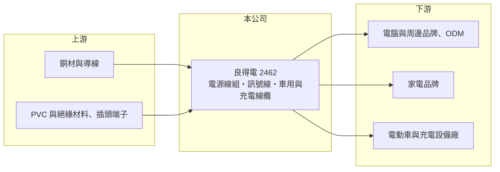

# 2462 良得電

> 上市｜[[產業索引-電子零組件業|電子零組件業]]｜上市（櫃）日期 2001/09/17

# 第一章：企業模式與商業藍圖

> [!info] 撰寫說明
> 精簡版，由 Claude 依公開資料整理，架構比照 [[2330台積電]]，資料截至 2026-10-08。來源：證交所開放資料（基本資料、2026 年上半年財報、股利）、Goodinfo 經營績效頁、nStock 公司簡介，以及財經媒體標題。公開資料有限，無營收比重與客戶名單。#待校對

本章說明良得電（2462）的商業模式：替電腦與家電品牌供應電源線組的老牌線材廠，近年嘗試往車用與大電流線材升級。

- **核心業務：** 良得電成立於 1978 年，1992 年上櫃、2001 年轉上市。主要產品是電腦系統電源傳輸線組、家電電源線組、資訊周邊訊號線、通訊系統連接線，以及用於[[充電樁]]與電動車的充電線纜，另有不動產租賃收入。電源線看似簡單，但每個國家的插頭規格與安規認證不同，線材廠必須取得各國認證（例如北美的 [[UL 認證]]）才能出貨。
- **營收結構：** 本次未查得產品別比重。從產品組合推估，電腦與家電電源線仍是主要收入，車用與充電線纜是成長中的新業務（推估）。營收在 2020 至 2025 年間大致維持在 39 億至 49 億元。
- **營運據點：** 總部在新北深坑，生產據點本次未查得（過往以中國為主，待校對）。媒體報導公司擴充車用與大電流線材產能（標題資訊，年份與地點待校對）。
- **長期方向：** 電腦電源線是成熟且價格競爭激烈的市場，公司的方向是把產品往電動車充電線、車用[[線束]]與資料中心大電流線材移動。這類產品需要更高的耐熱、耐電流規格與車規認證，毛利率也較高。

# 第二章：護城河深度與競爭優勢

本章分析良得電的競爭位置：它是規模中等的線材廠，優勢在認證與客戶關係，但產品同質性高。

- **競爭優勢：** 良得電經營四十多年，擁有各國電源線安規認證與長期配合的品牌客戶，這是新進廠商短期內難以取得的。品牌廠商更換電源線供應商需要重新送驗，因此只要品質穩定，訂單通常能延續。
- **主要對手：** 台股中的電源線同業包括 [[6290良維]]、[[6205詮欣]]、[[2392正崴]] 等，另有大量中國線材廠。電源線本身的技術門檻不高，價格是主要競爭手段，這解釋了良得電多數年度毛利率只有 6% 至 16%。
- **觀察重點：** 長期要看車用與大電流線材的營收比重能否明顯提高，帶動毛利率站穩 15% 以上。2025 年毛利率 13.1%、2026 年上半年降到 9.6%，顯示升級成果尚未穩定反映在財報上。

# 第三章：財務體質與盈利規模

資料日期：2026-10-08，表格是撰寫當時的快照；最新月營收、毛利率、累計 EPS 由自動排程寫在本筆記的屬性欄位（月營收、毛利率、累計EPS 等）。#待校對

本章用多年度數字檢視良得電的獲利結構：本業利潤薄，業外收益常是 EPS 的主要來源。

| 年度 | 營收（億元） | [[毛利率]] | [[營業利益率]] | EPS（元） | [[ROE]] |
|---|---|---|---|---|---|
| 2020 | 45.3 | 10.4% | 2.5% | 0.87 | 4.8% |
| 2021 | 49.3 | 6.2% | -3.0% | 0.83 | 4.5% |
| 2022 | 47.9 | 8.5% | 0.4% | 1.48 | 8.0% |
| 2023 | 39.2 | 16.2% | 6.1% | 1.86 | 9.4% |
| 2024 | 40.7 | 12.5% | 1.4% | 1.49 | 7.1% |
| 2025 | 40.6 | 13.1% | 2.5% | 0.27 | 1.2% |

- **營收規模：** 2020 至 2025 年營收年複合成長率約 -2%，規模停滯在 40 億元上下。2026 年上半年營收 20.2 億元，與前一年相近。
- **獲利：** 營業利益率長期在 -3% 至 6% 之間，2021 至 2022 年本業接近虧損，EPS 仍為正，代表業外收益（例如租賃、匯兌或投資收益，來源未逐項查得）占獲利比重高。2026 年上半年毛利率 9.6%、營業利益率 -1.7%、EPS -0.19 元。
- **財務特色：** 近 5 年（2021 至 2025）平均 ROE 約 6.0%。2025 年度配發現金股利 0.2 元，約占 EPS 74%。2026 年第二季股東權益 33.0 億元、負債 25.6 億元，負債比約 44%；股價淨值比約 0.9 倍（2026 年 10 月初），市場對其資產評價偏保守。
- **[[ROIC]] 與 [[WACC]]：** 2025 年營業利益約 1.0 億元（40.6 億 × 2.51%），稅後約 0.8 億元。以股東權益 33.0 億元為投入資本，ROIC 約 2.5%；把全部負債 25.6 億元也算入約 1.4%（推算）。WACC 以 [[CAPM]] 推估：無風險利率 1.75%、市場風險溢酬 6%、β 假設 0.8（傳統線材股波動較低），股東權益成本約 6.6%；負債成本假設稅後 2%、負債占資本 25%（假設），WACC 約 5.4%（推算）。ROIC 長期低於 WACC，只有 2023 年本業較好時接近打平，代表本業大致沒有創造經濟價值，股價長期在淨值附近也反映了這一點。

# 第四章：總體風險與地緣政治

本章整理良得電長期要面對的風險。

- **產業週期：** 電腦與家電電源線跟著 PC 與家電出貨週期起伏，屬成熟市場，長期需求成長有限。車用線材則受電動車銷售與車型改款影響。
- **營運風險：** 產品同質性高、客戶議價力強，毛利率容易被壓縮；車用與大電流線材需要新的設備投資與認證，若訂單量不足，新產能會拖累獲利。
- **其他風險：** 銅價是電源線最主要的成本，銅價大漲時若無法及時轉嫁，毛利率會明顯下滑。生產若集中在中國，也面臨美中關稅與客戶要求移轉產地的壓力。

# 專有名詞解析

## 應用

- **[[UL 認證]]**：美國 UL 機構的產品安全認證，電源線與電器產品進入北美市場通常必須取得。

## 金融

- **[[CAPM]]**：資本資產定價模型，以無風險利率加上 β 乘以市場風險溢酬，推估股東要求的報酬率。

## 產業

- **[[線束]]**：把多條電線、端子與連接器組合成一組的配線系統，汽車與家電大量使用。
- **[[充電樁]]**：替電動車充電的設備，分為交流慢充與直流快充，直流快充樁單價高、技術門檻也較高。

# 核心供應鏈

- 上游：銅材與導線、PVC 等絕緣材料、插頭與端子零件。
- 下游／客戶：電腦與周邊品牌及其代工廠、家電品牌、電動車與充電設備廠，具名客戶未查得。
- 同業：[[6290良維]]、[[6205詮欣]]、[[2392正崴]]，以及中國線材廠。

## 最新新聞
<!-- news:start -->
<!-- news:end -->

## 相關連結
- [公開資訊觀測站](https://mopsov.twse.com.tw/mops/web/t05st03?step=1&firstin=1&co_id=2462)
- [Goodinfo](https://goodinfo.tw/tw/StockDetail.asp?STOCK_ID=2462)
- [Yahoo 股市](https://tw.stock.yahoo.com/quote/2462)
- [鉅亨網新聞](https://www.cnyes.com/twstock/2462/news)
