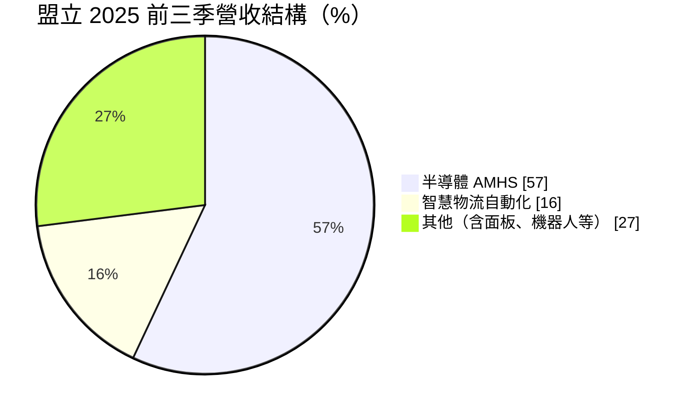
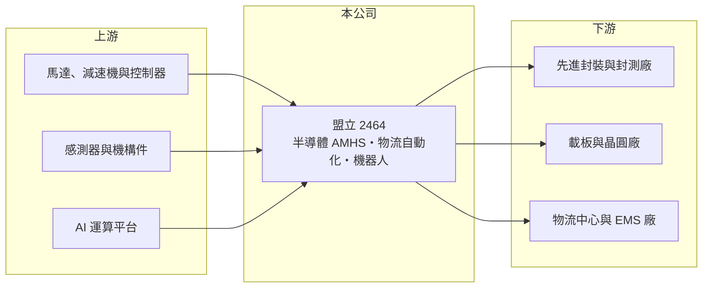

# 2464 盟立

> 上市｜[[產業索引-其他電子業|其他電子業]]｜上市（櫃）日期 2001/09/17

# 第一章：企業模式與商業藍圖

> [!info] 撰寫說明
> 精簡版，由 Claude 依公開資料整理，架構比照 [[2330台積電]]，資料截至 2026-10-08。來源：證交所開放資料快照（基本資料、2026 年第二季資產負債與損益、股利）、Goodinfo 經營績效頁、富果研究 2025 年 12 月法說會筆記、自由時報報導。主要客戶名稱為市場推估。#待校對

盟立自動化是台灣歷史最久的工廠自動化系統商之一，過去以面板廠的搬運與倉儲系統起家，近年轉型為半導體[[AMHS]]（自動化物料搬運系統）供應商，切入[[先進封裝]]與載板產線。它的商業模式是「依客戶工廠設計整套系統、驗收後認列營收」，因此營收跟著客戶的建廠與擴產週期走。

- **核心業務：** 盟立成立於 1989 年、2001 年上市，總部與工廠在新竹科學園區，董事長兼總經理為林世東。產品包括天車搬運系統（[[OHT]]）、晶圓前端模組（[[EFEM]]）、自動倉儲（Stocker、AS/RS）、自主移動機器人（AMR/AGV）等，另有物流中心自動化、停車場設備與醫療器材自動化，以及近年發展的人形機器人與機器狗。
- **營收結構：** 依 2025 年前三季法說會資料，半導體 AMHS 約占 57%、智慧物流自動化約占 16%，其餘約 27% 未拆分。公司預期 2026 年半導體比重超過 60%。2025 年底在手訂單約 60 億元，其中約 58% 來自半導體。

- **營運據點：** 主要產能在新竹，規劃銅鑼二廠支應 2027 年後需求，2026 年整體產能預計提升約四成。客戶在馬來西亞、新加坡、泰國等地擴廠，盟立也在北美、歐洲與東南亞設有服務據點。
- **長期方向：** 以先進封裝、測試與載板的自動化為主軸，並爭取前段晶圓廠的供應鏈；同時透過子公司與轉投資（鞍新盟機器人製造）發展 AI 機器人生態系，與 [[NVDA輝達]] 的機器人平台及新代的控制器合作。

# 第二章：護城河深度與競爭優勢

盟立的護城河來自系統整合經驗與客戶產線的驗證，一旦進入產線，替換成本高。

- **競爭優勢：** AMHS 不是單一機台，而是要配合整座工廠的動線、製程節奏與資訊系統設計，系統商必須深入了解客戶製程。盟立在面板與半導體累積三十多年專案經驗，能隨封裝形式（例如 CoWoS、面板級封裝 FOPLP）調整方案；系統上線後，後續擴產與維護通常延用同一家，形成轉換成本。
- **主要對手：** 半導體 AMHS 的國際龍頭是日本大福（Daifuku）與村田機械，在晶圓前段廠占有率極高；台灣同業有 [[6438迅得]] 等。盟立的定位是以在地服務、交期與客製彈性，在封測與載板領域與日系大廠競爭。
- **觀察重點：** 半導體比重能否持續提高、能否打進前段晶圓廠，以及擴產後的毛利率。2019 至 2025 年毛利率在 16.5% 至 21.1% 之間，屬系統整合業中偏低水準，若半導體高階產品無法拉高毛利，營收成長也難轉成獲利。

# 第三章：財務體質與盈利規模

資料日期：2026-10-08，表格是撰寫當時的快照；最新月營收、毛利率、累計 EPS 由自動排程寫在本筆記的屬性欄位（月營收、毛利率、累計EPS 等）。#待校對

盟立的財務呈現明顯的「專案週期」：面板投資退潮後營收與獲利一路下滑，2025 年虧損，2026 年隨先進封裝訂單認列回升。

| 年度 | 營收（億元） | [[毛利率]] | [[營業利益率]] | EPS（元） | [[ROE]] |
|---|---|---|---|---|---|
| 2019 | 125 | 18.6% | 7.03% | 3.49 | 16.7% |
| 2020 | 89.1 | 21.1% | 7.51% | 2.63 | 12.6% |
| 2021 | 98.6 | 20.7% | 7.01% | 2.70 | 12.8% |
| 2022 | 108 | 17.4% | 3.31% | 2.63 | 12.2% |
| 2023 | 88.1 | 16.5% | 0.15% | 0.89 | 4.26% |
| 2024 | 75.0 | 18.1% | 0.61% | 0.52 | 2.33% |
| 2025 | 66.8 | 18.8% | -1.13% | -0.84 | -3.29% |

（來源：Goodinfo 經營績效頁。2026 年上半年依證交所資料：營收 40.3 億元、毛利率 20.6%、營業利益率 4.4%、EPS 0.66 元。）

- **營收規模：** 2019 至 2025 年營收由 125 億元降到 66.8 億元，年複合成長率約 -9.9%（推算），主因面板廠停止大規模擴產，而半導體訂單尚未補上缺口。2025 年部分專案因美國關稅政策延後認列，也壓低當年營收。
- **獲利：** 近五年（2021 至 2025）平均 ROE 約 5.7%（推算），但趨勢是由 12% 一路降到負值。營業利益率在 2023 至 2025 年接近零或為負，因為研發、人力與擴產費用在營收下滑時無法同步縮減。2026 年上半年營業利益率回到 4.4%，是否站穩仍需觀察。
- **財務特色：** 2026 年第二季總資產約 129.2 億元、負債 71.5 億元（非流動負債僅 2.9 億元）、權益總計 57.7 億元。負債以流動負債（68.6 億元）為主，推估多為專案預收款與應付款，而非長期借款。2025 年度配發現金股利 0.25 元加資本公積 0.25 元；Goodinfo 統計的歷年平均現金股利約 1.25 元，配息隨獲利大幅變動。專案業的自由現金流取決於預收與驗收時點，長期是否為正未查得。
- **[[ROIC]] 與 [[WACC]]：** 以 2025 年營業損失約 0.75 億元（66.8 億元 × -1.13%）計算，ROIC 約 -0.5% 至 -1.0%（推算，投入資本以權益 57.7 億元到權益加負債 129.2 億元為區間）；若以 2026 年上半年營業利益 1.76 億元年化，稅後約 2.8 億元，ROIC 約 2.2% 至 4.9%（推算）。WACC 以 [[CAPM]] 推估：無風險利率 1.75%、市場風險溢酬 6%、β 假設 1.1（半導體設備股常見值），權益成本約 8.35%；有息負債少，WACC 約 7.5% 至 8%（推算）。2019 至 2021 年 ROIC 大致高於 WACC，2023 年後明顯低於 WACC；盟立要回到創造價值的狀態，營業利益率需要回到 7% 以上。

# 第四章：總體風險與地緣政治

盟立的風險集中在半導體資本支出循環、客戶集中與專案執行。

- **產業週期：** 營收高度依賴晶圓廠、封測廠與載板廠的擴產計畫，AI 晶片需求若降溫、客戶放緩資本支出，新訂單會迅速減少。過去面板投資退潮造成營收腰斬，就是這種風險的實例。
- **營運風險：** 主要客戶集中在少數半導體大廠，專案驗收時間決定營收認列，季度波動大。擴產期間若人力、供應鏈或交機進度跟不上，可能出現成本超支與毛利下滑。
- **其他風險：** 2025 年已出現美國關稅導致專案延後；客戶赴東南亞與美國設廠，要求盟立跟隨布局，增加海外服務成本。人形機器人等新事業仍在早期，投資回收時間不確定。

# 專有名詞解析

## 半導體

- **[[AMHS]]**：自動化物料搬運系統，在晶圓廠或封裝廠內自動運送晶圓盒與載具，串連各製程機台。
- **[[OHT]]**：天車搬運系統，在廠房天花板軌道上行駛的搬運車，用於機台之間運送晶圓盒。
- **[[EFEM]]**：設備前端模組，負責在晶圓盒與製程機台之間取放晶圓的機械手臂與潔淨空間模組。
- **[[先進封裝]]**：把多顆晶片以中介層、混合鍵合等方式高密度整合的封裝技術，例如 CoWoS、SoIC。

## 金融

- **[[CAPM]]**：資本資產定價模型，以無風險利率加上 β 乘以市場風險溢酬估算股東要求報酬率。

# 核心供應鏈

- 上游：馬達、減速機、控制器（合作夥伴新代）、感測器與機構件供應商，以及 [[NVDA輝達]] 的機器人運算平台。
- 下游／客戶：先進封裝與封測廠、ABF 載板廠、晶圓廠（市場普遍推估包含 [[2330台積電]] 的先進封裝產線，#待校對）；物流中心與北美 EMS 客戶。
- 同業：日本大福、村田機械；台灣 [[6438迅得]]。

## 最新新聞
<!-- news:start（自動產生，請勿手動編輯此範圍） -->
- 2026-10-12 📰 媒體 17:52｜營收速報 - 盟立(2464)9月營收9.98億元年增率高達77.97％｜[鉅亨網](https://news.cnyes.com/news/id/6628266)

完整紀錄：[[2464盟立 新聞]]
<!-- news:end -->

## 相關連結
- [公開資訊觀測站](https://mopsov.twse.com.tw/mops/web/t05st03?step=1&firstin=1&co_id=2464)
- [Goodinfo](https://goodinfo.tw/tw/StockDetail.asp?STOCK_ID=2464)
- [Yahoo 股市](https://tw.stock.yahoo.com/quote/2464)
- [鉅亨網新聞](https://www.cnyes.com/twstock/2464/news)
