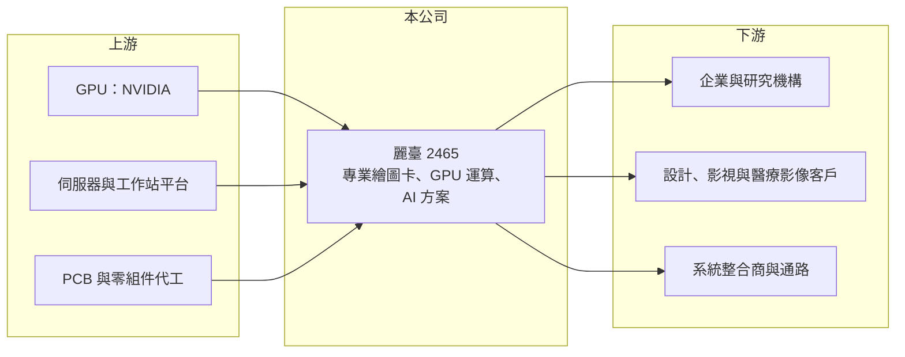

# 2465 麗臺

> 上市｜[[產業索引-電腦及週邊設備業|電腦及週邊設備業]]｜上市（櫃）日期 2001/09/19

# 第一章：企業模式與商業藍圖

> [!info] 撰寫說明
> 精簡版，由 Claude 依公開資料整理，架構比照 [[2330台積電]]，資料截至 2026-10-08。來源：證交所開放資料快照（基本資料、2026 年第二季財報、營益分析、股利、每月營收與公司營收說明）、Goodinfo 經營績效年度表、StockAnalysis 年度損益表。產品線與 NVIDIA 合作關係為依產業常識整理，本次來源未逐條驗證；公開資料有限。#待校對

麗臺是長期與 NVIDIA 合作的繪圖卡廠，本章說明它從消費性顯示卡轉向專業繪圖與 AI 運算產品的商業模式。

- **核心業務：** 麗臺成立於 1986 年、2001 年上市，總部在新北中和，英文品牌 Leadtek，早年以 WinFast 顯示卡聞名。目前主力是 NVIDIA 專業繪圖卡、[[GPU]] 運算卡與 [[AI 伺服器]]相關解決方案，客戶包括設計、影視、醫療影像與研究機構，另有零終端（Zero Client）等商用產品與健康量測產品線（產品線現況待校對）。
- **營收結構：** 本次來源未查得產品別比重。依公司 2026 年 8 月營收說明，前 8 月營收年增約 201%，「主係受惠於全球市場之人工智能應用相關產品需求」，代表 AI 運算產品已成為營收主體。
- **營運據點：** 總部在台灣，負責研發、系統整合與銷售，並在中國、日本等地設有據點（待校對）。麗臺的角色比較接近「NVIDIA 生態系的加值通路與系統整合商」，自己不製造晶片，而是把 GPU 整合成客戶能直接使用的工作站與伺服器方案。
- **長期方向：** 麗臺的成長完全取決於 AI 與專業運算市場。2021 年加密貨幣與顯示卡缺貨讓營收衝上 88 億元，2022 至 2024 年連續虧損，2026 年則因 AI 需求再度大幅成長。長期要看它能否從賣卡轉為提供 AI 軟硬體整合與服務，讓獲利不只是跟著 GPU 供貨與價格波動。

# 第二章：護城河深度與競爭優勢

GPU 產品的定價權掌握在 NVIDIA 手中，本章分析麗臺這類合作夥伴的護城河有多深。

- **競爭優勢：** 麗臺與 NVIDIA 合作數十年，熟悉專業繪圖卡與運算卡的驗證、驅動與售後支援，在台灣與亞洲的設計、學術與醫療客戶中有長期關係。AI 運算需要把 GPU、伺服器、網路與軟體整合在一起，具備系統整合能力的通路商能提供比單純賣卡更高的附加價值。
- **主要對手：** 專業與 AI 運算產品的對手包括 PNY 等 NVIDIA 專業卡夥伴、[[2357華碩]]、[[2376技嘉]]、[[2377微星]] 的伺服器與工作站產品，以及 [[2347聯強]] 等大型通路與各地系統整合商。這些對手多數規模比麗臺大，在 GPU 配貨上也有優勢。
- **觀察重點：** 麗臺毛利率只有 8% 至 15%，顯示它在價值鏈中的議價能力有限，獲利主要靠營收規模放大。長期要看 AI 需求能否維持多年，以及 NVIDIA 是否持續把資源分配給這類區域型夥伴。

# 第三章：財務體質與盈利規模

資料日期：2026-10-08，表格是撰寫當時的快照；最新月營收、毛利率、累計 EPS 由自動排程寫在本筆記的屬性欄位（月營收、毛利率、累計EPS 等）。#待校對

麗臺的獲利呈現極端的景氣循環：2021 年大賺，2022 至 2024 年連續虧損，2026 年再隨 AI 需求轉強。

| 年度 | 營收（億元） | [[毛利率]] | [[營業利益率]] | EPS（元） | [[ROE]] |
|---|---|---|---|---|---|
| 2021 | 88.2 | 17.8% | 6.27% | 8.12 | 81.3% |
| 2022 | 53.1 | 11.4% | −2.87% | −3.32 | −31.0% |
| 2023 | 42.8 | 14.7% | −2.30% | −2.53 | −21.1% |
| 2024 | 42.1 | 8.02% | −6.53% | −5.26 | −55.2% |
| 2025 | 44.4 | 9.82% | 1.95% | 0.43 | 4.37% |

- **營收規模：** 2020 年營收 45.5 億元，2025 年 44.4 億元，五年年複合成長率約 −0.5%，但期間振幅很大。2026 年上半年營收 40.7 億元，已接近 2025 年全年；前 8 月累計 63.3 億元，年增約 201%。
- **獲利：** 2021 至 2025 年平均 ROE 約 −4.3%，ROE 波動極大是因為權益基數小。2026 年上半年毛利率 11.7%、營業利益率 6.5%、EPS 2.79 元，費用率只有約 5%，營收放大時獲利彈性很高。
- **財務特色：** 2025 年初帳上有[[累積虧損]]約 2.58 億元，因此 2025 年度未配發股利，多年來幾乎沒有配息。2026 年第二季末保留盈餘 2.62 億元，與上半年淨利相同，推估累積虧損已在 2026 年以資本公積或其他方式彌補（待校對）。母公司權益 13.6 億元、負債總額 10.1 億元，流動資產占總資產近九成，屬輕資產的通路型結構。
- **[[ROIC]] 與 [[WACC]]：** 2025 年營業利益約 0.87 億元（44.4 億 × 1.95%），稅後約 0.69 億元；以 2025 年底權益約 11 億元（由 2026 年第二季末權益扣除上半年獲利推估）計 ROIC 約 6%（推算）。2022 至 2024 年 ROIC 為負，2024 年約 −25% 以上（推算），代表那幾年持續侵蝕股東資本。WACC 以 CAPM 推估：無風險利率 1.75%、市場風險溢酬 6%、β 取 AI 硬體族群常見值 1.2，股東權益成本約 9%；負債多為營運性應付款，WACC 約 8.5%（推算）。2026 年上半年年化 ROIC 明顯高於 WACC，但以完整景氣循環平均來看，麗臺尚未證明能長期創造價值。

# 第四章：總體風險與地緣政治

麗臺的風險集中在單一供應商依賴與極端的景氣循環。

- **產業週期：** 麗臺營收跟著 GPU 需求循環，曾經歷 2021 年挖礦熱潮的高峰與之後三年的虧損。AI 投資若出現降溫或庫存調整，營收可能快速回落，過去經驗顯示虧損時的 ROE 可低到 −50% 以下。
- **營運風險：** 產品高度依賴 NVIDIA，GPU 配貨、價格政策或通路策略的任何改變，都會直接影響麗臺的營收與毛利。毛利率低，存貨跌價一旦發生，很容易吃掉整年獲利。
- **其他風險：** 美國對高階 GPU 的出口管制會影響部分市場的銷售；營收大幅成長時需要更多營運資金，若應收帳款或存貨增加過快，財務壓力會上升。

# 專有名詞解析

## 半導體

- **[[GPU]]**：圖形處理器，原用於繪圖運算，因擅長大量平行計算而成為 AI 訓練與推論的主要晶片。

## 應用

- **[[AI 伺服器]]**：搭載 GPU 等加速晶片、專門執行 AI 模型訓練與推論的伺服器。

## 金融

- **[[累積虧損]]**：公司歷年虧損累計超過盈餘的部分，須先彌補後才能分配股利。

# 核心供應鏈

- 上游：[[NVDA輝達]] 的 GPU 與運算平台，伺服器與工作站平台、PCB 與零組件代工（具體供應商未查得）。
- 下游／客戶：企業 AI 部門、學術與研究機構、設計與影視工作室、醫療影像客戶，以及系統整合商與通路。
- 同業：[[2357華碩]]、[[2376技嘉]]、[[2377微星]]、[[2347聯強]]、PNY。

## 最新新聞
<!-- news:start -->
<!-- news:end -->

## 相關連結
- [公開資訊觀測站](https://mopsov.twse.com.tw/mops/web/t05st03?step=1&firstin=1&co_id=2465)
- [Goodinfo](https://goodinfo.tw/tw/StockDetail.asp?STOCK_ID=2465)
- [Yahoo 股市](https://tw.stock.yahoo.com/quote/2465)
- [鉅亨網新聞](https://www.cnyes.com/twstock/2465/news)
