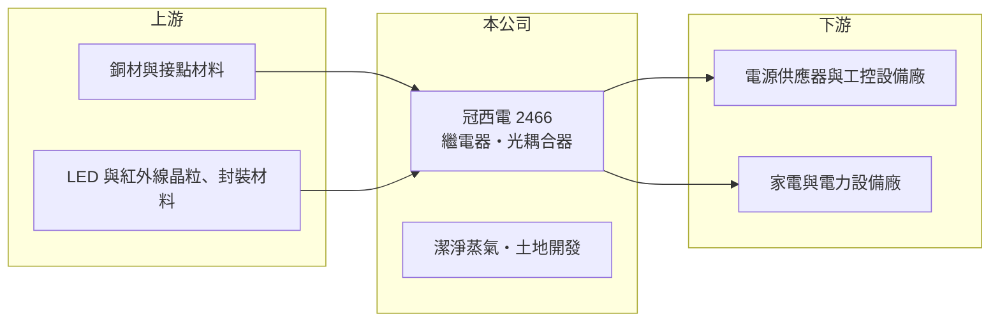

# 2466 冠西電

> 上市｜[[產業索引-光電業|光電業]]｜上市（櫃）日期 2001/09/17

# 第一章：企業模式與商業藍圖

> [!info] 撰寫說明
> 精簡版，由 Claude 依公開資料整理，架構比照 [[2330台積電]]，資料截至 2026-10-08。來源：證交所開放資料快照（基本資料、2026 年第二季資產負債與損益、股利、每月營收）、Goodinfo 經營績效頁、CMoney 2025 年 4 月個股快訊、nStock 公司概況。公開資料有限，各業務營收比重與生產據點未查得。#待校對

冠西電是老牌被動與光電元件廠，本業做[[繼電器]]與[[光耦合器]]，另經營潔淨蒸氣與土地開發。它的長期問題是：電子元件本業規模縮小且連年營業虧損，公司的價值與每年 EPS 越來越取決於非本業項目。

- **核心業務：** 冠西電成立於 1981 年、2001 年上市，登記業務為繼電器、光耦合器及 LED 的製造與銷售，產品用於電源、工控、家電與發電、輸配電設備。另經營潔淨蒸氣（供應工業製程用的純淨蒸汽，推估）與土地開發事業。
- **營收結構：** 各業務營收比重公開資料未查得。2026 年月營收在約 4,600 萬元到 2.25 億元之間大幅跳動，1 至 8 月累計約 8.1 億元，推估部分月份含土地開發或專案收入（#待校對）。2025 年全年毛利率僅 0.5%，與元件業常態差距極大，推估當年認列了低毛利或虧損的非本業項目，需以財報附註確認。
- **營運據點：** 生產與營運據點公開資料未查得，本文不推測。
- **長期方向：** 電子元件本業屬成熟產業，營收由 2019 年的 22.9 億元降到 2025 年的 9.5 億元。未來獲利方向取決於公司如何運用土地與資產（[[資產活化]]），以及元件本業能否藉電力基礎建設需求止跌，需追蹤公司公告。

# 第二章：護城河深度與競爭優勢

冠西電在元件市場規模不大，公開資料看不出明確的規模或技術優勢，護城河有限。

- **競爭優勢：** 光耦合器與繼電器是電源與工控的基礎元件，產品需要通過安規認證，客戶導入後不常更換，冠西電經營四十多年累積了一定的客戶基礎。電力相關題材（台電強化電網、輸配電設備需求）可能帶動相關元件需求，但實際受惠程度未查得。
- **主要對手：** 光耦合器有 [[2393億光]]、[[2301光寶科]] 與 [[AVGO博通]]、東芝、瑞薩等國際大廠；繼電器則有歐姆龍、松下等日系大廠與大量中國廠商（#待校對）。與這些對手相比，冠西電的規模明顯較小。
- **觀察重點：** 長期觀察重點在本業毛利率能否回到 15% 至 25% 的元件業常態、營業虧損能否收斂，以及土地開發與潔淨蒸氣的實際貢獻。這三點決定冠西電是一家元件公司，還是以資產價值為主的公司。

# 第三章：財務體質與盈利規模

資料日期：2026-10-08，表格是撰寫當時的快照；最新月營收、毛利率、累計 EPS 由自動排程寫在本筆記的屬性欄位（月營收、毛利率、累計EPS 等）。#待校對

冠西電的財務特徵是營收萎縮、本業虧損擴大，但靠業外收益維持小幅正 EPS，配息極少。

| 年度 | 營收（億元） | [[毛利率]] | [[營業利益率]] | EPS（元） | [[ROE]] |
|---|---|---|---|---|---|
| 2019 | 22.9 | 7.88% | -3.88% | 0.18 | 1.62% |
| 2020 | 12.5 | 11.8% | -6.97% | 0.04 | 0.38% |
| 2021 | 13.4 | 17.4% | 0.05% | 0.35 | 3.32% |
| 2022 | 13.9 | 24.2% | 2.81% | 0.66 | 6.66% |
| 2023 | 10.5 | 14.8% | -10.7% | 0.18 | 1.70% |
| 2024 | 11.1 | 12.5% | -12.9% | -0.17 | -1.50% |
| 2025 | 9.49 | 0.5% | -29.9% | 0.25 | 2.13% |

（來源：Goodinfo 經營績效頁；2025 年毛利率 0.5% 為原頁數字，異常偏低，待以財報確認。2026 年上半年依證交所資料：營收 4.0 億元、毛利率 20.8%、營業利益率 -12.2%、業外收益約 0.7 億元、EPS 0.05 元。）

- **營收規模：** 2019 至 2025 年營收年複合成長率約 -13.7%（推算），六年間減少約六成。2019 年營收 22.9 億元但毛利率只有 7.9%，推估當年含較多低毛利的非元件收入（#待校對），之後營收規模就大致在 10 億至 14 億元之間。
- **獲利：** 近五年（2021 至 2025）平均 ROE 約 2.5%（推算），只有 2022 年營業利益率為正 2.8%。2023 年後本業虧損逐年擴大，2025 年營業利益率 -29.9%，但 EPS 仍為 0.25 元，代表[[業外收益]]（推估為處分資產、租金或投資收益，#待校對）抵銷了本業虧損。
- **財務特色：** 2026 年第二季總資產約 46.5 億元、負債 27.1 億元（其中非流動負債 16.0 億元，推估與土地開發或長期借款相關）、權益 19.4 億元，負債比約 58%，對一家元件廠而言偏高。每股淨值約 11.2 元，保留盈餘僅 2.2 億元。Goodinfo 統計的歷年平均現金股利僅約 0.05 元，2025 年度未配息。
- **[[ROIC]] 與 [[WACC]]：** 以 2025 年營業損失約 2.8 億元（9.49 億元 × -29.9%）計算，稅後營業利益為負，以權益 19.4 億元到權益加全部負債 46.5 億元為投入資本，ROIC 約 -5% 至 -12%（推算）。WACC 以 [[CAPM]] 推估：無風險利率 1.75%、市場風險溢酬 6%、β 假設 1.0（小型電子股常見值），權益成本約 7.75%；稅後負債成本假設 2.2%、負債占約四成，WACC 約 5.5%（推算）。本業 ROIC 長期遠低於 WACC，代表元件本業在消耗價值；股東報酬主要取決於土地等資產能否以合理價格活化。

# 第四章：總體風險與地緣政治

冠西電的風險在於本業持續萎縮、獲利依賴非經常項目，以及偏高的負債。

- **產業週期：** 繼電器與光耦合器需求跟著工控、家電、電源與電力設備景氣起伏；電網投資可能帶來需求，但規模與時程不確定。
- **營運風險：** 本業連年營業虧損，若無法止血，業外收益終究有限。土地開發的認列時點不固定，單季或單年的數字難以代表長期實力；開發案也需要資金，會增加負債與利息負擔。
- **其他風險：** 中國大陸元件廠的低價競爭；銅、銀等接點與導線材料價格波動；股價曾因電力題材大幅上漲（2025 年 4 月），評價與基本面落差大，波動風險高。

# 專有名詞解析

## 應用

- **[[繼電器]]**：以小電流控制大電流開關的元件，分為電磁式與固態式，廣泛用於家電、工控與電力設備。
- **[[光耦合器]]**：以光傳遞訊號、讓兩端電路電氣隔離的元件，常用於電源供應器、工控與電動車。

## 金融

- **[[資產活化]]**：企業把閒置土地、廠房等資產出售、出租或開發，以取得現金或收益。
- **[[業外收益]]**：本業以外的收入，例如投資收益、處分資產利益或匯兌利益。
- **[[CAPM]]**：資本資產定價模型，以無風險利率加上 β 乘以市場風險溢酬估算股東要求報酬率。

# 核心供應鏈

- 上游：銅材與接點材料、LED 與紅外線晶粒、封裝材料供應商。
- 下游／客戶：電源供應器、工控、家電與輸配電設備廠（推估）。
- 同業：[[2393億光]]、[[2301光寶科]]、[[AVGO博通]]；繼電器的日系與中國廠商。

## 最新新聞
<!-- news:start（自動產生，請勿手動編輯此範圍） -->
- 2026-10-19 🏛️ 重訊 17:00｜代子公司COSMO ELECTRONICS (HK) COMPANY LIMITED公告收到臺灣臺北地方法院執行命令｜[觀測站](https://mops.twse.com.tw/mops/#/web/t05st01)
- 2026-10-13 📰 媒體 20:06｜明起新增6檔股票抓去關 飆股冠西電近90個交易日漲幅高達4倍｜[鉅亨網](https://news.cnyes.com/news/id/6629640)
- 2026-10-13 📰 媒體 18:12｜拿出賺大錢的霸氣!!大立光、天二科⊕、冠西電⊕、其陽⊕｜[鉅亨網](https://news.cnyes.com/news/id/6629538)
- 2026-10-12 📰 媒體 17:52｜營收速報 - 冠西電(2466)9月營收1.16億元年增率高達308.16％｜[鉅亨網](https://news.cnyes.com/news/id/6628267)

完整紀錄：[[2466冠西電 新聞]]
<!-- news:end -->

## 相關連結
- [公開資訊觀測站](https://mopsov.twse.com.tw/mops/web/t05st03?step=1&firstin=1&co_id=2466)
- [Goodinfo](https://goodinfo.tw/tw/StockDetail.asp?STOCK_ID=2466)
- [Yahoo 股市](https://tw.stock.yahoo.com/quote/2466)
- [鉅亨網新聞](https://www.cnyes.com/twstock/2466/news)
