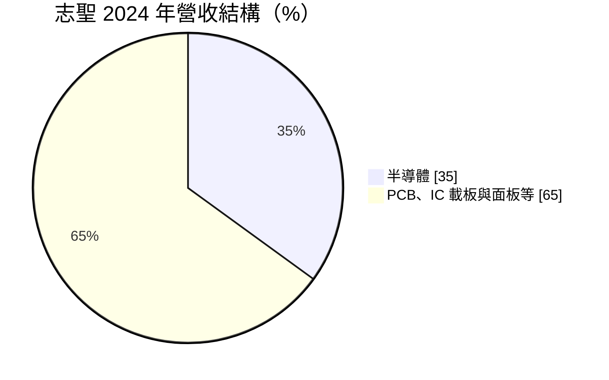
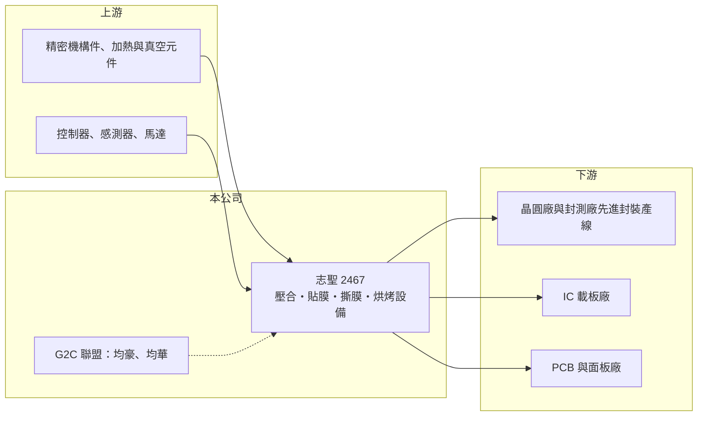

# 2467 志聖

> 上市｜[[產業索引-電子零組件業|電子零組件業]]｜上市（櫃）日期 2001/09/17

# 第一章：企業模式與商業藍圖

> [!info] 撰寫說明
> 精簡版，由 Claude 依公開資料整理，架構比照 [[2330台積電]]，資料截至 2026-10-08。來源：證交所開放資料（基本資料、2026 年上半年財報、每月營收、股利）、Goodinfo 經營績效頁、財報狗 2025 年 4 月志聖報導，以及財經媒體標題。G2C 聯盟成員與交叉持股描述憑過往認知整理。#待校對

本章說明志聖工業（2467）的商業模式：從 PCB 製程設備起家，近年轉型為半導體[[先進封裝]]設備供應商。

- **核心業務：** 志聖成立於 1978 年，總部在新北林口，核心技術是壓合、貼膜、撕膜與烘烤四大製程。這些技術最早用在 [[PCB]] 的乾膜貼合與烘烤，後來延伸到 [[IC 載板]]、平面顯示器，以及半導體封裝中的晶圓貼膜、壓合與熱處理。設備廠的生意模式是依客戶擴產計畫接單，每台設備都需要配合客戶製程客製調整。
- **營收結構：** 2024 年半導體營收約占 35%，公司當時預期 2025 年可望超過 50%，成長主要來自先進封裝。其餘營收來自 PCB、IC 載板與面板設備，報導指出 PCB 與面板需求當時仍不明朗。
- **營運據點：** 生產與研發以台灣為主，銷往中國的設備主要供中國內需使用。依報導，公司直接出口美國的比例很低（過去三年合計不超過 0.58%），但若客戶在美國建廠，公司不排除設立美國據點提供售後服務。
- **長期方向：** 公司把研發重心放在 [[CoWoS]] 往 [[CoPoS]] 與面板級扇出型封裝（[[FOPLP]]）演進所需的設備，並與 [[5443均豪]]、[[6640均華]] 組成 G2C 聯盟，提供晶圓上晶片（Chip on Wafer）製程的整合設備方案（2024 年報導，聯盟成員待校對）。這讓志聖從單機供應商朝整線解決方案發展。

# 第二章：護城河深度與競爭優勢

本章分析志聖的護城河：先進封裝客戶的製程認證，以及跨 PCB 與半導體的熱製程技術。

- **競爭優勢：** 先進封裝設備必須在客戶產線上長時間驗證，一旦進入 [[2330台積電]] 等大廠的 CoWoS 產線，後續擴產通常會沿用同一供應商，這是設備廠最重要的轉換成本。志聖在 PCB 時代累積的壓合、烘烤技術，可以直接延伸到封裝的貼膜與熱處理，讓它比只做單一製程的對手更容易切入新製程。
- **主要對手：** 半導體封裝設備的國際對手包括日本與歐美的貼膜、烘烤設備大廠；台灣同業有 [[3131弘塑]]、[[3583辛耘]]、[[6187萬潤]]、[[6640均華]]（同時是聯盟夥伴）。PCB 設備方面的同業則有 [[6664群翊]] 等。
- **觀察重點：** 長期要看半導體營收比重能否維持在五成以上、客戶是否從單一大廠擴散到其他封測廠與海外客戶，以及 CoPoS、FOPLP 等新製程能否如期導入量產。設備業的訂單集中在客戶擴產週期，營收高峰之後常會出現明顯回落。

# 第三章：財務體質與盈利規模

資料日期：2026-10-08，表格是撰寫當時的快照；最新月營收、毛利率、累計 EPS 由自動排程寫在本筆記的屬性欄位（月營收、毛利率、累計EPS 等）。#待校對

本章用多年度數字檢視志聖轉型半導體設備後的獲利變化。

| 年度 | 營收（億元） | [[毛利率]] | [[營業利益率]] | EPS（元） | [[ROE]] |
|---|---|---|---|---|---|
| 2020 | 40.9 | 37.9% | 13.0% | 2.94 | 17.8% |
| 2021 | 57.2 | 33.9% | 12.9% | 4.35 | 25.0% |
| 2022 | 53.7 | 35.6% | 13.6% | 4.59 | 24.0% |
| 2023 | 36.3 | 41.5% | 11.1% | 3.12 | 15.4% |
| 2024 | 48.2 | 41.2% | 13.2% | 4.80 | 17.5% |
| 2025 | 61.0 | 43.3% | 14.5% | 5.50 | 14.6% |

- **營收規模：** 2020 至 2025 年營收年複合成長率約 8%，期間 2023 年因 PCB 與載板客戶縮減資本支出而下滑約三成，2024 年起靠半導體設備回升。2026 年上半年營收 50.4 億元，已接近 2025 年全年的八成。
- **獲利：** 毛利率由 34% 至 38% 提升到 43%，2026 年上半年更達 49.1%，營業利益率 26.1%、EPS 7.16 元，反映半導體設備的毛利高於 PCB 設備。營業利益率提升幅度大於毛利率，顯示營收放大時研發與管理費用的[[營運槓桿]]效果。
- **財務特色：** 近 5 年（2021 至 2025）平均 ROE 約 19.3%。2025 年度配發現金股利 5.5 元，約等於全年 EPS，配發率很高。2026 年第二季母公司權益 158.2 億元，其中「其他權益」高達 101.8 億元，推估主要是持有聯盟夥伴等股權的未實現評價利益（[[FVOCI]]，待校對），這部分不屬於營運資本，也使每股淨值（約 100 元）與帳面 ROE 被放大或稀釋。
- **[[ROIC]] 與 [[WACC]]：** 2025 年營業利益約 8.8 億元（61 億 × 14.5%），稅後約 7.1 億元。扣除其他權益後，營運相關的權益約 56.3 億元，ROIC 約 12.6%；若再加入非流動負債 40.7 億元，約 7.3%（推算），實際值在兩者之間。WACC 以 [[CAPM]] 推估：無風險利率 1.75%、市場風險溢酬 6%、β 假設 1.3（半導體設備股波動較大），股東權益成本約 9.6%；負債成本假設稅後 2%、負債占資本 15%（假設），WACC 約 8.4%（推算）。以 2025 年計算 ROIC 與 WACC 大致相當到略高；若 2026 年上半年的營業利益率能延續，ROIC 將明顯高於 WACC，代表半導體轉型正在提高資本創造價值的能力。

# 第四章：總體風險與地緣政治

本章整理志聖長期要面對的風險。

- **產業週期：** 設備業營收取決於客戶的資本支出，先進封裝擴產高峰過後，訂單可能大幅下滑；PCB 與載板設備則跟著電子景氣起伏，2023 年營收衰退約三成就是例子。
- **營運風險：** 半導體設備營收集中在少數先進封裝客戶，客戶擴產節奏或供應商策略改變會直接影響營收。新一代封裝技術若改用其他製程路線，既有設備可能被取代。
- **其他風險：** 持有大量股權投資，股價波動會使淨值大幅變動。中國客戶占一定比例，面臨美國出口管制與中國本土設備替代的風險；客戶赴美、赴日建廠也需要公司投入海外服務據點。

# 專有名詞解析

## 半導體

- **[[先進封裝]]**：把多顆晶片以中介層、混合鍵合等方式高密度整合的封裝技術，例如 CoWoS、SoIC。
- **[[CoWoS]]**：台積電的 2.5D 先進封裝技術，把 GPU 與 HBM 並排放在矽中介層上，是 AI 晶片的主流封裝。
- **[[CoPoS]]**：把 CoWoS 的圓形晶圓中介層改為方形面板的封裝技術，可提高面積利用率與產能。
- **[[FOPLP]]**：面板級扇出型封裝，以大型方形面板取代圓形晶圓進行扇出封裝，降低單位成本。
- **[[IC 載板]]**：承載晶片並連接到電路板的基板，例如 ABF 載板與 BT 載板。

## 金融

- **[[FVOCI]]**：透過其他綜合損益按公允價值衡量的金融資產，股價漲跌計入權益而非當期損益。

# 核心供應鏈

- 上游：精密機構件、加熱與真空元件、控制器、感測器與馬達，例如 [[1590亞德客-KY]]、[[2049上銀]] 等自動化零件廠（供貨關係待校對）。
- 下游／客戶：先進封裝產線（[[2330台積電]]、[[3711日月光投控]] 等，個別供貨關係待校對）、IC 載板廠（[[3037欣興]]、[[8046南電]]、[[3189景碩]]）與 PCB、面板廠。
- 同業：[[3131弘塑]]、[[3583辛耘]]、[[6187萬潤]]、[[6640均華]]、[[5443均豪]]、[[6664群翊]]。

## 供應鏈關係
- 供應給 [[2330台積電]]：晶圓級真空壓膜設備（台積電供應鏈 › 下游：先進封裝大聯盟 (CoWoS 設備與載板) › CoWoS 核心設備群）

## 最新新聞
<!-- news:start（自動產生，請勿手動編輯此範圍） -->
- 2026-10-14 📰 媒體 10:34｜討論牆 ／ 盤中速報 - 志聖(2467)大漲7.1%，報572元｜[LINE TODAY](https://news.google.com/rss/articles/CBMiZEFVX3lxTE5ONWR4VDZ4YVktRTFYcmtSTVZZWHFPT1R4bzlwT0s4NjR4dnRqcUI1QTBieThmQVJHZ3loekhKVGZHTFozdGJ1WTlGZWo4MEFnU0lNbGwzLWgyRXpUaF83cXNhM1I?oc=5)
- 2026-10-14 📰 媒體 09:25｜先進封裝設備需求旺 志聖前三季EPS 10.67元創歷史新高｜[鏡週刊Mirror Media](https://news.google.com/rss/articles/CBMiaEFVX3lxTFBpSUlpVkpzMGdtcl9XMUEtTE5KUE9pclBFcGlLckZvVDV3V3lQUV9wSlFXYUNBMUhmZHBDbWJYd2tBaF9uVVR5dWV3VDJOMWRoQzdtMFhFOFd2WEdJamJKRDhyR0FubGpL0gFoQVVfeXFMUGlJSWlWSnMwZ21yX1cxQS1MTkpQT2lyUEVwaUtyRm9UNXdXeVBRX3BKUVdhQ0ExSGZkcENtYlh3a0FoX25VVHl1ZXdUMk4xZGhDN20wWEU4V3ZYR0lqYkpEOHJHQW5saks?oc=5)
- 2026-10-14 📰 媒體 08:39｜年底交機旺季至志聖Q4營收動能看旺- 新聞｜[MoneyDJ](https://news.google.com/rss/articles/CBMikgFBVV95cUxQUlZCb3VsUHNLOFlHaFRUUUZvN3ZqOHRBUjMyMm1rRkpCdTMtMFRMTWRHMEM1clVPSkMxeTB2c1NaSXU1aWR1dWdpLWVjeS1xUFY3dFlPUnA1NFE3VFZuU0JPQnlGTHVER092bkRLRXBZYmtyREZKSjBDMnlqT3Q5bmZOWk9JU0xSYS1PbmNVMGlKZw?oc=5)
- 2026-10-14 📰 媒體 03:52｜志聖工業 ／ 2467.TW 股價走勢與即時報價｜[BigGo 財經](https://news.google.com/rss/articles/CBMiVEFVX3lxTE51c1BsaVN4eHF0WFhmNzdzS21IX3REZENJRnVDNVNSOFFwNTV3VmpCVkhaVnBhWUk0NnZfWXltYVN4QXFVMHlpMUNkVHZtQmQwdWJtMA?oc=5)
- 2026-10-13 📰 媒體 23:48｜志聖第3季EPS 3.51元 深化PCB布局｜[經濟日報](https://news.google.com/rss/articles/CBMiWkFVX3lxTE01VVdZbFgzZW9leFUzb05wWGZuRmd5VFhYanNNSzV0Y0ZDSzR1T2NpOXNLV09MV3VJbE9ERGpfSXpzSFVJcTZ6RV9Fcmp6R0ZiVlUyUlhtM2NFZ9IBX0FVX3lxTE5TM2dwcUNEOXdwN0xXbVRUZzctX0VZMFdNSTlPZ0xvTzFIZ1hOY0pFM3ptQncyUWlKYS12TC1LTmY2b24xRElvVU9Wa0Zad3paME85WXBTcU11SGpFQjEw?oc=5)

完整紀錄：[[2467志聖 新聞]]
<!-- news:end -->

## 相關連結
- [公開資訊觀測站](https://mopsov.twse.com.tw/mops/web/t05st03?step=1&firstin=1&co_id=2467)
- [Goodinfo](https://goodinfo.tw/tw/StockDetail.asp?STOCK_ID=2467)
- [Yahoo 股市](https://tw.stock.yahoo.com/quote/2467)
- [鉅亨網新聞](https://www.cnyes.com/twstock/2467/news)
