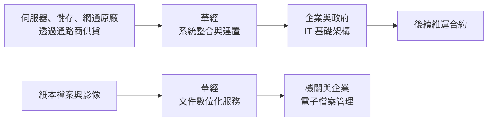
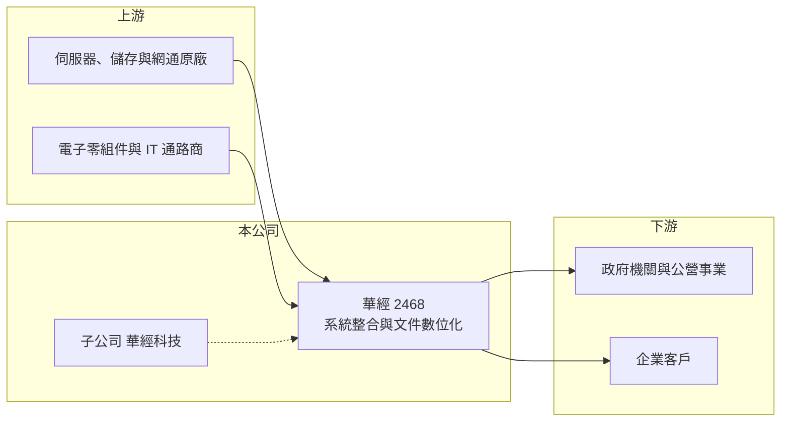

# 2468 華經

> 上市｜[[產業索引-資訊服務業|資訊服務業]]｜上市（櫃）日期 2001/09/17

# 第一章：企業模式與商業藍圖

> [!info] 撰寫說明
> 精簡版，由 Claude 依公開資料整理，架構比照 [[2330台積電]] 的四章研究，資料截至 2026-10-08。來源：Goodinfo 年度經營績效頁與基本資料頁（含重要子公司）、證交所開放資料（基本資料、2026 年第二季資產負債與綜合損益、每月營收、股利）、Yahoo 股市與 CMoney 報導標題。與大聯大的股權關係依報導標題與記憶整理；營收比重未查得，公開資料有限。#待校對

華經資訊是以系統整合與文件數位化為主的資訊服務公司，本章說明它的業務組合、薄利的系統整合模式，以及數位化服務如何提供較穩定的收入。

## 一、核心定位：系統整合加數位化服務

- **核心業務：** 華經的登記主要業務為「資訊系統整合業務之軟、硬體規劃、開發及維運」、「文件數位化服務」、「企業應用軟體之規劃及服務」與「公／私有雲基礎架構建置規劃」（Goodinfo 基本資料）。也就是說，它一方面替企業與政府建置伺服器、儲存與雲端基礎架構，另一方面提供紙本文件掃描、影像處理與檔案管理等[[文件數位化]]服務。財經媒體常以「數位影像處理商」稱之（CMoney 投資快訊標題）。
- **公司背景：** 華經成立於 1977 年、2001 年上市，實收資本額約 7.0 億元（證交所開放資料）。重要子公司為華經科技，經營電腦及事務機器設備銷售、資訊軟體處理與設備安裝維護（Goodinfo 基本資料）。報導以「大聯大當後盾」形容華經（Yahoo 股市報導標題），推估 [[3702大聯大]] 為重要股東（待校對），這讓公司在硬體採購與資金上有集團支援。
- **營收結構：** 公開資料未查得產品別比重。從 [[毛利率]] 長期只有一成左右推估，營收中硬體與軟體轉售的比重偏高（推估），數位化服務與維運則是毛利較高的部分。
- **長期方向：** 政府與企業持續推動無紙化、檔案電子化與雲端化，是華經長期的需求來源。公司若能提高服務型收入比重，就能改善目前偏低的利潤率。

## 二、資本轉化邏輯：硬體轉售帶規模、服務帶利潤

系統整合中的硬體轉售，毛利率低但能帶來營收規模與客戶關係；文件數位化與維運服務則以人力和專業流程為主，毛利較高且常以長期合約或分期專案進行。兩者組合讓華經營收穩定在 20 億元以上，但整體[[營業利益率]]只有 2% 至 4%（Goodinfo）。

# 第二章：護城河深度與競爭優勢

本章分析華經在系統整合與數位化市場的競爭優勢與限制。

## 一、競爭優勢

- **文件數位化的作業能力：** 大量檔案的掃描、索引、品質檢查與保密管理，需要標準化流程、場地與訓練有素的人力。累積的大型專案經驗與作業規模，是小型業者難以承接同等案件的門檻。
- **股東與通路支援：** 若大聯大為重要股東（待校對），華經在取得硬體貨源與付款條件上有一定優勢，有助於承接需要先墊付設備款的大型專案。
- **長期客戶：** 政府與企業的檔案管理與系統維運，多為年度續約，提供基本的營收來源。

## 二、主要對手

| 對手 | 定位 | 與華經的比較 |
|---|---|---|
| [[6214精誠]] | 大型資訊服務集團 | 企業系統整合的主要對手，規模大很多 |
| [[5410國眾]] | 系統整合與網路建置 | 政府與企業基礎架構標案重疊 |
| [[5212凌網]] | 數位內容與電子書平台 | 在數位典藏與內容數位化領域部分重疊 |
| 中小型掃描與檔案管理業者 | 低價承接 | 在單純掃描案件以價格競爭 |

## 三、觀察重點

- **毛利率結構：** 2025 年毛利率降到 9.87%，若硬體轉售比重持續提高，利潤率會再被壓縮。
- **服務收入比重：** 數位化與維運的比重才是長期價值所在，可惜公開資料未查得拆分。
- **雲端與 AI 轉型：** 文件數位化之後的下一步是檔案的智慧檢索與 AI 分析，華經能否把數位化客戶延伸到資料應用服務，是成長關鍵。

# 第三章：財務體質與盈利規模

資料日期：2026-10-08，表格是撰寫當時的快照；最新月營收、毛利率、累計 EPS 由自動排程寫在本筆記的屬性欄位（月營收、毛利率、累計EPS 等）。#待校對

本章用多年度數據檢視華經的獲利能力與資本報酬。

## 一、多年度三率與 ROE

| 年度 | 營收（新台幣） | [[毛利率]] | [[營業利益率]] | EPS（元） | [[ROE]] |
|---|---|---|---|---|---|
| 2020 | 21.6 億 | 10.3% | 2.19% | 0.55 | 3.41% |
| 2021 | 21.5 億 | 10.8% | 2.47% | 0.64 | 3.91% |
| 2022 | 22.7 億 | 10.9% | 2.81% | 0.91 | 5.41% |
| 2023 | 23.4 億 | 11.6% | 3.84% | 1.12 | 6.45% |
| 2024 | 22.5 億 | 10.9% | 3.21% | 0.96 | 5.37% |
| 2025 | 26.9 億 | 9.87% | 3.20% | 1.25 | 6.92% |
| 2026 上半年 | 12.9 億 | 10.80% | 3.64% | 0.61 | 未查得 |

註：2020 至 2025 年取自 Goodinfo；2026 上半年取自證交所綜合損益與營益分析。

- **營收規模：** 2020 至 2025 年營收年複合成長率約 4.5%（推算）。2026 年 1 至 8 月累計營收約 16.6 億元、年減約 11.1%（證交所每月營收），專案型營收的年度起伏明顯。
- **獲利：** 營業利益率由 2% 緩步升到 3% 以上，EPS 由 0.55 元增到 1.25 元，但絕對水準仍低。
- **ROE：** 2021 至 2025 年平均 ROE 約 5.6%（推算），低於資訊服務同業平均。

## 二、股利與財務結構

2025 年度配發現金股利 1.0 元，以 EPS 1.25 元計算配發率約 80%（推算）。2026 年第二季底權益約 12.5 億元、總負債約 13.4 億元，其中流動負債約 12.9 億元、非流動負債僅約 0.5 億元（證交所資產負債）。流動資產約 19.9 億元，足以支應流動負債，負債推估多為應付帳款等營運性負債（推估）。

## 三、[[ROIC]] 與 [[WACC]]

**ROIC 推算：** 2025 年營業利益約 26.9 億元 × 3.20% ≈ 0.86 億元，扣除 20% 稅後約 0.69 億元。投入資本以權益 12.5 億元加上非流動負債 0.5 億元計算，約 13.0 億元，ROIC 約 5.3%（推算）。

**WACC 推算：** 公債殖利率 1.75%、市場風險溢酬 6%、β 取資服股常見值 0.7，權益成本約 5.95%；有息負債很少，WACC 約 5.8%（推算）。

**結論：** ROIC 約 5.3%，與約 5.8% 的 WACC 大致相當甚至略低，代表華經目前只是勉強賺回資金成本，尚未明顯創造超額價值。要擴大利差，必須提高服務型收入比重，或改善營運資金的週轉效率。

# 第四章：總體風險與地緣政治

本章整理華經長期面對的產業、營運與其他風險。

## 一、產業週期

- **政府標案時程：** 文件數位化與系統整合案件常來自公部門，預算編列與決標時間會讓營收在年度間大幅波動。
- **企業 IT 支出：** 景氣轉弱時，企業會延後伺服器與雲端基礎架構的投資。

## 二、營運風險

- **低毛利結構：** 毛利率長期約一成，任何專案成本超支或價格競爭，都可能讓單年獲利大幅下滑。
- **人力密集：** 數位化服務需要大量作業人員，基本工資上漲會直接推升成本。
- **技術替代：** 新產生的文件多已是電子檔，傳統紙本掃描的需求長期會遞減，公司需要轉向資料治理與 AI 應用服務。

## 三、其他風險

- **資料保密：** 承接機關檔案與個資，若發生外洩，會影響商譽與投標資格。
- **股東關係：** 若與大聯大的關係改變（待校對），可能影響採購條件與資金支援。

# 專有名詞解析

## 應用

- **[[系統整合]]**：替客戶規劃並整合軟硬體、網路與應用系統，讓不同設備與軟體能一起運作的資訊服務。
- **[[文件數位化]]**：把紙本文件、圖檔與影像掃描並建立索引，轉成可搜尋、可長期保存的電子檔案。

## 金融

- **[[ROIC]]**：投入資本報酬率，衡量企業用股東與債權人投入的資本，每年能產生多少稅後營業利益。
- **[[WACC]]**：加權平均資金成本，股東要求報酬與負債利息依資本結構加權後的平均值，是判斷是否創造價值的門檻。

# 核心供應鏈

- 上游：伺服器、儲存與網通設備原廠與 IT 通路商；[[3702大聯大]]（報導指為重要後盾，待校對）、[[2347聯強]]（產業代表，非指名合作對象）。
- 下游／客戶：政府機關、公營事業與一般企業。
- 同業：[[6214精誠]]、[[5410國眾]]、[[5212凌網]]。

## 最新新聞
<!-- news:start -->
<!-- news:end -->

## 相關連結
- [公開資訊觀測站](https://mopsov.twse.com.tw/mops/web/t05st03?step=1&firstin=1&co_id=2468)
- [Goodinfo](https://goodinfo.tw/tw/StockDetail.asp?STOCK_ID=2468)
- [Yahoo 股市](https://tw.stock.yahoo.com/quote/2468)
- [鉅亨網新聞](https://www.cnyes.com/twstock/2468/news)
