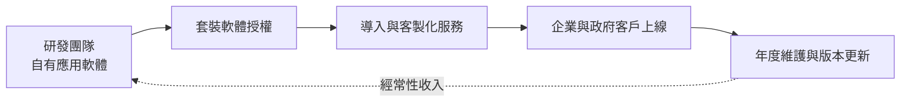
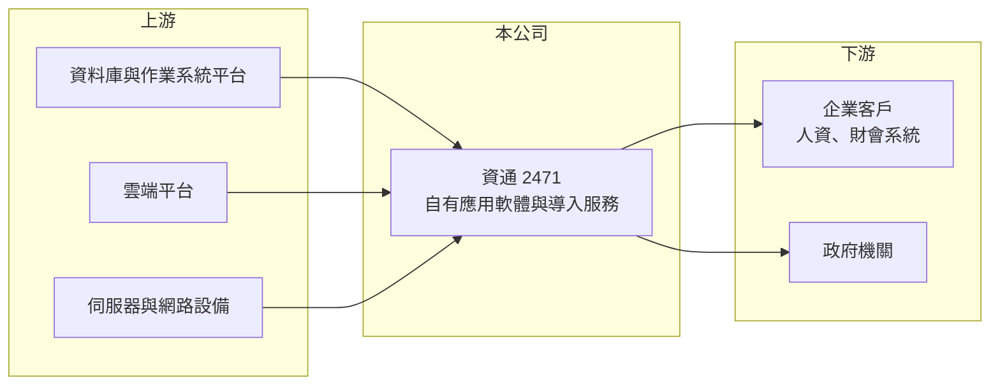

# 2471 資通

> 上市｜[[產業索引-資訊服務業|資訊服務業]]｜上市（櫃）日期 2001/09/17

# 第一章：企業模式與商業藍圖

> [!info] 撰寫說明
> 精簡版，由 Claude 依公開資料整理，架構比照 [[2330台積電]] 的四章研究，資料截至 2026-10-08。來源：Goodinfo 年度經營績效頁與基本資料頁、證交所開放資料（基本資料、2026 年第二季資產負債與綜合損益、每月營收、股利）。產品線（人資、財會與政府應用軟體）與客戶分布依記憶整理；營收比重未查得，公開資料有限。#待校對

資通電腦是一家以自有應用軟體為核心的資訊服務公司，本章說明它「套裝軟體加導入服務加年度維護」的商業模式，以及這種模式為何能在小規模下維持四成毛利率與高 ROE。

## 一、核心定位：自有套裝軟體的開發商

- **核心業務：** 資通的登記主要業務為「應用套裝軟體之分析、設計、修改、安裝及維護」，以及電腦與網路設備買賣、系統整合、網路規劃、資料庫管理與應用軟體設計（Goodinfo 基本資料）。與多數以硬體轉售為主的系統整合商不同，資通的重心在自行開發的應用軟體，例如人力資源管理、薪資與財會系統，以及政府機關的業務系統（依記憶整理，待校對）。
- **公司背景：** 資通成立於 1980 年、2001 年上市，董事長為余宏揚，實收資本額約 4.7 億元（證交所開放資料）。公司規模不大，2025 年營收約 10.0 億元（Goodinfo），但在人資與政府應用軟體這類利基市場深耕多年。
- **營收結構：** 公開資料未查得拆分。以業務性質推估，營收由軟體授權、客製化導入、年度維護費與少量硬體轉售組成（推估）。其中年度維護費是典型的[[經常性收入]]，客戶只要持續使用系統，就會每年續約。
- **長期方向：** 企業軟體正從自建機房的買斷授權，轉向雲端訂閱的 [[SaaS]] 模式。資通若能把既有的人資與財會產品雲端化，就能把一次性的授權收入轉為按月收費，提高收入的可預測性（推估）。

## 二、資本轉化邏輯：軟體開發一次、多次銷售

軟體的特點是開發成本在前、複製成本極低。產品一旦成熟，每多賣一套授權，大部分收入都能轉為利潤，這解釋了資通的[[毛利率]]能維持在 40% 上下，遠高於以硬體轉售為主的同業。2025 年營收成長約 14%，[[營業利益率]]卻由 12.6% 升到 17.9%（Goodinfo），正是軟體業營運槓桿的表現。

# 第二章：護城河深度與競爭優勢

本章分析資通的護城河構成，以及它在企業應用軟體市場的競爭位置。

## 一、競爭優勢

- **在地法規與業務知識：** 人資與薪資系統必須符合台灣的勞基法、勞健保、所得稅扣繳等規定，法規每年都可能調整。長期耕耘在地市場的軟體商，能快速更新功能，這是國際大廠產品不易做到的。
- **高轉換成本：** 人資與財會系統保存企業多年的員工、薪資與帳務資料，更換系統需要資料轉移、流程重整與人員訓練，風險高、成本大。客戶因此很少更換供應商，維護收入相對穩定。
- **自有產品的利潤率：** 以自有軟體為主，使資通的毛利率約為硬體轉售型系統整合商的兩倍，ROE 長期維持在 15% 以上（Goodinfo）。

## 二、主要對手

| 對手 | 定位 | 與資通的比較 |
|---|---|---|
| 鼎新電腦（未上市，屬鼎捷集團） | 台灣最大的 ERP 軟體商 | 中小企業 ERP 與人資模組的主要對手 |
| 國際 ERP 與人資雲端業者（SAP、Oracle、Workday 等） | 大型企業與跨國公司 | 搶大型企業與外商客戶 |
| [[6214精誠]] | 大型資訊服務集團 | 在企業應用與系統整合案件上競爭 |
| [[2453凌群]] | 政府與金融系統整合 | 在政府應用系統標案上重疊 |

## 三、觀察重點

- **雲端化進度：** 從買斷授權轉向雲端訂閱，短期會讓營收認列變慢，長期則提高經常性收入比重，是公司評價能否提升的關鍵。
- **人均產值：** 軟體公司的成本以研發與顧問人力為主，營收成長快於人力成長，代表產品化程度在提高。
- **客戶集中度：** 政府案件的比重若過高，營收會受預算時程影響，具體比重未查得。

# 第三章：財務體質與盈利規模

資料日期：2026-10-08，表格是撰寫當時的快照；最新月營收、毛利率、累計 EPS 由自動排程寫在本筆記的屬性欄位（月營收、毛利率、累計EPS 等）。#待校對

本章用多年度數據檢視資通的軟體型獲利結構與資本報酬。

## 一、多年度三率與 ROE

| 年度 | 營收（新台幣） | [[毛利率]] | [[營業利益率]] | EPS（元） | [[ROE]] |
|---|---|---|---|---|---|
| 2020 | 7.74 億 | 39.1% | 10.6% | 2.07 | 12.9% |
| 2021 | 8.01 億 | 41.7% | 15.4% | 2.42 | 14.5% |
| 2022 | 8.03 億 | 41.9% | 12.4% | 3.04 | 16.9% |
| 2023 | 8.42 億 | 40.8% | 12.1% | 3.66 | 19.3% |
| 2024 | 8.78 億 | 40.2% | 12.6% | 3.33 | 17.1% |
| 2025 | 10.00 億 | 43.4% | 17.9% | 3.63 | 18.4% |
| 2026 上半年 | 4.75 億 | 38.09% | 11.34% | 1.60 | 未查得 |

註：2020 至 2025 年取自 Goodinfo；2026 上半年取自證交所綜合損益與營益分析。

- **營收成長：** 2020 至 2025 年營收年複合成長率約 5.3%（推算），2026 年 1 至 8 月累計營收約 6.44 億元、年增約 7.9%（證交所每月營收）。
- **獲利品質：** 毛利率穩定在 39% 至 43%，營業利益率在 10% 至 18% 之間。2026 年上半年營業外收入約 0.29 億元，使稅後淨利率高於營業利益率（證交所綜合損益），業外部分不宜視為常態。
- **ROE：** 2021 至 2025 年平均 ROE 約 17.2%（推算）。

## 二、股利與財務結構

2025 年度配發現金股利約 3.31 元，以 EPS 3.63 元計算配發率約 91%（推算），屬於高配息政策。2026 年第二季底權益約 8.7 億元、總負債約 8.0 億元，其中流動負債約 7.3 億元、非流動負債約 0.6 億元（證交所資產負債）。流動資產約 14.2 億元，推估包含相當比例的現金，負債則以預收維護費與應付帳款為主（推估）。軟體公司先收款、後提供服務的特性，讓它幾乎不需要外部借款。

## 三、[[ROIC]] 與 [[WACC]]

**ROIC 推算：** 2025 年營業利益約 10.0 億元 × 17.9% ≈ 1.79 億元，扣除 20% 稅後約 1.43 億元。投入資本以權益 8.7 億元加上非流動負債 0.6 億元計算，約 9.3 億元，ROIC 約 15.4%（推算）；若扣除帳上多餘現金，實際營運資本報酬會更高（推估）。

**WACC 推算：** 公債殖利率 1.75%、市場風險溢酬 6%、β 取軟體股常見值 0.7，權益成本約 5.95%；幾乎沒有有息負債，WACC 約 5.9%（推算）。

**結論：** ROIC 約 15% 遠高於約 6% 的 WACC，代表資通的自有軟體模式長期在創造價值。由於成長不需要大量資本，公司把九成盈餘配給股東，屬於典型的現金牛型軟體公司。

# 第四章：總體風險與地緣政治

本章整理資通長期面對的產業、營運與其他風險。

## 一、產業週期

- **企業 IT 預算：** 景氣轉弱時，企業會延後新系統導入，但既有系統的維護費通常照常支付，因此營收波動小於硬體型同業。
- **政府預算：** 政府應用系統的標案時程會影響部分年度的營收認列。

## 二、營運風險

- **雲端轉型的過渡期：** 由買斷授權轉向訂閱制時，單一年度認列的營收會變少，短期獲利可能下滑。
- **人才流動：** 軟體公司的核心資產是開發與顧問人才，人才流失會影響產品更新速度與服務品質。
- **規模限制：** 營收約 10 億元，研發資源遠小於國際大廠，在 AI 功能與雲端平台的投資上需要選擇重點。

## 三、其他風險

- **國際雲端業者的競爭：** 國際人資與 ERP 雲端業者若積極在地化，可能侵蝕大型企業客戶。
- **資安與個資：** 人資系統保存大量員工個資，資安事件會造成法律責任與商譽損失。

# 專有名詞解析

## 應用

- **[[SaaS]]**：軟體即服務，使用者透過網路按月或按年訂閱軟體，不必自行安裝與維護。

## 金融

- **[[經常性收入]]**：按月或按年持續收取的收入，例如維護合約與訂閱費，可預測性高於一次性的專案收入。
- **[[ROIC]]**：投入資本報酬率，衡量企業用股東與債權人投入的資本，每年能產生多少稅後營業利益。
- **[[WACC]]**：加權平均資金成本，股東要求報酬與負債利息依資本結構加權後的平均值，是判斷是否創造價值的門檻。

# 核心供應鏈

- 上游：資料庫、作業系統與雲端平台業者，例如 [[MSFT微軟]]、[[AMZN亞馬遜]]、[[GOOGL谷歌]]（產業代表，非指名合作對象）；伺服器與網路設備原廠。
- 下游／客戶：使用人資、薪資與財會系統的各產業企業，以及政府機關。
- 同業：鼎新電腦（未上市）、[[6214精誠]]、[[2453凌群]]，以及國際 ERP 與人資雲端業者。

## 最新新聞
<!-- news:start -->
<!-- news:end -->

## 相關連結
- [公開資訊觀測站](https://mopsov.twse.com.tw/mops/web/t05st03?step=1&firstin=1&co_id=2471)
- [Goodinfo](https://goodinfo.tw/tw/StockDetail.asp?STOCK_ID=2471)
- [Yahoo 股市](https://tw.stock.yahoo.com/quote/2471)
- [鉅亨網新聞](https://www.cnyes.com/twstock/2471/news)
