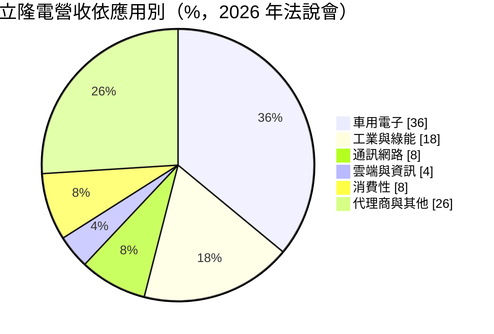
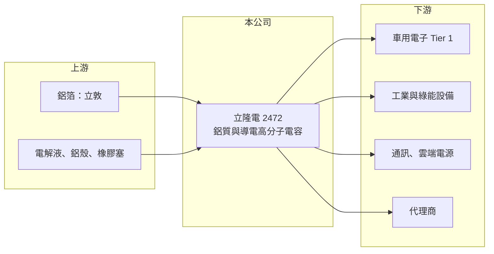

# 2472 立隆電

> 上市｜[[產業索引-電子零組件業|電子零組件業]]｜上市（櫃）日期 2001/09/17

# 第一章：企業模式與商業藍圖

> [!info] 撰寫說明
> 精簡版，由 Claude 依公開資料整理，架構比照 [[2330台積電]]，資料截至 2026-10-08。來源：證交所開放資料快照（基本資料、2026 年第二季財報、股利）、Goodinfo 經營績效年度表、富果研究 2026 年 7 月法說會摘要。法說會摘要為 AI 整理稿，數字需與公司簡報核對。#待校對

立隆電是台灣歷史最久的鋁質電解電容廠之一，本章說明它賣什麼、賣給誰，以及為什麼把重心從消費電子移往車用與工業。

- **核心業務：** 立隆電成立於 1976 年，總部在台中大里，專做[[鋁質電解電容]]，產品包括插件式（Radial）、表面黏著（SMD）、牛角型（Snap-in）與螺絲型（Screw）。電容是幾乎所有電子產品電源電路都要用的[[被動元件]]，單價低、用量大，因此競爭重點在品質穩定度、交期與成本。依 2026 年法說會摘要，SMD 型鋁電容是公司全球產量最大、也是主要獲利來源的產品。
- **營收結構：** 依 2026 年法說會摘要，應用別約為車用電子 36%、工業與綠能 18%、通訊網路 8%、雲端與資訊 4%、消費性 8%，其餘 26% 經由代理商銷售，單一客戶占比不超過 9%。車用與工業合計超過一半，代表公司已從早年以電腦、家電為主的結構，轉成以高可靠度應用為主。客戶分散的好處是單一客戶砍單的衝擊有限。
- **營運據點：** 公司在台灣與中國設有生產據點（中國工廠細節未查得，待校對），法說會提到總產能約每月 6.39 億顆。泰國春武里新廠預計 2026 年第四季投產、2027 年貢獻較完整營收，目的是分散生產地風險並就近服務東南亞客戶。
- **長期方向：** 公司長期把資源放在[[導電高分子電容]]，包括固態電容與固液混合電容，這類產品耐高溫、壽命長，適合車用與伺服器電源，毛利也高於傳統液態電容。上游透過轉投資的 [[6175立敦]] 取得鋁箔，形成[[垂直整合]]，在原物料上漲時較有成本緩衝。

# 第二章：護城河深度與競爭優勢

鋁質電解電容是成熟產業，日本廠技術領先、中國廠成本低，本章分析立隆電夾在中間靠什麼守住獲利。

- **競爭優勢：** 第一是上游鋁箔的垂直整合，立隆電持有 [[6175立敦]] 並將其併入合併報表，化成箔占鋁電容成本比重高，自有箔源讓它在缺料時能優先供貨、在漲價時壓低成本。第二是車用認證，車用電容需通過 AEC-Q200 等可靠度測試與車廠長時間驗證，一旦導入就不易被替換，這是車用占比高於同業的根本原因。第三是固液混合電容的技術累積，法說會提到其 V-chip 混合電容在台廠中具領先地位，並與工研院和日本顧問合作研發。
- **主要對手：** 國際上以日本的 Nippon Chemi-Con、Nichicon、Rubycon、Panasonic 為高階市場主力，中國的艾華集團、江海股份則以價格與產能擴張搶中低階市場。台灣同業有 [[6449鈺邦]]（固態電容）、[[2375凱美]] 與 [[2327國巨]] 集團。立隆電的定位是品質接近日系、價格較有彈性的第二供應來源。
- **觀察重點：** 長期要看三件事：固態與混合電容占營收比重能否持續提高，泰國廠能否取得歐美車廠與工業客戶的認證，以及雲端與資料中心電源能否成為車用之外的第二成長來源。若高附加價值產品比重上升，毛利率可望維持在 30% 上下的水準；若仍以標準品為主，就會跟著原物料與景氣上下波動。

# 第三章：財務體質與盈利規模

資料日期：2026-10-08，表格是撰寫當時的快照；最新月營收、毛利率、累計 EPS 由自動排程寫在本筆記的屬性欄位（月營收、毛利率、累計EPS 等）。#待校對

財務數字用來檢驗前兩章的護城河是否真實存在。立隆電近六年毛利率都在 28% 以上，在電容廠中屬於穩定偏高的水準。

| 年度 | 營收（億元） | [[毛利率]] | [[營業利益率]] | EPS（元） | [[ROE]] |
|---|---|---|---|---|---|
| 2020 | 78.2 | 28.7% | 16.5% | 5.13 | 15.1% |
| 2021 | 99.6 | 29.4% | 18.0% | 6.12 | 18.0% |
| 2022 | 103 | 30.7% | 19.1% | 7.53 | 18.1% |
| 2023 | 90 | 28.7% | 16.4% | 5.60 | 12.1% |
| 2024 | 105 | 30.8% | 17.9% | 7.01 | 15.0% |
| 2025 | 113 | 32.0% | 20.3% | 8.73 | 15.4% |

- **營收規模：** 營收從 2020 年 78.2 億元成長到 2025 年 113 億元，年複合成長率約 7.6%。2023 年因庫存調整小幅衰退，隔年即回升，顯示車用與工業需求的韌性高於消費電子。2026 年上半年合併營收 66.3 億元，年增約 18%（證交所快照）。
- **獲利：** 2025 年 EPS 8.73 元，近五年（2021 至 2025 年）平均 ROE 約 15.7%。2026 年上半年毛利率 30.9%、營業利益率 20.4%、EPS 3.98 元。要注意合併報表中有相當比例的淨利屬於[[非控制權益]]（主要是立敦的其他股東），2026 年上半年稅後淨利 9.6 億元中，歸屬母公司的是 6.6 億元。
- **財務特色：** 2026 年第二季末總資產 198.0 億元、總負債 52.0 億元，負債比約 26%，財務結構保守。2025 年度配發現金股利 3.5 元，配息率約 40%，公司章程規定每年至少分配可分配盈餘的 10%，實際上長期偏向保留盈餘支應擴產。
- **[[ROIC]] 與 [[WACC]]：** 官方快照只有負債總額、沒有拆出有息負債，因此用區間推算：2025 年營業利益約 22.9 億元（113 億 × 20.3%），乘以 (1−20%) 得稅後營業利益約 18.3 億元；投入資本若只算權益總額 145.9 億元，ROIC 約 12.6%，若把全部負債 52.0 億元都當有息負債，ROIC 約 9.3%，實際值落在兩者之間（推算）。WACC 以 CAPM 推估：無風險利率 1.75%、市場風險溢酬 6%、β 取被動元件同業常見值 1.0，股東權益成本約 7.75%；負債成本約 2%、稅後 1.6%，假設負債占資本 15%，WACC 約 6.8%（推算）。ROIC 長期高於 WACC 約 3 至 6 個百分點，代表公司在景氣循環中仍持續創造價值。

# 第四章：總體風險與地緣政治

電容產業與電子景氣高度連動，本章整理立隆電需要長期面對的風險。

- **產業週期：** 被動元件有明顯的庫存循環，下游在缺貨時重複下單、景氣轉弱時大幅去化庫存，形成[[長鞭效應]]，2023 年營收衰退即為一例。車用占比雖高，但汽車市場同樣有景氣循環，電動車銷售放緩也會影響需求。
- **營運風險：** 鋁箔、電解液與鋁殼等原物料價格波動直接影響毛利，公司 2026 年第二季已藉漲價轉嫁成本，但轉嫁有時間落差。泰國新廠初期折舊與良率爬坡，可能短期拉低獲利率。
- **其他風險：** 中國廠商在中低階鋁電容持續擴產並壓價，可能侵蝕代理商通路的市占。營收以美元與人民幣計價為主，新台幣升值會壓縮以台幣計算的毛利。此外，若子公司立敦的獲利波動，會透過合併報表放大或縮小整體表現。

# 專有名詞解析

## 金融

- **[[非控制權益]]**：合併報表中屬於子公司其他股東的權益與淨利，不歸母公司股東所有。
- **[[長鞭效應]]**：終端需求的小幅變動，沿供應鏈往上游傳遞時被逐級放大，造成上游庫存與訂單劇烈波動。

## 產業

- **[[被動元件]]**：不需外加電源即可運作的電子元件，主要是電容、電阻與電感，負責儲能、濾波與限流。
- **[[鋁質電解電容]]**：以鋁箔為電極、電解液為介質的電容，容量大、價格低，廣泛用於電源供應器與車用電子。
- **[[導電高分子電容]]**：以導電高分子取代或搭配電解液的電容，包括固態與固液混合型，耐高溫、壽命長，單價與毛利較高。
- **[[垂直整合]]**：同一集團掌握上下游多個生產環節，以穩定供料並降低成本。

# 核心供應鏈

- 上游：鋁箔來自轉投資的 [[6175立敦]]；電解液、鋁殼與橡膠塞等材料向外部供應商採購。
- 下游／客戶：車用電子模組廠、工業與綠能設備廠、通訊與雲端電源廠，以及各地電子零件代理商；法說會提到已打入歐洲大型雲端業者供應鏈。
- 同業：[[6449鈺邦]]、[[2375凱美]]、[[2327國巨]]；國外有 Nippon Chemi-Con、Nichicon、Rubycon、Panasonic，中國有艾華集團、江海股份。

## 最新新聞
<!-- news:start（自動產生，請勿手動編輯此範圍） -->
- 2026-10-07 📰 媒體 11:50｜營收速報 - 立隆電(2472)9月營收13.39億元年增率高達39.51％｜[鉅亨網](https://news.cnyes.com/news/id/6623530)

完整紀錄：[[2472立隆電 新聞]]
<!-- news:end -->

## 相關連結
- [公開資訊觀測站](https://mopsov.twse.com.tw/mops/web/t05st03?step=1&firstin=1&co_id=2472)
- [Goodinfo](https://goodinfo.tw/tw/StockDetail.asp?STOCK_ID=2472)
- [Yahoo 股市](https://tw.stock.yahoo.com/quote/2472)
- [鉅亨網新聞](https://www.cnyes.com/twstock/2472/news)
