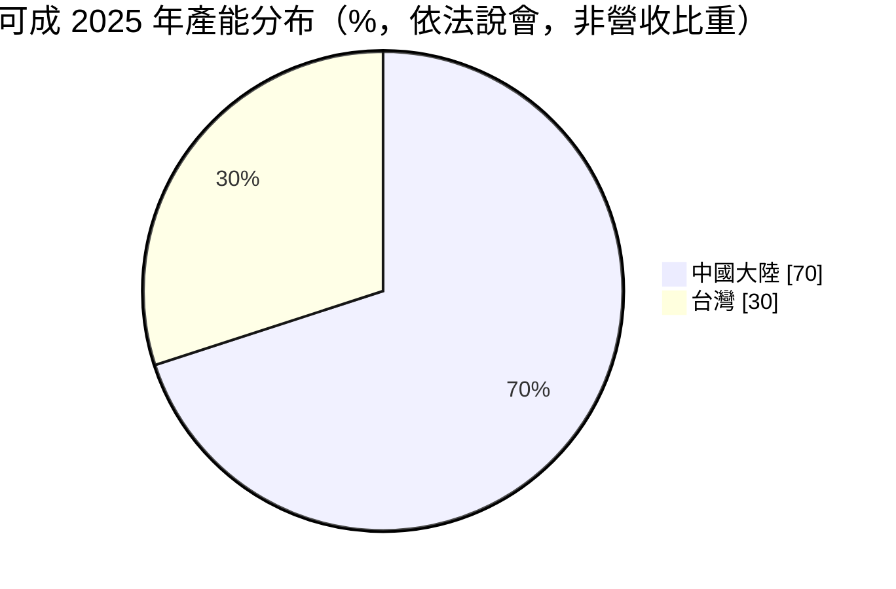
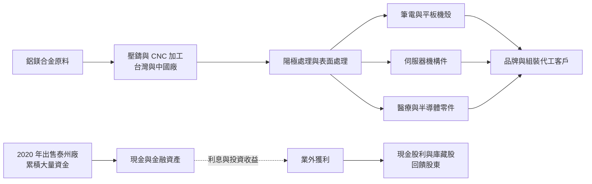
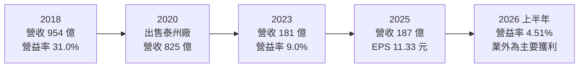
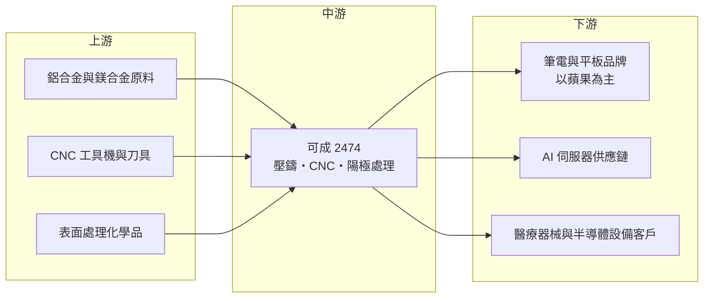

# 2474 可成

> 上市｜[[產業索引-其他電子業|其他電子業]]｜上市（櫃）日期 2001/09/17

# 第一章：企業模式與商業藍圖

> [!info] 撰寫說明
> 本文由 Claude 依公開資料整理，架構比照 [[2330台積電]] 的四章研究，資料截至 2026-10-08。財務數字來源：證交所開放資料快照（基本資料、2026 年第二季資產負債與綜合損益、股利）、Goodinfo 經營績效頁與股利政策頁（2016 至 2025 年）、理財周刊 2026 年報導（伺服器營收目標與庫藏股註銷）、富果研究 2025 年 8 月法說會整理（醫療占比與產能分布）；泰州廠出售金額與年份係沿用舊版筆記與記憶整理，尚未逐條比對原始文件。#待校對

在評估一家公司的長期投資價值時，第一步是看懂它靠什麼賺錢、為什麼能一直賺下去。本章針對可成科技（股票代號：2474，以下簡稱可成）的商業模式進行定性分析，說明這家曾經的蘋果金屬機殼龍頭，為什麼在 2020 年選擇賣掉最大的手機機殼工廠，以及它如何用龐大的資產負債表與精密加工能力，嘗試在醫療、AI 伺服器與半導體設備等領域建立第二條成長曲線。

## 一、核心定位：從金屬機殼龍頭變成「高現金、轉型中」的精密加工廠

可成成立於 1984 年，2001 年上市，總部在台南永康，董事長為創辦人洪水樹。公司以鋁、鎂合金的[[壓鑄]]、[[CNC]] 精密加工與[[陽極處理]]起家，在 2010 年代成為筆電、平板與手機一體成型金屬機殼的主要供應商，最大客戶是 [[AAPL蘋果]]。金屬[[一體成型機殼]]需要大量 CNC 機台長時間切削，加上對外觀色差、刮傷的嚴格要求，進入門檻很高，這讓可成在 2015 至 2018 年維持 40% 以上的毛利率與 30% 以上的營業利益率。

轉折發生在 2020 年。可成宣布把江蘇泰州兩家主要生產 iPhone 機殼的子公司，以約 14.27 億美元出售給中國的藍思科技（金額與年份待校對）。這個決定讓可成的營收從 2020 年的 825 億元，降到 2023 年的 181 億元，但也讓公司手上累積了大量現金與金融資產。依證交所 2026 年第二季資料，可成資產總計約 2,290 億元，權益總計約 1,416 億元，每股淨值約 256.83 元，資產規模遠大於一年的營收。

因此，今天的可成同時是兩家公司：一家是年營收不到 200 億元、正在尋找新客戶與新產品的精密加工廠；另一家是握有大量金融資產、靠利息與投資收益貢獻大部分獲利的資產管理體。依證交所資料，2026 年上半年可成營業利益僅約 2.9 億元，[[業外收支]]淨額卻達約 32.3 億元。評估可成，必須同時看本業轉型的進度，以及管理層如何配置這筆資金。

## 二、終端應用／產品板塊：筆電為主，伺服器與醫療是新引擎

可成未揭露完整的產品別營收比重。依富果整理的 2025 年 8 月法說會，醫療事業在 2025 年上半年約占營收一成，其餘以筆電與消費性電子機殼為主。公司揭露的是產能分布（不是營收比重）：

- **筆電與平板機殼：** 仍是營收主體，客戶以蘋果為主。這塊業務的特性是單價高、品質要求嚴格，但受制於單一客戶的產品週期與訂單分配，近年在供應鏈多元化與 PC 市場成熟的影響下逐步萎縮。
- **AI [[伺服器機構件]]：** 可成在 2025 年第四季開始小量出貨伺服器機殼、機構件與功能件。依理財周刊報導，公司在 2026 年 5 月的股東會表示，伺服器營收在 2026 年可望超過兩成，三年內有機會超越筆電。這是可成近年最重要的新事業，因為伺服器機構件的市場規模與成長性都高於筆電。
- **[[醫療器械]]零件：** 包括運動醫學、骨科與微創手術器械的精密零件，已取得醫療器材品質系統認證，並有子公司投入神經調控裝置開發。醫療產品的認證週期長、產量小但單價高，是最能延續可成精密加工優勢的領域。
- **半導體與航太：** 半導體設備高精度零件，以及航太與無人機零件（已取得 [[AS9100]] 航太品質認證），屬長期選項，目前營收貢獻有限。

## 三、資本轉化邏輯（營運模式）：精密加工產能加上金融資產

- **高固定成本的加工業：** CNC 機台、壓鑄設備與陽極處理產線都是固定成本，營收下滑時折舊與人力無法同步減少，營業利益率會被放大壓縮。2025 年營業利益率 16.6%，2026 年上半年降到 4.51%，就是營收大幅衰退造成的[[營運槓桿]]反轉。
- **台灣研發、中國量產：** 依法說會，台灣產能約三成，負責新領域的研發與初期量產；中國產能約七成，負責成熟產品。公司也在推進東南亞布局，以回應客戶分散供應鏈的要求（具體廠區進度未查得）。
- **資本回饋是重要的價值來源：** 可成長期每年配發約 10 元以上的現金股利，並多次執行[[庫藏股]]後註銷。依理財周刊，可成在 2026 年註銷約 2,254.8 萬股庫藏股，減資比例約 4.02%。在本業規模縮小的情況下，縮小股本是維持每股價值的方法之一。

## 四、企業長期藍圖：用資產負債表換第二成長曲線

- **AI 伺服器：** 若伺服器營收在三年內超越筆電，可成的客戶結構將從單一消費性品牌，轉為雲端與伺服器供應鏈，降低對單一客戶的依賴。
- **醫療器械：** 醫療事業的成長慢，但一旦取得認證與客戶，訂單穩定、毛利率高，適合可成「高精度、小批量」的能力。
- **資本配置的選擇：** 可成手上的資金足以支撐多年的轉型投資，也可能用於併購。管理層至今的做法偏保守，以配息、庫藏股與自建新事業為主，未進行大型併購。這種保守讓股東權益得以保全，但也讓資金報酬率長期接近利率水準。

# 第二章：護城河深度與競爭優勢

在長期價值投資中，「護城河」指企業抵禦競爭、長期維持超額利潤的保護機制。本章分析可成的護城河在出售手機機殼事業後還剩下什麼、面對哪些國內外對手，以及在新領域中能守住多少。

## 一、可成護城河的核心組成要素

可成過去的護城河建立在「蘋果機殼的規模與良率」，出售泰州廠後這道護城河明顯變窄。目前的優勢由以下三個要素構成：

- **1. 高外觀與高精度的金屬加工經驗：** 一體成型機殼要在數十道 CNC 工序之後維持外觀一致，還要經過陽極處理上色，良率管理非常困難。可成長期服務對品質要求最嚴格的客戶，累積了製程參數、治具設計與品質管理的經驗，這是它進入醫療、半導體設備與伺服器機構件的入場券。
- **2. 認證門檻：** 醫療器材需要醫療品質系統認證與各國主管機關審查，航太零件需要 AS9100 認證。這些認證取得耗時，取得後客戶不會輕易更換供應商，能形成比消費性電子更穩定的轉換成本。
- **3. 資產負債表：** 大量現金與金融資產，讓可成能承受轉型期的虧損與試錯，也能在客戶要求時快速投資新產線。在一個需要長時間驗證的新領域，「撐得久」本身就是一種優勢。

## 二、全球主要競爭對手格局

| 對手 | 定位 | 對可成的影響 |
|---|---|---|
| 藍思科技 | 中國玻璃蓋板與金屬機殼大廠，買下可成泰州廠 | 掌握原 iPhone 機殼產能，在蘋果供應鏈與可成競爭 |
| 比亞迪電子、長盈精密 | 中國大型結構件與組裝廠 | 規模大、成本低，積極爭取蘋果與非蘋果機殼訂單 |
| [[2317鴻海]]、[[2354鴻準]] | 鴻海集團的機構件事業 | 垂直整合組裝與機構件，可直接承接品牌機殼與伺服器機構件 |
| [[2059川湖]]、[[3013晟銘電]]、[[8210勤誠]] | 台灣伺服器滑軌與機殼廠 | 在 AI 伺服器機構件市場已先卡位，是可成新事業的主要對手 |
| 歐美醫療器械代工廠 | 醫療精密零件專業代工 | 在醫療市場擁有更長的客戶關係與法規經驗 |

## 三、優勢轉化：守得住／守不住／觀察重點

- **守得住：** 需要高外觀品質的筆電機殼，以及需要認證的醫療與航太零件。這些領域看重品質、良率與交期，價格不是唯一考量，可成的製程經驗能轉化為訂單。可成的毛利率在 2021 至 2025 年營收大幅縮小的情況下，仍維持在 27% 至 33%，顯示加工能力與報價仍有支撐。
- **守不住：** 一般消費性機殼的價格競爭，以及營收規模本身。中國結構件廠在成本與規模上占優，可成已不再是蘋果機殼的最大供應商；伺服器機構件市場則已有先進者，可成需要從後段班追趕。
- **觀察重點：** 長期而言，可以追蹤三件事。第一是伺服器營收占比能否如公司預期超過兩成並持續成長；第二是本業營業利益率能否回到雙位數，讓獲利不再依賴利息收入；第三是管理層對大量資金的配置方式，是持續回饋股東，還是投入能創造更高報酬的新事業。

# 第三章：財務體質與盈利規模

資料日期：2026-10-08。數字取自 Goodinfo 經營績效頁與股利政策頁、證交所開放資料快照，表格是撰寫當時的快照；最新月營收、毛利率、累計 EPS 由自動排程寫在本筆記的屬性欄位（月營收、毛利率、累計EPS 等）。#待校對

財務報表是檢驗護城河是否真實存在的最終標準。本章用多年度的三率、ROE、股利與資本報酬，檢視可成在出售手機機殼事業前後的獲利品質變化。

## 一、獲利能力的基石：三率

| 年度 | 營收（億元） | [[毛利率]] | [[營業利益率]] | EPS（元） | [[ROE]] |
|---|---|---|---|---|---|
| 2017 | 933 | 45.0% | 35.8% | 28.35 | 17.1% |
| 2018 | 954 | 40.5% | 31.0% | 36.31 | 19.7% |
| 2019 | 916 | 24.3% | 15.4% | 14.63 | 7.53% |
| 2020 | 825 | 26.6% | 18.1% | 27.65 | 13.8% |
| 2021 | 411 | 33.0% | 21.3% | 11.31 | 5.55% |
| 2022 | 278 | 31.9% | 17.9% | 15.14 | 7.20% |
| 2023 | 181 | 27.3% | 9.0% | 13.33 | 5.92% |
| 2024 | 181 | 32.4% | 18.2% | 19.40 | 8.18% |
| 2025 | 187 | 31.6% | 16.6% | 11.33 | 4.72% |

（來源：Goodinfo 經營績效頁，合併報表。2026 年上半年依證交所資料：營收 64.6 億元、毛利率 28.83%、營業利益率 4.51%、EPS 5.14 元，稅前淨利中約九成來自業外收支。）

- **營收規模的斷崖：** 2020 至 2025 年營收年複合成長率約負 25.7%（推算），主要是出售泰州廠與手機機殼業務的結果，屬於主動縮小，而不是市場流失。不過 2023 年之後營收停在約 180 億元，2026 年上半年又因客戶拉貨減少而大幅衰退，顯示剩下的筆電業務本身也缺乏成長。
- **毛利率仍在，營業利益率失去規模支撐：** 毛利率長期維持在 27% 至 33%，代表報價與加工效率仍有競爭力；但營業利益率從 2017 至 2018 年的三成以上，降到 2023 年的 9% 與 2026 年上半年的約 4.5%。原因是營收縮小後，研發、管理與新事業的費用相對變大。
- **EPS 與本業脫鉤：** 2021 年以後可成的淨利率長期高於營業利益率，2024 年淨利率甚至達 73%，代表利息、投資與匯兌收益占獲利的主要部分。這讓 EPS 對利率與匯率非常敏感，例如 2025 年 EPS 由 19.40 元降到 11.33 元，本業營業利益率其實只小幅下降（推估主因為匯兌與投資收益減少）。

## 二、[[ROE]]：資本效率

2021 至 2025 年可成平均 ROE 約 6.3%（推算），遠低於 2016 至 2018 年的 17% 至 20%。ROE 下降的原因很直接：股東權益仍維持在約 1,400 億元的規模，但其中很大一部分是報酬接近市場利率的金融資產，而能創造高報酬的手機機殼事業已經出售。依證交所資料，2026 年第二季可成歸屬母公司權益約 1,383.8 億元，保留盈餘約 1,164 億元。要讓 ROE 回升，可成只有兩條路：讓本業重新成長，或透過高配息與庫藏股把多餘的資本還給股東。

## 三、資本支出、自由現金流與股利

- **[[CapEx]]：** 新事業以既有廠房轉換與台灣研發線為主，具體資本支出金額未查得。相較於可成的資產規模，新事業的投資金額推估不大。
- **[[自由現金流]]：** 多年度自由現金流金額未查得。由於資本支出相對有限，加上利息收入穩定，推估可成多數年份的自由現金流為正，足以支應現金股利（推估）。
- **股利穩定度：** 依 Goodinfo，2015 至 2023 年度可成每年配發 10 至 12 元現金股利，2024 年度為 15.83 元，2025 年度為 10.27 元，2023 年起改為半年配。以 EPS 計算，2021 至 2025 年度配發率約在 66% 至 91% 之間（推算）。在獲利大幅波動的情況下仍維持每股 10 元左右的現金股利，顯示管理層把穩定配息視為重要承諾，並以龐大的保留盈餘作為後盾。

## 四、[[ROIC]] 與 [[WACC]]：價值創造利差

- **ROIC（推算）：** 以 2025 年營收約 187 億元乘以營業利益率 16.6%，營業利益約 31.0 億元，扣除 20% 稅率後稅後營業利益約 24.8 億元。有息負債的明細未查得（2026 年第二季流動負債約 801.4 億元，結構不明），投入資本先以權益總計約 1,416 億元計算，ROIC 約 1.8%（推算）。若只計算實際用於營運的資產，ROIC 會高得多，但這部分資料未查得。作為對照，2018 年營業利益約 295.7 億元（954 億元乘以 31.0%），稅後約 236.6 億元，以當年 ROE 19.7% 與淨利約 279.5 億元回推權益約 1,419 億元，ROIC 約 16.7%（推算）。
- **WACC（推算）：** 以 [[CAPM]] 估算股東權益成本：無風險利率取台灣 10 年期公債約 1.75%，市場風險溢酬 6%，β 假設 0.8（電子機構件同業常見值，未查得可成實際數字），權益成本約 6.55%。負債結構未查得，若假設有息負債占投入資本兩成、稅前負債成本 2.5%（稅後約 2.0%），WACC 約 5.6%（推算）。
- **價值創造判斷：** 以整體權益計算，可成目前的 ROIC 約 1.8%，低於約 5.6% 至 6.6% 的資金成本，代表大部分資本並未創造超額價值。2018 年手機機殼全盛期的 ROIC 約 16.7%，明顯高於 WACC，對照之下可以清楚看出出售手機機殼事業對資本報酬的影響。可成的課題是：要不是讓新事業的報酬率超過 WACC，就是把超額資本還給股東，否則每股價值會隨時間被資金成本侵蝕。

# 第四章：總體風險與地緣政治

任何企業都無法脫離宏觀環境獨立存在。本章分析可成未來必須面對的地緣政治、產業週期、營運與技術法規風險。

## 一、地緣政治風險

- **中國產能比重高：** 可成約七成產能位於中國，美國對中國製品的關稅與科技管制，以及品牌客戶要求「中國以外產能」的壓力，都可能迫使可成增加東南亞投資。若轉移速度落後同業，訂單分配可能受到影響。
- **兩岸資產配置：** 可成大量資產與部分金融資產可能以外幣或在海外持有，匯率波動會直接反映在業外損益；兩岸關係與資本管制政策的變化，也會影響資金的調度彈性（推估）。
- **伺服器供應鏈的地緣要求：** AI 伺服器的客戶對生產地點有明確要求，部分專案需要在台灣、東南亞或美國生產，可成必須配合客戶的產地策略投資。

## 二、產業週期與市場結構風險

- **客戶集中：** 筆電與平板機殼高度依賴單一品牌客戶，其產品週期、材料選擇與供應商分配，直接決定可成的營收。這種集中度在出售手機業務後並未明顯降低。
- **PC 市場成熟：** 全球筆電出貨量已進入成熟期，換機需求依賴作業系統更新與 AI PC 等題材，長期成長有限。
- **[[長鞭效應]]：** 2026 年記憶體等電子零件短缺，使品牌客戶減少拉貨，可成雖然不是缺料的一方，營收卻被連帶衝擊。終端供應鏈任何一個環節的波動，都可能放大傳導到機構件廠。

## 三、營運環境的隱性風險

- **利率下行侵蝕獲利：** 可成的 EPS 有很大一部分來自利息與投資收益，若全球利率長期下降，獲利會明顯縮水，而本業目前還無法完全補上。
- **轉型執行：** 伺服器、醫療、半導體與航太都需要新客戶、新製程與新認證，量產時程容易延後。新事業同時推進，也考驗管理層的資源分配能力。
- **市值與流動性：** 本業縮小後，可成在國際指數中的權重下降，外資持股可能減少，股價對資本回饋政策的依賴度提高（推估）。

## 四、科技與法規演進風險

- **材料與設計改變：** 筆電若改用不同材料或結構，或品牌客戶改採自有製程，金屬一體成型機殼的需求可能下降。
- **醫療法規：** 醫療器械受各國法規嚴格規範，品質系統稽核、產品召回與責任訴訟，都是可成過去在消費性電子中不曾面對的風險。
- **伺服器散熱與機構設計演進：** AI 伺服器朝液冷、高密度機櫃發展，機構件的規格變化快，供應商需要跟著客戶同步開發，技術落後就可能失去下一代平台的訂單。

# 專有名詞解析

## 應用

- **[[醫療器械]]**：骨科、運動醫學與微創手術使用的器材與零件，需通過各國主管機關審查與品質系統認證。

## 金融

- **[[庫藏股]]**：公司從市場買回自家股票，可註銷以縮小股本，提升每股盈餘與每股淨值。
- **[[業外收支]]**：本業以外的收入與支出，例如利息、投資收益與匯兌損益，評估本業時常會拆開看。
- **[[營運槓桿]]**：固定成本占比高時，營收變動會放大反映在營業利益上的現象。
- **[[長鞭效應]]**：終端需求的小幅變動，沿供應鏈往上游傳遞時被逐級放大，造成庫存與訂單劇烈波動。
- **[[ROIC]]**：投入資本報酬率，稅後營業利益除以股東權益加有息負債，衡量本業運用資本的效率。
- **[[WACC]]**：加權平均資金成本，依股東權益與負債的比重，加權計算公司取得資金的平均成本。
- **[[CAPM]]**：資本資產定價模型，以無風險利率加上 β 乘以市場風險溢酬估算股東要求報酬率。

## 產業

- **[[壓鑄]]**：把熔化的鋁、鎂合金以高壓注入模具，冷卻後成形的金屬加工方法，適合大量生產結構件。
- **[[CNC]]**：電腦數值控制加工，以程式控制刀具切削金屬，可做出高精度、複雜形狀的零件。
- **[[陽極處理]]**：在鋁合金表面以電解方式形成氧化膜，提高耐磨與防腐蝕，並可染出各種顏色。
- **[[一體成型機殼]]**：以整塊金屬切削出筆電或手機外殼，結構強度與外觀較好，但需要大量 CNC 工時。
- **[[伺服器機構件]]**：伺服器的機殼、滑軌、支架與功能件，AI 伺服器重量與散熱需求高，規格要求更嚴格。
- **[[AS9100]]**：航太產業的品質管理系統標準，是進入航太零件供應鏈的基本門檻。

# 核心供應鏈

## 1. 上游：原料與設備
- 鋁合金、鎂合金錠與板材供應商
- CNC 工具機、刀具與治具供應商
- 陽極處理與表面處理化學品

## 2. 中游：可成本身與同業
- 可成：金屬機殼、伺服器機構件、醫療與半導體精密零件
- 消費性電子機殼同業：藍思科技、比亞迪電子、長盈精密、[[2354鴻準]]
- 伺服器機構件同業：[[2059川湖]]、[[3013晟銘電]]、[[8210勤誠]]

## 3. 下游：品牌與組裝客戶
- 筆電與平板品牌：[[AAPL蘋果]]
- 組裝代工：[[2317鴻海]]、[[2382廣達]]（推估，未查證為直接客戶）

## 4. 下游：新事業客戶
- AI 伺服器供應鏈（公司未證實具體客戶）
- 醫療器械品牌、半導體設備與航太客戶

## 最新新聞
<!-- news:start（自動產生，請勿手動編輯此範圍） -->
- 2026-10-16 🏛️ 重訊 15:08｜本公司受邀參加國票證券舉辦之法人座談會｜[觀測站](https://mops.twse.com.tw/mops/#/web/t05st01)
- 2026-10-06 📰 媒體 17:38｜可成Q3營收季增逾1成 AI產品擴大出貨營收逐步增｜[鉅亨網](https://news.cnyes.com/news/id/6622759)
- 2026-10-06 🏛️ 重訊 16:57｜公告本公司買回庫藏股期間屆滿執行情形｜[觀測站](https://mops.twse.com.tw/mops/#/web/t05st01)
- 2026-10-06 🏛️ 重訊 16:55｜公告本公司買回股份金額達新台幣三億元以上｜[觀測站](https://mops.twse.com.tw/mops/#/web/t05st01)

完整紀錄：[[2474可成 新聞]]
<!-- news:end -->

## 相關連結
- [公開資訊觀測站](https://mopsov.twse.com.tw/mops/web/t05st03?step=1&firstin=1&co_id=2474)
- [Goodinfo](https://goodinfo.tw/tw/StockDetail.asp?STOCK_ID=2474)
- [Yahoo 股市](https://tw.stock.yahoo.com/quote/2474)
- [鉅亨網新聞](https://www.cnyes.com/twstock/2474/news)
