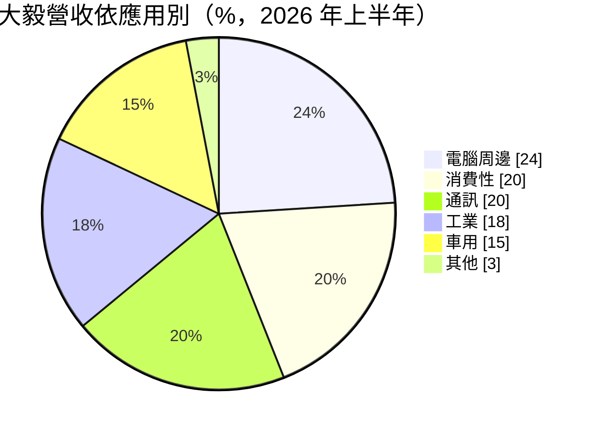
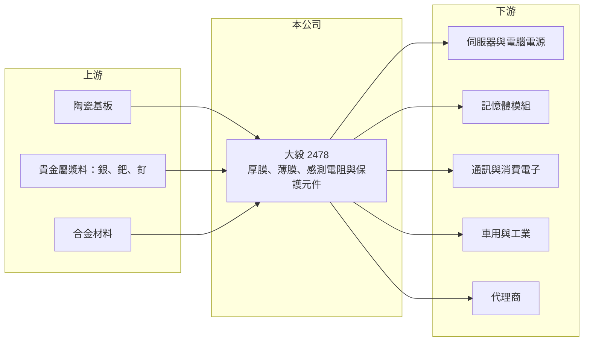

# 2478 大毅

> 上市｜[[產業索引-電子零組件業|電子零組件業]]｜上市（櫃）日期 2001/09/17

# 第一章：企業模式與商業藍圖

> [!info] 撰寫說明
> 精簡版，由 Claude 依公開資料整理，架構比照 [[2330台積電]]，資料截至 2026-10-08。來源：證交所開放資料快照（基本資料、2026 年第二季財報、股利）、Goodinfo 經營績效年度表、富果研究 2026 年 8 月法說會摘要。法說會摘要為 AI 整理稿，數字需與公司簡報核對。#待校對

大毅是台灣的電阻專業廠，本章說明它如何從一般厚膜電阻，轉向電流感測、薄膜與保護元件等利基產品。

- **核心業務：** 大毅成立於 1989 年，總部在桃園蘆竹，產品分三大類：厚膜[[晶片電阻]]（一般型、車用、高壓、抗硫化、高功率等）、薄膜與保護元件（精密薄膜電阻、晶片保險絲、ESD 抑制器），以及[[電流感測電阻]]（金屬板、金屬膜、四端子、分流器等）。電阻是最基礎的被動元件之一，一般品價格競爭激烈，因此公司把重心放在規格要求高、價格較穩的利基品。
- **營收結構：** 依 2026 年上半年法說會摘要，薄膜、保護與感測元件占營收 54%（2025 年為 50%），傳統厚膜電阻占 46%。應用別約為電腦周邊 24%、消費性 20%、通訊 20%、工業 18%、車用 15%；其中 AI 相關（主要是伺服器電源與記憶體）約占 12%，公司預期 2026 全年提高到 15%。地區別以大中華區 66% 為主。
- **營運據點：** 生產據點包括台灣桃園、中國蘇州與東莞，以及越南海陽。台灣南山二廠預計 2027 年第二季量產，法說會指出可增加約 50% 的高階電阻、保護與感測元件產能。
- **長期方向：** 公司策略是提高利基與新應用產品的比重，包括大功率、低阻值、高精度與客製化的感測電阻，主要用在 [[AI 伺服器]]電源、記憶體模組、車用電池管理與工業電源。電流感測電阻是電源系統偵測電流、保護電路的關鍵零件，功率越高的系統需要越多、越精密的感測電阻。

# 第二章：護城河深度與競爭優勢

電阻市場由少數大廠主導，大毅規模遠小於龍頭，本章分析它靠哪些利基守住獲利。

- **競爭優勢：** 大毅的優勢在於產品線深度，而不是規模。電流感測、薄膜精密電阻與保護元件需要材料配方、雷射修阻與特殊製程的累積，客戶導入前要經過長時間驗證，轉換成本高於一般電阻。2026 年經銷通路比重提高到 25%，公司表示經銷賣的多是少量多樣、毛利較高的利基品。
- **主要對手：** 全球晶片電阻龍頭是 [[2327國巨]]，台灣同業有 奇力新、[[6173信昌電]] 等；電流感測與精密電阻領域的國際對手包括日本的 KOA、Rohm 與美國 Vishay。大毅在一般厚膜電阻上難以與國巨比成本，因此選擇在感測與薄膜領域做差異化。
- **觀察重點：** 長期要看利基產品占比能否持續高於五成、南山二廠產能能否順利被 AI 與車用訂單消化，以及貴金屬（銀、鈀、釕）價格上漲時能否把成本轉嫁給客戶。法說會指出原物料約占電阻成本 51%，成本轉嫁能力決定毛利率的下限。

# 第三章：財務體質與盈利規模

資料日期：2026-10-08，表格是撰寫當時的快照；最新月營收、毛利率、累計 EPS 由自動排程寫在本筆記的屬性欄位（月營收、毛利率、累計EPS 等）。#待校對

大毅的獲利高度受被動元件景氣影響，2021 年高峰後連續三年毛利率下滑，2025 年起回升。

| 年度 | 營收（億元） | [[毛利率]] | [[營業利益率]] | EPS（元） | [[ROE]] |
|---|---|---|---|---|---|
| 2020 | 53.9 | 24.1% | 14.2% | 4.70 | 12.0% |
| 2021 | 63.1 | 28.4% | 18.7% | 6.60 | 15.5% |
| 2022 | 50.2 | 22.8% | 11.1% | 4.31 | 9.66% |
| 2023 | 45.9 | 20.7% | 10.4% | 2.56 | 5.67% |
| 2024 | 50.3 | 18.6% | 7.68% | 3.13 | 6.69% |
| 2025 | 54.2 | 22.8% | 11.5% | 3.45 | 7.04% |

- **營收規模：** 2020 至 2025 年營收在 46 億至 63 億元之間來回，五年年複合成長率接近 0%，顯示傳統電阻市場成長有限，公司的成長主要來自產品組合改善而非量的擴張。2026 年上半年營收 31.3 億元，年增約 15%。
- **獲利：** 2026 年上半年毛利率約 27.0%、營業利益率約 15.9%、EPS 2.91 元，其中第二季毛利率 29%、EPS 1.77 元。毛利率從 2024 年的 18.6% 回到接近 2021 年高峰，主因是利基品比重提高與產能利用率回升到 85% 至 90%，屬於典型的[[營業槓桿]]。近五年（2021 至 2025 年）平均 ROE 約 8.9%。
- **財務特色：** 2026 年第二季末總資產 105.6 億元、總負債 31.6 億元，負債比約 30%，帳上現金約 18 億元。2025 年度配發現金股利 2 元，配息率約 58%，公司章程採剩餘股利政策，現金股利不低於股利總額 10%。
- **[[ROIC]] 與 [[WACC]]：** 2025 年營業利益約 6.2 億元（54.2 億 × 11.5%），稅後營業利益約 5.0 億元；投入資本以權益總額 74.0 億元計 ROIC 約 6.7%，若把全部負債 31.6 億元都計入則約 4.7%（推算）。2026 年上半年營業利益 5.0 億元，年化後稅後約 8.0 億元，對權益的報酬約 10.8%（推算）。WACC 以 CAPM 推估：無風險利率 1.75%、市場風險溢酬 6%、β 取被動元件同業常見值 1.1，股東權益成本約 8.4%；負債成本 2%、稅後 1.6%，負債占資本 15%，WACC 約 7.4%（推算）。2023 至 2025 年 ROIC 低於 WACC，代表景氣低谷期並未創造價值；2026 年若維持上半年水準，ROIC 可回到 WACC 之上。

# 第四章：總體風險與地緣政治

電阻是高度標準化的零件，本章整理大毅長期需要面對的風險。

- **產業週期：** 被動元件有明顯的庫存循環，2022 至 2024 年的去庫存期大毅毛利率由 28.4% 掉到 18.6%，下一次景氣反轉時同樣會出現。目前接單出貨比約 1.4 至 1.5、交期拉長到 10 至 14 週，屬於景氣偏熱的訊號，歷史上這類時期之後常伴隨客戶重複下單與後續修正。
- **營運風險：** 銀、鈀、釕等貴金屬占成本比重高，價格大漲時若轉嫁不及會壓縮毛利。南山二廠新增產能若遇需求放緩，折舊會拉低獲利率。
- **其他風險：** 大中華區占營收三分之二，中國電阻廠的價格競爭與中國景氣變化影響大。營收以外幣計價為主，匯率波動影響以台幣計算的毛利；AI 伺服器需求若放緩，高階感測元件的成長動能也會減弱。

# 專有名詞解析

## 應用

- **[[AI 伺服器]]**：搭載 GPU 等加速晶片、用於 AI 訓練與推論的伺服器，功耗高，對電源與被動元件規格要求也高。

## 金融

- **[[營業槓桿]]**：固定成本占比高的公司，營收增加時利潤增幅大於營收增幅，反之亦然。

## 產業

- **[[晶片電阻]]**：表面黏著用的小型電阻，以厚膜或薄膜製程製造，是電子產品用量最大的電阻。
- **[[電流感測電阻]]**：阻值極低、精度高的電阻，串接在電源迴路中量測電流，用於電池管理與伺服器電源保護。

# 核心供應鏈

- 上游：氧化鋁陶瓷基板、銀鈀釕等貴金屬電極漿料、合金感測材料。
- 下游／客戶：伺服器與電腦電源廠、記憶體模組廠、通訊與消費電子組裝廠、車用與工業電子廠，以及電子零件代理商。
- 同業：[[2327國巨]]、奇力新、[[6173信昌電]]；國外有 KOA、Rohm、Vishay。

## 最新新聞
<!-- news:start -->
<!-- news:end -->

## 相關連結
- [公開資訊觀測站](https://mopsov.twse.com.tw/mops/web/t05st03?step=1&firstin=1&co_id=2478)
- [Goodinfo](https://goodinfo.tw/tw/StockDetail.asp?STOCK_ID=2478)
- [Yahoo 股市](https://tw.stock.yahoo.com/quote/2478)
- [鉅亨網新聞](https://www.cnyes.com/twstock/2478/news)
