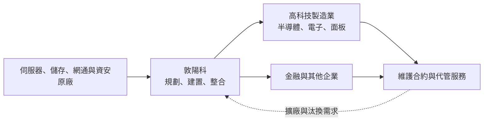
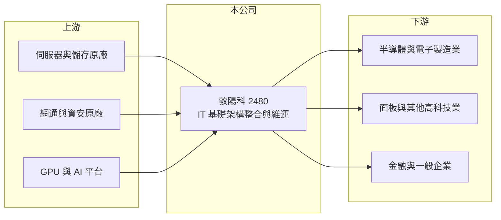

# 2480 敦陽科

> 上市｜[[產業索引-資訊服務業|資訊服務業]]｜上市（櫃）日期 2001/09/17

# 第一章：企業模式與商業藍圖

> [!info] 撰寫說明
> 精簡版，由 Claude 依公開資料整理，架構比照 [[2330台積電]] 的四章研究，資料截至 2026-10-08。來源：Goodinfo 年度經營績效頁與基本資料頁、證交所開放資料（基本資料、2026 年第二季資產負債與綜合損益、每月營收、股利）、優分析與商周報導標題。客戶產業分布、合作原廠與發展沿革依記憶整理；營收比重未查得。#待校對

敦陽科技是以高科技製造業為主要客戶的系統整合商，本章說明它如何從伺服器與儲存設備的整合起家，憑藉對半導體與電子業 IT 需求的熟悉，建立資服業少見的高 ROE 模式。

## 一、核心定位：高科技業的 IT 基礎建設夥伴

- **核心業務：** 敦陽科的登記主要業務為「電腦系統、電腦週邊、網路產品及電腦軟體之規劃、銷售及整合」，以及系統整合、諮詢與維修（Goodinfo 基本資料）。實際上它替企業建置資料中心所需的伺服器、儲存、網路、資安與備份系統，並提供長期維護與代管服務，是典型的 IT 基礎架構[[系統整合]]商。
- **公司背景：** 敦陽科成立於 1993 年、2001 年上市，董事長兼總經理為梁修宗，實收資本額約 10.6 億元（證交所開放資料）。公司早年代理國際伺服器與儲存大廠產品起家，逐步擴大到資安、雲端與應用服務（依記憶整理，待校對）。
- **客戶產業分布：** 客戶以半導體、電子製造、面板與金融業為主，高科技製造業比重高（依記憶整理，待校對）。這些客戶的工廠全年運轉，對系統可用性與資料安全要求極高，願意為穩定的服務支付溢價。
- **長期方向：** 優分析以「台灣本土 AI 基礎設施概念股」形容敦陽科（報導標題）。企業導入 AI 需要 GPU 伺服器、高速儲存與網路，敦陽科的角色是替客戶規劃並建置這些地端 AI 基礎設施，並延伸到資安與維運服務（推估）。

## 二、資本轉化邏輯：建置帶動維護，維護帶動擴充

半導體與電子業客戶每次擴廠、建新產線，都需要同步建置資料中心與網路，這讓敦陽科能跟著客戶的資本支出一起成長。系統建置完成後，維護合約與資安監控服務提供穩定收入，而汰換與擴充又帶來下一輪專案。2020 至 2025 年營收由 55.4 億元增至 83.9 億元，EPS 由 4.68 元增至 8.00 元（Goodinfo）。

# 第二章：護城河深度與競爭優勢

本章分析敦陽科的護城河構成，以及它為何能在薄利的系統整合業維持高資本報酬。

## 一、競爭優勢

- **高科技客戶的信任：** 半導體與電子業的生產資料與製程配方屬於最高機密，系統停擺一小時就可能造成巨額損失。能長期服務這些客戶的整合商，需要有大型專案的實績與 24 小時支援能力，這種信任一旦建立，客戶很少更換供應商。
- **技術廣度：** 從伺服器、儲存、網路到資安與備份，敦陽科能一次整合多家原廠產品並負責到底，降低客戶管理多個供應商的負擔。
- **資本效率：** 營業利益率約 12%，遠高於一般系統整合商的 3% 至 6%；ROE 連續五年在 20% 以上（Goodinfo）。高利潤率說明公司的收入中，服務與高附加價值整合的比重高於單純硬體轉售（推估）。

## 二、主要對手

| 對手 | 定位 | 與敦陽科的比較 |
|---|---|---|
| [[6214精誠]] | 大型資訊服務集團 | 企業系統整合的全面對手 |
| [[3029零壹]] | 資安、雲端與 IT 基建代理商 | 在資安與基礎架構產品上競爭 |
| [[3147大綜]] | 製造業伺服器與資料中心整合 | 同樣以製造業客戶為主，AI 伺服器案件直接競爭 |
| [[6112邁達特]] | 系統整合與 IT 服務 | 企業基礎架構案件重疊 |
| [[2453凌群]] | 政府與金融系統整合 | 金融客戶部分重疊 |

## 三、觀察重點

- **AI 基礎建設的比重：** 地端 AI 伺服器單價高、毛利率較低，若比重快速提高，營收會成長但利潤率可能下滑。
- **客戶集中度：** 對半導體大客戶的依賴程度未查得，若單一客戶占比過高，客戶資本支出的週期會直接影響營收。
- **維護與服務收入：** 這是高利潤率的來源，追蹤其比重比追蹤營收成長更重要。

# 第三章：財務體質與盈利規模

資料日期：2026-10-08，表格是撰寫當時的快照；最新月營收、毛利率、累計 EPS 由自動排程寫在本筆記的屬性欄位（月營收、毛利率、累計EPS 等）。#待校對

本章用多年度數據檢視敦陽科的穩定成長與高資本報酬。

## 一、多年度三率與 ROE

| 年度 | 營收（新台幣） | [[毛利率]] | [[營業利益率]] | EPS（元） | [[ROE]] |
|---|---|---|---|---|---|
| 2020 | 55.4 億 | 24.9% | 9.8% | 4.68 | 17.7% |
| 2021 | 65.8 億 | 24.3% | 11.6% | 6.00 | 21.8% |
| 2022 | 67.3 億 | 25.8% | 11.9% | 6.91 | 23.9% |
| 2023 | 72.7 億 | 24.6% | 11.9% | 7.36 | 24.5% |
| 2024 | 75.4 億 | 25.0% | 12.2% | 7.50 | 23.8% |
| 2025 | 83.9 億 | 24.3% | 11.9% | 8.00 | 24.5% |
| 2026 上半年 | 48.8 億 | 22.89% | 12.11% | 4.91 | 未查得 |

註：2020 至 2025 年取自 Goodinfo；2026 上半年取自證交所綜合損益與營益分析。

- **營收成長：** 2020 至 2025 年營收年複合成長率約 8.7%（推算），2026 年 1 至 8 月累計營收約 64.7 億元、年增約 16.4%（證交所每月營收）。
- **獲利穩定：** 毛利率長年在 24% 至 26%、營業利益率在 12% 上下，EPS 連續五年成長，顯示公司有很好的成本與報價紀律。
- **ROE：** 2021 至 2025 年平均 ROE 約 23.7%（推算），在台灣資訊服務業中屬於前段。

## 二、股利與財務結構

2025 年度配發現金股利 7.8 元，以 EPS 8.00 元計算配發率約 97.5%（推算），幾乎把盈餘全數配給股東。2026 年第二季底權益約 32.8 億元、總負債約 62.0 億元，其中流動負債約 61.3 億元、非流動負債僅約 0.7 億元；流動資產約 82.3 億元（證交所資產負債）。負債高但幾乎全是流動性的營運負債，推估以預收款與應付帳款為主（推估）。客戶先付款、原廠後收款的營運資金結構，讓公司不需要大量自有資本就能承接大案，這是 ROE 高的重要原因。

## 三、[[ROIC]] 與 [[WACC]]

**ROIC 推算：** 2025 年營業利益約 83.9 億元 × 11.9% ≈ 9.98 億元，扣除 20% 稅後約 7.99 億元。投入資本以權益 32.8 億元加上非流動負債 0.7 億元計算，約 33.5 億元，ROIC 約 23.9%（推算）；若扣除帳上多餘現金，營運資本報酬會更高（推估）。

**WACC 推算：** 公債殖利率 1.75%、市場風險溢酬 6%、β 取資服股常見值 0.7，權益成本約 5.95%；幾乎沒有有息負債，WACC 約 5.9%（推算）。

**結論：** ROIC 約 24%，比約 6% 的 WACC 高出 18 個百分點，代表敦陽科長期大幅創造價值。輕資產加上正向的營運資金循環，使公司能同時維持成長與接近全額配息。

# 第四章：總體風險與地緣政治

本章整理敦陽科長期面對的產業、營運與其他風險。

## 一、產業週期

- **高科技業資本支出：** 半導體與電子業的擴廠節奏決定 IT 基礎建設需求，產業下行時客戶會延後資料中心擴充，營收成長會放緩。
- **硬體價格與供貨：** 伺服器、GPU 與儲存設備的供需緊張時，交期延長會影響專案認列時點。

## 二、營運風險

- **產品組合變化：** AI 伺服器等高單價硬體比重提高，毛利率可能被稀釋，2026 年上半年毛利率已降至 22.89%。
- **原廠政策：** 國際原廠若調整通路政策、直接服務大客戶，整合商的角色可能被壓縮。
- **人才：** 資安與雲端工程師供不應求，人力成本持續上升。

## 三、其他風險

- **地緣政治：** 客戶集中在台灣高科技業，兩岸情勢與美中科技管制會影響客戶的投資地點與規模；客戶海外設廠時，公司需要具備跨國服務能力。
- **匯率：** 設備多以美元向原廠採購，匯率波動會影響成本。

# 專有名詞解析

## 應用

- **[[系統整合]]**：替客戶規劃並整合軟硬體、網路與應用系統，讓不同設備與軟體能一起運作的資訊服務。
- **[[AI伺服器]]**：搭載 GPU 等加速晶片、專門用來訓練或執行 AI 模型的伺服器，單價與耗電都遠高於一般伺服器。
- **[[資安]]**：資訊安全，保護企業系統與資料不被入侵、竊取或破壞的技術與服務。

## 金融

- **[[ROIC]]**：投入資本報酬率，衡量企業用股東與債權人投入的資本，每年能產生多少稅後營業利益。
- **[[WACC]]**：加權平均資金成本，股東要求報酬與負債利息依資本結構加權後的平均值，是判斷是否創造價值的門檻。

# 核心供應鏈

- 上游：伺服器、儲存、網通與資安原廠，例如 [[CSCO思科]]、[[NVDA輝達]]、[[MSFT微軟]]（產業代表，非指名合作對象）。
- 下游／客戶：半導體與電子製造業，例如 [[2330台積電]]、[[2303聯電]]（產業代表，非指名客戶，待校對）；面板、金融與一般企業。
- 同業：[[6214精誠]]、[[3029零壹]]、[[3147大綜]]、[[6112邁達特]]、[[2453凌群]]。

## 最新新聞
<!-- news:start（自動產生，請勿手動編輯此範圍） -->
- 2026-10-08 📰 媒體 17:23｜營收速報 - 敦陽科(2480)9月營收9.77億元年增率高達50.45％｜[鉅亨網](https://news.cnyes.com/news/id/6624996)

完整紀錄：[[2480敦陽科 新聞]]
<!-- news:end -->

## 相關連結
- [公開資訊觀測站](https://mopsov.twse.com.tw/mops/web/t05st03?step=1&firstin=1&co_id=2480)
- [Goodinfo](https://goodinfo.tw/tw/StockDetail.asp?STOCK_ID=2480)
- [Yahoo 股市](https://tw.stock.yahoo.com/quote/2480)
- [鉅亨網新聞](https://www.cnyes.com/twstock/2480/news)
