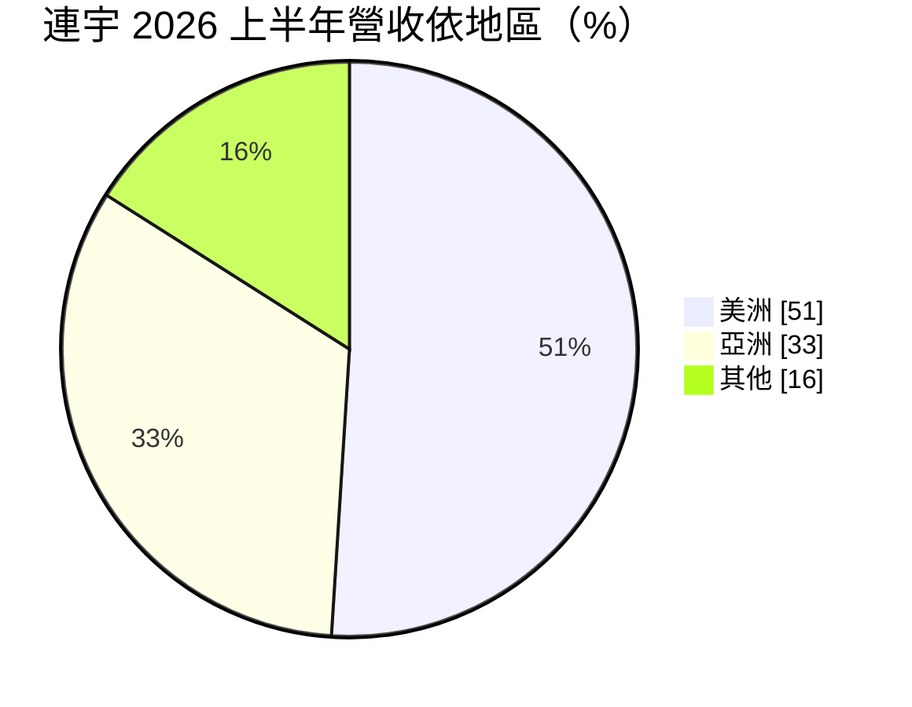
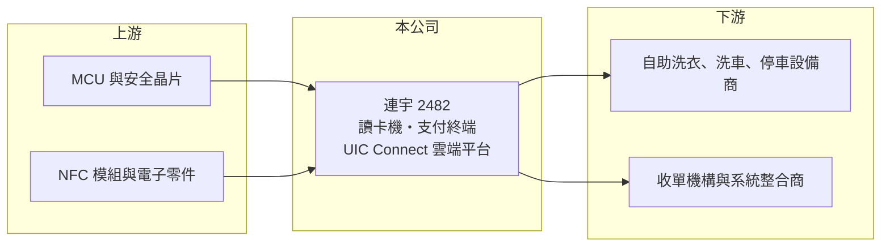

# 2482 連宇

> 上市｜[[產業索引-其他電子業|其他電子業]]｜上市（櫃）日期 2001/09/17

# 第一章：企業模式與商業藍圖

> [!info] 撰寫說明
> 精簡版，由 Claude 依公開資料整理，架構比照 [[2330台積電]] 的四章研究，資料截至 2026-10-08。來源：證交所開放資料快照（基本資料、2026 年上半年綜合損益與資產負債、股利）、Goodinfo 經營績效頁（2019 至 2025 年）、富果研究連宇 2026 年 9 月法說會筆記、nStock 公司簡介。有息負債未查得，ROIC 與 WACC 為推算。#待校對

連宇（股票代號：2482）是一家專注非現金支付硬體的台灣中小型電子公司，產品是各種讀卡機與付款終端。本章說明它在支付產業鏈中的位置、營收從哪裡來，以及為什麼這門生意的獲利會大起大落。

- **核心業務：** 連宇成立於 1983 年，產銷讀卡機、讀寫卡機、支票讀取機、[[POS]] 終端與密碼輸入器，支援感應、插卡與刷卡等[[非接觸支付]]方式，並提供 UIC Connect 雲端設備管理平台。它的產品多半不是放在商店櫃台，而是嵌入自助洗衣機、洗車機、停車場繳費機這類無人設備裡，讓機器能直接收信用卡與行動支付。
- **營收結構：** 依 2026 年 9 月法說會資料，2026 年上半年美洲占營收約 51%、亞洲約 33%，其餘為其他地區。美洲比重在 2025 年上半年曾高達 68%，代表連宇的營收高度依賴美國自助設備市場的換機需求。
- **營運據點：** 公司總部位於新北市土城區，從硬體設計、製造到各國支付認證都在台灣完成，屬於「研發加認證」驅動的垂直整合模式。銷售則透過美洲、亞洲的設備商與系統整合商出貨。
- **長期方向：** 管理層的策略是強化既有業務效益、拓展新市場與客戶、縮短產品上市時間，並提高 UIC Connect 軟體平台的使用率。若軟體與服務收入能逐步累積，連宇就有機會從「一次性賣硬體」轉向帶有[[經常性收入]]的模式，降低營收的波動。

# 第二章：護城河深度與競爭優勢

在長期投資中，「護城河」指企業抵禦競爭、維持超額利潤的能力。本章說明連宇的優勢來自哪裡、要和誰競爭，以及這些優勢能守住多少。

- **競爭優勢：** 支付終端必須取得 [[EMV]] 晶片卡認證、國際卡組織與各國收單機構的安全認證，認證流程耗時且費用高，這構成了一定的進入門檻。連宇耕耘無人自助設備的嵌入式讀卡模組多年，熟悉這類設備商的機構與軟體整合需求，這是它能長期維持四成以上[[毛利率]]的原因。
- **主要對手：** 國際支付終端大廠如 Ingenico、Verifone、百富（PAX），以及美國專做自助設備支付模組的廠商。這些對手規模與通路都遠大於連宇，在標準化產品上有明顯的價格與品牌優勢，連宇只能在利基應用與客製整合上取勝。
- **規模劣勢：** 連宇年營收在 5 億至 14 億元之間，研發與認證費用卻相對固定。這代表營收一旦縮小，費用就會吃掉毛利；營收放大時則能出現明顯的[[營運槓桿]]。護城河屬於「窄而淺」：門檻真實存在，但不足以保證穩定獲利。
- **觀察重點：** 長期可以追蹤三件事：美洲以外市場能否接手成長、UIC Connect 等軟體服務能否形成經常性收入，以及下一次支付規格換代時連宇能否搶到換機訂單。

# 第三章：財務體質與盈利規模

資料日期：2026-10-08，表格是撰寫當時的快照；最新月營收、毛利率、累計 EPS 由自動排程寫在本筆記的屬性欄位（月營收、毛利率、累計EPS 等）。#待校對

財務報表是檢驗護城河是否真實的最後標準。連宇的數字清楚呈現「高毛利、小規模、需求週期劇烈」的特性。

| 年度 | 營收（億元） | [[毛利率]] | [[營業利益率]] | EPS（元） | [[ROE]] |
|---|---|---|---|---|---|
| 2019 | 9.87 | 41.6% | 3.23% | 0.39 | 3.16% |
| 2020 | 8.16 | 39.0% | -3.19% | -0.50 | -4.12% |
| 2021 | 8.27 | 36.8% | -0.03% | 0.11 | 0.83% |
| 2022 | 12.60 | 41.9% | 16.0% | 2.98 | 22.1% |
| 2023 | 14.40 | 42.7% | 15.6% | 2.40 | 15.0% |
| 2024 | 5.97 | 44.8% | -4.18% | 0.81 | 4.84% |
| 2025 | 4.96 | 42.4% | -19.5% | -1.09 | -7.17% |

（來源：Goodinfo 經營績效頁，合併報表。2026 年上半年依證交所資料，營收 2.34 億元、毛利率 40.73%、營業利益率 -26.93%、EPS -0.46 元。）

- **毛利穩、營益劇烈波動：** 七年來毛利率始終落在 37% 至 45%，代表產品定價能力沒有被破壞；但營業利益率從 2022 年的 16% 跌到 2025 年的 -19.5%，完全由營收規模決定。2022 至 2023 年美國自助設備換機潮帶動營收衝上 12 至 14 億元，之後需求退潮，營收腰斬，費用結構卻來不及調整。
- **長期指標：** 2021 至 2025 年平均 ROE 約 7.1%（推算），但這是兩年高峰與三年低谷的平均，並不穩定。2020 至 2025 年營收年複合成長率約 -9.5%（推算）。現金股利不固定，2025 年度僅配 0.1 元。
- **資產負債表：** 2026 年第二季權益總計約 11.06 億元，負債約 2.70 億元且多為流動負債，財務槓桿很低，每股淨值 14.19 元。低負債讓連宇能撐過虧損期，但持續虧損仍會侵蝕淨值。
- **[[ROIC]] 與 [[WACC]]：** 以 2025 年營收 4.96 億元乘營業利益率 -19.5%，營業損失約 0.97 億元，稅後約 -0.77 億元；投入資本以 2026 年第二季權益 11.06 億元計（有息負債未查得，推估很小），ROIC 約 -7%（推算）。景氣高峰的 2022 年營業利益約 2.0 億元，稅後約 1.6 億元，ROIC 約 13%（推算）。WACC 以 [[CAPM]] 估算：無風險利率 1.75%、市場風險溢酬 6%、β 假設 0.9（小型電子設備股常見值，未查得實際數字），權益成本約 7.2%；幾乎無有息負債，WACC 約 7%（推算）。結論是連宇只有在換機高峰期才創造價值，長期平均 ROIC 低於資金成本，要靠穩定的經常性收入才能改善。

# 第四章：總體風險與地緣政治

任何企業都無法脫離宏觀環境獨立存在。連宇的風險集中在需求週期、規模與單一市場。

- **產業週期：** 自助設備業者更新支付設備，通常集中在支付規格換代或卡組織責任轉移的時點，之後會有好幾年的空窗。這使連宇的營收呈現「幾年一次高峰」的型態，2022 至 2023 年的高峰之後就是 2024 至 2025 年的低谷。
- **營運風險：** 營收規模約 5 億元時，研發、認證與管銷費用無法同步縮減，持續虧損會侵蝕股東權益。國際大廠若向下切入自助設備市場，價格與通路壓力會更大。
- **地緣與匯率：** 美洲是最大市場，美國關稅政策變化會直接影響產品競爭力；營收以美元計價為主，新台幣升值會壓縮換算後的毛利。
- **技術演進：** 行動支付、[[QR Code 支付]]與軟體式收單（例如手機直接當收款機）可能降低專用讀卡硬體的需求。支付安全標準持續更新，也代表每一代產品都要重新投入認證成本。

# 專有名詞解析

## 應用

- **[[POS]]**：銷售點終端，商店結帳時用來刷卡、感應付款與列印收據的設備。
- **[[非接觸支付]]**：以信用卡或手機的感應晶片在讀卡機前輕觸即完成付款的方式，常用 NFC 技術。
- **[[QR Code 支付]]**：以手機掃描或出示二維條碼完成付款的方式，不需要專用讀卡硬體。

## 金融

- **[[EMV]]**：由國際卡組織制定的晶片卡支付安全標準，支付終端須通過 EMV 認證才能受理信用卡。
- **[[經常性收入]]**：訂閱、服務費等每期重複發生的收入，可降低營收波動。
- **[[營運槓桿]]**：固定費用占比高時，營收小幅變動就會造成營業利益大幅變動的現象。
- **[[ROIC]]**：投入資本報酬率，稅後營業利益除以股東權益加有息負債，衡量本業運用資本的效率。
- **[[WACC]]**：加權平均資金成本，依股東權益與負債的比重，加權計算公司取得資金的平均成本。

# 核心供應鏈

- 上游：MCU、安全晶片、NFC 模組與電子零件供應商（推估）
- 下游／客戶：美洲與亞洲的自助洗衣、洗車、停車等無人設備商，以及支付收單機構與系統整合商
- 同業：Ingenico、Verifone、百富（PAX）等國際支付終端廠

## 最新新聞
<!-- news:start -->
<!-- news:end -->

## 相關連結
- [公開資訊觀測站](https://mopsov.twse.com.tw/mops/web/t05st03?step=1&firstin=1&co_id=2482)
- [Goodinfo](https://goodinfo.tw/tw/StockDetail.asp?STOCK_ID=2482)
- [Yahoo 股市](https://tw.stock.yahoo.com/quote/2482)
- [鉅亨網新聞](https://www.cnyes.com/twstock/2482/news)
