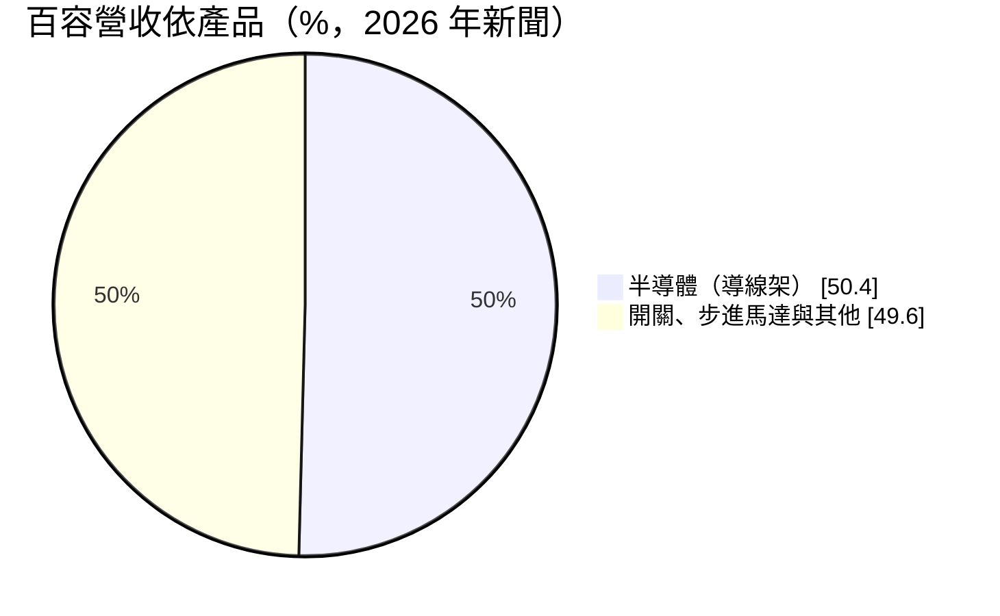
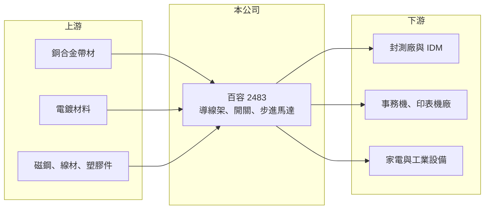

# 2483 百容

> 上市｜[[產業索引-電子零組件業|電子零組件業]]｜上市（櫃）日期 2001/09/17

# 第一章：企業模式與商業藍圖

> [!info] 撰寫說明
> 精簡版，由 Claude 依公開資料整理，架構比照 [[2330台積電]]，資料截至 2026-10-08。來源：證交所開放資料快照（基本資料、2026 年第二季財報、股利）、Goodinfo 經營績效年度表與公司基本資料頁、財經新聞標題（半導體業務占比、事務機與油電混合車應用）。公開資料有限，產品比重以外的營收結構未查得。#待校對

百容是一家從電子零件起家、近年轉向半導體材料的中型製造商，本章說明它的三條產品線與轉型方向。

- **核心業務：** 百容成立於 1981 年，總部在台中工業區，主要產品是半導體[[導線架]]、程式開關（微動開關等機構式開關）與[[步進馬達]]。導線架是封裝時承載晶片、把訊號引出到電路板的金屬框架；開關與步進馬達則是事務機、家電與工業設備的機構零件。三條產品線都屬於精密沖壓與組裝的延伸，核心能力是金屬加工與模具。
- **營收結構：** 依公司資訊與 2026 年新聞，半導體應用（導線架）約占營收 50.4%，已超過一半；其餘為開關與步進馬達，細項比重未查得。新聞也提到半導體產品已出貨到油電混合車相關應用、步進馬達受[[多功能事務機]]備貨需求帶動（新聞年份未逐一確認，待校對）。
- **營運據點：** 總部與主要工廠在台中南屯工業區，中國有蘇州與安徽兩家生產子公司。公司已在台中工業區購地興建新廠，2026 年 9 月完成資產過戶，顯示公司打算把半導體相關產能放在台灣擴充。
- **長期方向：** 長期方向是把營收重心從成熟的機構零件移向半導體導線架，特別是功率元件與車用封裝所需的產品。這個轉型若成功，產品單價與技術門檻都會提高；但目前半導體業務的放量仍在初期，尚未反映在整體獲利率上。

# 第二章：護城河深度與競爭優勢

百容的三條產品線都面對規模更大的對手，本章分析它能守住的利基與尚待證明之處。

- **競爭優勢：** 百容的優勢是四十多年的精密沖壓、模具與小型馬達組裝經驗，可以用同一套金屬加工能力供應不同產品。導線架客戶在封裝廠與 IDM，導入前需要長時間的品質認證，一旦合格就有一定黏著度。開關與步進馬達則依附在事務機與家電客戶的長期機種上，訂單穩定但成長性有限。
- **主要對手：** 導線架領域的台灣對手有 [[2351順德]]、[[5285界霖]]，以及以材料通路見長的 [[8070長華]]，國際上有日本三井高科技、新光電氣等大廠。步進馬達與開關則與日本 Minebea、Nidec 及中國中小型馬達廠競爭（國外對手為整理性描述，待校對）。
- **觀察重點：** 長期要看導線架比重能否持續提高並帶動毛利率回升，台中新廠建成後的產能利用率，以及車用、功率半導體客戶的導入進度。2023 至 2025 年本業連續三年營業虧損，若新事業不能把營業利益率拉回正值，轉型的價值就難以實現。

# 第三章：財務體質與盈利規模

資料日期：2026-10-08，表格是撰寫當時的快照；最新月營收、毛利率、累計 EPS 由自動排程寫在本筆記的屬性欄位（月營收、毛利率、累計EPS 等）。#待校對

百容近年營收停在 18 億元上下，本業從 2023 年起轉為虧損，獲利主要靠業外收入支撐。

| 年度 | 營收（億元） | [[毛利率]] | [[營業利益率]] | EPS（元） | [[ROE]] |
|---|---|---|---|---|---|
| 2020 | 17.8 | 21.1% | 1.29% | 0.76 | 3.50% |
| 2021 | 21.7 | 16.4% | 0.54% | 1.40 | 6.27% |
| 2022 | 22.3 | 18.7% | 5.11% | 1.54 | 6.58% |
| 2023 | 18.0 | 13.9% | -1.75% | 0.32 | 1.44% |
| 2024 | 18.1 | 12.8% | -3.55% | 0.35 | 1.56% |
| 2025 | 17.6 | 9.17% | -6.56% | 0.60 | 2.56% |

- **營收規模：** 營收 2020 年 17.8 億元、2025 年 17.6 億元，五年年複合成長率約 −0.2%，中間 2021 至 2022 年曾短暫升到 22 億元以上。2026 年上半年營收 10.5 億元，若下半年持平，全年可望超過 2022 年高點（推估）。
- **獲利：** 毛利率從 2020 年的 21.1% 一路降到 2025 年的 9.17%，營業利益率 2023 至 2025 年皆為負值，但 EPS 仍為正，代表業外收益（投資收益、利息、匯兌等，細項未查得）補上本業虧損。2026 年上半年毛利率約 14.2%、營業利益率約 1.4%、EPS 0.40 元，本業已轉回小幅獲利。近五年（2021 至 2025 年）平均 ROE 約 3.7%。
- **財務特色：** 2026 年第二季末總資產 44.6 億元、總負債 17.2 億元，負債比約 38%，母公司權益 27.3 億元、每股淨值 25.4 元。2025 年度配發現金股利 0.3 元，配息率約 50%。興建新廠會在未來幾年增加資本支出與折舊。
- **[[ROIC]] 與 [[WACC]]：** 2025 年營業損失約 1.15 億元（17.6 億 × −6.56%），虧損時不計稅盾；投入資本以權益總額 27.4 億元計 ROIC 約 −4.2%，含全部負債 17.2 億元則約 −2.6%（推算）。WACC 以 CAPM 推估：無風險利率 1.75%、市場風險溢酬 6%、β 取電子零組件同業常見值 0.9，股東權益成本約 7.2%；負債成本 2%、稅後 1.6%，負債占資本 25%，WACC 約 5.8%（推算）。ROIC 為負、遠低於 WACC，表示近三年本業在侵蝕價值，轉型能否讓 ROIC 回到 6% 以上是長期評估的關鍵。

# 第四章：總體風險與地緣政治

百容處於轉型期，本章整理新舊事業各自的風險。

- **產業週期：** 導線架需求跟著封測稼動率起伏，半導體庫存調整時封裝廠會同步砍單；事務機與家電市場則屬成熟產業，長期需求平緩甚至下滑。兩個市場的週期不同步，有分散效果，但也意味沒有一條產品線具備強勁的長期成長。
- **營運風險：** 銅材是導線架主要原料，銅價上漲若無法轉嫁會直接壓縮毛利。新廠建置期間折舊增加，若半導體客戶導入進度延後，毛利率回升會被推遲。
- **其他風險：** 中國蘇州與安徽工廠面對當地人工與環保成本上升，以及中國同業的價格競爭。以本業虧損、業外支撐 EPS 的獲利結構不易長期持續，投資人應以營業利益而非 EPS 評估本業。

# 專有名詞解析

## 半導體

- **[[導線架]]**：封裝時承載晶片並把訊號引到電路板的金屬框架，多以銅合金沖壓或蝕刻製成。

## 產業

- **[[步進馬達]]**：以脈衝訊號控制、每次轉動固定角度的馬達，常用於印表機、事務機與精密定位設備。
- **[[多功能事務機]]**：整合列印、掃描、影印與傳真的辦公設備，內部使用大量馬達與開關。

# 核心供應鏈

- 上游：銅合金帶材與電鍍材料（導線架）、磁鋼、漆包線與塑膠件（步進馬達與開關）。
- 下游／客戶：半導體封測廠與 IDM，事務機與印表機品牌廠，家電與工業設備廠；具體客戶名稱未查得。
- 同業：[[2351順德]]、[[5285界霖]]、[[8070長華]]；國外有三井高科技、新光電氣、Minebea、Nidec。

## 最新新聞
<!-- news:start -->
<!-- news:end -->

## 相關連結
- [公開資訊觀測站](https://mopsov.twse.com.tw/mops/web/t05st03?step=1&firstin=1&co_id=2483)
- [Goodinfo](https://goodinfo.tw/tw/StockDetail.asp?STOCK_ID=2483)
- [Yahoo 股市](https://tw.stock.yahoo.com/quote/2483)
- [鉅亨網新聞](https://www.cnyes.com/twstock/2483/news)
