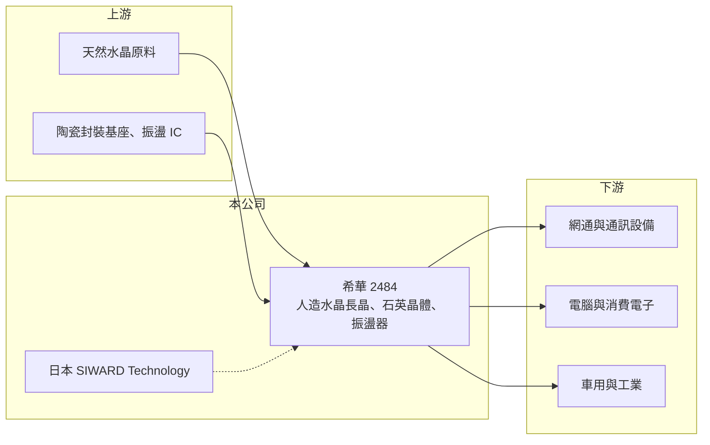

# 2484 希華

> 上市｜[[產業索引-電子零組件業|電子零組件業]]｜上市（櫃）日期 2001/09/17

# 第一章：企業模式與商業藍圖

> [!info] 撰寫說明
> 精簡版，由 Claude 依公開資料整理，架構比照 [[2330台積電]]，資料截至 2026-10-08。來源：證交所開放資料快照（基本資料、2026 年第二季財報、股利）、Goodinfo 經營績效年度表與公司基本資料頁、財經新聞標題（南科長晶爐、日本長晶廠）。公開資料有限，營收比重未查得。#待校對

希華是台灣的石英頻率元件廠，本章說明頻率元件在電子產品中的角色，以及希華從長晶到元件的生產模式。

- **核心業務：** 希華成立於 1988 年，總部在台中潭子，主要產品是[[石英晶體]]（Crystal）與[[石英振盪器]]（Oscillator）。幾乎所有含處理器或通訊晶片的電子產品，都需要石英元件提供穩定的時脈或頻率基準，就像電子系統的「心跳」。產品依精度分級，一般消費性用途價格低、量大，車用、網通與基地台用的高精度振盪器單價與毛利較高。
- **營收結構：** 公司未公開詳細比重（未查得）。依產業常見結構推估，希華的產品應用涵蓋電腦、手機與消費電子、網通、車用與工業，其中網通與車用屬於近年產業重點方向（推估，待校對）。
- **營運據點：** 總部與元件產線在台中，南部科學園區設有人造石英長晶產能，日本子公司 SIWARD Technology 從事石英晶棒與振盪器的製造與銷售（2004 年設立）。自有長晶意味著希華從最上游的人造水晶開始自製，掌握原料品質與成本，這在台灣同業中較少見（長晶產能細節依新聞標題，年份未確認，待校對）。
- **長期方向：** 頻率元件長期的升級方向是小型化、高頻化與高精度，例如資料中心光模組與網通設備所需的差動振盪器、車用電子所需的寬溫高可靠度產品。希華的長期機會在於把產品組合從消費性移向這些高規格應用，以提高單價與獲利率。

# 第二章：護城河深度與競爭優勢

石英元件是寡占程度高的成熟產業，日系廠商長期領先，本章分析希華的定位。

- **競爭優勢：** 希華的主要優勢是從人造水晶長晶、切割研磨到元件封裝的一貫生產能力，加上日本子公司的長晶與技術背景，讓它在原料取得與品質控制上比單純做封裝的業者更有自主性。頻率元件一旦被設計進客戶產品，在該產品生命週期內通常不會更換供應商，帶來一定的黏著度。
- **主要對手：** 全球市場以日本的 Epson、日本電波工業（NDK）、大真空（KDS）、京瓷為主，台灣同業有規模最大的 [[3042晶技]]，以及 [[8182加高]]、[[3221台嘉碩]]。希華的規模小於晶技，在高階振盪器領域仍以追趕為主。
- **觀察重點：** 長期要看高階振盪器（網通、車用、資料中心）的營收占比能否明顯提高，以及長晶產能的利用率。2022 年毛利率曾達 38.3%，2025 年降到 17.5%，若能透過產品升級回到 25% 以上，代表競爭地位有實質改善。

# 第三章：財務體質與盈利規模

資料日期：2026-10-08，表格是撰寫當時的快照；最新月營收、毛利率、累計 EPS 由自動排程寫在本筆記的屬性欄位（月營收、毛利率、累計EPS 等）。#待校對

希華的獲利呈現明顯的景氣循環，2022 年高峰後連續三年下滑，2026 年上半年開始回升。

| 年度 | 營收（億元） | [[毛利率]] | [[營業利益率]] | EPS（元） | [[ROE]] |
|---|---|---|---|---|---|
| 2020 | 25.9 | 20.5% | 7.78% | 1.02 | 5.32% |
| 2021 | 32.3 | 28.6% | 15.9% | 2.54 | 11.3% |
| 2022 | 32.6 | 38.3% | 24.5% | 4.82 | 18.9% |
| 2023 | 23.6 | 27.4% | 11.9% | 1.64 | 6.37% |
| 2024 | 21.9 | 19.6% | 3.96% | 0.99 | 4.04% |
| 2025 | 24.1 | 17.5% | 3.29% | 0.65 | 2.77% |

- **營收規模：** 營收 2020 年 25.9 億元、2025 年 24.1 億元，五年年複合成長率約 −1.4%，2021 至 2022 年的 5G 與遠距需求高峰後回落。2026 年上半年營收 12.1 億元，年化後與 2025 年相近或略高（推估）。
- **獲利：** 毛利率在 17% 至 38% 之間大幅擺動，因為長晶與元件產線固定成本高，產能利用率變化會被放大到獲利上，屬於高[[營業槓桿]]的產業特性。2026 年上半年毛利率約 24.6%、營業利益率約 10.3%、EPS 0.86 元，已超過 2025 全年。近五年（2021 至 2025 年）平均 ROE 約 8.7%。
- **財務特色：** 2026 年第二季末總資產 50.9 億元、總負債 9.8 億元，負債比約 19%，財務結構保守。2025 年度發放現金 0.7 元（盈餘 0.5 元加資本公積 0.2 元），高於當年 EPS，顯示公司傾向維持股利穩定。
- **[[ROIC]] 與 [[WACC]]：** 2025 年營業利益約 0.79 億元（24.1 億 × 3.29%），稅後約 0.63 億元；投入資本以權益總額 41.1 億元計 ROIC 約 1.5%，含全部負債 9.8 億元則約 1.2%（推算）。2026 年上半年營業利益 1.25 億元，年化稅後約 2.0 億元，ROIC 約 4% 至 5%（推算）。WACC 以 CAPM 推估：無風險利率 1.75%、市場風險溢酬 6%、β 取電子零組件同業常見值 1.0，股東權益成本約 7.75%；負債成本 2%、稅後 1.6%，負債占資本 10%，WACC 約 7.1%（推算）。只有 2021 至 2022 年的高峰期 ROIC 明顯高於 WACC，近三年都低於 WACC，長期要靠產品升級提高平均報酬率。

# 第四章：總體風險與地緣政治

頻率元件的需求與電子產品出貨連動，本章整理希華的長期風險。

- **產業週期：** 石英元件有明顯的庫存循環，2023 至 2025 年即處於去庫存與價格下跌期。由於固定成本高，景氣反轉時毛利率下滑的幅度大於營收下滑幅度。
- **營運風險：** 高階振盪器的技術由日系大廠主導，若希華在新規格（更高頻、更低抖動）上的研發進度落後，只能在中低階市場與中國廠商拚價格。長晶產能若利用率不足，會成為折舊負擔。
- **其他風險：** 部分技術與產品被 MEMS 振盪器替代是長期的技術風險。營收以外幣計價為主，匯率波動會影響毛利；日本子公司的營運也受日圓匯率影響。

# 專有名詞解析

## 應用

- **[[石英振盪器]]**：把石英晶體與振盪電路封裝在一起的主動元件，可直接輸出穩定時脈，精度與單價高於晶體。

## 金融

- **[[營業槓桿]]**：固定成本占比高的公司，營收增加時利潤增幅大於營收增幅，反之亦然。

## 產業

- **[[石英晶體]]**：利用石英的壓電效應產生固定頻率的被動元件，需搭配外部電路才能起振。

# 核心供應鏈

- 上游：長晶用的天然水晶原料、陶瓷封裝基座、振盪器用的 IC。
- 下游／客戶：網通設備廠、電腦與消費電子組裝廠、車用與工業電子廠；具體客戶名稱未查得。
- 同業：[[3042晶技]]、[[8182加高]]、[[3221台嘉碩]]；國外有 Epson、日本電波工業、大真空、京瓷。

## 最新新聞
<!-- news:start -->
<!-- news:end -->

## 相關連結
- [公開資訊觀測站](https://mopsov.twse.com.tw/mops/web/t05st03?step=1&firstin=1&co_id=2484)
- [Goodinfo](https://goodinfo.tw/tw/StockDetail.asp?STOCK_ID=2484)
- [Yahoo 股市](https://tw.stock.yahoo.com/quote/2484)
- [鉅亨網新聞](https://www.cnyes.com/twstock/2484/news)
