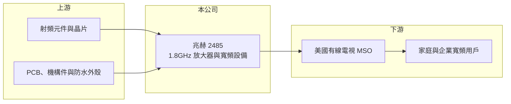

# 2485 兆赫

> 上市｜[[產業索引-通信網路業|通信網路業]]｜上市（櫃）日期 2001/09/17

# 第一章：企業模式與商業藍圖

> [!info] 撰寫說明
> 精簡版，由 Claude 依公開資料整理，架構比照 [[2330台積電]] 的四章研究，資料截至 2026-10-08。來源：聯合新聞網經濟日報 2026 年 1 月 12 日報導、Goodinfo 年度經營績效、證交所開放資料（基本資料、綜合損益、資產負債、營益分析、股利、每月營收）；產業描述為整理性內容，尚未逐條比對原始文件。#待校對

本章說明兆赫電子（股票代號：2485，以下簡稱兆赫）的商業模式：一家從衛星接收元件與機上盒，轉型到有線寬頻網路設備的通訊廠。

- **核心業務：** 兆赫成立於 1981 年，2001 年在台灣證券交易所上市，總部位於新北市中和區。依經濟日報 2026 年 1 月報導，兆赫的傳統產品是衛星電視的低雜訊降頻器（[[LNB]]）與[[機上盒]]，後來退出機上盒業務，轉進有線寬頻骨幹網路使用的 1.8GHz [[放大器]]，並打入美國有線電視多系統營運商（[[MSO]]）供應鏈。放大器裝在有線電視網路的線路上，負責補強訊號，是有線電視業者升級網路頻寬時必須汰換的設備。
- **營收結構：** 公開資料未提供產品別營收比重。依同一篇報導，新產品包括 1.8GHz 可抽換式智慧放大器模組與完整放大器、戶外防水分配器與電源插入器、室內外 G.hn 設備、邊緣 AI 影像辨識攝影機、遠端 OLT、分散式光纖轉換器等。2025 年第四季營收 9.33 億元、季增 55%、年增 184.5%，說明有線寬頻新產品已開始放量。
- **營運據點：** 總部位於新北中和，生產據點本次未查得（待校對）。主要市場從過去的衛星電視接收轉向美國有線電視網路，客戶結構從零售與機上盒客戶轉為少數大型 MSO。
- **長期方向：** 美國有線電視業者正把網路頻寬升級到 1.8GHz，以支援 [[DOCSIS]] 4.0 的多 Gbps 寬頻服務，線路上的放大器、分配器都需要更換，這是一個以數年計的升級週期。兆赫能否在這個週期中取得穩定市占，並延伸到光纖與家庭網路產品，決定它的轉型能否成功。

# 第二章：護城河深度與競爭優勢

本章評估兆赫在有線寬頻設備市場的競爭位置。轉型時間還短，護城河尚待驗證。

- **競爭優勢：** 兆赫長期累積的射頻與高頻電路設計能力，是從衛星降頻器延伸到有線電視放大器的技術基礎。打入美國 MSO 需要經過長時間的產品驗證與現場測試，一旦取得供應商資格，後續擴充與汰換訂單有一定延續性。不過客戶數少、議價能力強，屬於窄護城河。
- **主要對手：** 有線電視網路設備市場的主要廠商包括 CommScope（已將部分事業出售）、Vecima、Teleste 與 Antronix 等國際廠商；台灣同業有 [[5388中磊]]、[[2419仲琦]] 等寬頻用戶端設備廠（對手名單為產業常識整理，待校對）。
- **觀察重點：** 第一，1.8GHz 放大器出貨能否從 2025 年第四季的起步延續成多年的穩定訂單。第二，毛利率能否站穩 15% 以上，2026 上半年為 18.75%，已明顯高於 2025 年的 4.3%。第三，客戶是否從單一 MSO 擴展到更多業者。

# 第三章：財務體質與盈利規模

資料日期：2026-10-08。數字取自 Goodinfo 年度經營績效、經濟日報與證交所開放資料，表格是撰寫當時的快照；最新月營收、毛利率、累計 EPS 由自動排程寫在本筆記的屬性欄位（月營收、毛利率、累計EPS 等）。#待校對

兆赫的財務數字記錄了一次從舊產品退出、到新產品起步的轉型過程。

| 年度 | 營收（新台幣） | [[毛利率]] | [[營業利益率]] | EPS（元） | [[ROE]] |
|---|---|---|---|---|---|
| 2020 | 79.4 億 | 3.42% | -3.26% | -0.48 | -2.39% |
| 2021 | 62.8 億 | 1.64% | -7.85% | -1.11 | -5.76% |
| 2022 | 65.8 億 | 7.55% | -3.86% | 0.00 | -1.04% |
| 2023 | 58.2 億 | 9.98% | -2.56% | -0.23 | -4.50% |
| 2024 | 26.1 億 | -11.4% | -33.3% | -2.26 | -12.3% |
| 2025 | 26.1 億 | 4.30% | -14.5% | -0.96 | -6.14% |
| 2026 上半年 | 19.55 億 | 18.75% | 5.60% | 0.55 | 未查得 |

註：2020 至 2025 年取自 Goodinfo 合併報表，2025 年營收 26.09 億元、年減 0.05%（經濟日報），因此 2024 與 2025 年營收相近；2026 上半年取自證交所開放資料。

- **營收規模：** 營收從 2020 年的 79.4 億元縮小到 2024、2025 年的約 26 億元，2020 至 2025 年年複合成長率約 -20%（推算），主要反映退出機上盒等低毛利產品。2026 年 1 至 8 月累計營收 25.16 億元，較去年同期的 13.88 億元成長約 81%，新產品帶動營收回升。
- **獲利：** 經濟日報指出兆赫在 2026 年以前連續七年虧損、僅 2022 年接近損益兩平。2026 上半年毛利率 18.75%、營業利益 1.09 億元，加上業外收益 0.91 億元，稅後淨利 1.76 億元，EPS 0.55 元，是多年來首次出現明顯的本業獲利。
- **財務特色：** 依證交所資料，2026 年第二季底資產總計 67.1 億元、股東權益 53.4 億元、負債僅 12.0 億元，每股淨值 16.81 元，保留盈餘 16.8 億元。長年虧損但財務結構保守、負債低，讓公司有本錢承受轉型期的虧損。2025 年度未配發股利。
- **[[ROIC]] 與 [[WACC]]：** 以 2026 上半年營業利益 1.09 億元年化並扣 20% 稅後約 1.75 億元，投入資本以股東權益 53.4 億元加非流動負債 0.47 億元（代替有息負債）約 53.9 億元計算，ROIC 約 3.3%（推算）；2024 與 2025 年營業虧損，ROIC 為負。WACC 以 CAPM 推估：無風險利率 1.75%、市場風險溢酬 6%、β 取 1.0（推估，通信設備同業常見值），權益成本約 7.75%；幾乎無負債，WACC 約 7.5%（推算）。目前 ROIC 仍低於 WACC，但差距已大幅縮小；股東權益中有相當比例可能是現金與投資，若扣除閒置資金，本業 ROIC 會較高（推估）。

# 第四章：總體風險與地緣政治

本章整理兆赫的長期風險，核心是客戶集中與升級週期的持續性。

- **產業週期：** 有線電視網路升級屬於數年一次的資本支出週期，升級高峰過後訂單可能明顯下滑。兆赫新業務的營收高度依賴美國 MSO 的 1.8GHz 與 DOCSIS 4.0 建置進度。
- **營運風險：** 客戶集中在少數美國 MSO，單一客戶的採購節奏或轉單就會劇烈影響營收。新產品放量初期的良率、交期與售後服務能力都還在建立中。
- **其他風險：** 美國關稅政策與供應鏈在地化要求可能影響出口成本與生產布局。長期而言，光纖到府與固定無線接取可能侵蝕有線電視寬頻市場，限制放大器的長期需求。營收以美元計價，匯率變動影響毛利。

# 專有名詞解析

## 應用

- **[[LNB]]**：低雜訊降頻器，裝在衛星碟型天線上，把衛星訊號放大並降到較低頻率傳給接收器。
- **[[機上盒]]**：接在電視上解碼有線、衛星或網路電視訊號的設備，市場已因串流普及而萎縮。
- **[[放大器]]**：有線電視網路線路上補強訊號的設備，網路頻寬升級到 1.8GHz 時需要全面汰換。
- **[[DOCSIS]]**：有線電視網路傳輸資料的國際標準，由 CableLabs 制定，3.1 與 4.0 版本分別支援數 Gbps 等級的速度。

## 金融

- **[[ROIC]]**：投入資本報酬率，稅後營業利益除以股東權益與有息負債的合計，衡量本業對所有資金提供者的報酬。

## 產業

- **[[MSO]]**：多系統有線電視營運商，同時經營多個地區的有線電視與寬頻網路，是纜線數據機的主要採購者。

# 核心供應鏈

- 上游：射頻元件與晶片（例如 [[3105穩懋]] 一類的化合物半導體供應鏈，實際供應商未公開，待校對）、印刷電路板與機構件。
- 下游／客戶：美國有線電視多系統營運商，客戶名稱公開報導未揭露。
- 同業：[[2419仲琦]]、[[5388中磊]]、[[2314台揚]]；國際有線網路設備商 CommScope、Vecima、Teleste。

## 最新新聞
<!-- news:start -->
<!-- news:end -->

## 相關連結
- [公開資訊觀測站](https://mopsov.twse.com.tw/mops/web/t05st03?step=1&firstin=1&co_id=2485)
- [Goodinfo](https://goodinfo.tw/tw/StockDetail.asp?STOCK_ID=2485)
- [Yahoo 股市](https://tw.stock.yahoo.com/quote/2485)
- [鉅亨網新聞](https://www.cnyes.com/twstock/2485/news)
