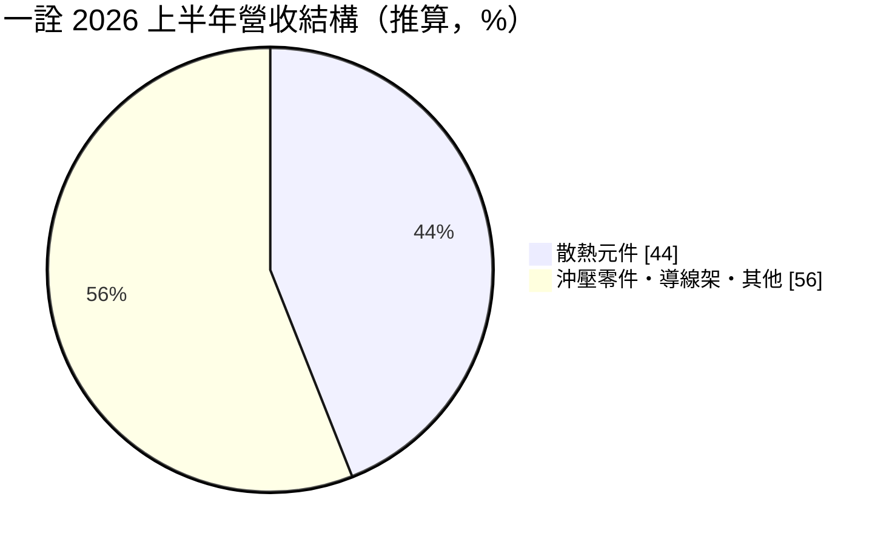
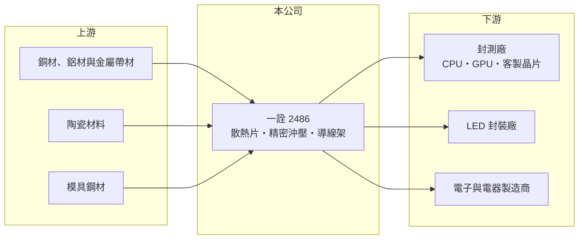

# 2486 一詮

> 上市｜[[產業索引-光電業|光電業]]｜上市（櫃）日期 2001/09/19

# 第一章：企業模式與商業藍圖

> [!info] 撰寫說明
> 精簡版，由 Claude 依公開資料整理，架構比照 [[2330台積電]] 的四章研究，資料截至 2026-10-08。來源：證交所開放資料快照（基本資料、2026 年上半年綜合損益與資產負債、股利）、Goodinfo 經營績效頁（2019 至 2025 年）、優分析 2026 年 9 月報導（散熱元件營收與擴產計畫）、nStock 公司概況。有息負債未查得，ROIC 與 WACC 為推算。#待校對

一詮精密（股票代號：2486，以下簡稱一詮）是一家從精密沖壓與 LED 導線架起家、近年轉型為 AI 晶片散熱元件供應商的老牌零件廠。本章說明它的業務組成、轉型邏輯與長期藍圖。

- **核心業務：** 一詮成立於 1977 年，總部位於新北市新莊。傳統業務是[[精密模具]]、精密沖壓零件、半導體與 LED [[導線架]]，以及[[陶瓷基板]]電路板，另有少量貿易與不動產租賃。近年成長主力是用於 CPU、GPU 與客製晶片封裝的[[散熱片]]（Lid），這類金屬蓋板直接貼在晶片上，把熱導到散熱模組，需要極高的平整度與尺寸精度，正好用上一詮數十年的沖壓與模具技術。
- **營收結構：** 依優分析 2026 年 9 月報導，散熱元件 2025 年全年營收約 17 億元，約占全年營收 60.5 億元的 28%（推算）；2026 年上半年散熱元件營收已超過 16 億元，約占上半年營收 36.8 億元的四成以上（推算）。公司預期 2027 年散熱產品占比將突破 60%，代表一詮正從傳統零件廠變成散熱元件廠。
- **營運據點：** 散熱片主要在新北五股的兩個生產基地製造，2025 年另購置新北三重廠，規劃 2027 年第一季量產。其他傳統產品的海外據點本次未查得。
- **長期方向：** 一詮目標把散熱片月產值從接近 4 億元提升到 2027 年底近 10 億元，客戶方面已與台系、美系委外封測廠合作，並爭取切入新一代 AI 伺服器 GPU 的散熱供應鏈。2026 年完成 20 億元可轉換公司債募集，支應擴產高峰期的資本支出。

# 第二章：護城河深度與競爭優勢

護城河決定一家公司能否長期賺到超過資金成本的報酬。一詮的優勢來自製程能力，而非品牌或規模。

- **競爭優勢：** 晶片散熱蓋板需要在大面積金屬件上做到微米級平整度，還要配合封測廠的封裝流程反覆驗證。一詮擁有自製精密模具與沖壓的完整能力，可以從模具開發到量產一條龍承接，縮短客戶導入時間。一旦通過封測廠與晶片客戶認證，轉換供應商需要重新驗證，形成一定的轉換成本。
- **主要對手：** 散熱蓋板領域的主要對手是 [[3653健策]]，散熱模組廠如 [[3017奇鋐]]、[[3324雙鴻]] 也在延伸相關產品；傳統導線架則可對照 [[2351順德]]、[[5285界霖]]。健策在高階蓋板起步較早、市占較高，一詮屬於追趕者，必須靠產能與交期爭取第二供應商的位置。
- **轉型的意義：** 一詮過去的沖壓與導線架業務屬於成熟、價格競爭激烈的代工，毛利率長期只有一成多。散熱元件讓一詮第一次接上 AI 與高效能運算這條長期成長的需求，但也讓營收集中在少數封測廠與晶片客戶。
- **觀察重點：** 長期可以追蹤散熱產品占比是否如期超過六成、毛利率能否隨產品組合改善而穩定在兩成以上，以及新一代 GPU 平台的認證是否成功。

# 第三章：財務體質與盈利規模

資料日期：2026-10-08，表格是撰寫當時的快照；最新月營收、毛利率、累計 EPS 由自動排程寫在本筆記的屬性欄位（月營收、毛利率、累計EPS 等）。#待校對

財務報表可以檢驗一詮的轉型是否真正轉化為獲利。過去七年的數字顯示，一詮的營收規模不小，但長期獲利能力偏弱。

| 年度 | 營收（億元） | [[毛利率]] | [[營業利益率]] | EPS（元） | [[ROE]] |
|---|---|---|---|---|---|
| 2019 | 36.7 | 9.07% | -5.73% | -0.90 | -5.95% |
| 2020 | 42.0 | 12.4% | -1.12% | -0.75 | -5.33% |
| 2021 | 59.9 | 19.5% | 8.92% | 1.79 | 10.7% |
| 2022 | 52.0 | 11.1% | -0.03% | 0.47 | 2.17% |
| 2023 | 50.7 | 14.1% | 3.48% | 0.92 | 4.62% |
| 2024 | 54.9 | 14.0% | -0.41% | 0.08 | 0.61% |
| 2025 | 60.5 | 14.2% | 1.96% | 0.22 | 1.29% |

（來源：Goodinfo 經營績效頁，合併報表。2026 年上半年依證交所資料，營收 36.83 億元、毛利率 21.00%、營業利益率 8.05%、EPS 0.91 元。）

- **獲利結構正在改變：** 2019 至 2025 年一詮的毛利率多在 9% 至 15%，營業利益率在正負數個百分點之間擺盪，典型的低毛利零件代工。2026 年上半年毛利率升到 21%、營業利益率 8%，是散熱元件比重提高後的第一個明顯訊號。能否維持，要看擴產後的良率與折舊負擔。
- **長期指標：** 2021 至 2025 年平均 ROE 約 3.9%（推算），2020 至 2025 年營收年複合成長率約 7.6%（推算）。2025 年度配發現金 0.5 元（盈餘 0.25 元加資本公積 0.25 元），配息能力有限。
- **資產負債表：** 2026 年第二季資產總計約 151.2 億元、負債約 87.1 億元，負債比約 57.6%，其中非流動負債約 49.4 億元，包含 2026 年發行的可轉債。權益總計約 64.1 億元（資本公積約 35.2 億元），每股淨值 25.70 元。擴產期間財務槓桿明顯升高。
- **[[ROIC]] 與 [[WACC]]：** 以 2025 年營收 60.5 億元乘營業利益率 1.96%，營業利益約 1.19 億元，稅後約 0.95 億元；投入資本以 2026 年第二季權益 64.1 億元加上有息負債推估約 55 億元（有息負債未查得，以非流動負債與部分短期借款推估），合計約 119 億元，ROIC 約 0.8%（推算）。以 2026 年上半年營業利益 2.96 億元年化，ROIC 約 4%（推算）。WACC 以 [[CAPM]] 估算：無風險利率 1.75%、市場風險溢酬 6%、β 假設 1.1（電子零組件同業常見值），權益成本約 8.4%；稅前負債成本假設 2.5%、稅率 20%，稅後 2.0%；權益與負債約 54：46，WACC 約 5.4%（推算）。結論是一詮過去長期沒有賺到資金成本，散熱元件轉型是讓 ROIC 超過 WACC 的唯一路徑，2027 年後擴產完成、折舊與利息都已上升時的獲利水準是關鍵檢驗點。

# 第四章：總體風險與地緣政治

一詮的風險集中在轉型執行、客戶集中與擴產財務壓力。

- **產業週期：** 散熱元件需求跟著 AI 伺服器與高效能運算的資本支出走，雲端業者若縮減投資，訂單會快速下修。傳統沖壓與導線架則跟著消費電子與 LED 景氣起伏。
- **客戶與技術風險：** 散熱蓋板需要配合特定晶片平台認證，若下一代平台驗證失敗或封裝設計改變（例如改用不同材料或一體式散熱方案），既有產能可能閒置。客戶集中於少數封測廠與晶片設計公司，議價力偏弱。
- **擴產與財務風險：** 五股與三重雙基地擴建、20 億元可轉債與較高的負債比，意味著折舊與利息費用將上升。若營收成長不如預期，[[營運槓桿]]會反向放大虧損；可轉債轉換也可能稀釋股權。
- **原物料與匯率：** 銅、鋁等金屬價格波動會影響成本，外銷以美元計價，新台幣升值會壓縮毛利。

# 專有名詞解析

## 半導體

- **[[導線架]]**：IC 或 LED 封裝用的金屬框架，負責固定晶片並把訊號引出到外部接腳。
- **[[散熱片]]**：貼在晶片封裝上方的金屬蓋板，負責把晶片熱量導向散熱模組，高階 AI 晶片對平整度要求極高。
- **[[陶瓷基板]]**：以氧化鋁、氮化鋁等陶瓷製成的電路板，導熱與耐高溫能力遠優於一般有機板，用於 LED 與功率元件。

## 金融

- **[[營運槓桿]]**：固定費用占比高時，營收小幅變動就會造成營業利益大幅變動的現象。
- **[[ROIC]]**：投入資本報酬率，稅後營業利益除以股東權益加有息負債，衡量本業運用資本的效率。
- **[[WACC]]**：加權平均資金成本，依股東權益與負債的比重，加權計算公司取得資金的平均成本。

## 產業

- **[[精密模具]]**：用來沖壓或射出成型零件的高精度模具，品質決定量產零件的尺寸精度與良率。

# 核心供應鏈

- 上游：銅材與鋁材等金屬帶材、陶瓷材料、模具鋼材供應商
- 下游／客戶：台系與美系委外封測廠（CPU、GPU、客製晶片散熱），LED 封裝廠（如 [[2393億光]]，推估），電子與電器製造商
- 同業：散熱蓋板 [[3653健策]]；散熱模組 [[3017奇鋐]]、[[3324雙鴻]]；導線架 [[2351順德]]、[[5285界霖]]

## 最新新聞
<!-- news:start（自動產生，請勿手動編輯此範圍） -->
- 2026-10-06 📰 媒體 18:00｜一詮(2486)9月營收衝新高！散熱元件暴增117%佔比逼近五成，獲利跟得上嗎？｜[鉅亨網](https://news.cnyes.com/news/id/6622832)
- 2026-10-06 📰 媒體 17:31｜一詮(2486)9月營收創高！逾7成增量都靠散熱、相關營收暴增117%，獲利跟得上嗎？｜[鉅亨網](https://news.cnyes.com/news/id/6622783)
- 2026-10-05 📰 媒體 17:50｜營收速報 - 一詮(2486)9月營收7.85億元年增率高達56.83％｜[鉅亨網](https://news.cnyes.com/news/id/6621838)

完整紀錄：[[2486一詮 新聞]]
<!-- news:end -->

## 相關連結
- [公開資訊觀測站](https://mopsov.twse.com.tw/mops/web/t05st03?step=1&firstin=1&co_id=2486)
- [Goodinfo](https://goodinfo.tw/tw/StockDetail.asp?STOCK_ID=2486)
- [Yahoo 股市](https://tw.stock.yahoo.com/quote/2486)
- [鉅亨網新聞](https://www.cnyes.com/twstock/2486/news)
