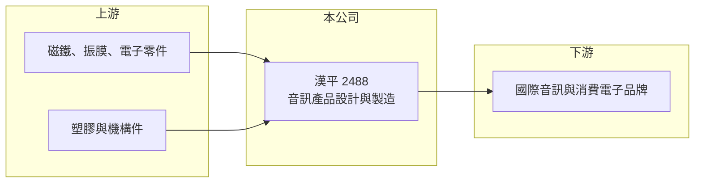

# 2488 漢平

> 上市｜[[產業索引-其他電子業|其他電子業]]｜上市（櫃）日期 2001/09/17

# 第一章：企業模式與商業藍圖

> [!info] 撰寫說明
> 精簡版，由 Claude 依公開資料整理，架構比照 [[2330台積電]] 的四章研究，資料截至 2026-10-08。來源：證交所開放資料快照（基本資料、2026 年上半年綜合損益與資產負債、股利、每月營收）、Goodinfo 經營績效頁（2019 至 2025 年）、nStock 與股感漢平頁面。公開資料有限，主要客戶與海外生產據點本次未查得。有息負債未查得，ROIC 與 WACC 為推算。#待校對

漢平電子（股票代號：2488，以下簡稱漢平）是一家位於台南的老牌音訊產品製造商，營收幾乎全部來自音訊產品。本章說明它的商業模式與長期定位。

- **核心業務：** 漢平成立於 1969 年，2001 年上市，總部與工廠登記在台南市仁德區。主要業務是設計與製造音訊產品，例如[[揚聲器]]等聲學產品（產品細項推估），營業項目另登記電器、照明、無線通信器材，以及廠房與不動產開發租售。
- **營收結構：** 依公開資料，音訊產品約占營收 98.3%，其他營運事業約 1.7%。業務高度專注，代表漢平的命運與音訊產品客戶的出貨高度連動。
- **商業模式：** 漢平推估以 [[OEM]] 或 [[ODM]] 方式替國際品牌生產，品牌商負責行銷與通路，漢平負責聲學設計、量產與品質。這種模式不需負擔品牌行銷費用，但定價權主要在品牌客戶手上，毛利率長期落在兩成上下。
- **長期方向：** 2026 年 8 月營收 3.94 億元創單月歷史新高，公司在月營收備註中說明主要是訂單量增加。長期來看，漢平能否從現有客戶延伸到更多品牌或更高單價的音訊產品，決定它的成長空間。

# 第二章：護城河深度與競爭優勢

護城河是企業長期維持超額報酬的保護機制。漢平沒有品牌，護城河來自客戶關係與穩定的製造品質。

- **競爭優勢：** 聲學產品的音質調校、可靠度與量產一致性需要長期累積經驗，品牌客戶一旦認可某家代工廠的品質與交期，多半會在後續機種延續合作。漢平 2019 至 2025 年每年都獲利，營業利益率維持在 6% 至 15%，在聲學代工同業中屬於穩定的一群。
- **主要對手：** 聲學同業 [[2439美律]]、[[2415錩新]]、[[5225東科-KY]]、[[2477美隆電]]，以及中國的大型聲學廠。美律等同業規模大得多，客戶與產品線也更廣；漢平的優勢在於規模小、專注與成本控制，而不是技術領先。
- **守得住與守不住：** 現有客戶的延續訂單相對守得住，因為更換代工廠需要重新驗證聲學表現。守不住的是價格：消費性音訊產品的終端價格競爭激烈，品牌商會把壓力往代工廠轉嫁，漢平難以大幅提高毛利率。
- **觀察重點：** 長期可以追蹤客戶集中度是否下降、毛利率能否維持兩成以上，以及高配息政策能否延續。

# 第三章：財務體質與盈利規模

資料日期：2026-10-08，表格是撰寫當時的快照；最新月營收、毛利率、累計 EPS 由自動排程寫在本筆記的屬性欄位（月營收、毛利率、累計EPS 等）。#待校對

財務數字顯示，漢平是一家小股本、低負債、高配息的穩定獲利公司。

| 年度 | 營收（億元） | [[毛利率]] | [[營業利益率]] | EPS（元） | [[ROE]] |
|---|---|---|---|---|---|
| 2019 | 25.4 | 23.7% | 11.0% | 3.50 | 13.7% |
| 2020 | 19.4 | 22.4% | 9.13% | 2.27 | 8.73% |
| 2021 | 24.9 | 16.8% | 6.34% | 1.79 | 6.80% |
| 2022 | 30.9 | 20.6% | 10.1% | 3.86 | 13.9% |
| 2023 | 24.6 | 26.7% | 14.9% | 4.39 | 14.6% |
| 2024 | 31.8 | 24.4% | 13.1% | 5.24 | 16.1% |
| 2025 | 28.8 | 22.9% | 11.5% | 4.56 | 13.2% |

（來源：Goodinfo 經營績效頁，合併報表。2026 年上半年依證交所資料，營收 15.43 億元、毛利率 22.11%、營業利益率 11.38%、EPS 2.21 元。）

- **穩定但有波動：** 營收在 19 億至 32 億元之間起伏，跟著客戶產品週期上下，但七年都維持獲利。2021 年毛利率一度降到 16.8%，推估與原物料、運費上漲有關，之後回到兩成以上，顯示有一定的成本轉嫁能力。
- **長期指標：** 2021 至 2025 年平均 ROE 約 12.9%（推算），2020 至 2025 年營收年複合成長率約 8.2%（推算）。2025 年度配發現金股利 3 元，對照 EPS 4.56 元，配息率約 66%（推算）；Goodinfo 列出的歷年加權平均現金股利約 1.95 元。
- **資產負債表：** 2026 年第二季權益總計約 27.77 億元，其中保留盈餘約 19.57 億元，股本僅 8 億元；負債約 14.35 億元，多為流動負債（推估以應付帳款為主）。流動資產約 33.3 億元，財務體質保守。
- **[[ROIC]] 與 [[WACC]]：** 以 2025 年營收 28.8 億元乘營業利益率 11.5%，營業利益約 3.31 億元，稅後約 2.65 億元；投入資本以 2026 年第二季權益 27.77 億元計（有息負債未查得，推估很小），ROIC 約 9.5%（推算）。若扣除帳上現金，實際營運資本的報酬更高。WACC 以 [[CAPM]] 估算：無風險利率 1.75%、市場風險溢酬 6%、β 假設 0.8（聲學代工同業常見值，未查得實際數字），權益成本約 6.6%；幾乎無有息負債，WACC 約 6.5%（推算）。ROIC 高於 WACC 約 3 個百分點，代表漢平長期在創造價值，只是規模有限。

# 第四章：總體風險與地緣政治

漢平的風險主要來自單一產品、客戶集中與外銷代工的共通風險。

- **產業週期：** 音訊產品屬消費電子，終端需求與品牌庫存調整會透過[[長鞭效應]]放大到代工廠，2025 年底曾出現月營收年減兩到三成的情況。營收在不同年度之間的起伏，主要就是客戶產品週期的反映。
- **營運風險：** 營收幾乎全部來自音訊產品，客戶集中度推估偏高，主要客戶轉單、改變供應策略或新品失利，影響都會很大。公開資料揭露有限，投資人難以事先掌握客戶變化。
- **地緣與匯率：** 外銷代工面臨美國關稅政策變化與「中國以外」產地要求，若客戶要求移轉產地，需要額外資本支出。營收以美元計價為主，新台幣升值會壓縮毛利。
- **成本風險：** 毛利率約兩成，磁鐵、電子零件等原物料與人工成本上升時，如果無法及時轉嫁給品牌客戶，就會直接壓縮利潤。

# 專有名詞解析

## 金融

- **[[長鞭效應]]**：終端需求的小幅變動，沿供應鏈往上游傳遞時被逐級放大，造成上游庫存與訂單劇烈波動。
- **[[ROIC]]**：投入資本報酬率，稅後營業利益除以股東權益加有息負債，衡量本業運用資本的效率。
- **[[WACC]]**：加權平均資金成本，依股東權益與負債的比重，加權計算公司取得資金的平均成本。

## 產業

- **[[揚聲器]]**：把電訊號轉成聲音的元件，俗稱喇叭，由磁鐵、音圈與振膜組成。
- **[[OEM]]**：原廠委託製造，代工廠依品牌客戶的設計與規格生產，產品掛品牌商的商標。
- **[[ODM]]**：原廠委託設計製造，代工廠同時負責產品設計與生產，再以品牌商名義出貨。

# 核心供應鏈

- 上游：磁鐵、振膜、電子零件與機構件供應商（推估）
- 下游／客戶：國際音訊與消費電子品牌，以 OEM 或 ODM 方式出貨（推估，具體客戶未查得）
- 同業：[[2439美律]]、[[2415錩新]]、[[5225東科-KY]]、[[2477美隆電]]

## 最新新聞
<!-- news:start -->
<!-- news:end -->

## 相關連結
- [公開資訊觀測站](https://mopsov.twse.com.tw/mops/web/t05st03?step=1&firstin=1&co_id=2488)
- [Goodinfo](https://goodinfo.tw/tw/StockDetail.asp?STOCK_ID=2488)
- [Yahoo 股市](https://tw.stock.yahoo.com/quote/2488)
- [鉅亨網新聞](https://www.cnyes.com/twstock/2488/news)
