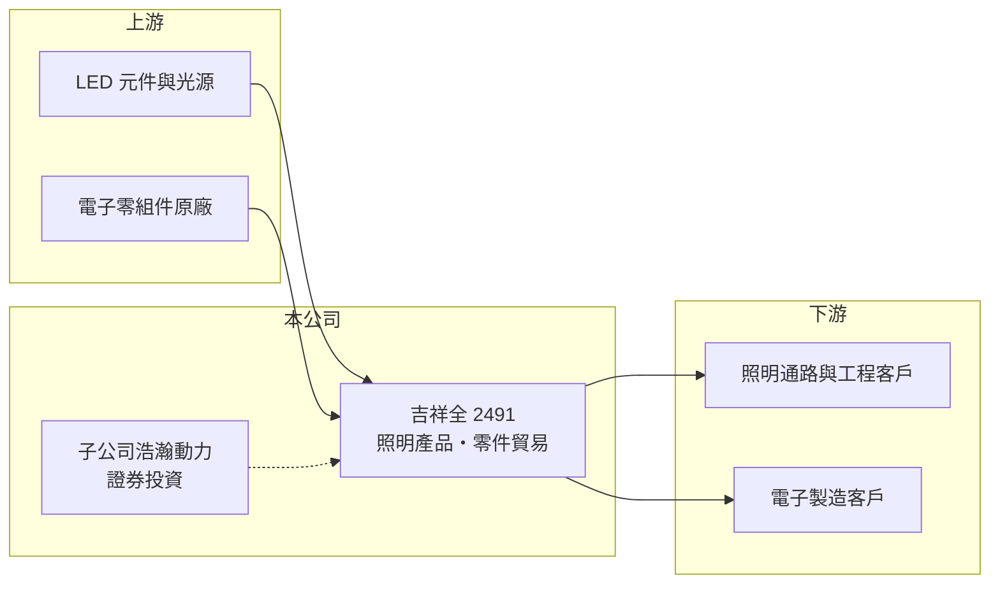

# 2491 吉祥全

> 上市｜[[產業索引-光電業|光電業]]｜上市（櫃）日期 2001/09/17

# 第一章：企業模式與商業藍圖

> [!info] 撰寫說明
> 精簡版，由 Claude 依公開資料整理，架構比照 [[2330台積電]] 的四章研究，資料截至 2026-10-08。來源：證交所開放資料快照（基本資料、2026 年上半年綜合損益與資產負債、股利、每月營收）、Goodinfo 經營績效頁（2019 至 2025 年）、Yahoo 股市公司資料、nStock 公司概況。公開資料有限，2026 年上半年大額業外收益的來源未查得，需以財報附註確認。ROIC 與 WACC 為推算。#待校對

吉祥全球實業（股票代號：2491，以下簡稱吉祥全）是一家本業規模很小、獲利主要來自投資的上市公司。本章說明它的業務結構，以及為什麼看這家公司要先看資產負債表，再看損益表。

- **核心業務：** 吉祥全成立於 1995 年，2001 年上市，公司登記在新北市新店區。Yahoo 股市將其主要業務列為光學資訊相關產品，nStock 則列為照明相關應用產品的製造銷售與電子零組件買賣、進出口貿易。本業月營收約 1,500 萬元，年營收不到 2 億元，在上市公司中屬於極小規模。
- **營收結構：** 各業務營收比重本次未查得，推估以照明產品與零組件貿易為主。本業長期處於營業虧損，2023 至 2025 年營業利益率在 -56% 至 -78% 之間，代表營收連營業費用都無法支應。
- **投資型的獲利來源：** 吉祥全的損益幾乎由[[業外收益]]決定。2026 年上半年本業營業損失約 1.39 億元，但營業外收入約 33.07 億元，歸屬母公司淨利約 24.58 億元，EPS 29.98 元。2026 年 10 月公司代子公司浩瀚動力公告取得與處分有價證券，顯示集團透過子公司進行證券投資。這類收益屬於[[一次性收益]]或評價利益，不具每年重複的性質。
- **長期方向：** 公司是否會用這筆大額收益發展新事業、進行併購，或以配息、減資回饋股東，是判斷吉祥全長期價值最重要的問題，目前公開資料未見明確說明。

# 第二章：護城河深度與競爭優勢

吉祥全的本業看不出明確護城河，投資價值主要建立在資產面。

- **競爭優勢：** 照明與零組件貿易屬於門檻低、競爭者眾多的市場，公開資料中看不出吉祥全有技術、規模或通路上的優勢。本業長期虧損，也說明它在這個市場中沒有定價能力。
- **主要對手：** 照明產品可對照國內 [[LED封裝]]與照明業者如 [[2393億光]]，以及大量中國照明製造商；零組件貿易則面對眾多通路商。
- **資產型公司的評價邏輯：** 對於這類公司，市場評價通常看每股淨值與持有資產的品質，而不是本業獲利。2026 年第二季每股淨值 49.73 元，較過去大幅提升，但淨值中有相當部分來自金融資產評價，價格波動會直接反映在淨值上。
- **觀察重點：** 長期應追蹤大額收益的來源與後續用途、子公司證券投資的規模與風險，以及本業是否持續縮小或轉型。

# 第三章：財務體質與盈利規模

資料日期：2026-10-08，表格是撰寫當時的快照；最新月營收、毛利率、累計 EPS 由自動排程寫在本筆記的屬性欄位（月營收、毛利率、累計EPS 等）。#待校對

吉祥全的財務數字必須把本業與業外分開看，否則 EPS 會嚴重誤導對公司實力的判斷。

| 年度 | 營收（億元） | [[毛利率]] | [[營業利益率]] | EPS（元） | [[ROE]] |
|---|---|---|---|---|---|
| 2019 | 3.23 | -13.7% | -50.2% | 5.48 | 86.1% |
| 2020 | 4.00 | 59.9% | 37.0% | 1.50 | 53.7% |
| 2021 | 3.70 | 65.6% | 34.5% | 0.63 | 33.7% |
| 2022 | 未查得（來源數字異常） | 未查得 | 未查得 | -4.70 | -38.9% |
| 2023 | 1.93 | 26.6% | -70.5% | 0.45 | 4.83% |
| 2024 | 2.01 | 38.1% | -56.2% | -0.40 | -5.33% |
| 2025 | 1.80 | 26.5% | -77.5% | 1.43 | 8.02% |

（來源：Goodinfo 經營績效頁，合併報表；2022 年營收在來源中顯示為負值，推估與業務重分類或停業單位調整有關，本表不採用。2026 年上半年依證交所資料，營收 0.82 億元、毛利率 21.31%、營業利益率 -170.2%、EPS 29.98 元。）

- **EPS 與本業脫鉤：** 2019 年本業大幅虧損，EPS 卻有 5.48 元；2026 年上半年營業利益率 -170%，EPS 卻接近 30 元。這兩次都說明吉祥全的獲利主要來自投資或資產處分，而不是本業。2020 至 2021 年本業曾出現三成以上的營業利益率，推估與當時的產品或業務組合有關，之後再也沒有出現。
- **長期指標：** 2021 至 2025 年 ROE 在 -39% 至 34% 之間劇烈擺盪，平均值沒有參考意義；2020 至 2025 年本業營收年複合成長率約 -14.8%（推算）。2025 年度未配發股利，Goodinfo 列出的歷年平均現金股利僅約 0.03 元，配息紀錄很少。
- **資產負債表：** 2026 年第二季資產總計約 63.15 億元，其中流動資產約 55.41 億元；負債約 11.23 億元；權益總計約 51.92 億元，其中歸屬母公司約 40.79 億元、非控制權益約 11.13 億元，保留盈餘約 24.85 億元。資產規模已遠大於本業所需，資產品質與流動性是評估重點。
- **[[ROIC]] 與 [[WACC]]：** 以 2025 年營收 1.80 億元乘營業利益率 -77.5%，本業營業損失約 1.40 億元，稅後約 -1.12 億元；投入資本以 2026 年第二季權益 51.92 億元計（有息負債未查得），本業 ROIC 約 -2%（推算），若只計入營運所需資本，負值會更大。WACC 以 [[CAPM]] 估算：無風險利率 1.75%、市場風險溢酬 6%、β 假設 1.0（資產型小型股，未查得實際數字），權益成本約 7.8%，WACC 約 7.5%（推算）。本業長期無法賺回資金成本，股東報酬完全依賴投資收益，屬於高度不確定的價值來源。

# 第四章：總體風險與地緣政治

吉祥全的風險在於本業持續虧損、獲利依賴投資，以及資訊揭露有限。

- **投資部位風險：** 淨值中有大量金融資產與評價利益，證券市場下跌時，淨值與損益都會同步縮水。子公司持續取得與處分有價證券，投資策略與風險控管的透明度有限。
- **本業風險：** 照明與零組件貿易屬於成熟、價格競爭激烈的市場，本業營收逐年縮小，若沒有新的事業規劃，營業虧損會持續消耗資源。
- **治理與資本配置：** 大額收益若長期留在公司內部從事投資，而非投入有報酬的本業或回饋股東，股東權益的使用效率會偏低。這是資產型公司常見的治理風險。
- **其他風險：** 資訊揭露有限，大額收益的性質需以財報原文確認；匯率與零件價格波動影響本業。

# 專有名詞解析

## 半導體

- **[[LED封裝]]**：把 LED 晶粒固定在支架或基板上，接線並以膠體保護，做成可焊接使用的元件。

## 金融

- **[[業外收益]]**：本業以外的收益，例如投資、處分資產或匯兌利益，通常不具持續性。
- **[[一次性收益]]**：處分資產、土地或投資等不會每年重複的收益，會讓單期 EPS 偏離本業實力。
- **[[非控制權益]]**：子公司中不屬於母公司持有的股東權益，代表其他股東分享的部分。
- **[[ROIC]]**：投入資本報酬率，稅後營業利益除以股東權益加有息負債，衡量本業運用資本的效率。
- **[[WACC]]**：加權平均資金成本，依股東權益與負債的比重，加權計算公司取得資金的平均成本。

# 核心供應鏈

- 上游：LED 元件與光源、電子零組件原廠
- 下游／客戶：照明通路與工程客戶、電子製造客戶（推估）
- 集團：子公司浩瀚動力，從事有價證券取得與處分
- 同業：[[2393億光]] 等照明與 LED 業者

## 最新新聞
<!-- news:start（自動產生，請勿手動編輯此範圍） -->
- 2026-10-16 🏛️ 重訊 17:03｜代子公司浩瀚動力(股)公司公告處分有價證券｜[觀測站](https://mops.twse.com.tw/mops/#/web/t05st01)
- 2026-10-16 🏛️ 重訊 17:02｜代子公司浩瀚動力(股)公司公告取得有價證券｜[觀測站](https://mops.twse.com.tw/mops/#/web/t05st01)

完整紀錄：[[2491吉祥全 新聞]]
<!-- news:end -->

## 相關連結
- [公開資訊觀測站](https://mopsov.twse.com.tw/mops/web/t05st03?step=1&firstin=1&co_id=2491)
- [Goodinfo](https://goodinfo.tw/tw/StockDetail.asp?STOCK_ID=2491)
- [Yahoo 股市](https://tw.stock.yahoo.com/quote/2491)
- [鉅亨網新聞](https://www.cnyes.com/twstock/2491/news)
