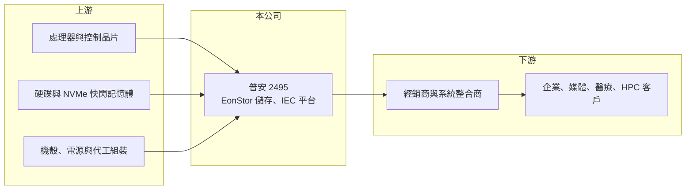

# 2495 普安

> 上市｜[[產業索引-電腦及週邊設備業|電腦及週邊設備業]]｜上市（櫃）日期 2002/03/25

# 第一章：企業模式與商業藍圖

> [!info] 撰寫說明
> 精簡版，由 Claude 依公開資料整理，架構比照 [[2330台積電]]，資料截至 2026-10-08。來源：證交所開放資料快照（基本資料、2026 年第二季財報、營益分析、股利、每月營收）、Goodinfo 經營績效年度表、富果研究 2025 年 11 月法說會摘要。法說會摘要為 AI 整理稿，數字需與公司簡報核對；營收比重未查得。#待校對

普安是台灣少數以自有品牌經營企業級儲存設備的公司，本章說明它的產品定位，以及從硬體轉向軟硬整合方案的方向。

- **核心業務：** 普安成立於 1993 年、2002 年上市，總部在新北中和，英文名稱 Infortrend，產品品牌為 EonStor。公司設計並銷售[[企業儲存]]設備，包括全快閃 NVMe 儲存、高密度硬碟儲存、平行檔案儲存與橫向擴充 NAS，客戶用來存放資料庫、影音素材、醫療影像與 AI 訓練資料。儲存系統的核心價值在控制器與韌體軟體，決定資料存取速度與可靠度。
- **營收結構：** 本次來源未揭露產品、地區或客戶比重。依法說會摘要，產品線涵蓋 EonStor GS U.2 全快閃系列（旗艦機型讀取速度達每秒 100GB）、單一 4U 機箱可放 90 顆硬碟的高密度系列、GSx 平行檔案儲存，以及 EonStor CS 橫向擴充 NAS。
- **營運據點：** 總部在台灣負責研發，透過海外子公司與經銷夥伴銷售到全球，並與 VMware、Veeam、Adobe 等軟體以及 Lustre、BeeGFS 等高效能運算檔案系統做相容認證（各區域比重未查得）。
- **長期方向：** 公司把研發集中在 AI、[[HPC]] 與媒體娛樂這三個對儲存效能與容量需求最高的領域，並推出內建 Kubernetes 與虛擬化的 Infortrend Enterprise Cloud（IEC）[[超融合]]平台，從單純賣硬體轉向軟硬整合方案。AI 布局分兩條線：大型機種支援模型訓練，KS 系列則鎖定企業與工廠的邊緣模型部署。

# 第二章：護城河深度與競爭優勢

企業儲存市場由國際大廠主導，本章分析普安作為中小型品牌的生存方式。

- **競爭優勢：** 普安自己開發控制器與韌體，三十多年累積的儲存技術讓它能以比國際大廠更低的價格，提供效能相近的中階與高階儲存設備。儲存系統一旦導入，客戶通常會持續擴充同一品牌的容量並購買維護服務，形成一定的轉換成本。毛利率長期在 43% 至 51%，顯示產品有技術含量。
- **主要對手：** 國際大廠有 Dell、NetApp、HPE、Pure Storage 等，中小企業與 NAS 市場則有群暉（Synology）、威聯通（QNAP）等台灣品牌，台灣上市同業有 [[3057喬鼎]]。普安規模遠小於國際大廠，主要在價格敏感的中型企業與特定產業（媒體、監控、醫療）取得空間。
- **觀察重點：** 普安年營收只有 12 億至 15 億元，研發與海外行銷費用的負擔很重，營業利益率在 2022 至 2024 年約 12% 至 15%，2025 年降到 5%。長期要看 AI 與 HPC 儲存需求能否讓營收突破既有規模，以及 IEC 等軟體方案能否提高經常性收入比重。

# 第三章：財務體質與盈利規模

資料日期：2026-10-08，表格是撰寫當時的快照；最新月營收、毛利率、累計 EPS 由自動排程寫在本筆記的屬性欄位（月營收、毛利率、累計EPS 等）。#待校對

普安本業毛利率高、營收規模小，EPS 有相當部分來自業外投資收益。

| 年度 | 營收（億元） | [[毛利率]] | [[營業利益率]] | EPS（元） | [[ROE]] |
|---|---|---|---|---|---|
| 2021 | 11.9 | 43.8% | 2.19% | 0.53 | 3.66% |
| 2022 | 14.6 | 49.2% | 15.1% | 0.78 | 5.24% |
| 2023 | 13.9 | 51.1% | 14.3% | 0.88 | 5.78% |
| 2024 | 13.2 | 50.6% | 12.1% | 2.22 | 13.7% |
| 2025 | 11.8 | 43.1% | 5.31% | 1.13 | 6.68% |

- **營收規模：** 2020 年營收 11.3 億元，2025 年 11.8 億元，五年年複合成長率約 0.9%。2026 年上半年營收 7.8 億元，前 8 月累計 10.9 億元、年增約 53%，公司說明主要是客戶訂單金額增加。
- **獲利：** 2021 至 2025 年平均 ROE 約 7.0%。2025 年營業利益只有約 0.63 億元，EPS 1.13 元中大部分來自[[業外收入]]，例如 2025 年第三季業外淨收入 2.17 億元、第二季則因業外虧損而單季 EPS −0.62 元。2026 年上半年毛利率 41.7%、營業利益率 14.2%，業外收入 0.77 億元，EPS 0.61 元，本業明顯回升。
- **財務特色：** 2026 年第二季末總資產 79.1 億元、母公司權益 45.3 億元，其中流動資產 71.6 億元，是年營收的五倍以上，代表資產以金融投資與現金為主而非生產設備。流動負債 33.2 億元也偏高，組成細項未查得（待校對）。2025 年度配發現金股利 0.8 元，配息率約七成。
- **[[ROIC]] 與 [[WACC]]：** 2025 年營業利益約 0.63 億元（11.8 億 × 5.31%），稅後約 0.5 億元，以權益 45.3 億元計 ROIC 約 1.1%（推算）；但權益中大部分是金融資產，若只計營運所需的資本（推估 10 億元以內），本業 ROIC 可能在 5% 以上，2022 至 2024 年更高（推算，營運資產拆分資料不足）。WACC 以 CAPM 推估：無風險利率 1.75%、市場風險溢酬 6%、β 取資訊設備同業常見值 0.9，股東權益成本約 7.2%；有息負債細項未查得，WACC 約 6.5% 至 7%（推算）。本業在景氣好時能賺過資金成本，但大量閒置於金融資產的資本拉低了整體資本報酬。

# 第四章：總體風險與地緣政治

普安的風險來自規模劣勢、企業資訊支出循環與業外收益波動。

- **產業週期：** 企業儲存需求隨企業 IT 預算與資料中心投資起伏，景氣轉差時企業會延後設備更新。AI 帶動的資料量成長是長期利多，但大型雲端業者多採自建或白牌儲存，中型品牌的受惠程度有限。
- **營運風險：** 硬碟、快閃記憶體價格大幅波動會影響產品成本與客戶購買時點。研發費用相對營收比重高，營收下滑時營業利益會被大幅壓縮，2025 年就是例子。
- **其他風險：** EPS 高度依賴業外投資收益，金融市場波動可能讓單季獲利由盈轉虧。營收以海外為主，匯率變動影響毛利；國際大廠價格策略的改變也可能壓縮中階市場空間。

# 專有名詞解析

## 應用

- **[[HPC]]**：高效能運算，以大量運算節點平行處理科學模擬、AI 訓練等工作，對儲存讀寫速度要求極高。

## 金融

- **[[業外收入]]**：本業以外的收益，例如投資收益、利息、匯兌利益與處分資產利益。

## 產業

- **[[企業儲存]]**：供企業存放與管理大量資料的專用設備，包括 SAN、NAS 與全快閃陣列，強調效能、可靠度與擴充性。
- **[[超融合]]**：把運算、儲存與網路虛擬化整合在同一套標準硬體與軟體平台上，簡化企業機房建置。

# 核心供應鏈

- 上游：處理器與控制晶片、硬碟與 NVMe 快閃記憶體、機殼與電源（具體供應商未查得）。
- 下游／客戶：全球經銷商與系統整合商，終端為媒體娛樂、監控、醫療影像、HPC 與 AI 研究等企業客戶。
- 同業：國際品牌 Dell、NetApp、HPE、Pure Storage，台灣 [[3057喬鼎]]、群暉、威聯通。

## 最新新聞
<!-- news:start -->
<!-- news:end -->

## 相關連結
- [公開資訊觀測站](https://mopsov.twse.com.tw/mops/web/t05st03?step=1&firstin=1&co_id=2495)
- [Goodinfo](https://goodinfo.tw/tw/StockDetail.asp?STOCK_ID=2495)
- [Yahoo 股市](https://tw.stock.yahoo.com/quote/2495)
- [鉅亨網新聞](https://www.cnyes.com/twstock/2495/news)
