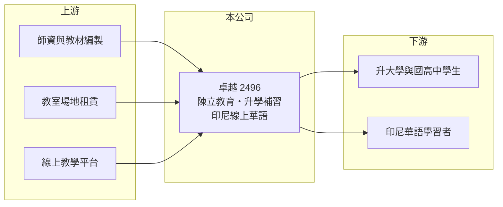

# 2496 卓越

> 上市｜[[產業索引-其他業|其他業]]｜上市（櫃）日期 2002/03/08

# 第一章：企業模式與商業藍圖

> [!info] 撰寫說明
> 精簡版，由 Claude 依公開資料整理，架構比照 [[2330台積電]] 的四章研究，資料截至 2026-10-08。來源：證交所開放資料快照（基本資料、2026 年上半年綜合損益與資產負債、股利、每月營收）、Goodinfo 經營績效頁（2019 至 2025 年）、聯合新聞網 2026 年卓越成功財報報導（陳立教育品牌、印尼華語計畫、配息）。各課程營收比重與校區數未查得；有息負債（含租賃負債）未查得，ROIC 與 WACC 為推算。#待校對

卓越成功（股票代號：2496，以下簡稱卓越）是台灣少數上市的補習教育公司，以「陳立教育」品牌經營升學補習。本章說明補教業的商業模式，以及卓越如何把它變成一家高毛利、高配息的公司。

- **核心業務：** 卓越成立於 1991 年，2002 年上市，總部位於台北車站商圈的忠孝西路。主要業務是[[短期補習班]]與教育諮詢服務，以升大學市場為基礎，並以陳立教育品牌向國中、高中學段延伸，規劃增設國高中直營校。媒體報導稱其為台灣規模最大的教育集團之一（待校對）。
- **商業模式：** 補習班的成本主要是師資、教室租金與招生行銷，學生通常先繳學費再上課，形成[[預收學費]]。這種模式讓公司在開課前就收到現金，營運資金需求很低，甚至是負的，是補教業現金流良好的根本原因。
- **營收結構：** 各類課程營收比重本次未查得。月營收約在 6,000 萬至 8,000 萬元之間，暑假與開學前的招生旺季較高。2025 年全年營收 8.71 億元，創歷史新高。
- **長期方向：** 國內方面往中小學學段延伸，用直營校擴大服務年齡層；海外方面在印尼推出線上華語認證班（A1、A2 等級），採先測試產品與行銷模型、再依招生表現擴大投入的策略。這是卓越首次嘗試把教學能力輸出到台灣以外的市場。

# 第二章：護城河深度與競爭優勢

補教業的護城河來自品牌口碑與師資，而不是資本或技術。

- **競爭優勢：** 升學補習的消費決策高度依賴口碑與升學成績，學生與家長傾向選擇知名品牌，這讓已建立名聲的補習班招生成本較低。卓越 2019 至 2025 年[[毛利率]]由約 45% 穩定提高到 53% 至 55%，顯示品牌帶來一定的定價能力與規模效益。
- **主要對手：** 國內其他連鎖升學補習班與各地區型補習班，以及線上教育平台。台灣補教業高度分散，多數業者未上市，具體同業名單本次未查得。
- **守得住與守不住：** 品牌與既有學生群相對守得住，名師與系統化教材讓學生轉換補習班的意願不高。守不住的是人口：[[少子化]]會讓目標學生數長期下滑，補習班只能靠提高市占、擴大學段或提高單價來抵銷。
- **觀察重點：** 長期可以追蹤國高中直營校的獲利情況、印尼線上華語業務能否建立可複製的獲客模式，以及名師團隊的穩定度。

# 第三章：財務體質與盈利規模

資料日期：2026-10-08，表格是撰寫當時的快照；最新月營收、毛利率、累計 EPS 由自動排程寫在本筆記的屬性欄位（月營收、毛利率、累計EPS 等）。#待校對

財務數字顯示，卓越是一家股本小、毛利高、配息率高的服務型公司。

| 年度 | 營收（億元） | [[毛利率]] | [[營業利益率]] | EPS（元） | [[ROE]] |
|---|---|---|---|---|---|
| 2019 | 8.82 | 44.8% | 9.70% | 4.41 | 9.75% |
| 2020 | 7.76 | 47.9% | 9.21% | 3.30 | 7.85% |
| 2021 | 6.62 | 48.4% | 11.7% | 3.02 | 7.07% |
| 2022 | 7.02 | 50.2% | 13.5% | 4.16 | 9.90% |
| 2023 | 7.65 | 52.6% | 16.0% | 5.48 | 12.4% |
| 2024 | 8.36 | 54.6% | 17.9% | 7.02 | 15.1% |
| 2025 | 8.71 | 53.5% | 15.9% | 6.12 | 12.8% |

（來源：Goodinfo 經營績效頁，合併報表。2026 年上半年依證交所資料，營收 4.16 億元、毛利率 54.67%、營業利益率 15.31%、EPS 2.48 元。）

- **疫情後的復甦與效率提升：** 2020 至 2021 年受疫情影響，營收降到 6.6 億元左右，之後逐年回升，2025 年創新高。同時毛利率與營業利益率都比疫情前高，代表卓越在恢復規模的過程中也提高了效率。2025 年獲利年減約 12%，公司說明是新設直營校與印尼拓展的前期投入。
- **長期指標：** 2021 至 2025 年平均 ROE 約 11.5%（推算），2020 至 2025 年營收年複合成長率約 2.3%（推算）。2025 年度合計配發現金股利 4.5 元與股票股利 0.5 元，對照 EPS 6.12 元，現金配息率約 74%（推算）；2026 年上半年再配發現金股利 1.5 元，採半年配息。
- **資產負債表：** 2026 年第二季資產總計約 15.53 億元，其中非流動資產約 10.0 億元（推估含使用權資產與不動產）；負債約 6.71 億元，多為流動負債，推估以預收學費（合約負債）與租賃負債為主；權益總計約 8.82 億元，每股淨值 43.72 元。
- **[[ROIC]] 與 [[WACC]]：** 以 2025 年營收 8.71 億元乘營業利益率 15.9%，營業利益約 1.39 億元，稅後約 1.11 億元；投入資本以 2026 年第二季權益 8.82 億元加上推估租賃負債約 1.5 億元（未查得，推估），合計約 10.3 億元，ROIC 約 11%（推算）。由於預收學費讓營運資金為負，實際營運所需資本更低，ROIC 可能更高。WACC 以 [[CAPM]] 估算：無風險利率 1.75%、市場風險溢酬 6%、β 假設 0.7（內需服務業常見值，未查得實際數字），權益成本約 6.0%；負債占比約 15%、稅後負債成本 2.0%，WACC 約 5.4%（推算）。ROIC 高於 WACC 約 5 個百分點，代表卓越長期在創造價值，這也是它能維持高配息的基礎。

# 第四章：總體風險與地緣政治

卓越的風險主要來自人口結構、教育政策與人才。

- **人口結構：** 少子化是補教業最根本的長期風險，台灣每年出生人數持續下降，十年後的升學人口會明顯少於今天。卓越往中小學延伸與發展海外華語，都是對沖這個風險的嘗試。
- **教育政策：** 升學制度、考科與招生方式的改變，會影響補習需求的型態。例如考試內容調整可能讓既有課程與教材需要大幅更新，而政策方向不是公司能控制的。
- **營運風險：** 名師流動會直接影響招生，補教業的核心資產是人。新設直營校需要租金與人事投入，若招生不如預期，固定成本會拉低獲利；印尼市場的法規、文化與匯率也與台灣完全不同。
- **競爭與技術：** 線上課程、AI 輔助學習工具與免費教學資源普及，可能壓低實體補習的價格與需求。補習班需要把線上與實體整合，才能維持競爭力。

# 專有名詞解析

## 應用

- **[[線上課程]]**：透過網路直播或錄影授課，可跨區招生並降低場地成本。

## 金融

- **[[預收學費]]**：學生先繳學費、課程後續提供，會計上列為合約負債，讓公司提前取得現金。
- **[[ROIC]]**：投入資本報酬率，稅後營業利益除以股東權益加有息負債，衡量本業運用資本的效率。
- **[[WACC]]**：加權平均資金成本，依股東權益與負債的比重，加權計算公司取得資金的平均成本。

## 產業

- **[[短期補習班]]**：依補習及進修教育法立案、提供升學或考試輔導的教學機構。
- **[[少子化]]**：出生人數持續下降，使教育相關產業的潛在客群減少。

# 核心供應鏈

- 上游：講師團隊、教材編製、教室場地與線上教學平台（推估）
- 下游／客戶：準備升學的高中與國中學生、家長，以及印尼的華語學習者
- 同業：國內連鎖升學補習班與線上教育業者（多數未上市，本次未查得具體名單）

## 最新新聞
<!-- news:start -->
<!-- news:end -->

## 相關連結
- [公開資訊觀測站](https://mopsov.twse.com.tw/mops/web/t05st03?step=1&firstin=1&co_id=2496)
- [Goodinfo](https://goodinfo.tw/tw/StockDetail.asp?STOCK_ID=2496)
- [Yahoo 股市](https://tw.stock.yahoo.com/quote/2496)
- [鉅亨網新聞](https://www.cnyes.com/twstock/2496/news)
