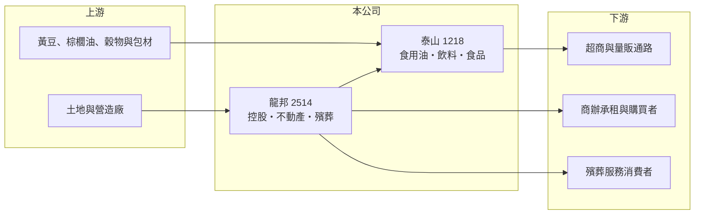

# 2514 龍邦

> 上市｜[[產業索引-其他業|其他業]]｜上市（櫃）日期 1992/09/26

# 第一章：企業模式與商業藍圖

> [!info] 撰寫說明
> 精簡版，由 Claude 依公開資料整理，架構比照 [[2330台積電]] 的四章研究，資料截至 2026-10-08。來源：證交所開放資料快照（基本資料、2026 年上半年綜合損益與資產負債、股利、每月營收）、Goodinfo 經營績效頁（2019 至 2025 年）、數位時代泰山經營權之爭報導（2023 年 5 月龍邦取得泰山董事會多數席次）、nStock 公司簡介。2023 年起營收倍增係泰山併入合併報表的推論，各事業營收比重與有息負債未查得，ROIC 與 WACC 為推算。#待校對

龍邦國際興業（股票代號：2514，以下簡稱龍邦）原本是一家經營商業不動產與殯葬設施的資產型公司，2023 年取得老牌食品廠 [[1218泰山]] 的經營權後，變成以食品飲料為最大營收來源的多角化控股集團。本章說明這個轉變的來龍去脈與商業邏輯。

- **核心業務：** 龍邦成立於 1988 年，1992 年上市，總部位於台北市忠孝西路。登記的營業項目包括商業大樓租售、[[殯葬設施]]管理與經營、娛樂設施經營、投資開發、土木建築工程，以及食品加工與零售。
- **關鍵轉折：泰山經營權：** 依數位時代報導，龍邦在 2018 年應泰山詹家部分家族成員之邀入股，之後雙方反目，2023 年 5 月 31 日的泰山股東臨時會上，龍邦以持股優勢取得過半董事席次，結束詹家約 70 年的經營。龍邦營收從 2022 年的 91.7 億元跳到 2023 年的 178 億元、2024 年的 249 億元，推估主要就是泰山納入合併報表的結果。泰山以食用油、八寶粥、仙草蜜等飲料與食品聞名。
- **營收結構：** 各事業營收比重本次未查得。依營收規模推估，食品飲料已是最大的營收來源，不動產、殯葬與娛樂事業營收較小但屬於資產型收入。資產負債表中約 76 億元的[[非控制權益]]，反映龍邦並未百分之百持有泰山，泰山的其他股東仍分享相當比例的損益。
- **長期方向：** 龍邦的模式是用控股方式取得具有品牌或資產價值的公司，再透過經營權主導資本配置。長期價值取決於它能否把泰山的品牌與通路經營得更有效率，並讓不動產與殯葬資產持續產生穩定收入。

# 第二章：護城河深度與競爭優勢

龍邦的護城河分散在不同事業中，強弱差異很大。

- **殯葬設施的特許門檻：** 納骨塔、墓園等殯葬設施的設置須經地方政府核准，土地取得與鄰避抗爭使新設施很難出現，既有設施具有長期、穩定的稀缺性。這是龍邦最具護城河特質的資產（推估）。
- **食品品牌的消費者心占率：** 泰山擁有數十年的品牌認知與通路鋪貨，八寶粥、仙草蜜等產品在超商與量販通路有固定的貨架位置。不過食用油與飲料市場競爭激烈，品牌優勢不足以帶來高毛利，龍邦 2023 至 2025 年[[毛利率]]僅約 9% 至 13%。
- **主要對手：** 食品飲料面對 [[1216統一]]、[[1201味全]]、[[1227佳格]]、[[1210大成]] 等大型食品集團；殯葬業面對 [[5530龍巖]] 等專業業者；不動產則面對各地建商與商辦業主。
- **控股結構的限制：** 多角化事業之間的綜效有限，管理層的注意力與資本分散在多個不相關領域。經營權之爭期間產生的訴訟與治理爭議，也會消耗管理資源。
- **觀察重點：** 長期可以追蹤泰山本業的營業利益率能否提升、業外投資與訴訟是否繼續拖累淨利，以及龍邦是否恢復穩定配息。

# 第三章：財務體質與盈利規模

資料日期：2026-10-08，表格是撰寫當時的快照；最新月營收、毛利率、累計 EPS 由自動排程寫在本筆記的屬性欄位（月營收、毛利率、累計EPS 等）。#待校對

財務數字顯示，龍邦的營收規模在併入泰山後倍增，但獲利與資本報酬沒有同步提升。

| 年度 | 營收（億元） | [[毛利率]] | [[營業利益率]] | EPS（元） | [[ROE]] |
|---|---|---|---|---|---|
| 2019 | 93.0 | 4.99% | 1.15% | 1.87 | 9.94% |
| 2020 | 108 | 7.24% | 3.13% | 3.05 | 12.5% |
| 2021 | 114 | 7.09% | 2.85% | 2.45 | 9.19% |
| 2022 | 91.7 | 6.61% | 2.79% | 0.91 | 3.16% |
| 2023 | 178 | 9.22% | 2.60% | 1.03 | 3.24% |
| 2024 | 249 | 13.4% | 6.37% | 2.83 | 7.39% |
| 2025 | 216 | 13.3% | 4.90% | 1.85 | 5.07% |

（來源：Goodinfo 經營績效頁，合併報表。2026 年上半年依證交所資料，營收 105.51 億元、毛利率 12.77%、營業利益率 3.05%、EPS -0.65 元。）

- **營收倍增、利潤率偏低：** 2019 至 2022 年龍邦的毛利率只有 5% 至 7%，推估當時營收以低毛利的貿易或工程類業務為主；泰山併入後毛利率提高到 13% 左右，但營業利益率仍只有 5% 至 6%。2026 年上半年本業仍有營業利益約 3.22 億元，但營業外損失約 6.99 億元，使稅前轉為虧損，業外項目的波動是龍邦獲利最大的變數。
- **長期指標：** 2021 至 2025 年平均 ROE 約 5.6%（推算）；2020 至 2025 年營收年複合成長率約 14.9%（推算），但主要來自併購而非有機成長。2025 年度未配發股利，Goodinfo 列出的歷年平均現金股利約 0.23 元，配息紀錄不穩定。
- **資產負債表：** 2026 年第二季資產總計約 377.6 億元、負債約 177.6 億元，負債比約 47%；權益總計約 199.9 億元，其中歸屬母公司約 123.9 億元、非控制權益約 76.1 億元。母公司與子公司合計持有約 3,661 萬股龍邦庫藏股，每股淨值 34.59 元。
- **[[ROIC]] 與 [[WACC]]：** 以 2025 年營收 216 億元乘營業利益率 4.9%，營業利益約 10.6 億元，稅後約 8.5 億元；投入資本以 2026 年第二季權益 199.9 億元加上有息負債推估約 100 億元（未查得，以負債結構推估），合計約 300 億元，ROIC 約 2.8%（推算）。WACC 以 [[CAPM]] 估算：無風險利率 1.75%、市場風險溢酬 6%、β 假設 0.8（食品與資產型控股常見值，未查得實際數字），權益成本約 6.6%；稅前負債成本假設 2.5%、稅率 20%，稅後 2.0%；權益與負債約 67：33，WACC 約 5.0%（推算）。ROIC 低於 WACC 約 2 個百分點，代表併購帶來的營收規模尚未轉化為超過資金成本的報酬，提升泰山本業效率與減少業外損失是改善的關鍵。

# 第四章：總體風險與地緣政治

龍邦的風險在於業外損益波動、多角化管理與治理爭議。

- **業外與投資風險：** 2026 年上半年業外損失約 6.99 億元，使本業獲利被完全抵銷。泰山過去的投資與交易仍有訴訟，投資部位的評價或處分結果可能持續影響損益。
- **產業週期：** 食品飲料需求相對穩定，但食用油等原料（黃豆、棕櫚油）價格受國際農產品市場影響，成本波動大；不動產與娛樂事業則跟著景氣、利率與房市政策起伏。
- **治理與管理風險：** 經營權之爭留下的訴訟與股東關係，以及跨食品、不動產、殯葬、娛樂的多角化經營，都提高了管理難度。控股集團的資本配置是否以股東報酬為優先，是長期觀察重點。
- **法規風險：** 殯葬業受地方政府法規與管理，食品業受食安法規與標示規範約束，任何食安事件都可能重創品牌價值。

# 專有名詞解析

## 金融

- **[[非控制權益]]**：子公司中不屬於母公司持有的股東權益，代表其他股東分享的部分。
- **[[業外損失]]**：本業以外的損失，例如投資虧損、資產減損或處分損失，會拉低稅後淨利。
- **[[ROIC]]**：投入資本報酬率，稅後營業利益除以股東權益加有息負債，衡量本業運用資本的效率。
- **[[WACC]]**：加權平均資金成本，依股東權益與負債的比重，加權計算公司取得資金的平均成本。

## 產業

- **[[殯葬設施]]**：納骨塔、墓園與殯儀館等設施，設置須經政府核准，經營門檻較高。
- **[[多角化經營]]**：同時經營多個不相關事業，以分散單一產業的風險。

# 核心供應鏈

- 上游：黃豆、棕櫚油、穀物與包材供應商，土地與營造廠（推估）
- 本公司與子公司：龍邦本身（不動產、殯葬、娛樂設施），子公司 [[1218泰山]]（食用油、飲料、食品）
- 下游／客戶：超商與量販通路（如 [[2912統一超]]、[[5903全家]]，推估）、商辦承租與購買者、殯葬服務消費者
- 同業：食品 [[1216統一]]、[[1201味全]]、[[1227佳格]]、[[1210大成]]；殯葬 [[5530龍巖]]

## 最新新聞
<!-- news:start -->
<!-- news:end -->

## 相關連結
- [公開資訊觀測站](https://mopsov.twse.com.tw/mops/web/t05st03?step=1&firstin=1&co_id=2514)
- [Goodinfo](https://goodinfo.tw/tw/StockDetail.asp?STOCK_ID=2514)
- [Yahoo 股市](https://tw.stock.yahoo.com/quote/2514)
- [鉅亨網新聞](https://www.cnyes.com/twstock/2514/news)
