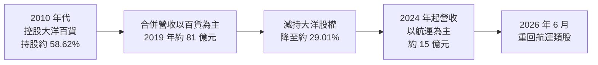
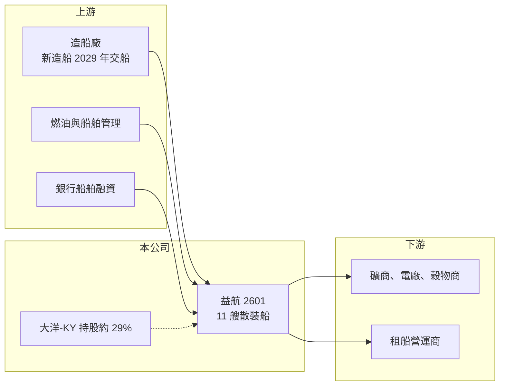

# 2601 益航

> 上市｜[[產業索引-貿易百貨業|貿易百貨業]]｜上市（櫃）日期 1965/11/04

# 第一章：企業模式與商業藍圖

> [!info] 撰寫說明
> 精簡版，由 Claude 依公開資料整理，架構比照 [[2330台積電]] 的四章研究，資料截至 2026-10-08。來源：Goodinfo 年度經營績效頁、ETtoday 財經雲 2026 年第一季業績報導（含 2025 年底法說會船隊資料）、證交所開放資料（基本資料、2026 年第二季資產負債與綜合損益、營益分析、股利、每月營收）。百貨事業的歷史沿革部分憑記憶整理，已標示待校對。#待校對

益航是台灣老牌的[[散裝航運]]公司，過去十多年因控股中國的大洋百貨，一度被歸類為百貨股；近年減持大洋股權，並在 2026 年 6 月重回航運類股。本章說明它的船隊與事業結構的轉變。

## 一、核心定位：中型散裝船隊的船東

益航成立於 1963 年，1965 年上市，是台灣最早上市的航運公司之一，董事長為郭人豪、總經理為莊仟萬（證交所開放資料）。依 ETtoday 引述的 2025 年底法說會資料，公司營運中的散裝船共 11 艘：2 艘輕便型（Handysize）、5 艘 [[Kamsarmax]] 型、4 艘超輕便型，另有 8 艘 1 年內的合約船；兩家子公司各訂造 1 艘 6.45 萬噸的超輕便型船，每艘造價 3,340 萬美元，預計 2029 年交船。

* **散裝航運的角色：** 運送鐵礦砂、煤炭、穀物、水泥等大宗原物料，運價由全球供需決定，船東幾乎沒有定價權。
* **中型船的特性：** Kamsarmax 與超輕便型船靈活度高，可以進出較小的港口、運送多種貨物，運價波動通常比海岬型大船小。

## 二、事業結構的轉變：從百貨控股回到航運

益航過去持有 [[5907大洋-KY]] 約 58.62% 股權並合併其營收，大洋在中國經營百貨商場，這讓益航 2019 年合併營收達 81.3 億元、毛利率高達 67%（Goodinfo，百貨以專櫃抽成認列營收，因此毛利率偏高）。之後持股降到約 29.01% 並持續減持（ETtoday），2024 年起不再合併大洋，營收降到約 15 億元、毛利率降到約 15% 至 23%，反映的是純航運的成本結構。2025 年航運部門營收 14.49 億元、部門獲利約 0.71 億元（ETtoday）。

## 三、長期方向

公司的長期方向是回歸航運本業：持續處分大洋股權、更新船隊並把資源集中在散裝船。新造船在 2029 年交船後，船隊將更年輕、更省油，有助於符合國際海事組織的減碳規範。不過，大洋股權的處分損益仍會影響未來幾年的淨利。

# 第二章：護城河深度與競爭優勢

散裝航運是高度商品化的產業，護城河很淺。本章分析益航在其中的位置。

## 一、競爭優勢

* **船型集中在靈活的中型船：** Kamsarmax 與超輕便型船可承運多種貨物、進出多數港口，租船需求比單一用途的大型船更分散。
* **老牌船東的營運經驗：** 經營航運超過一甲子，在船舶管理、租船與融資上有長期經驗，2025 年航運部門維持獲利（ETtoday）。
* **限制：** 船隊規模只有十餘艘，遠小於國際大型散裝船東，在採購新船、融資利率與議價上沒有規模優勢。

## 二、主要競爭對手

| 對手 | 定位 | 與益航的比較 |
|---|---|---|
| [[2637慧洋-KY]] | 台灣最大散裝船東之一，船隊規模大 | 船型重疊，規模遠大於益航 |
| [[2606裕民]] | 海岬型為主的散裝船東，長約比重高 | 船型較大，營運模式以長約為主 |
| [[5608四維航]] | 散裝船東 | 同為台灣中型散裝船東 |
| [[2612中航]]、[[2605新興]] | 散裝與油輪船東 | 同屬台灣散裝航運族群 |

## 三、守得住與守不住

* **守得住：** 在運價正常的年度，維持航運本業的小幅獲利。
* **守不住：** 運價週期。散裝運價波動極大，船東只能透過長短約搭配與船隊更新降低風險，無法控制運價。
* **觀察重點：** 大洋股權的處分進度與損益、新造船交船後的船隊成本，以及長約比重。

# 第三章：財務體質與盈利規模

資料日期：2026-10-08，表格是撰寫當時的快照；最新月營收、毛利率、累計 EPS 由自動排程寫在本筆記的屬性欄位（月營收、毛利率、累計EPS 等）。#待校對

本章用多年度數據檢視益航從百貨控股轉回航運後的財務變化。

## 一、多年度三率與 ROE

| 年度 | 營收（新台幣） | [[毛利率]] | [[營業利益率]] | EPS（元） | [[ROE]] |
|---|---|---|---|---|---|
| 2019 | 81.3 億 | 67.1% | 17.5% | 2.23 | 12.7% |
| 2020 | 64.4 億 | 56.2% | 4.91% | -0.21 | -1.33% |
| 2021 | 69.3 億 | 64.1% | 12.7% | 0.20 | 0.42% |
| 2022 | 63.3 億 | 68.3% | 9.51% | 0.01 | -2.64% |
| 2023 | 55.0 億 | 65.6% | -4.56% | -2.02 | -20.6% |
| 2024 | 16.2 億 | 21.1% | 6.99% | -0.35 | -4.7% |
| 2025 | 14.9 億 | 14.5% | 3.27% | -1.63 | -19.9% |
| 2026 上半年 | 9.75 億 | 22.87% | 16.87% | -0.20 | 未查得 |

註：2019 至 2025 年取自 Goodinfo；2026 上半年取自證交所營益分析與綜合損益。2023 年以前的數字包含大洋百貨的合併營收，與 2024 年後不可直接比較。

* **營收斷層來自合併範圍改變：** 2024 年營收大減是因為不再合併大洋百貨，不是航運本業衰退。航運本業約 15 億元的營收規模，才是現在的基準。證交所每月營收顯示 2026 年 1 至 8 月累計約 12.6 億元，但公告的年減幅度約 55%，與 2025 年全年 14.9 億元的規模對不上，去年同期的比較基礎未查得（待校對）。
* **本業有獲利、業外拖累：** 2026 年上半年營業利益約 1.65 億元，但營業外損失約 3.02 億元，稅前虧損約 1.38 億元（證交所綜合損益），業外損失主要應與大洋股權相關（推估）。
* **ROE 長期為負：** 2021 至 2025 年平均 ROE 約 -9.5%（推算），2025 年本期淨損約 13.4 億元（證交所股利資料）。

## 二、股利與財務結構

2025 年度虧損，未配發股利（證交所股利資料）。2026 年第二季底總資產約 114.0 億元、總負債約 39.6 億元、權益約 74.5 億元，保留盈餘為 -15.1 億元（證交所資產負債）。資產負債表上的股本約 82.5 億元，而證交所基本資料的實收資本額為 69.0 億元，兩者差異可能來自第二季後的減資彌補虧損（待校對）。股價淨值比約 0.69 倍，市場對帳上資產（含大洋股權）的價值有所折價。

## 三、[[ROIC]] 與 [[WACC]]

**ROIC 推算：** 2025 年營業利益約 14.9 億 × 3.27% ≈ 0.49 億元，以 20% 稅率計算稅後約 0.39 億元。以權益約 74.5 億元加上推估的船舶融資等有息負債約 25 億元、合計約 100 億元作為投入資本，ROIC 約 0.4%（推算）。2026 年上半年營業利益年化約 3.3 億元，稅後約 2.6 億元，ROIC 約 2.6%（推算）。2023 年營業利益為負，ROIC 也為負。

**WACC 推算：** 台灣 10 年期公債 1.75%、市場風險溢酬 6%、β 取散裝航運同業常見值 1.0，權益成本約 7.75%；負債成本約 3%、稅後約 2.4%，以權益 75%、負債 25% 加權，WACC 約 6.4%（推算）。

**結論：** 益航過去多年的 ROIC 都低於 WACC，主要原因是大量資本卡在獲利不佳的大洋百貨股權上，而航運本業規模又不大。這也是股價長期低於淨值的原因。若大洋股權處分完成、資金重新投入船隊或回饋股東，資本效率才有機會改善。

# 第四章：總體風險與地緣政治

本章整理益航長期面對的航運週期、轉投資與法規風險。

## 一、產業週期

* **散裝運價波動：** 運價（可由 [[BDI]] 觀察）受中國鋼鐵與基建需求、全球穀物貿易、新船交付量影響，好壞年度落差極大。益航的營業利益會隨運價大幅擺盪。
* **新船供給：** 全球造船產能擴張時，船舶供給增加會壓低運價與二手船價。

## 二、轉投資與財務風險

* **大洋股權處分：** 大洋百貨在中國面臨電商與消費疲弱的壓力，股權價值下跌或處分價格低於帳面，都會產生業外損失。
* **船舶融資：** 新造船需要大量美元融資，利率上升會提高資金成本。

## 三、其他風險

* **減碳法規：** 國際海事組織（IMO）的碳排規範趨嚴，老舊船舶可能需要改裝或提前汰換。
* **地緣政治與航道：** 紅海、黑海等航道的衝突會改變航線與保險成本；中國大陸景氣與政策也同時影響運價與大洋百貨。
* **匯率：** 運費以美元計價，新台幣升值會降低換算後的營收。

# 專有名詞解析

## 金融

- **[[ROIC]]**：投入資本報酬率，衡量企業用股東與債權人投入的資本，每年能產生多少稅後營業利益。
- **[[WACC]]**：加權平均資金成本，股東要求報酬與負債利息依資本結構加權後的平均值，是判斷是否創造價值的門檻。

## 產業

- **[[散裝航運]]**：以不分裝的方式運送鐵礦砂、煤炭、穀物等大宗原物料的海運，運價由全球供需決定、波動大。
- **[[Kamsarmax]]**：載重約 8 萬噸的散裝船型，可通過巴拿馬運河並靠泊幾內亞 Kamsar 港，常用於運送煤炭與穀物。
- **[[BDI]]**：波羅的海乾散貨指數，反映全球主要散裝航線的即期運價，是觀察散裝航運景氣的指標。

# 核心供應鏈

- 上游：造船廠（新造船廠名未查得；台灣造船業可參考 [[2208台船]]）、燃油供應、船舶管理與銀行融資。
- 下游／客戶：鐵礦砂、煤炭與穀物的貨主，以及以期租方式承租船舶的租船營運商。
- 轉投資：[[5907大洋-KY]]（中國百貨，持股持續減少）。
- 同業：[[2637慧洋-KY]]、[[2606裕民]]、[[5608四維航]]、[[2612中航]]、[[2605新興]]。

## 最新新聞
<!-- news:start -->
<!-- news:end -->

## 相關連結
- [公開資訊觀測站](https://mopsov.twse.com.tw/mops/web/t05st03?step=1&firstin=1&co_id=2601)
- [Goodinfo](https://goodinfo.tw/tw/StockDetail.asp?STOCK_ID=2601)
- [Yahoo 股市](https://tw.stock.yahoo.com/quote/2601)
- [鉅亨網新聞](https://www.cnyes.com/twstock/2601/news)
