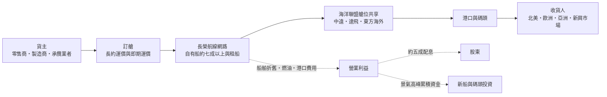
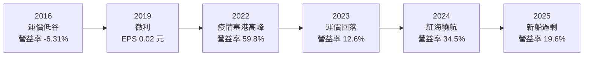
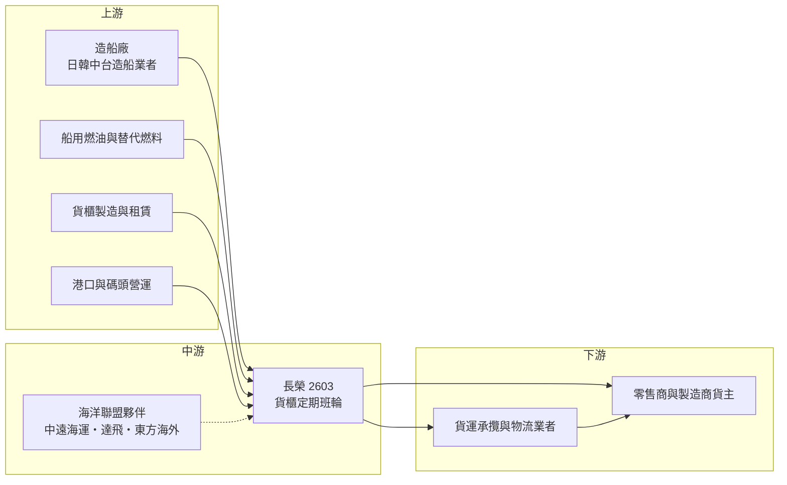

# 2603 長榮

> 上市｜[[產業索引-航運業|航運業]]｜上市（櫃）日期 1987/09/21

# 第一章：企業模式與商業藍圖

> [!info] 撰寫說明
> 本文由 Claude 依公開資料整理，架構比照 [[2330台積電]] 的四章研究，資料截至 2026-10-08。財務數字來源：證交所開放資料快照（基本資料、2026 年第二季資產負債與綜合損益、股利）、Goodinfo 經營績效頁與股利政策頁（2015 至 2025 年）、MoneyDJ 季資產負債表（2026 年第二季借款與租賃負債科目）、工商時報 2026 年船隊與運力報導；新船訂單數量、海洋聯盟成員與租船比率沿用舊版筆記整理，尚未逐條比對原始文件。#待校對

在評估一家公司的長期投資價值時，第一步是看懂它靠什麼賺錢、為什麼能一直賺下去。本章針對長榮海運（股票代號：2603，以下簡稱長榮）的商業模式進行定性分析，說明一家貨櫃航商如何把船舶、貨櫃與航線網路轉化為營收，為什麼它的獲利會隨運價大起大落，以及它在景氣高峰之後如何配置累積下來的大量資本。

## 一、核心定位：台灣最大、全球前段班的貨櫃航商

長榮成立於 1968 年，是長榮集團的起家事業，1987 年上市，董事長為張衍義。公司的本業是貨櫃定期班輪運輸：在固定航線上、按照公布的船期，替貨主把貨櫃從一個港口運到另一個港口。主要航線包括亞洲至北美、亞洲至歐洲、跨大西洋的東西向遠洋幹線，以及亞洲區間與新興市場航線。依工商時報 2026 年的報導，長榮船隊運力約 200 萬 [[TEU]]，全球排名約第七，十年間運力大約翻倍。

貨櫃航運是一個高度標準化的產業。一個 40 呎貨櫃不論由哪一家航商運送，對貨主來說差別不大，因此運價主要由全球的船舶供給與貨物需求決定，個別航商很難長期維持比同業更高的價格。在這樣的產業裡，長期能存活並賺錢的航商，靠的是三件事：足夠大的規模與航線網路、比同業更低的單位成本，以及在景氣低谷時撐得住的財務體質。長榮的經營策略，基本上就是圍繞這三點展開。

長榮的定位有三個特點。第一，它是台灣貨櫃三雄中規模最大的一家，2025 年營收約 3,791 億元，明顯大於 [[2609陽明]] 與 [[2615萬海]]。第二，它是[[航運聯盟]]「海洋聯盟（OCEAN Alliance）」的成員，與中遠海運（含東方海外）、達飛共享艙位，不必獨力在每條航線派足船舶，就能提供高頻率的班次。第三，依公司說法，它的[[租船]]比率在三成以下，是全球大型航商中自有船比重最高的之一，船舶成本受租金行情的影響較小。

## 二、終端應用／產品板塊：航線結構與貨物種類

長榮未公開最新的航線別營收比重，因此本節不畫圓餅圖，改以定性說明航線的角色：

- **遠洋東西向幹線：** 亞洲至北美、亞洲至歐洲是營收主體，也是運價波動最大的部分。這些航線使用最大型的船舶，單位成本最低，但也最直接受到全球消費景氣、庫存週期與航道事件影響。北美線多以每年議定一次的[[長約運價]]為主，歐洲線則有較高比例的[[即期運價]]。
- **新興市場航線：** 南美、中東、印度與非洲航線，貨量較小但成長潛力較高。長榮近年逐步加強這些航線，以分散對美中貿易的依賴。
- **亞洲區間航線：** 東北亞與東南亞之間的短程航線，貨量穩定但單價較低，一方面直接服務區域貿易，另一方面把貨物餵給遠洋幹線。
- **碼頭、貨櫃與集團資源：** 長榮在全球多個港口經營或投資貨櫃碼頭，並透過子公司管理大量自有與租賃貨櫃。集團內還有 [[2618長榮航]]、[[2607榮運]] 等關係企業，形成海、空、陸運的物流網路。

## 三、資本轉化邏輯（營運模式）：重資產、高營運槓桿的運價機器

- **固定成本高、[[營運槓桿]]極大：** 一艘船不論裝滿與否，船員、折舊、保險與大部分港口費用都差不多。運價上漲時，增加的收入幾乎全部變成利潤；運價下跌時，獲利也會快速消失。長榮的毛利率在 2016 年為負 2.8%，2022 年高達 63.5%，2023 年又降到 18.0%，就是這種槓桿的結果。
- **運價決定獲利，貨量相對穩定：** 全球貨櫃貨量每年的變化通常只有個位數百分比，但運價可以在一兩年內上漲數倍或腰斬。因此判斷長榮的獲利，最重要的是判斷運價所處的週期位置，而不是貨量。
- **成本控制工具：** 長榮船隊安裝[[脫硫塔]]的比例高，可以使用價格較低的高硫燃油；自有船比重高，則降低了租金上漲時的成本壓力。這些成本優勢不會讓長榮在景氣好時賺得特別多，但能讓它在景氣差時比同業虧得少。
- **景氣高峰的資本配置：** 2021 至 2022 年的運價高峰讓長榮累積了大量資金。依 MoneyDJ 整理的 2026 年第二季資產負債表，長榮帳上現金約 1,747 億元。這些資金被用於船隊更新、碼頭與貨櫃投資，並維持約五成的配息率。

## 四、企業長期藍圖：船隊更新與低碳轉型

- **[[雙燃料船]]船隊：** 2023 至 2025 年間，長榮陸續訂造大批甲醇與液化天然氣（LNG）雙燃料貨櫃船，合計約 55 艘（數量待校對），規劃到 2030 年雙燃料船運能占比超過三成。這批新船是長榮未來十年的核心資產，決定了它在國際海事組織減碳規範下的競爭力。
- **運能穩健擴張：** 新船交付讓長榮的總運能持續增加，但公司同時汰換老舊船舶，因此淨增幅低於訂單規模。運能擴張的目的不只是搶市占，也是為了用更大、更省油的船降低單位成本。
- **航線分散化：** 強化新興市場航線，降低對單一貿易路線的依賴，讓營收來源更能承受地緣政治與關稅變化。

# 第二章：護城河深度與競爭優勢

在長期價值投資中，「護城河」指企業抵禦競爭、長期維持超額利潤的保護機制。本章分析長榮的護城河構成、全球主要競爭對手，以及這些優勢在運價下行週期中能守住多少。

## 一、長榮護城河的核心組成要素

貨櫃航運本質上是商品化服務，運價由全球供需決定，因此長榮的護城河屬於「成本與規模型的窄護城河」，由以下三個要素構成：

- **1. 成本結構：** 自有船比重高、脫硫塔裝設比例高，加上新一代大型船舶的單位艙位成本較低，讓長榮在燃油與租金上漲時的成本壓力低於多數同業。在一個價格無法差異化的產業，成本就是最主要的競爭武器。
- **2. 航線網路與聯盟：** 海洋聯盟提供高頻率、廣覆蓋的航線組合。大型貨主偏好能一次滿足多條航線需求、班期穩定的航商，這讓聯盟成員在長約議價時更有籌碼。單一中小型航商很難複製這樣的網路。
- **3. 財務體質：** 2021 至 2024 年景氣高峰累積的大量現金，讓長榮能在低谷期繼續下單新船、維持配息，不必在景氣最差時被迫出售資產或增資。航運史上許多航商倒閉，正是因為在低谷期資金斷鏈，而不是因為服務不夠好。

## 二、全球主要競爭對手格局

| 對手 | 定位 | 對長榮的影響 |
|---|---|---|
| 地中海航運（MSC） | 全球最大貨櫃航商，持續大量下單新船 | 以規模壓低單位成本，在運價下行時能承受更低報價 |
| 馬士基（Maersk） | 全球前兩大，推動端到端物流整合 | 爭取大型貨主的整合物流合約 |
| 達飛（CMA CGM）、中遠海運 | 海洋聯盟夥伴，同時也是競爭者 | 在同一條航線上爭奪同一批貨主 |
| 赫伯羅特、ONE、HMM | 歐日韓主要航商 | 在東西向主航線直接競爭 |
| [[2609陽明]]、[[2615萬海]] | 台灣同業 | 陽明在遠洋線、萬海在亞洲區間線與長榮重疊 |

## 三、優勢轉化：守得住／守不住／觀察重點

- **守得住：** 成本端的相對優勢與財務韌性。在燃油大漲或景氣下行時，長榮的獲利受衝擊程度通常小於租船比重高、財務較弱的同業，這讓它在完整週期中更有機會維持正的平均報酬。
- **守不住：** 運價本身。2023 年與 2025 年運價回落時，長榮的營收與獲利都大幅下滑，說明再好的成本控制也擋不住產業運價下跌。2015 至 2016 年的運價低谷期，長榮也曾連續虧損。
- **觀察重點：** 長期而言，可以追蹤三件事。第一是全球新船交付量與需求成長的差距，這決定未來數年的運價水準；第二是長榮雙燃料新船交付後的單位成本表現；第三是管理層在景氣低谷時是否維持紀律，不在高峰時過度擴張、在低谷時被迫收縮。

# 第三章：財務體質與盈利規模

資料日期：2026-10-08。數字取自 Goodinfo 經營績效頁與股利政策頁、證交所開放資料快照與 MoneyDJ 季資產負債表，表格是撰寫當時的快照；最新月營收、毛利率、累計 EPS 由自動排程寫在本筆記的屬性欄位（月營收、毛利率、累計EPS 等）。#待校對

財務報表是檢驗護城河是否真實存在的最終標準。本章用跨越完整運價週期的三率、ROE、股利與資本報酬，檢視長榮的獲利品質。

## 一、獲利能力的基石：三率

| 年度 | 營收（億元） | [[毛利率]] | [[營業利益率]] | EPS（元） | [[ROE]] |
|---|---|---|---|---|---|
| 2016 | 1,245 | -2.81% | -6.31% | -1.88 | -14.9% |
| 2017 | 1,506 | 7.22% | 3.20% | 1.97 | 11.1% |
| 2019 | 1,906 | 7.64% | 2.44% | 0.02 | -0.31% |
| 2020 | 2,071 | 22.0% | 16.7% | 5.06 | 32.9% |
| 2021 | 4,894 | 61.7% | 58.2% | 45.57 | 115% |
| 2022 | 6,273 | 63.5% | 59.8% | 87.07 | 73.7% |
| 2023 | 2,767 | 18.0% | 12.6% | 16.70 | 7.59% |
| 2024 | 4,636 | 38.0% | 34.5% | 64.87 | 26.8% |
| 2025 | 3,791 | 24.5% | 19.6% | 31.68 | 11.8% |

（來源：Goodinfo 經營績效頁，合併報表；2018 年數字在來源頁上前後無法勾稽，故未列入。2026 年上半年依證交所資料：營收 1,916.7 億元、毛利率 19.50%、營業利益率 14.77%、EPS 11.24 元。）

- **典型的景氣循環股：** 2015 至 2019 年長榮營業利益率在負 6% 到正 3% 之間，是長達五年的微利或虧損期；2020 至 2022 年受疫情塞港帶動，營業利益率衝上近六成；2023 年之後在紅海繞航等事件影響下，運價呈現高低起伏。這段歷史說明，長榮的獲利幾乎完全由產業供需決定，單一年份的數字不能代表長期水準。
- **長期營收成長：** 2015 至 2025 年營收由 1,338 億元增至 3,791 億元，年複合成長率約 11.0%（推算）；2020 至 2025 年約 12.9%（推算）。營收成長一部分來自運力擴張，另一部分來自運價水準整體墊高，後者能否持續仍有疑問。
- **獲利下限墊高了嗎：** 2023 年與 2025 年雖是景氣回落年，營業利益率仍有 12.6% 與 19.6%，明顯高於 2015 至 2019 年。原因可能包括航運聯盟紀律、航道事件吸收運力，以及長榮自身的成本改善（推估）。這個下限能否在新船大量交付後維持，是判斷長榮長期價值的關鍵。

## 二、[[ROE]]：資本效率

2021 至 2025 年長榮平均 ROE 約 47.0%（推算），但這個數字被 2021 至 2022 年的極端高峰拉高；若以 2016 至 2025 年完整週期計算（2018 年依來源數字約 0.1%），平均 ROE 約 26%（推算），仍屬優異，但波動極大。景氣高峰累積的保留盈餘，讓長榮的股東權益大幅增加：依證交所資料，2026 年第二季權益總計約 5,834 億元，其中保留盈餘約 4,919 億元，每股淨值約 259.09 元。權益基數變大之後，即使運價維持中等水準，ROE 也會落在一成上下，未來很難再出現百分之百以上的 ROE。

## 三、資本支出、自由現金流與股利

- **[[CapEx]]：** 大批雙燃料新船在 2026 年之後陸續交付，未來數年每年都有大額造船款支出，具體金額未逐年彙整（未查得）。造船款多以自有資金搭配銀行融資支應。
- **[[自由現金流]]：** 景氣好的年份，營業現金流遠大於造船支出；景氣差的年份，兩者可能接近，甚至需要動用帳上現金。由於運價週期與造船付款時點不一定同步，自由現金流的波動會比獲利更大（推估，多年度金額未查得）。
- **股利穩定度：** 依 Goodinfo，長榮在 2015 至 2019 年度幾乎沒有配息（僅 2017 年度配發 0.2 元現金與 0.5 元股票股利），2020 年度起才恢復，2021 至 2025 年度每股現金股利分別為 18、70、9.97、32.5 與 16 元。以 EPS 計算，2023 至 2025 年度配發率約 50% 至 60%（推算），管理層大致遵循「約五成配息、其餘保留做船隊投資」的原則。股利金額隨運價大幅波動，不適合當作穩定的現金收入來源。

## 四、[[ROIC]] 與 [[WACC]]：價值創造利差

- **ROIC（推算）：** 依 MoneyDJ 2026 年第二季資產負債表，有息負債包括短期借款約 0.3 億元、一年內到期長期負債約 128.6 億元、應付公司債約 94.7 億元、長期銀行借款約 832.3 億元，以及租賃負債約 969.1 億元（流動 204.3 億元、非流動 764.8 億元），合計約 2,025 億元；加上權益總計約 5,834 億元，投入資本約 7,859 億元。以 2025 年營收約 3,791 億元乘以營業利益率 19.6%，營業利益約 743 億元，扣除 20% 稅率後稅後營業利益約 594 億元，ROIC 約 7.6%（推算）。以相同資本基數套用 2023 年景氣回落年的營業利益約 349 億元，ROIC 約 3.5%；2024 年營業利益約 1,599 億元，ROIC 約 16.3%（推算，分母未逐年調整）。
- **WACC（推算）：** 以 [[CAPM]] 估算股東權益成本：無風險利率取台灣 10 年期公債約 1.75%，市場風險溢酬 6%，β 假設 1.1（航運股波動高，未查得長榮實際數字），權益成本約 8.35%。稅前負債成本假設 3%、稅率 20%，稅後約 2.4%。以帳面價值計算，有息負債約占投入資本 26%、權益約 74%，WACC 約 6.8%（推算）。
- **價值創造判斷：** 2025 年長榮的 ROIC 約 7.6%，略高於約 6.8% 的資金成本；2023 年這類景氣回落年則低於 WACC，2024 年明顯高於 WACC。長榮在完整週期中是否創造價值，取決於高峰期的超額報酬能否彌補低谷期的不足。從 2020 至 2025 年的累積獲利來看，長榮在這段期間明顯創造了價值；但隨著權益基數擴大與新船交付，未來的 ROIC 會更接近資金成本，管理層的資本配置紀律將是關鍵。

# 第四章：總體風險與地緣政治

任何企業都無法脫離宏觀環境獨立存在。本章分析長榮未來必須面對的地緣政治、產業週期、營運與法規風險。

## 一、地緣政治風險

- **航道安全：** 紅海、蘇伊士運河、荷莫茲海峽與巴拿馬運河等關鍵航道，一旦因戰事、海盜或乾旱受限，航商必須繞行，航程拉長會吸收運力、推升運價，但也帶來燃油、保險與船員安全的風險。2024 年以來的紅海繞航，就是典型案例。這類事件對長榮的獲利短期多半有利，但結束後運力釋放，運價也可能快速回落。
- **美中貿易與港口費：** 美中貿易摩擦已延伸到海運，雙方對特定航商或船舶課徵港口費，可能改變貨流與艙位配置。長榮雖非中資航商，但聯盟夥伴中有中資企業，航線安排可能間接受影響。
- **關稅造成的需求波動：** 美國關稅政策會讓貨主提前出貨或延後下單，造成貨量在短期內劇烈波動，增加運價判斷的難度。

## 二、產業週期與市場結構風險

- **新船過剩：** 疫情高峰期間航商大量下單新船，2023 年以來全球新船持續交付。當運力增速長期高於貨量成長時，運價就會承壓，這是貨櫃航運最根本的週期風險。
- **大型航商的規模競爭：** 地中海航運等大型航商持續擴張，規模差距擴大後，可能在運價下行時以更低價格搶市，壓縮中型航商的生存空間。
- **[[長鞭效應]]：** 零售商的庫存調整會放大訂艙需求的波動，旺季可能提前或延後，使運價出現短期的暴漲暴跌。
- **匯率：** 營收以美元計價為主，新台幣升值會壓縮以台幣表示的營收與獲利。

## 三、營運環境的隱性風險

- **燃油價格：** 燃油是航商最大的變動成本之一。脫硫塔可部分降低成本，也可透過[[燃油附加費]]向貨主轉嫁，但轉嫁通常有時間落差，油價急漲時仍會壓縮利潤。
- **新船折舊與資本紀律：** 大批新船交付後，折舊費用會持續增加，若運價同時下行，毛利率承壓會更明顯。景氣高峰時下單的新船，若在景氣低谷交付，是航運業反覆出現的資本配置陷阱。
- **集團治理：** 長榮集團旗下有多家上市公司，集團內交易與經營權安排，可能影響個別公司的資本配置與股東權益（推估）。

## 四、科技與法規演進風險

- **國際海事組織減碳規範：** 國際海事組織（IMO）推動航運業在本世紀中期達到淨零排放，歐盟也已把航運納入碳排放交易制度。這會提高傳統燃油船的營運成本，並加速老舊船舶淘汰。
- **燃料路線的不確定性：** 甲醇、LNG、氨等替代燃料的成本與供應尚未定型。長榮同時押注甲醇與 LNG 雙燃料船，若未來主流燃料走向不同方向，部分船隊可能面臨提早汰換或改裝的成本。
- **數位化與物流整合：** 大型航商推動端到端物流與數位訂艙平台，若長榮在數位服務上落後，可能在大型貨主的長約競爭中處於劣勢。

# 專有名詞解析

## 金融

- **[[營運槓桿]]**：固定成本占比高時，營收變動會放大反映在營業利益上的現象，航運業尤其明顯。
- **[[長鞭效應]]**：終端需求的小幅變動，沿供應鏈往上游傳遞時被逐級放大，造成庫存與訂單劇烈波動。
- **[[ROIC]]**：投入資本報酬率，稅後營業利益除以股東權益加有息負債，衡量本業運用資本的效率。
- **[[WACC]]**：加權平均資金成本，依股東權益與負債的比重，加權計算公司取得資金的平均成本。
- **[[CAPM]]**：資本資產定價模型，以無風險利率加上 β 乘以市場風險溢酬估算股東要求報酬率。

## 產業

- **[[TEU]]**：20 呎標準貨櫃單位，用來計算貨櫃船的載運能力與航商的運力規模。
- **[[航運聯盟]]**：多家航商共享船舶艙位、共同安排航線的合作組織，可提高班次密度並降低成本。
- **[[租船]]**：航商向船東租用船舶營運，彈性較高，但租金在景氣好時會大幅上漲。
- **[[長約運價]]**：航商與大型貨主事先議定、通常為期一年的運價，主要用於美線。
- **[[即期運價]]**：依當下市場供需決定的運價，波動遠大於長約運價。
- **[[SCFI]]**：上海出口集裝箱運價指數，由上海航運交易所每週公布，是觀察即期運價的主要指標。
- **[[脫硫塔]]**：裝在船上的廢氣清洗設備，讓船舶可使用較便宜的高硫燃油並符合排放規範。
- **[[雙燃料船]]**：可同時使用傳統燃油與甲醇或液化天然氣等低碳燃料的船舶，是航運業減碳的主要方案。
- **[[燃油附加費]]**：航商依燃油價格變動向貨主加收的費用，用來轉嫁燃料成本。

# 核心供應鏈

## 1. 上游：船舶、燃油與港口
- 造船：日本、韓國與中國造船廠，台灣的 [[2208台船]]（推估，未逐一查證長榮在各廠的訂單）
- 燃油：船用燃油、液化天然氣與甲醇供應商
- 貨櫃與碼頭：貨櫃製造商與租賃公司、全球港口碼頭營運商

## 2. 中游：長榮本身、聯盟夥伴與同業
- 長榮海運與旗下碼頭、貨櫃子公司
- 海洋聯盟夥伴：中遠海運（含東方海外）、達飛
- 台灣同業：[[2609陽明]]、[[2615萬海]]
- 國際同業：地中海航運、馬士基、赫伯羅特、ONE、HMM

## 3. 下游：貨主與物流業者
- 承攬與物流業者：[[2636台驊控股]]、[[5609中菲行]] 等（推估）
- 零售、電子、汽車、家具等製造業與零售業貨主

## 4. 集團關係企業
- [[2618長榮航]]、[[2607榮運]]、[[2645長榮航太]]

## 最新新聞
<!-- news:start（自動產生，請勿手動編輯此範圍） -->
- 2026-10-20 📰 媒體 08:10｜鉅亨速報 - Factset 最新調查：長榮(2603-TW)目標價調升至271.5元，幅度約4.83%｜[鉅亨網](https://news.cnyes.com/news/id/6633898)
- 2026-10-17 📰 媒體 12:38｜〈熱門股〉海運供需結構健康 長榮周漲近15% 股價創新高紀錄｜[鉅亨網](https://news.cnyes.com/news/id/6632500)
- 2026-10-16 📰 媒體 12:10｜鉅亨速報 - Factset 最新調查：長榮(2603-TW)EPS預估上修至43.53元，預估目標價為265元｜[鉅亨網](https://news.cnyes.com/news/id/6631950)
- 2026-10-15 📰 媒體 12:10｜鉅亨速報 - Factset 最新調查：長榮(2603-TW)EPS預估上修至43.03元，預估目標價為259元｜[鉅亨網](https://news.cnyes.com/news/id/6631037)
- 2026-10-12 📰 媒體 16:10｜鉅亨速報 - Factset 最新調查：長榮(2603-TW)EPS預估上修至39.33元，預估目標價為253元｜[鉅亨網](https://news.cnyes.com/news/id/6628122)

完整紀錄：[[2603長榮 新聞]]
<!-- news:end -->

## 相關連結
- [公開資訊觀測站](https://mopsov.twse.com.tw/mops/web/t05st03?step=1&firstin=1&co_id=2603)
- [Goodinfo](https://goodinfo.tw/tw/StockDetail.asp?STOCK_ID=2603)
- [Yahoo 股市](https://tw.stock.yahoo.com/quote/2603)
- [鉅亨網新聞](https://www.cnyes.com/twstock/2603/news)
